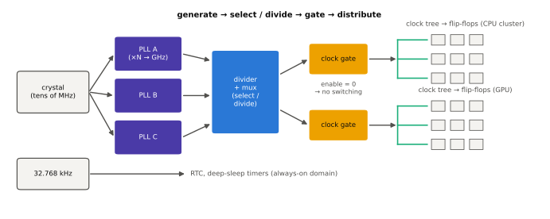
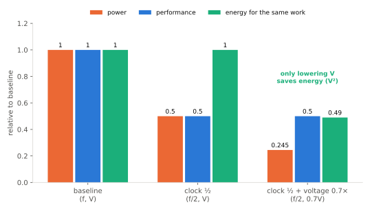

# 클럭과 전압

!!! spec "규격 · 세대"
    클럭·전압 구조는 설계 선택 · 관련 표준·인터페이스: Arm SCMI(전원·성능 관리 메시지), Linux 공통 클럭 프레임워크(`clk`)·레귤레이터 프레임워크, 디바이스 트리 `clocks`·`*-supply` 바인딩
    칩 전체 단일 클럭·전압 → 블록별 클럭 도메인 → 클러스터별 전압 도메인(big.LITTLE) → 코어별·블록별 세분화된 도메인과 전력 관리 펌웨어

!!! basic "한눈에 보기"
    디지털 회로는 **클럭**이라는 박자에 맞춰 움직이고, **전압**이라는 힘으로 스위치를 켭니다.

    1. **클럭**이 빠를수록 1초에 더 많은 일을 하지만, 그만큼 자주 스위칭하므로 전력이 늘어납니다.
    2. 클럭이 빠르려면 트랜지스터가 빨리 켜져야 하고, 그러려면 **전압**을 높여야 합니다.
    3. SoC 안의 블록은 각자 필요한 속도가 다르므로, **클럭과 전압을 블록마다 따로** 조절합니다. 이렇게 같은 클럭을 쓰는 영역을 클럭 도메인, 같은 전압을 쓰는 영역을 전압(파워) 도메인이라고 합니다.

    오케스트라에 비유하면 지휘자의 박자(클럭)는 파트마다 다르게 줄 수 있고, 연주자에게 주는 힘(전압)도 파트마다 다르게 줄 수 있습니다. 쉬는 파트는 아예 무대에서 내려보낼 수도 있습니다(파워 게이팅).

## 클럭은 어디서 오나 { .l2 }

| 구성 요소 | 역할 |
|---|---|
| 기준 수정 발진기 | 수십 MHz 안팎의 안정된 기준 클럭 (보드 위 크리스털) |
| PLL (위상 고정 루프) | 기준 클럭을 수 GHz까지 곱해 만듦. 블록마다 별도 PLL을 두는 경우가 많음 |
| 분주기·멀티플렉서 | PLL 출력을 나누거나 여러 소스 중 선택 |
| 클럭 게이트 | 쓰지 않는 회로의 클럭을 끊어 스위칭 전력을 없앰 |
| 클럭 트리 | 칩 전체의 수많은 플립플롭에 같은 시점에 클럭을 나눠 주는 배선망 |
| 저속 클럭 (32.768 kHz 등) | 실시간 시계, 깊은 절전 상태의 타이머 |

## 동적 전력과 전압의 관계 { .l2 }

$$
P_{dyn} = \alpha \cdot C \cdot V^2 \cdot f
$$

| 바꾸는 것 | 전력 | 성능 | 에너지(같은 일) |
|---|---|---|---|
| 클럭만 절반 | 1/2 | 1/2 | 그대로 |
| 클럭 절반 + 전압 0.7배 | 약 0.245배 | 1/2 | 약 0.49배 |
| 클럭 게이팅 (\(\alpha\) → 0) | 동적 전력 0 | 그 블록은 정지 | — |
| 파워 게이팅 (전압 차단) | 누설까지 0 | 상태 소실 (리텐션 없으면) | — |

전압을 낮추지 않고 클럭만 낮추면 같은 일을 하는 데 드는 에너지는 줄지 않습니다. **에너지를 아끼는 것은 전압**입니다. 이 관계는 [DVFS와 전력 관리](../power/dvfs.md)에서 OPP 테이블과 함께 자세히 다룹니다.

## 도메인 나누기 { .l2 }

| 도메인 | 단위 | 나누는 이유 | 대가 |
|---|---|---|---|
| 클럭 도메인 | 블록·클러스터·코어 | 블록마다 필요한 속도가 다름 | 도메인 사이 신호는 동기화 회로(CDC)가 필요, 지연 증가 |
| 전압 도메인 | 클러스터·주요 블록 | 높은 클럭이 필요한 곳만 높은 전압 | 레귤레이터·레벨 시프터 추가, 보드 면적 |
| 파워 도메인 | 블록·코어 | 쓰지 않는 블록의 누설 제거 | 전원 스위치 면적, 켜고 끌 때 지연과 에너지 |
| 항상 켜짐(AON) 도메인 | 작은 영역 | 깨우기 회로, 타이머, 센서 허브 | 이 영역의 누설은 항상 듦 |

??? expert "전문가 노트 — 클럭 도메인 교차, 전압 강하, 적응형 클럭"
    **CDC(Clock Domain Crossing).** 서로 다른 클럭 도메인 사이로 신호가 넘어가면, 받는 쪽 플립플롭이 신호가 바뀌는 순간에 샘플링해 0도 1도 아닌 **준안정 상태**에 빠질 수 있습니다. 단일 비트는 2단 이상의 동기화 플립플롭으로, 다중 비트 데이터는 비동기 FIFO나 핸드셰이크로 넘깁니다. SoC 검증에서 CDC 검사가 별도 단계로 존재할 만큼 흔한 버그 원인입니다([검증과 에뮬레이션](../design/verification.md)).

    **전압 강하(IR drop)와 di/dt.** 코어가 대기 상태에서 갑자기 최대 부하로 바뀌면 전류가 급증하고, 전원망의 저항·인덕턴스 때문에 순간적으로 전압이 떨어집니다. 이 순간 전압이 OPP 최소값 아래로 내려가면 타이밍 오류가 납니다. 그래서 설계는 전압에 여유(가드밴드)를 두는데, 이 여유가 곧 전력 낭비입니다. 최근 칩은 전압 강하를 감지해 순간적으로 클럭을 늦추는 **적응형 클럭** 회로나, 부하 급증을 미리 완만하게 만드는 전류 제어로 가드밴드를 줄입니다.

    **클럭 트리의 전력.** 클럭은 매 사이클 반드시 토글하는 신호라 활동률이 가장 높습니다. 클럭 트리 자체가 동적 전력의 상당 부분을 차지하므로, 세밀한 클럭 게이팅은 설계 도구가 자동으로 넣는 기본 최적화입니다.

    **커널에서 보이는 모습.** Linux에서는 공통 클럭 프레임워크가 클럭 트리를 `/sys/kernel/debug/clk/clk_summary`로, 레귤레이터 프레임워크가 전압 공급을 `/sys/class/regulator/`로 보여 줍니다. 다만 최신 모바일 SoC는 CPU 클럭과 전압을 전력 관리 펌웨어가 직접 관리하는 경우가 많아, 커널에 보이는 값과 실제 하드웨어 값이 다를 수 있습니다([DVFS와 전력 관리](../power/dvfs.md)).

## 칩셋 비교

| 항목 | 일반적인 Android SoC | Apple |
|---|---|---|
| CPU 전압 도메인 | 클러스터 단위가 일반적 | 클러스터 단위로 알려짐 |
| CPU 주파수 결정 | 커널 거버너 요청 → 펌웨어가 최종 결정하는 구조가 많음 | 하드웨어·펌웨어 성능 컨트롤러 비중이 큼 |
| 공개 정보 | 업스트림·벤더 커널 소스로 일부 확인 | 공개 분석 위주 |

## 관련 페이지
- [트랜지스터와 CMOS](transistor.md) — 동적 전력과 누설 전력의 원인
- [DVFS와 전력 관리](../power/dvfs.md) — 동작점과 전력 관리 흐름
- [파워 도메인과 게이팅](../power/power-domains.md) — 블록 끄기와 리텐션
- [PMIC와 전원 공급](../power/pmic.md) — 전압을 만들어 주는 칩
