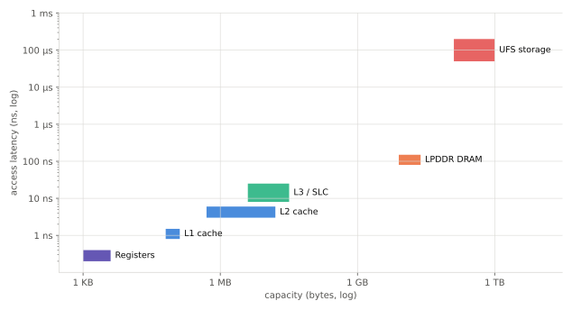

# 메모리 계층

!!! spec "규격 · 세대"
    캐시 구조는 표준이 아니라 설계 선택 · 외부 메모리: JEDEC LPDDR4X·LPDDR5·LPDDR5X·LPDDR6, 저장장치: JEDEC UFS
    CPU 전용 L1·L2 → 클러스터 공유 L3(DynamIQ DSU) → SoC 전체가 공유하는 시스템 레벨 캐시(SLC)로 계층이 한 단계씩 늘어남

!!! basic "한눈에 보기"
    메모리는 **빠르면 작고 비싸며, 크면 느리고 쌉니다.** 이 법칙은 물리적으로 피할 수 없어서, 칩은 여러 층의 메모리를 쌓아 둡니다.

    1. **레지스터** — CPU가 바로 쓰는 몇 KB. 한 사이클 안에 읽힘
    2. **캐시(L1·L2·L3·SLC)** — 칩 안의 SRAM. 수십 KB에서 수십 MB
    3. **DRAM(LPDDR)** — 칩 밖(위)의 메인 메모리. 수 GB에서 수십 GB
    4. **저장장치(UFS)** — 전원을 꺼도 남는 수백 GB에서 TB

    책상에 비유하면 레지스터는 손에 든 연필, L1 캐시는 책상 위, L2·L3는 책상 서랍, DRAM은 방 안의 책장, UFS는 지하 창고입니다. 자주 쓰는 것을 가까이 두는 것이 캐시의 원리입니다.

## 계층별 용량과 지연 { .l2 }

| 계층 | 위치 | 대표 용량 (스마트폰 SoC) | 대략의 지연 | 관리 주체 |
|---|---|---|---|---|
| 레지스터 | 코어 안 | 수 KB | 0–1 사이클 | 컴파일러 |
| L1 캐시 | 코어 안 (명령·데이터 분리) | 코어당 수십 KB씩 | 약 4 사이클 (3 GHz에서 약 1.33 ns) | 하드웨어 |
| L2 캐시 | 코어 전용 또는 클러스터 공유 | 코어당 수백 KB–수 MB, 공유형은 10 MB 이상도 있음 | 10–20 사이클 안팎 | 하드웨어 |
| L3 캐시 | 클러스터 공유 (DSU) | 수 MB | 수십 사이클 | 하드웨어 |
| SLC | SoC 전체 공유 (메모리 컨트롤러 앞) | 수 MB–수십 MB | 수십 ns | 하드웨어 + 소프트웨어 힌트 |
| LPDDR DRAM | 칩 밖 (보통 SoC 위에 적층) | 8–24 GB | 약 100 ns 이상 | 운영체제 |
| UFS | 보드 위 별도 칩 | 128 GB–1 TB | 수십–수백 µs | 운영체제·파일 시스템 |

표의 지연은 **대표 범위**이며, 칩·클럭·부하에 따라 크게 달라집니다. 숫자보다 **계층 사이마다 몇 배씩 벌어진다**는 감각이 중요합니다.

## 캐시가 통하는 이유 — 지역성 { .l2 }

| 지역성 | 뜻 | 하드웨어의 활용 |
|---|---|---|
| 시간 지역성 | 방금 쓴 데이터를 곧 다시 씀 | 최근 쓴 데이터를 캐시에 남김 (교체 정책) |
| 공간 지역성 | 방금 쓴 데이터 근처를 곧 씀 | 한 번에 **캐시 라인**(보통 64바이트) 단위로 가져옴 |
| 접근 패턴 | 일정한 간격으로 읽어 나감 | **프리페처**가 다음 주소를 미리 가져옴 |

캐시 성능은 적중률(hit rate)로 봅니다. 평균 메모리 접근 시간은 다음과 같습니다.

$$
AMAT = t_{hit} + m \times t_{miss}
$$

여기서 \(m\)은 미스 비율, \(t_{miss}\)는 다음 계층까지 다녀오는 시간입니다. DRAM 지연이 L1의 약 100배이므로, 미스 비율이 1%만 늘어도 평균 접근 시간이 눈에 띄게 늘어납니다.

## 캐시의 기본 구조 { .l2 }

| 용어 | 뜻 |
|---|---|
| 캐시 라인 | 캐시가 데이터를 다루는 최소 단위. 대부분 64바이트 |
| 연관도 (way) | 한 주소가 들어갈 수 있는 자리의 수. 직접 사상(1-way) ↔ 완전 연관 사이 |
| 교체 정책 | 자리가 찼을 때 무엇을 내보낼지 (LRU 근사 등) |
| 쓰기 정책 | 쓰기를 바로 아래로 보낼지(write-through), 쫓겨날 때 보낼지(write-back) |
| 포함 정책 | 아래 계층이 위 계층의 내용을 반드시 포함하는지 (inclusive / exclusive / non-inclusive) |

??? expert "전문가 노트 — 메모리 벽, SLC의 역할 변화, 대역폭과 지연의 구분"
    **메모리 벽.** 코어 성능은 매년 늘었지만 DRAM 지연(ns 단위)은 수십 년 동안 거의 줄지 않았습니다. 3 GHz 코어에게 120 ns DRAM 접근은 약 360 사이클이며, 그동안 넓은 비순차 코어는 수백~수천 개의 명령을 처리할 수 있습니다. 그래서 최근 모바일 코어는 큰 L2(일부 설계는 클러스터 공유 L2를 10 MB 이상으로), 큰 ROB, 강력한 프리페처로 이 지연을 숨기려 합니다.

    **SLC는 CPU만의 캐시가 아니다.** SLC는 GPU·NPU·ISP·디스플레이까지 함께 쓰는 마지막 계층 캐시입니다. 성능보다 **전력**이 더 큰 목적인 경우가 많습니다. 칩 밖 DRAM 접근은 칩 안 SRAM 접근보다 비트당 에너지가 훨씬 크기 때문에, 화면 프레임 버퍼나 NPU 중간 결과를 SLC에 붙잡아 두면 DRAM 트래픽과 전력이 줄어듭니다. 소프트웨어가 블록별로 SLC 영역을 나눠 주는 구조도 있습니다([메모리 컨트롤러와 SLC](../memory/controller-slc.md)).

    **지연과 대역폭은 다른 문제.** 지연은 "한 번 다녀오는 데 걸리는 시간", 대역폭은 "초당 옮길 수 있는 양"입니다. CPU의 포인터 추적 같은 작업은 지연에, GPU 렌더링·NPU 추론·온디바이스 LLM 생성은 대역폭에 좌우됩니다. 예를 들어 LPDDR5X-8533 64비트 버스의 피크 대역폭은 약 **68.3 GB/s**이며, 70억 매개변수 모델을 INT4로 돌리면 토큰 생성 속도의 이론 상한은 약 **19.5 토큰/s**입니다([온디바이스 LLM](../npu/llm.md)). (수치는 `tools/soc_numbers.py`에서 계산)

    **측정 방법.** 계층별 지연은 포인터 체이싱 벤치마크(작업 집합 크기를 늘려 가며 무작위 연결 리스트를 따라가는 시간 측정)로, 대역폭은 스트림형 복사 벤치마크로 측정합니다. 공개 칩셋 분석 자료의 "지연 곡선"이 계단 모양인 것은 작업 집합이 각 캐시 용량을 넘을 때마다 다음 계층으로 떨어지기 때문입니다.

## 칩셋 비교

| 항목 | Arm 코어 기반 (DynamIQ) | 자체 코어 (Apple, Qualcomm Oryon) |
|---|---|---|
| L2 | 코어 전용 L2 (코어별 크기 선택) | 클러스터 공유 대형 L2 |
| L3 | DSU의 클러스터 공유 L3 | 없거나 SLC가 그 역할 |
| SLC | 있음 (제조사 설계) | 있음 |

> 세대별 캐시 용량은 [칩셋 세대 인덱스](../reference/chipset-index.md)에 모읍니다.

## 관련 페이지
- [캐시와 일관성](../cpu/cache-coherence.md) — 여러 코어가 같은 데이터를 볼 때
- [LPDDR](../memory/lpddr.md) — DRAM의 구조와 대역폭
- [메모리 컨트롤러와 SLC](../memory/controller-slc.md) — 시스템 레벨 캐시의 실제
- [UFS 저장장치](../memory/ufs.md) — 가장 아래 계층
