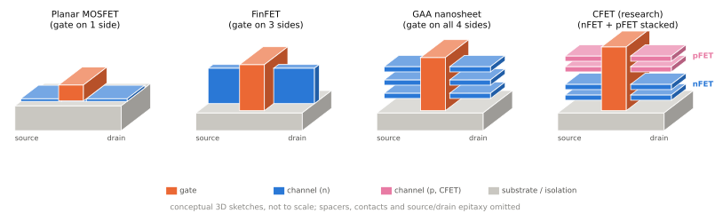
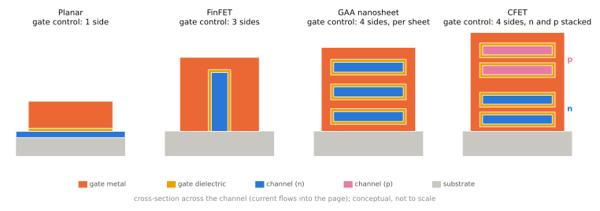

# 공정 노드와 미세화

!!! spec "규격 · 세대"
    공정 이름은 표준이 아니라 각 파운드리의 세대 이름 · 업계 로드맵 참고 문서: IEEE IRDS(International Roadmap for Devices and Systems)
    평면 MOSFET → **FinFET**(Intel 22nm 2011년 무렵, TSMC 16nm·삼성 14nm 2015년 무렵 스마트폰 도입) → **EUV 노광** 양산 도입(7nm급, 2019년 무렵) → **GAA 나노시트**(삼성 3nm 2022년 양산 시작, TSMC N2 2025년 양산 시작) → 후면 전력 공급(Intel 18A, TSMC A16 계획)

!!! basic "한눈에 보기"
    "3nm 공정"이라고 하면 트랜지스터 크기가 3 nm일 것 같지만, **지금의 공정 이름은 실제 치수가 아니라 세대 이름**입니다.

    1. 옛날에는 공정 이름이 트랜지스터 게이트 길이와 거의 같았습니다.
    2. 2000년대 후반부터 이름과 실제 치수가 어긋나기 시작했고, 지금은 "이전 세대보다 한 단계 더 촘촘하다"는 뜻에 가깝습니다.
    3. 그래서 **회사가 다르면 같은 "3nm"도 성능이 다릅니다.** 같은 회사 안에서도 N3, N3E, N3P처럼 개량판이 이어집니다.

    공정이 좋아지면 같은 면적에 트랜지스터를 더 많이 넣거나(밀도), 같은 회로를 더 빠르게 돌리거나(성능), 같은 속도에서 전력을 줄일 수 있습니다(전력). 보통 새 공정은 이 셋 중 하나를 고르는 "선택지"로 발표됩니다.

## 트랜지스터 구조의 변화 { .l2 }

| 구조 | 게이트가 채널을 감싸는 방식 | 도입 이유 | 스마트폰 SoC 적용 |
|---|---|---|---|
| 평면(Planar) | 위 한 면 | — | 2014년 무렵까지 (예: 20nm 평면 공정) |
| **FinFET** | 지느러미 모양 채널의 세 면 | 채널이 짧아지자 게이트가 전류를 제대로 끄지 못함(단채널 효과) → 감싸는 면을 늘림 | 14·16nm부터 TSMC N3 계열까지 |
| **GAA (나노시트)** | 수평으로 쌓은 얇은 판 채널의 네 면 전부 | FinFET도 더 줄이면 제어력 부족, 핀 개수 단위로만 폭을 바꿀 수 있는 제약 | 삼성 3nm(MBCFET이라는 이름) 이후, TSMC N2, Intel 18A(RibbonFET) |
| CFET (논의 중) | NMOS·PMOS를 위아래로 적층 | 면적을 더 줄이기 위한 차세대 구조 | 연구·로드맵 단계 |

위 그림은 소스에서 드레인으로 전류가 흐르는 채널(파랑)을 게이트(주황)가 어떻게 덮는지 보여 줍니다. 평면 구조는 게이트가 채널 위에만 얹혀 있고, FinFET은 채널을 세워 게이트가 위와 양옆을 덮습니다. GAA는 채널을 얇은 판 여러 장으로 눕혀 쌓고, 게이트가 판 사이까지 채워 각 판을 완전히 감쌉니다. CFET는 같은 GAA 판을 nFET과 pFET로 나눠 위아래로 쌓아, 인버터 하나가 차지하는 바닥 면적을 줄이려는 구조입니다.

같은 구조를 전류가 흐르는 방향으로 잘라 보면 차이가 더 분명합니다. 게이트가 채널을 덮는 면이 많을수록 게이트 전압으로 채널을 "확실히 끌" 수 있어, 채널이 짧아져도 누설이 덜 늘어납니다([트랜지스터와 CMOS](transistor.md)). 두 그림 모두 개념도이며 실제 치수 비율과 다릅니다.

## 공정 이름을 읽는 법 { .l2 }

| 지표 | 뜻 | 왜 중요한가 |
|---|---|---|
| CPP (Contacted Poly Pitch) | 이웃한 게이트 사이 간격 | 로직 셀의 가로 크기를 정함 |
| 최소 금속 피치 (MMP) | 가장 촘촘한 배선 사이 간격 | 셀 높이와 배선 밀도를 정함 |
| 셀 높이 (트랙 수) | 표준 셀 한 줄의 높이 | 같은 공정에서도 고밀도용·고성능용 셀이 다름 |
| SRAM 비트셀 면적 | SRAM 1비트가 차지하는 면적 | 캐시 용량의 비용을 정함 |
| 트랜지스터 밀도 | mm²당 트랜지스터 수 | 회사 간 비교에 쓰이지만 계산 방식이 제각각 |

!!! tip "같은 '3nm'를 비교할 때"
    제조사 발표의 "성능 +x%, 전력 −y%, 밀도 +z%"는 **자사 이전 공정 대비, 특정 기준 회로에서** 측정한 값입니다. 회사 간 비교에는 쓸 수 없고, 실제 칩의 이득은 설계와 목표에 따라 다릅니다. 실제 SoC의 전력 효율 차이는 분해 분석과 같은 조건의 전력 측정으로 확인해야 합니다.

## 미세화를 가능하게 한 기술 { .l2 }

| 기술 | 하는 일 | 영향 |
|---|---|---|
| 멀티 패터닝 | 기존 193 nm 노광으로 여러 번 나눠 찍어 더 촘촘한 패턴 형성 | 공정 단계·비용 증가, 설계 규칙 복잡 |
| **EUV 노광** | 13.5 nm 파장 빛으로 한 번에 미세 패턴 형성 | 마스크 수 감소, 7nm급부터 핵심 공정에 도입 |
| High-NA EUV | 개구수를 키운 차세대 EUV | 2nm 이후 세대에서 도입이 논의·진행 중 |
| 후면 전력 공급 (BSPDN) | 전원 배선을 웨이퍼 뒷면으로 옮김 | 신호 배선 공간 확보, 전압 강하 감소 |
| DTCO | 설계와 공정을 함께 최적화 | 같은 공정에서도 셀 구조를 바꿔 밀도 확보 |

??? expert "전문가 노트 — SRAM 스케일링 정체, 공정 선택의 실제, 수치 해석"
    **SRAM이 줄지 않는다.** 로직 밀도는 세대마다 늘었지만, SRAM 비트셀은 최근 세대에서 거의 줄지 않고 있습니다. TSMC N3E의 고밀도 SRAM 비트셀이 N5와 비슷한 크기라는 발표가 대표적입니다. 캐시를 많이 넣는 설계일수록 새 공정의 면적 이득이 작아지며, 이것이 캐시를 별도 다이로 떼어 적층하는 방식(서버·PC의 3D 캐시)이 나온 배경입니다. 모바일 SoC에서 L2·SLC 용량 결정은 이 비용을 직접 반영합니다([메모리 계층](memory-hierarchy.md)).

    **GAA의 장점.** 나노시트 폭을 연속적으로 정할 수 있어, 핀 개수(정수) 단위로만 전류를 늘릴 수 있던 FinFET보다 셀 설계 자유도가 높습니다. 또한 게이트가 채널을 완전히 감싸 누설 제어가 좋아지므로 낮은 전압 동작에 유리합니다. 다만 초기 GAA 세대는 수율과 성숙도에서 FinFET 말기 공정과 경쟁해야 했고, 실제 제품 경쟁력은 공정 이론상 이점보다 **수율·생산 능력·설계 생태계(PDK, IP)**가 더 크게 좌우했습니다.

    **공정 선택은 설계 결정이다.** 한 공정 안에도 고밀도·고성능 셀, 여러 Vth, 여러 금속층 옵션이 있습니다. 같은 공정을 쓴 두 칩이라도 CPU 코어에 고성능 셀을 쓰고 클럭을 높였는지, 고밀도 셀로 면적을 아꼈는지에 따라 전력 효율이 크게 다릅니다. "같은 공정인데 왜 효율이 다르냐"는 질문의 답은 대개 여기에 있습니다.

    **발표 수치를 쓰는 규칙.** 이 책은 공정의 PPA 이득을 회사 발표 그대로 옮기지 않고, 필요할 때 "회사 발표 기준, 비교 대상 공정"을 함께 적습니다. 실제 치수(CPP, MMP)는 학회 발표·분석 보고서마다 다르므로 [칩셋 세대 인덱스](../reference/chipset-index.md)에 출처와 함께만 적습니다.

## 파운드리 공정 비교

| 세대 | TSMC | 삼성 파운드리 | 트랜지스터 |
|---|---|---|---|
| 5nm급 | N5, N4 계열 | 5LPE, 4LPE·4LPP 계열 | FinFET |
| 3nm급 | N3(N3B), N3E, N3P | SF3E(3GAE), SF3(3GAP) | TSMC: FinFET / 삼성: GAA |
| 2nm급 | N2, N2P (A16은 후면 전력 추가) | SF2 계열 | GAA |

> 각 공정이 어떤 칩셋에 쓰였는지는 [칩셋 세대 인덱스](../reference/chipset-index.md), 파운드리별 사업 구조는 [파운드리와 공정](../design/foundry.md)에서 다룹니다.

## 관련 페이지
- [트랜지스터와 CMOS](transistor.md) — 누설 전력과 문턱 전압
- [성능·전력·면적 (PPA)](ppa.md) — 공정이 면적과 비용에 주는 영향
- [파운드리와 공정](../design/foundry.md) — TSMC와 삼성 파운드리의 공정 로드맵
- [2nm 세대와 GAA 경쟁](../next/2nm.md) — 최신 공정 동향
