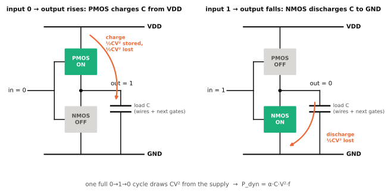
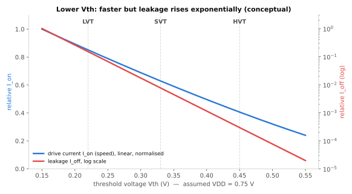

# 트랜지스터와 CMOS

!!! spec "규격 · 세대"
    물리 원리(표준 문서 없음) · 관련 개념: MOSFET, CMOS 논리, 문턱 전압(Vth), 다중 Vth 셀 라이브러리
    1960년대 CMOS 발명 → 1970–2000년대 데나드 스케일링(크기와 전압을 함께 축소) → 2000년대 중반 전압 축소 정체, 누설 전력 급증 → 고유전율 금속 게이트(HKMG) → FinFET → GAA

!!! basic "한눈에 보기"
    칩 안의 모든 계산은 **트랜지스터**라는 아주 작은 스위치 수십억 개가 켜지고 꺼지면서 이루어집니다.

    1. 트랜지스터는 **게이트**에 전압을 걸면 전류가 흐르고(켜짐), 전압을 빼면 막히는(꺼짐) 스위치입니다.
    2. **CMOS**는 성질이 반대인 두 종류의 트랜지스터(NMOS, PMOS)를 짝지어, 출력이 0이든 1이든 **한쪽은 반드시 꺼져 있게** 만든 회로 방식입니다. 그래서 가만히 있을 때는 전류가 거의 흐르지 않습니다.
    3. 전력은 두 군데서 씁니다. 0과 1이 **바뀔 때마다** 배선을 충전·방전하는 **동적 전력**, 그리고 완벽하게 꺼지지 않은 스위치로 **새는** **누설(정적) 전력**입니다.

    수도꼭지에 비유하면 동적 전력은 물통을 채웠다 비울 때마다 쓰는 물, 누설 전력은 잠근 꼭지에서 똑똑 떨어지는 물입니다. 꼭지가 수십억 개면 떨어지는 물도 무시할 수 없습니다.

## CMOS 인버터와 전력 { .l2 }

가장 단순한 CMOS 회로인 인버터(NOT 게이트)는 PMOS 하나가 전원(VDD)에, NMOS 하나가 접지(GND)에 붙어 있습니다. 입력이 0이면 PMOS가 켜져 출력이 1, 입력이 1이면 NMOS가 켜져 출력이 0이 됩니다.

| 전력 종류 | 원인 | 크기를 정하는 요소 | 줄이는 방법 |
|---|---|---|---|
| 동적(스위칭) 전력 | 출력이 바뀔 때 부하 정전 용량 \(C\)를 충전·방전 | \(\alpha C V^2 f\) | 전압 낮추기, 클럭 게이팅, 회로 축소 |
| 단락(short-circuit) 전력 | 전환 순간 PMOS·NMOS가 잠깐 동시에 켜짐 | 입력 전환 속도, 전압 | 빠른 신호 전환, 적절한 셀 크기 |
| 누설 전력 | 꺼진 트랜지스터의 문턱 아래 전류, 게이트 누설 등 | 문턱 전압, 온도, 전압, 트랜지스터 수 | 높은 Vth 셀, 파워 게이팅, 낮은 온도 |

동적 전력 공식에서 \(V\)가 제곱이라는 점이 핵심입니다. 같은 일을 할 때 에너지는 \(CV^2\)에 비례하므로, **전압을 낮추는 것이 에너지를 아끼는 가장 강력한 수단**입니다([DVFS와 전력 관리](../power/dvfs.md)).

## 문턱 전압의 딜레마 { .l2 }

트랜지스터가 켜지기 시작하는 게이트 전압을 **문턱 전압(Vth)**이라고 합니다.

| Vth를 낮추면 | Vth를 높이면 |
|---|---|
| 같은 공급 전압에서 더 많은 전류 → **빠름** | 전류가 적음 → **느림** |
| 꺼진 상태의 누설 전류가 **지수적으로 증가** | 누설이 적음 |
| 낮은 공급 전압에서도 동작 가능 | 공급 전압을 충분히 높여야 속도 확보 |

그래서 실제 칩은 한 가지 트랜지스터만 쓰지 않습니다. 셀 라이브러리에 Vth가 다른 여러 종류(예: 낮은 Vth = 빠르고 새는 셀, 높은 Vth = 느리고 덜 새는 셀)를 두고, **타이밍이 빠듯한 경로에만 빠른 셀**을, 나머지에는 덜 새는 셀을 씁니다.

??? expert "전문가 노트 — 데나드 스케일링의 끝, 누설과 온도, 지연과 전압"
    **데나드 스케일링.** 1974년 Dennard 등이 제시한 축소 규칙은, 트랜지스터 치수와 전압을 같은 비율 \(1/k\)로 줄이면 면적당 전력 밀도가 일정하게 유지된다는 것이었습니다. 문제는 전압을 낮추려면 Vth도 낮춰야 하는데, Vth를 낮추면 문턱 아래(subthreshold) 누설 전류가 지수적으로 늘어난다는 점입니다. 상온에서 문턱 아래 전류는 게이트 전압이 대략 60 mV 이상 낮아질 때마다 10배씩 줄어드는 물리적 한계(문턱 아래 기울기)가 있어서, 스위치를 "더 확실히 끄는" 데에도 최소 전압 폭이 필요합니다. 이 때문에 2000년대 중반 이후 공급 전압은 1 V 안팎에서 거의 내려가지 않았고, 전력 밀도가 늘어나 **클럭 경쟁의 끝**과 **멀티코어·이기종 설계**로 이어졌습니다.

    **누설과 온도의 양의 되먹임.** 누설 전류는 온도가 오를수록 커지고, 누설이 늘면 다시 온도가 오릅니다. 스마트폰처럼 방열이 제한된 기기에서는 이 되먹임 때문에 같은 작업도 뜨거울 때 더 많은 전력을 씁니다. 스로틀링 정책이 온도를 일정 수준 아래로 묶으려는 이유 중 하나입니다([열 관리와 스로틀링](../power/thermal.md)).

    **지연과 전압.** 게이트 지연은 대략 \(C V / I_{on}\)에 비례하고, 구동 전류 \(I_{on}\)은 \((V - V_{th})\)의 거듭제곱(단채널 소자에서는 지수가 1과 2 사이)에 비례합니다. 그래서 전압이 Vth에 가까워질수록 지연이 급격히 늘어나며, 이 관계가 **각 주파수에 필요한 최소 전압**, 즉 OPP 테이블의 모양을 정합니다. 매우 낮은 전압(근문턱·문턱 아래 영역)에서 동작하는 초저전력 회로는 웨어러블·센서 허브 쪽에서 쓰입니다.

    **게이트 누설과 HKMG.** 게이트 산화막이 원자 몇 층 두께까지 얇아지자 전자가 산화막을 터널링해 새는 게이트 누설이 커졌습니다. 이를 줄이려고 유전율이 높은 재료(high-k)와 금속 게이트를 쓰는 HKMG가 2007년 무렵부터 도입되었습니다. 이후 채널을 게이트가 더 많이 감싸는 FinFET·GAA 구조가 나온 것도 결국 "스위치를 더 잘 끄기" 위해서입니다([공정 노드와 미세화](process-node.md)).

## 셀 라이브러리 선택 비교

| 셀 종류 | 속도 | 누설 | 주로 쓰는 곳 |
|---|---|---|---|
| 낮은 Vth (LVT·ULVT) | 빠름 | 큼 | 고성능 CPU 코어의 임계 경로 |
| 표준 Vth (SVT·RVT) | 중간 | 중간 | 일반 로직 |
| 높은 Vth (HVT) | 느림 | 작음 | 항상 켜진 저전력 영역, 타이밍 여유가 큰 경로 |

## 관련 페이지
- [공정 노드와 미세화](process-node.md) — 트랜지스터 구조의 변화
- [클럭과 전압](clock-voltage.md) — 전압 도메인과 동적 전력
- [DVFS와 전력 관리](../power/dvfs.md) — 전압을 낮춰 에너지를 아끼는 실제 방법
- [파워 도메인과 게이팅](../power/power-domains.md) — 누설 전력을 끄는 방법
