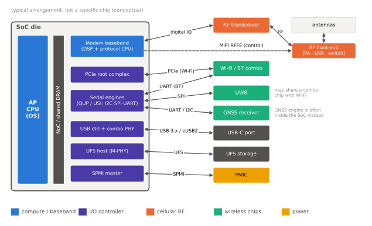

# 연결

이 섹션은 스마트폰이 바깥 세상과 이어지는 길, 즉 **모뎀·Wi-Fi·Bluetooth·GNSS·UWB** 같은 무선 블록과 **PCIe·USB·I2C·SPI** 같은 유선 인터페이스가 SoC의 어디에 자리 잡고, 어떤 인터페이스로 AP와 이어지며, 전력을 어떻게 아끼고, 누가 만드는지를 다룹니다. 프로토콜 자체(LTE·5G NR의 계층 구조, 802.11의 MAC, Bluetooth의 링크 계층)는 자매 핸드북에서 깊게 다루므로, 이 섹션은 **SoC 통합의 관점**에 집중합니다.

| 페이지 | 핵심 질문 |
|---|---|
| [모뎀의 통합](modem.md) | 모뎀을 SoC 안에 넣을까, 별도 칩으로 둘까? 모뎀과 AP는 어떻게 대화하나? |
| [Wi-Fi·Bluetooth 콤보](wifi-bt.md) | Wi-Fi와 Bluetooth는 왜 한 칩에 묶이고, SoC와는 어떤 인터페이스로 붙나? |
| [GNSS·UWB·위성](gnss-uwb.md) | 이중 주파수 GNSS, UWB 거리 측정, 위성 메시지는 각각 어디서 처리되나? |
| [PCIe·USB](pcie-usb.md) | 스마트폰 SoC 안의 PCIe·USB 컨트롤러와 PHY는 무엇을 연결하고, 얼마나 빠른가? |
| [저속 주변장치 (I2C·I3C·SPI·UART)](low-speed.md) | 센서·PMIC·터치 같은 작은 장치는 어떤 버스로 붙고, 핀은 어떻게 나눠 쓰나? |

!!! basic "연결 블록을 보는 세 가지 질문"
    연결 블록을 처음 볼 때는 아래 세 가지를 차례로 물어보면 구조가 정리됩니다.

    1. **어디에 있나** — SoC 다이 안에 통합되었나, 별도 칩인가? 별도 칩이라면 같은 패키지인가, 보드 위의 다른 부품인가?
    2. **어떻게 붙나** — AP와는 공유 메모리·PCIe·SDIO·UART·SPI 중 무엇으로 데이터를 주고받나?
    3. **언제 깨어 있나** — AP가 잠든 동안에도 혼자 깨어 있어야 하나(모뎀의 호출 수신, GNSS의 위치 기록), 아니면 필요할 때만 켜지나?

    예를 들어 링크 속도를 비교할 때는 선로 부호화까지 고려해야 합니다. PCIe Gen4 x1 링크는 16 GT/s × 128/130 ÷ 8 ≈ **1.97 GB/s**, USB 3.2 Gen 2는 10 Gbps × 128/132 ÷ 8 ≈ **1.21 GB/s**가 한 방향 이론 상한입니다. (수치는 `tools/soc_numbers.py`에서 계산)

위 그림은 연결 블록이 SoC 안팎 어디에 있고 어떤 버스로 이어지는지를 일반적인 배치로 보여 줍니다.

!!! tip "다른 섹션과의 연결"
    블록 사이의 온칩 연결은 [버스와 인터커넥트](../basics/interconnect.md), 모뎀·Wi-Fi 같은 장치의 메모리 접근 격리는 [메모리 보호와 IOMMU](../memory/iommu.md), 대기 중 연결 블록의 전력은 [대기 전력과 저전력 상태](../power/idle.md)에서 다룹니다. 무선 프로토콜 자체는 자매 핸드북인 [Cellular Handbook](https://goodhosup.github.io/cellular/), [Wi-Fi Handbook](https://goodhosup.github.io/wifi/), [Bluetooth Handbook](https://goodhosup.github.io/bluetooth/)을 참고하세요.
