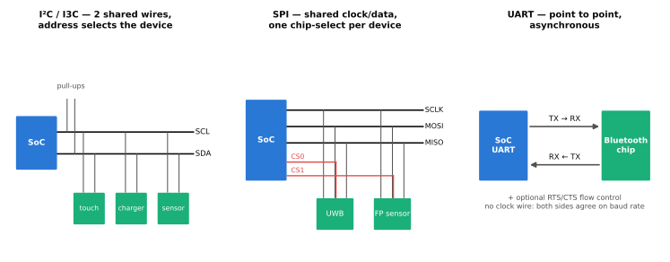
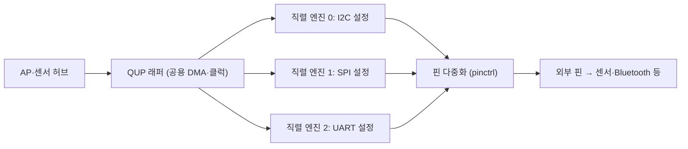

# 저속 주변장치 (I2C·I3C·SPI·UART)

!!! spec "규격 · 세대"
    I2C(NXP UM10204: Standard-mode 100 kHz, Fast-mode 400 kHz, Fast-mode Plus 1 MHz, High-speed 3.4 MHz) → **MIPI I3C**(v1.0 2016, 공개판 I3C Basic 2018, 이후 v1.1 등 개정) · SPI(사실상 표준), UART(16550 계열 레지스터 관례) · PMIC 버스 **MIPI SPMI**, RF 제어 버스 **MIPI RFFE**
    SoC 구현: 프로토콜별 고정 컨트롤러 → 하나의 직렬 엔진을 펌웨어로 I2C·SPI·UART 중 하나로 설정하는 **범용 직렬 엔진**(Qualcomm QUP v3의 GENI 직렬 엔진, Linux 업스트림 지원은 Snapdragon 845 세대부터 · Samsung Exynos의 USI)

!!! basic "한눈에 보기"
    스마트폰에는 CPU·GPU 같은 큰 블록 말고도 작은 부품이 수십 개 붙어 있습니다. 터치 컨트롤러, 가속도·자이로 센서, 충전 IC, 카메라 모듈의 초점 모터, 지문 센서, PMIC 같은 것들입니다. 이들은 많은 데이터를 주고받지 않으므로 **선 몇 가닥짜리 간단한 버스**로 연결합니다.

    1. **I2C** — 선 두 개로 여러 장치를 줄줄이 연결합니다. 느리지만 배선이 가장 적습니다.
    2. **I3C** — I2C의 후속으로, 같은 두 선으로 훨씬 빠르고 전력도 적게 씁니다.
    3. **SPI** — 선이 더 많지만 빠르고 단순해서 지문 센서·디스플레이 보조 칩 등에 씁니다.
    4. **UART** — 두 장치가 일대일로 글자를 주고받는 가장 오래된 방식입니다. Bluetooth 칩 연결과 디버그 콘솔에 씁니다.

    아파트 단지에 비유하면 I2C·I3C는 여러 집이 함께 쓰는 단지 내 방송, SPI는 집마다 따로 연결된 인터폰, UART는 두 집 사이의 전용 전화선입니다.

## 버스 비교 { .l2 }

| 버스 | 선 | 대표 속도 | 구조 | 스마트폰 용도 |
|---|---|---|---|---|
| I2C | 2 (SCL, SDA) | 100 kHz–1 MHz (3.4 MHz 모드는 드묾) | 다중 장치, 오픈 드레인 + 풀업 | 터치, 충전 IC, 카메라 모듈 제어, 오디오 앰프 |
| I3C | 2 (SCL, SDA) | SDR 12.5 MHz, HDR 모드로 더 빠르게 | 다중 장치, 푸시풀, 동적 주소, 대역 내 인터럽트 | 센서(가속도·자이로·지자기), 카메라 보조 장치 |
| SPI | 4 이상 (SCLK, MOSI, MISO, 장치별 선택 선) | 수–수십 MHz | 일대다, 장치마다 선택 선 | 지문 센서, UWB 칩, NFC 일부, 플래시 |
| UART | 2–4 (TX, RX, 선택적 RTS·CTS) | 115.2 kbaud(콘솔)–수 Mbaud(Bluetooth) | 일대일, 비동기 | Bluetooth HCI, 디버그 콘솔, GNSS 칩 일부 |
| SPMI | 2 (SCLK, SDATA) | 수십 MHz 이하 | 다중 마스터, 우선순위 중재 | SoC ↔ PMIC 전압 설정·인터럽트 |
| RFFE | 2–3 | 수십 MHz 이하 | 모뎀이 RF 부품 제어 | PA·스위치·안테나 튜너 설정 |

I3C의 SDR 클럭 12.5 MHz는 I2C Fast-mode(400 kHz)의 약 **31배**입니다. (수치는 `tools/soc_numbers.py`에서 계산) 다만 실제 효율은 주소·응답 비트와 장치 지연에 따라 달라집니다.

## 직렬 엔진과 핀 다중화 { .l2 }

| 개념 | 내용 |
|---|---|
| 범용 직렬 엔진 | 같은 하드웨어 블록이 펌웨어·설정에 따라 I2C·SPI·UART·I3C 중 하나로 동작. 보드 설계에 따라 필요한 조합을 고를 수 있음 |
| QUP 래퍼 | 여러 직렬 엔진을 묶고 공용 DMA·클럭을 제공 (Qualcomm) |
| 핀 다중화 | 하나의 패드를 GPIO·I2C·SPI 등 여러 기능 중 하나로 연결. Qualcomm은 TLMM 블록, Linux에서는 pinctrl 서브시스템 |
| GPIO | 리셋, 전원 켜기, 인터럽트 입력 같은 1비트 신호. 일부 GPIO는 SoC가 잠든 동안에도 깨우기 신호로 쓸 수 있음 |
| 센서 허브 소유 | 센서용 버스는 AP가 아니라 저전력 센서 허브가 직접 소유하기도 함 ([센서 허브](../media/sensor-hub.md)) |

??? expert "전문가 노트 — I3C가 바꾸는 것, SPMI와 실행 환경, 직렬 엔진 펌웨어와 DMA, 디버그 포트"
    **I3C가 바꾸는 것.** I2C는 오픈 드레인이라 풀업 저항으로 선을 끌어올리는 동안 전력이 새고 속도가 제한됩니다. I3C는 푸시풀 구동으로 속도와 에너지 효율을 높였고, **대역 내 인터럽트(IBI)**로 장치마다 따로 두던 인터럽트 GPIO를 줄일 수 있으며, 부팅 시 **동적 주소 할당**으로 주소 충돌 문제를 줄입니다. 기존 I2C 장치와 같은 버스에 둘 수는 있지만, 클럭 스트레칭을 쓰지 않고 I3C 신호의 짧은 펄스를 걸러 내는 필터가 있는 I2C 장치여야 하는 등 조건이 붙습니다. Linux는 `drivers/i3c/`에 서브시스템이 있습니다.

    **SPMI와 실행 환경.** SoC와 PMIC 사이의 SPMI는 여러 마스터가 공유하는 버스입니다. Qualcomm 플랫폼에서는 SoC 쪽 **PMIC 중재기(arbiter)**가 채널을 실행 환경별(AP 운영체제, 모뎀, TrustZone 등)로 나눠 소유권을 강제해, 운영체제가 모뎀 전원 레일을 마음대로 바꾸지 못하게 합니다(Linux `drivers/spmi/spmi-pmic-arb.c`). 전압 변경 요청은 대개 직접 쓰기보다 전력 관리 펌웨어(RPMh 같은 공유 자원 관리자)를 거칩니다([PMIC와 전원 공급](../power/pmic.md)).

    **직렬 엔진 펌웨어와 DMA.** Qualcomm GENI 직렬 엔진은 프로토콜별 마이크로코드를 받아 동작하며, 짧은 전송은 FIFO를 CPU가 직접 채우고 긴 전송은 DMA를 씁니다. 같은 엔진을 보안 세계(TrustZone)에 배정해 지문 센서 같은 장치를 운영체제에서 숨기는 구성도 가능합니다. Linux의 공통 코드는 `drivers/soc/qcom/qcom-geni-se.c`, 프로토콜별 드라이버는 `i2c-qcom-geni.c`, `spi-geni-qcom.c`, `qcom_geni_serial.c`에 있습니다. Samsung USI도 하나의 블록을 UART·SPI·I2C 중 하나로 설정하는 같은 발상입니다(`drivers/soc/samsung/exynos-usi.c`).

    **디버그 포트.** 개발 단계에서는 UART 콘솔과 JTAG·SWD 디버그 포트가 부팅 문제 분석의 출발점이지만, 양산 기기에서는 퓨즈 설정과 보안 부팅 정책으로 막거나 인증된 디버그만 허용합니다. 열린 디버그 포트는 하드웨어 공격의 대표적인 진입점이기 때문입니다([하드웨어 공격과 대응](../security/attacks.md)).

## 칩셋 비교

| 항목 | Qualcomm Snapdragon | Samsung Exynos | MediaTek Dimensity | Apple |
|---|---|---|---|---|
| 직렬 버스 구현 | QUP v3 (GENI 범용 직렬 엔진) | USI (범용 직렬 블록) + 고정 컨트롤러 | 프로토콜별 컨트롤러 (I2C·SPI·UART) | 자체 컨트롤러 (공개 정보는 주로 Asahi Linux 분석) |
| I3C | QUP 직렬 엔진에서 지원 (세대별) | 공개 정보 제한적 | 공개 정보 제한적 | 공개 정보 제한적 |
| 핀 다중화 | TLMM | 자체 pinctrl | 자체 pinctrl | 자체 |
| PMIC 버스 | SPMI + PMIC 중재기 | 자체 PMIC 인터페이스 (공개 정보 제한적) | PMIC 래퍼, 최신 세대는 SPMI | SPMI 사용 (Asahi Linux 분석 기준) |

> 세대별 직렬 엔진 수와 I3C 지원 여부는 [칩셋 세대 인덱스](../reference/chipset-index.md)에 모읍니다.

## 관련 페이지
- [센서 허브](../media/sensor-hub.md) — 저속 버스로 붙는 센서와 저전력 처리
- [PMIC와 전원 공급](../power/pmic.md) — SPMI로 연결되는 PMIC
- [버스와 인터커넥트](../basics/interconnect.md) — APB 같은 온칩 저속 버스와의 차이
- [Linux 커널과 SoC 지원](../software/linux-kernel.md) — pinctrl·I2C·SPI 드라이버와 장치 트리
- [하드웨어 공격과 대응](../security/attacks.md) — 디버그 포트와 버스 도청
