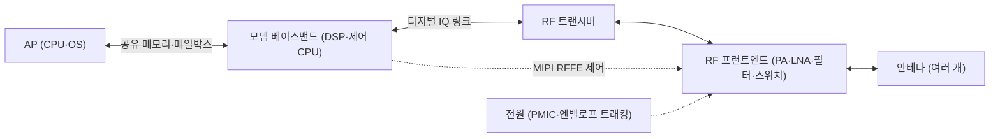

# 모뎀의 통합

!!! spec "규격 · 세대"
    3GPP 릴리스: **Rel-15**(5G NR 첫 규격, 2018) → Rel-16(URLLC·성능 개선) → **Rel-17**(NTN 위성, RedCap) → **Rel-18**(5G-Advanced 첫 릴리스) · RF 제어 버스: MIPI RFFE
    통합 흐름: 4G LTE 시절 플래그십 SoC는 모뎀 내장이 일반적 → 5G 초기에는 외장 모뎀(Snapdragon X50·X55, 2019–2020년형) → 2019년 말부터 5G 통합 SoC 등장(Exynos 980, Dimensity 1000, Snapdragon 765) → Qualcomm 플래그십은 Snapdragon 888(2021년형)부터 다시 통합 · Apple 자체 모뎀 **C1**은 iPhone 16e(2025)에 처음 탑재

!!! basic "한눈에 보기"
    **모뎀(modem)**은 휴대폰이 기지국과 대화하게 해 주는 통역사입니다. 앱이 보낸 데이터를 전파에 실을 수 있는 신호로 바꾸고, 받은 전파를 다시 데이터로 되돌립니다.

    1. **모뎀 프로세서** — 신호 처리와 통신 프로토콜을 담당하는, AP와는 별개의 작은 컴퓨터입니다. 자기만의 운영체제와 펌웨어가 돌아갑니다.
    2. **RF 트랜시버** — 디지털 신호를 실제 주파수의 아날로그 신호로 바꿉니다.
    3. **RF 프런트엔드** — 증폭기·필터·스위치·안테나 튜너로, 전파를 멀리 보내고 원하는 신호만 걸러냅니다.

    모뎀을 SoC 안에 넣는 것을 **통합(integrated)**, 별도 칩으로 두는 것을 **외장(discrete)**이라고 합니다. 한 건물 안에 통역 부서를 두느냐, 바깥 통역 회사와 계약하느냐의 차이와 비슷합니다. 안에 두면 가깝고 저렴하지만, 바깥 회사는 더 전문적이고 독립적으로 바꿀 수 있습니다.

## 통합 모뎀과 외장 모뎀 { .l2 }

| 항목 | 통합 (SoC 다이 안) | 외장 (별도 칩) |
|---|---|---|
| AP와의 연결 | 온칩 인터커넥트와 공유 DRAM | PCIe 등 칩 사이 링크 + 모뎀 전용 메모리가 필요할 수 있음 |
| 전력 | 칩 사이 링크가 없어 유리, 대기 전력 관리가 단순 | 링크 PHY 전력이 추가, 링크 절전 상태 관리 필요 |
| 보드 면적·비용 | 부품 수 감소 | 칩·전원·메모리 부품 추가 |
| 다이 면적 | SoC 다이가 커짐, 공정을 AP와 같이 써야 함 | 모뎀에 맞는 공정을 따로 고를 수 있음 |
| 개발 일정 | 모뎀과 AP를 같은 일정에 맞춰야 함 | 모뎀만 따로 바꾸거나 여러 AP에 재사용 가능 |
| 대표 사례 | Snapdragon 8 계열, Dimensity 플래그십, Exynos 플래그십 | Apple iPhone(Qualcomm 모뎀 또는 Apple C1), Google Tensor(Exynos Modem) |

통합 여부와 관계없이 **RF 트랜시버와 프런트엔드는 거의 항상 별도 칩**입니다. 아날로그·고주파 회로는 디지털 미세 공정의 이득을 덜 받고, 안테나 근처에 놓여야 하기 때문입니다. 그래서 "통합 모뎀"은 보통 **모뎀 베이스밴드(디지털 부분)가 SoC 안에 있다**는 뜻입니다.

## 모뎀 서브시스템의 구성 { .l2 }

| 블록 | 역할 | 보통 누가 만드나 |
|---|---|---|
| 베이스밴드 DSP | 채널 추정, 등화, 복조, 채널 디코딩 보조 같은 신호 처리 | SoC·모뎀 회사 (Qualcomm은 Hexagon 계열 DSP를 모뎀에 사용) |
| 프로토콜 프로세서 | 계층 2·3 프로토콜 스택, RRC·NAS 같은 제어 처리 | 모뎀 회사 (자체 RTOS 위에서 동작) |
| 하드웨어 가속기 | LDPC·Polar 디코더, FFT, 암호화(무선 구간 암호) | 모뎀 회사 |
| RF 트랜시버 | 디지털 ↔ 아날로그 변환, 상·하향 변환 | 모뎀 회사가 짝으로 공급하는 경우가 많음 |
| RF 프런트엔드 | 전력 증폭기(PA), 저잡음 증폭기(LNA), 필터, 안테나 튜너 | Qualcomm, Qorvo, Skyworks, Murata, Broadcom 등 |
| mmWave 안테나 모듈 | 28·39 GHz 대역의 안테나 배열과 RF를 한 모듈로 | 주로 모뎀 회사 (mmWave를 쓰는 지역 모델에만 탑재) |

## AP와의 통신과 전력 { .l2 }

| 주제 | 내용 |
|---|---|
| 데이터 경로 | IP 패킷은 공유 메모리의 링 버퍼(디스크립터 큐)로 오가고, 모뎀은 DMA로 직접 읽고 씁니다. |
| 제어 경로 | 통화·SIM·네트워크 상태 같은 제어 메시지는 별도 채널(Qualcomm QMI, Android의 RIL·Radio HAL 경유)로 오갑니다. |
| 알림 | 메일박스 인터럽트나 공유 메모리 상태 비트로 "새 데이터 있음"을 알립니다. |
| 메모리 격리 | DRAM의 모뎀 영역은 AP가 마음대로 쓰지 못하도록 하드웨어 접근 제어로 보호합니다([메모리 보호와 IOMMU](../memory/iommu.md)). |
| 대기 전력 | 화면이 꺼진 동안 AP는 깊이 잠들고, 모뎀만 정해진 주기로 깨어 호출(paging)을 확인합니다(DRX). |

??? expert "전문가 노트 — 공유 메모리 프로토콜, 대기 전력, 엔벨로프 트래킹, 자체 모뎀이 어려운 이유"
    **공유 메모리 프로토콜.** Qualcomm 통합 모뎀은 공유 메모리 영역(SMEM) 위에 GLINK 같은 메시지 전송 계층을 두고, 그 위에서 QMI 서비스와 데이터 경로가 동작합니다. 외장 모뎀(예: 노트북용 Snapdragon X 모뎀 모듈)은 PCIe 위의 **MHI(Modem Host Interface)**를 쓰며, Linux에는 `drivers/bus/mhi/`가 있습니다. 모뎀 펌웨어의 로딩·재시작은 Linux의 remoteproc 프레임워크(`drivers/remoteproc/qcom_q6v5_mss.c` 등)가 맡습니다. Samsung Exynos 모뎀은 공유 메모리와 메일박스 기반 인터페이스를, MediaTek은 CCCI라는 코어 간 통신 계층을 쓰는 것으로 알려져 있으며, 세부 구조는 대부분 벤더 커널 코드에서만 확인할 수 있습니다.

    **대기 전력은 모뎀이 정한다.** 화면이 꺼진 상태의 배터리 소모는 상당 부분 모뎀의 DRX 주기, 셀 재선택, 신호 세기에 따라 정해집니다. 모뎀이 깨어날 때마다 AP까지 깨우면 대기 전력이 크게 늘어나므로, 모뎀은 패킷을 모아 두었다가 한 번에 넘기거나(인터럽트 병합), 의미 없는 패킷을 걸러 AP를 깨우지 않도록 설계됩니다. 통합 모뎀은 AP와 같은 다이에 있지만 **별도 파워 도메인**에 있어 AP 클러스터가 꺼진 동안 독립적으로 동작합니다([파워 도메인과 게이팅](../power/power-domains.md)).

    **엔벨로프 트래킹.** 송신 중 전력 증폭기는 모뎀 전체에서 가장 전력을 많이 쓰는 부품 중 하나입니다. 5G의 넓은 대역폭 신호는 순간 전력의 변동 폭이 커서, 고정 전압으로 PA를 구동하면 낭비가 큽니다. **엔벨로프 트래킹**은 신호의 포락선을 따라 PA 전원 전압을 빠르게 바꿔 효율을 높이는 기술로, 모뎀·트랜시버·전원 칩이 함께 설계되어야 해서 모뎀 회사가 RF 전원 칩까지 묶어 공급하는 이유 중 하나입니다.

    **자체 모뎀이 어려운 이유.** 모뎀은 규격 구현만으로 끝나지 않습니다. 전 세계 수많은 대역 조합·통신사 망 설정·기지국 장비와의 상호 운용 시험, 통신사 인증, 국가별 인증을 통과해야 하고, 다른 회사의 표준 필수 특허 문제도 있습니다. Apple이 Intel 모뎀 사업을 인수(2019년 발표)한 뒤 C1을 내놓기까지 몇 년이 걸린 것도 이런 이유로 이해됩니다. 이 페이지 기준 시점에 Apple은 일부 모델에 자체 모뎀을 쓰면서 다른 모델에는 Qualcomm 모뎀을 함께 쓰는 과도기에 있습니다.

## 칩셋 비교

| 항목 | Qualcomm Snapdragon | Samsung Exynos | MediaTek Dimensity | Apple | Google Tensor |
|---|---|---|---|---|---|
| 플래그십 모뎀 배치 | 통합 (Snapdragon X 시리즈 IP) | 통합 (Exynos Modem IP) | 통합 | 외장 (Qualcomm 또는 자체 C1 계열) | 외장 (Samsung Exynos Modem) |
| 외장 모뎀 제품 | Snapdragon X 시리즈 (노트북·차량·모듈용 포함) | Exynos Modem 단품 (Tensor 등에 공급) | 외장 모뎀 제품 보유 (M 시리즈) | 자사 기기 전용 | — |
| RF 트랜시버·프런트엔드 | 트랜시버와 프런트엔드 대부분을 자체 공급 가능 | 트랜시버 자체, 프런트엔드는 외부 부품 혼용 | 트랜시버 자체, 프런트엔드는 외부 부품 혼용 | 트랜시버도 자체 설계로 알려짐(C1), 프런트엔드는 외부 부품 | Samsung 모뎀 플랫폼 기반 |
| 모뎀–AP 연결 | 온칩 공유 메모리 | 온칩 공유 메모리 | 온칩 공유 메모리 | 칩 사이 링크 | 칩 사이 링크 |

> 세대별 모뎀 이름·3GPP 릴리스·최대 속도는 [칩셋 세대 인덱스](../reference/chipset-index.md)에 모읍니다.

## 관련 페이지
- [Cellular Handbook](https://goodhosup.github.io/cellular/) — LTE·5G NR 프로토콜 자체 (자매 핸드북)
- [GNSS·UWB·위성](gnss-uwb.md) — 모뎀에 들어가는 NTN 위성 통신
- [Wi-Fi·Bluetooth 콤보](wifi-bt.md) — 셀룰러와 2.4·5 GHz 무선의 공존
- [메모리 보호와 IOMMU](../memory/iommu.md) — 모뎀 메모리 영역의 격리
- [대기 전력과 저전력 상태](../power/idle.md) — 화면 꺼짐 대기 전력과 모뎀
