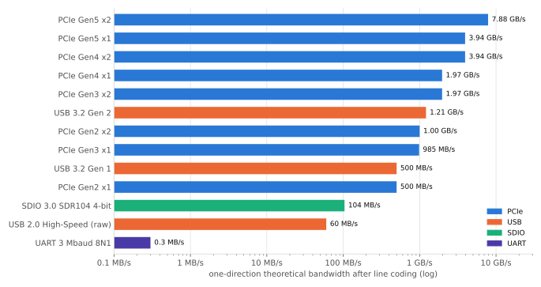
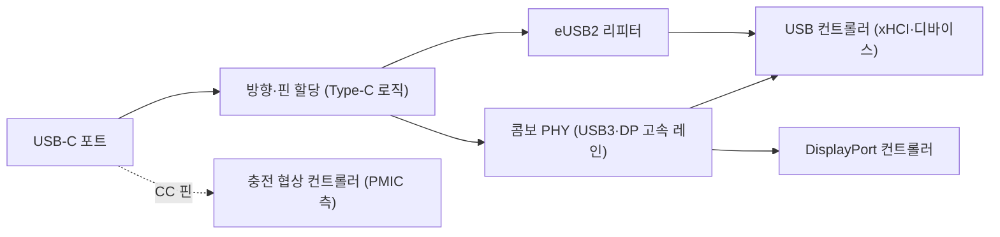

# PCIe·USB

!!! spec "규격 · 세대"
    PCI-SIG: PCIe 2.0(5 GT/s) → **3.0**(8 GT/s, 128b/130b) → **4.0**(16 GT/s) → 5.0(32 GT/s) → 6.0(PAM4) · USB-IF: USB 2.0 → **USB 3.2**(Gen 1 5 Gbps, Gen 2 10 Gbps, Gen 2x2 20 Gbps) → **USB4**(2019, 최대 40 Gbps) → USB4 Version 2.0(2022, 최대 80 Gbps) · **eUSB2**(USB 2.0 저전압 변형) · VESA DisplayPort Alt Mode, USB Type-C, USB Power Delivery
    스마트폰 적용: 플래그십 SoC는 USB 3.x(10 Gbps급)와 PCIe Gen3급 소수 레인이 일반적(이 페이지 기준 시점) · USB4·Thunderbolt급 포트는 노트북용 Arm SoC(Apple M 시리즈, Snapdragon X 계열)에서 지원

!!! basic "한눈에 보기"
    **PCIe**와 **USB**는 둘 다 고속 직렬 링크지만 쓰임이 다릅니다.

    1. **PCIe는 집 안의 배관** — 휴대폰 안에서 SoC와 Wi-Fi 칩, 외장 모뎀 같은 부품을 잇습니다. 바깥에서는 보이지 않습니다.
    2. **USB는 현관문** — 충전기, 외장 저장장치, 모니터, PC처럼 바깥 기기와 이어지는 유일한 유선 통로입니다.
    3. **PHY는 문틀** — 컨트롤러(규칙을 아는 두뇌)와 실제 전선 사이에서 전기 신호를 만들고 받는 회로입니다. USB-C 포트 하나 뒤에는 USB·DisplayPort가 함께 쓰는 **콤보 PHY**가 있는 경우가 많습니다.

    스마트폰은 PC처럼 확장 슬롯이 없어서 PCIe 레인 수가 적고, USB 포트도 하나뿐입니다. 대신 그 하나의 USB-C 포트로 충전·데이터·화면 출력·오디오를 모두 처리합니다.

## SoC 안의 PCIe { .l2 }

| 용도 | 대표 구성 | 비고 |
|---|---|---|
| Wi-Fi·Bluetooth 콤보 칩 | Gen3 x1 안팎 | [Wi-Fi·Bluetooth 콤보](wifi-bt.md) |
| 외장 모뎀 | Gen3 x1–x2 안팎 | AP–모뎀 사이 데이터 경로 ([모뎀의 통합](modem.md)) |
| NVMe 저장장치 | 노트북용 SoC, 일부 태블릿 | 스마트폰은 대부분 UFS ([UFS 저장장치](../memory/ufs.md)) |

| 링크 | 한 방향 이론 대역폭 |
|---|---|
| Gen2 x1 | 5 GT/s × 8/10 ÷ 8 = **0.5 GB/s** |
| Gen3 x1 | 8 GT/s × 128/130 ÷ 8 ≈ **0.98 GB/s** |
| Gen4 x1 | 16 GT/s × 128/130 ÷ 8 ≈ **1.97 GB/s** |
| Gen4 x2 | ≈ **3.94 GB/s** |

선로 부호화만 반영한 값이며, 실제 처리량은 패킷 헤더·흐름 제어로 더 낮습니다. (수치는 `tools/soc_numbers.py`에서 계산) 스마트폰 SoC의 PCIe는 **루트 컴플렉스(호스트)** 역할만 하는 경우가 대부분이고, 레인 수가 적은 대신 깊은 절전 상태(L1 하위 상태)를 적극적으로 씁니다.

UART와 PCIe Gen5 x2 사이에는 네 자릿수 이상의 차이가 있습니다.

## USB 컨트롤러와 Type-C { .l2 }

| 속도 등급 | 신호 속도 | 선로 부호화 | 한 방향 이론 대역폭 |
|---|---|---|---|
| USB 2.0 High-Speed | 480 Mbps | — | 60 MB/s (원시) |
| USB 3.2 Gen 1 | 5 Gbps | 8b/10b | **0.5 GB/s** |
| USB 3.2 Gen 2 | 10 Gbps | 128b/132b | 약 **1.21 GB/s** |
| USB4 (Gen 3x2) | 40 Gbps | 128b/132b | 노트북용 SoC에서 지원 |
| DisplayPort Alt Mode (HBR3 4레인) | 8.1 Gbps × 4 | 8b/10b | 약 **25.9 Gbps** 영상 데이터 |

(수치는 `tools/soc_numbers.py`에서 계산)

USB-C 포트의 고속 레인 4개는 **USB 3.x 2레인 + DP 2레인**, 또는 **DP 4레인 + USB 2.0만**처럼 나눠 쓸 수 있습니다. 모니터 해상도와 USB 3 속도를 동시에 최대로 쓸 수 없는 이유입니다. 충전 전력 협상(USB Power Delivery)은 CC 핀을 통해 별도 컨트롤러가 처리하고, 결과는 PMIC와 충전 IC로 전달됩니다([PMIC와 전원 공급](../power/pmic.md)).

??? expert "전문가 노트 — eUSB2가 필요한 이유, 컨트롤러 IP와 드라이버, 장치 격리, 링크 절전의 함정"
    **eUSB2가 필요한 이유.** USB 2.0은 3.3 V 신호 전압을 전제로 하지만, 최첨단 공정의 SoC I/O는 그런 높은 전압을 견디기 어렵습니다. **eUSB2**는 SoC와 리피터 사이를 1 V 안팎의 저전압 신호로 바꾸고, 보드 위의 리피터가 커넥터 쪽 표준 USB 2.0 신호로 변환합니다. 최신 Snapdragon 세대에서 Linux 장치 트리에 eUSB2 리피터 노드가 등장하는 것이 이 구조 때문입니다. 공정이 미세해질수록 고전압 아날로그 기능을 SoC 바깥으로 빼는 흐름의 한 예입니다.

    **컨트롤러 IP와 드라이버.** 많은 모바일 SoC가 USB 컨트롤러로 Synopsys DesignWare USB3(DWC3) 계열 IP를 쓰며, Linux에서는 `drivers/usb/dwc3/`에 공통 코드와 SoC별 연결 코드가 있습니다. MediaTek은 자체 컨트롤러(`drivers/usb/mtu3/`)를 쓰는 것으로 알려져 있습니다. PHY는 SoC 회사가 직접 설계하거나 IP를 받아 쓰며, Qualcomm 계열은 `drivers/phy/qualcomm/`의 QMP 콤보 PHY 드라이버에서 USB·DP 레인 전환을 볼 수 있습니다. PCIe 루트 컴플렉스도 DesignWare 계열 IP가 흔합니다(`drivers/pci/controller/dwc/`).

    **장치 격리.** PCIe와 USB 장치는 DMA로 메모리에 직접 접근하므로, SoC는 각 장치를 IOMMU(SMMU) 뒤에 두어 허용된 버퍼만 쓰게 합니다. 외부 포트는 특히 위험해서, 노트북의 USB4·Thunderbolt처럼 PCIe를 외부로 터널링하는 경우 DMA 공격 방어가 필수입니다. 스마트폰은 USB 포트로 PCIe를 노출하지 않는 것이 보통이어서 외부 DMA 위험이 상대적으로 작습니다([메모리 보호와 IOMMU](../memory/iommu.md)).

    **링크 절전의 함정.** PCIe의 L1.2는 기준 클럭까지 끌 수 있어 대기 전력이 크게 줄지만, 복귀에 수십 µs 이상 걸릴 수 있고 장치·보드 설계(CLKREQ# 배선, 복귀 지연 설정)가 맞지 않으면 링크가 불안정해집니다. USB도 U1·U2·U3 같은 절전 상태와 자동 일시 정지를 쓰는데, 일부 주변기기는 절전 복귀를 제대로 처리하지 못해 끊김이 생깁니다. 대기 전력 문제를 볼 때는 링크 상태 체류 시간을 먼저 확인하는 것이 출발점입니다([대기 전력과 저전력 상태](../power/idle.md)).

## 칩셋 비교

| 항목 | 스마트폰 플래그십 SoC | 노트북용 Arm SoC | 보급형 스마트폰 SoC |
|---|---|---|---|
| USB 최고 속도 | USB 3.x (10 Gbps급) | USB4·Thunderbolt급 포트 여러 개 | USB 2.0이 흔함 |
| 화면 출력 | DP Alt Mode 지원 모델 증가 (기기 제조사 정책에 따라 다름) | 기본 지원, 여러 화면 | 대개 미지원 |
| PCIe | 소수 레인 (Wi-Fi·모뎀용) | NVMe·Wi-Fi·외장 장치용 여러 레인 | Wi-Fi 연결용 또는 없음 (SDIO 사용) |
| 저장장치 | UFS | NVMe가 일반적 | UFS·eMMC |

> 세대별 USB 버전과 PCIe 세대·레인 수는 [칩셋 세대 인덱스](../reference/chipset-index.md)에 모읍니다.

## 관련 페이지
- [Wi-Fi·Bluetooth 콤보](wifi-bt.md) — PCIe로 붙는 대표 장치
- [UFS 저장장치](../memory/ufs.md) — 스마트폰 저장장치용 다른 고속 직렬 링크
- [디스플레이 파이프라인](../media/display.md) — DP Alt Mode의 영상 출력 경로
- [메모리 보호와 IOMMU](../memory/iommu.md) — PCIe·USB 장치의 DMA 격리
- [Arm PC와 노트북 SoC](../next/arm-pc.md) — USB4·NVMe를 쓰는 대형 Arm SoC
