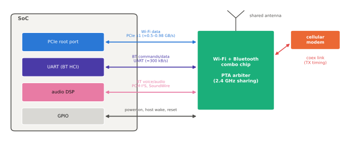

# Wi-Fi·Bluetooth 콤보

!!! spec "규격 · 세대"
    IEEE **802.11ax**(Wi-Fi 6, 6 GHz 대역 확장 = **Wi-Fi 6E**) → IEEE **802.11be**(Wi-Fi 7, Wi-Fi Alliance 인증 2024년 시작) · Bluetooth Core 5.x(5.2에서 LE Audio 기반 기능) → Core 6.0(2024) · 호스트 인터페이스: PCIe, SDIO 3.0, UART(HCI), 공존 인터페이스(Bluetooth Core의 MWS 공존·WCI-2)
    스마트폰 적용: Wi-Fi 6E 콤보는 2021년형 플래그십(예: Qualcomm FastConnect 6900)부터, Wi-Fi 7 콤보는 2023년형 플래그십(예: FastConnect 7800)부터 주류로 확산

!!! basic "한눈에 보기"
    Wi-Fi와 Bluetooth는 대부분 **한 칩(콤보 칩)**에 함께 들어갑니다. 둘 다 2.4 GHz 대역을 쓰고, 안테나와 RF 회로 일부를 나눠 쓸 수 있으며, 서로 방해하지 않도록 시간을 조율해야 하기 때문입니다.

    1. **같은 길을 쓰는 두 손님** — Wi-Fi와 Bluetooth는 2.4 GHz라는 같은 도로를 씁니다. 한 칩 안에 있으면 신호등(공존 제어)을 직접 맞출 수 있습니다.
    2. **SoC와는 다른 문으로** — Wi-Fi 데이터는 빠른 문(PCIe 또는 SDIO), Bluetooth는 작은 문(UART)으로 SoC와 오갑니다.
    3. **스스로 일하는 칩** — 콤보 칩은 자체 프로세서와 펌웨어를 가지고, AP가 자는 동안에도 연결을 유지하고 필요한 패킷만 골라 AP를 깨웁니다.

## 콤보 칩의 배치 { .l2 }

| 구성 | 내용 | 장점 | 단점 |
|---|---|---|---|
| 완전 외장 콤보 | MAC·베이스밴드·RF가 모두 별도 칩, SoC와 PCIe·UART로 연결 | 칩을 독립적으로 바꾸거나 여러 SoC에 재사용, RF 공정 최적화 | 칩 사이 링크 전력, 부품 추가 |
| 디지털 통합 + 외장 RF | Wi-Fi·BT의 MAC·베이스밴드는 SoC 안, RF만 동반 칩 | 부품·비용 절감, 공유 메모리로 데이터 이동 | SoC 일정에 묶임, 새 Wi-Fi 세대 대응이 SoC 세대에 종속 |
| 모듈형 | 콤보 칩과 프런트엔드를 한 모듈(SiP)로 | 보드 설계 단순, 인증 간소화 | 모듈 비용 |

스마트폰 플래그십에서는 **외장 콤보 칩 + PCIe** 구성이 가장 흔하고, 보급형에서는 비용을 위해 디지털 부분을 SoC에 넣는 경우가 많습니다. 2.4·5·6 GHz 각 대역의 전력 증폭기·저잡음 증폭기·필터는 콤보 칩에 내장되거나 외장 프런트엔드 모듈(FEM)로 붙습니다.

## SoC와 연결하는 인터페이스 { .l2 }

| 인터페이스 | 용도 | 이론 속도 (한 방향) |
|---|---|---|
| PCIe Gen2 x1 | Wi-Fi 데이터 (Wi-Fi 6 세대 콤보) | 5 GT/s × 8/10 ÷ 8 = **0.5 GB/s** |
| PCIe Gen3 x1 | Wi-Fi 데이터 (Wi-Fi 6E·7 세대 콤보) | 8 GT/s × 128/130 ÷ 8 ≈ **0.98 GB/s** |
| SDIO 3.0 (SDR104, 4비트) | 보급형·IoT 기기의 Wi-Fi 데이터 | 208 MHz × 4비트 ÷ 8 = **104 MB/s** |
| UART (HCI) | Bluetooth 명령·데이터 | 3 Mbaud에서 8N1 기준 약 **300 kB/s** |
| PCM·I2S, SLIMbus·SoundWire | Bluetooth 음성·오디오를 오디오 DSP로 직접 | 오디오 스트림 수준 |
| GPIO | 전원 켜기, 호스트 깨우기(host wake), 리셋 | — |
| 공존 링크 (UART 형태) | 셀룰러 모뎀과 송수신 일정 정보 교환 | 저속 |

(수치는 `tools/soc_numbers.py`에서 계산) Wi-Fi 7의 최대 PHY 속도는 수 Gbps에 이르므로, SDIO는 고성능 Wi-Fi에 부족하고 PCIe가 사실상 필수입니다. 반대로 Bluetooth는 수 Mbps 수준이어서 UART로 충분합니다.

## 공존 (Coexistence) { .l2 }

| 충돌 상황 | 원인 | 대응 |
|---|---|---|
| Wi-Fi 2.4 GHz ↔ Bluetooth | 같은 대역, 안테나 공유 | 칩 안의 시간 분할 중재(PTA), 우선순위 표 (음성 통화 > 오디오 > 데이터) |
| LTE·NR 2.3·2.6 GHz 대역 ↔ 2.4 GHz | 인접 대역, 송신 신호의 누설 | 모뎀–콤보 칩 공존 신호로 송신 시점 조율, 필터 |
| 셀룰러 고조파·상호 변조 ↔ 5·6 GHz | 송신 신호의 고조파가 Wi-Fi 대역에 떨어짐 | 채널 회피, 송신 전력 제한 |
| Wi-Fi 6 GHz ↔ UWB | 6 GHz Wi-Fi 대역과 UWB 채널 5가 겹침 | 일정 조율 ([GNSS·UWB·위성](gnss-uwb.md)) |

??? expert "전문가 노트 — PCIe 절전과 깨우기, 펌웨어 오프로드, 드라이버 구조, 통합의 득실"
    **PCIe 절전과 깨우기.** 스마트폰 Wi-Fi는 대부분 시간을 연결만 유지한 채 쉽니다. 이때 PCIe 링크는 L1 하위 상태(L1.1·L1.2)로 들어가 PHY를 거의 끄고, 콤보 칩은 비컨을 스스로 수신하며 연결을 유지합니다. AP를 깨워야 할 패킷이 오면 WAKE# 신호나 별도 GPIO로 알리고 링크를 다시 올립니다. 링크 복귀 지연이 길면 첫 패킷 지연이 늘어나므로, 절전 진입 타이머와 복귀 지연 사이의 균형이 대기 전력과 응답성을 함께 좌우합니다([PCIe·USB](pcie-usb.md)).

    **펌웨어 오프로드.** 콤보 칩은 ARP·IPv6 이웃 탐색 응답, 멀티캐스트 필터, 연결 유지 패킷 같은 일을 AP 없이 처리합니다(오프로드). 오프로드가 부족하면 의미 없는 브로드캐스트 패킷마다 AP가 깨어나 대기 전력이 크게 늘어납니다. Bluetooth도 LE 광고 스캔 필터링, 오디오 인코딩·디코딩 오프로드(오디오 DSP와의 직접 경로)를 써서 AP의 개입을 줄입니다.

    **드라이버 구조.** Linux에서 Qualcomm 계열은 Wi-Fi 코어가 SoC 안에 있던 세대(WCN3990, `ath10k_snoc`)와 PCIe 외장 콤보 세대(`ath11k`, `ath12k`)가 나뉘어 있고, Broadcom 계열은 `brcmfmac`, MediaTek 계열은 `mt76` 계열 드라이버가 있습니다. Bluetooth는 대개 UART 위의 HCI로 `drivers/bluetooth/`의 벤더별 드라이버가 펌웨어를 내려받습니다. Android 기기에서는 이 위에 Wi-Fi HAL과 Bluetooth 스택이 올라갑니다([Android BSP 구조](../software/android-bsp.md)).

    **통합의 득실.** Wi-Fi를 SoC에 통합하면 부품 수는 줄지만, Wi-Fi는 세대 전환이 빠르고 지역별 6 GHz 규제·인증이 복잡해 독립 칩의 이점이 큽니다. 또한 Wi-Fi 7의 MLO(다중 링크 동시 동작)처럼 여러 대역을 동시에 쓰는 기능은 RF 경로 수와 안테나 설계를 함께 바꿔야 해서, 플래그십은 외장 콤보 칩을 선택하는 경향이 이 페이지 기준 시점에도 이어지고 있습니다.

## 칩셋 비교

| 항목 | Qualcomm Snapdragon | Samsung Exynos | MediaTek Dimensity | Apple | Google Tensor |
|---|---|---|---|---|---|
| 플래그십 구성 | 자사 외장 콤보 (FastConnect) | 외부 공급사 콤보 칩 (모델별 상이) | 디지털 부분 SoC 통합 + 동반 RF 칩 구성으로 알려짐 | 오랫동안 Broadcom 콤보 → iPhone 17 세대부터 자체 무선 칩 N1 | 외부 공급사 콤보 칩 (분해 분석 기준 Broadcom) |
| Wi-Fi 연결 | PCIe | PCIe | 온칩 (구성에 따라 다름) | 공개 정보 적음 | PCIe |
| Bluetooth 연결 | UART (오디오는 별도 오디오 버스) | UART | 온칩 | 공개 정보 적음 | UART |
| 모뎀 공존 | 같은 회사 모뎀과 공존 설계 | 자사 모뎀과 공존 인터페이스 | 같은 SoC 안에서 조율 | 모뎀·무선 칩 공급사 조합에 따라 다름 | Exynos 모뎀과 공존 인터페이스 |

> 세대별 Wi-Fi·Bluetooth 지원 버전과 콤보 칩 이름은 [칩셋 세대 인덱스](../reference/chipset-index.md)에 모읍니다.

## 관련 페이지
- [Wi-Fi Handbook](https://goodhosup.github.io/wifi/) — 802.11 PHY·MAC과 Wi-Fi 7 기능 (자매 핸드북)
- [Bluetooth Handbook](https://goodhosup.github.io/bluetooth/) — Bluetooth 프로토콜과 LE Audio (자매 핸드북)
- [PCIe·USB](pcie-usb.md) — 콤보 칩을 잇는 PCIe 링크와 절전 상태
- [오디오와 DSP](../media/audio-dsp.md) — Bluetooth 오디오 오프로드 경로
- [모뎀의 통합](modem.md) — 셀룰러와의 공존
