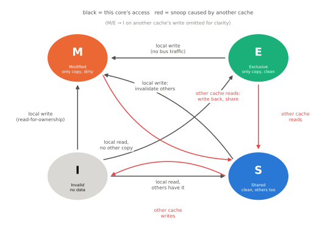
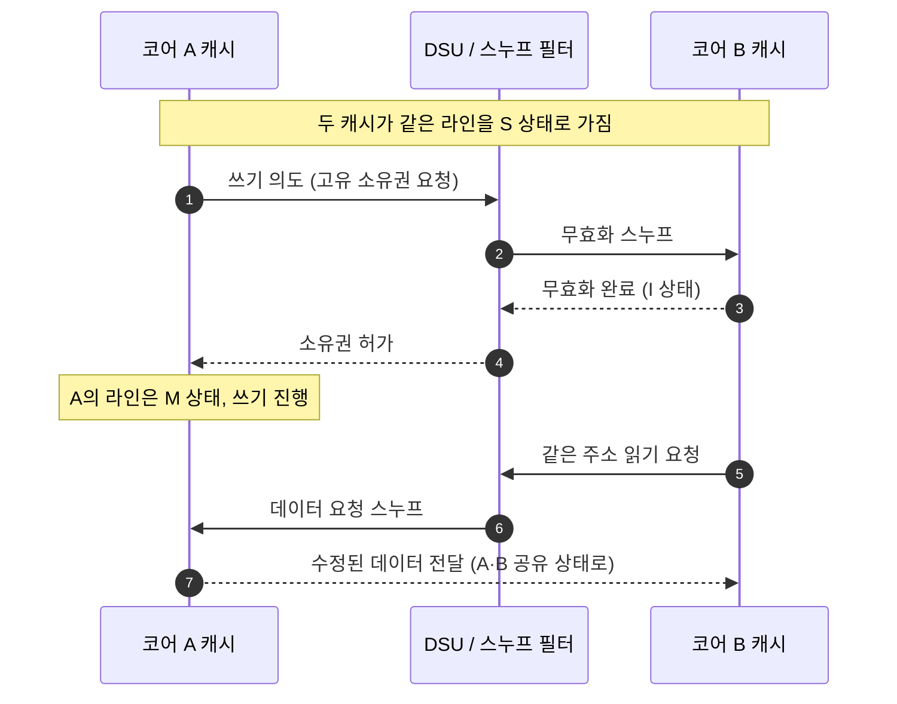

# 캐시와 일관성

!!! spec "규격 · 세대"
    Arm AMBA ACE(AMBA 4) · **CHI**(AMBA 5) 일관성 프로토콜, Arm 아키텍처의 메모리 모델(약한 순서, 배리어 `DMB`·`DSB`, 로드-획득·스토어-해제) · DynamIQ DSU(공유 L3, 스누프 필터)
    공유 버스 스누핑 → 디렉터리·스누프 필터 기반 → 클러스터 공유 L2·L3 + SoC 공유 SLC + I/O 일관성(ACE-Lite)

!!! basic "한눈에 보기"
    코어마다 자기 캐시가 있으면 문제가 생깁니다. 코어 A가 자기 캐시에서 어떤 값을 바꿨는데, 코어 B는 자기 캐시에 남은 **옛날 값**을 읽으면 어떻게 될까요?

    1. **캐시 일관성(coherence)**은 "같은 주소는 모든 코어가 결국 같은 값을 보게" 하는 하드웨어 약속입니다.
    2. 이를 위해 캐시들은 서로의 상태를 확인하고(스누프), 누군가 쓰면 다른 복사본을 무효로 만듭니다.
    3. 그래서 프로그래머는 대부분 캐시가 여러 개라는 사실을 신경 쓰지 않아도 됩니다. 다만 **순서**(어떤 쓰기가 먼저 보이는가)는 별개의 문제라서, 멀티스레드 코드는 배리어나 원자 연산을 써야 합니다.

    여러 사람이 각자 복사본을 들고 있는 공유 문서에 비유하면, 일관성 프로토콜은 "누가 고치면 나머지 복사본에 '폐기' 도장을 찍는 규칙"입니다.

## 일관성 프로토콜의 상태 { .l2 }

캐시 라인마다 상태를 붙여 관리합니다. 가장 널리 알려진 MESI 계열 이름으로 보면 다음과 같습니다(AMBA ACE·CHI는 같은 개념을 고유한 이름으로 정의).

| 상태 | 뜻 | 쓰기 가능? |
|---|---|---|
| **M** (Modified) | 이 캐시만 갖고 있고, 메모리와 다르게 수정됨 | 예 |
| **O** (Owned, MOESI) | 수정된 값을 여러 캐시가 공유하지만 이 캐시가 책임짐 | 아니요 |
| **E** (Exclusive) | 이 캐시만 갖고 있고, 메모리와 같음 | 예 (바로 M으로) |
| **S** (Shared) | 여러 캐시가 같은 값을 가짐 | 아니요 (먼저 다른 복사본 무효화) |
| **I** (Invalid) | 유효한 데이터 없음 | — |

## 모바일 SoC의 일관성 구조 { .l2 }

| 층 | 범위 | 담당 |
|---|---|---|
| 코어 전용 L1·L2 | 코어 하나 | 코어의 캐시 제어기 |
| 클러스터 | 클러스터 안 코어들 | DSU(공유 L3, 스누프 필터) 또는 자체 클러스터 패브릭(공유 L2) |
| 시스템 | 여러 클러스터, GPU 일부, I/O 일관성 장치 | 일관성 인터커넥트(CHI·ACE 기반) |
| SLC | SoC 전체 | 메모리 컨트롤러 앞의 공유 캐시 |
| 비일관성 장치 | ISP, 코덱, 디스플레이 등 | 소프트웨어 캐시 관리(clean·invalidate) 또는 I/O 일관성 경로 |

## 스누프 필터와 포함 정책 { .l2 }

모든 캐시에 매번 "그 주소 갖고 있니?"라고 묻는 브로드캐스트 스누프는 코어 수가 늘면 트래픽과 전력이 폭증합니다. **스누프 필터**는 위 계층 캐시에 어떤 라인이 있는지 장부로 관리해, 실제로 가진 캐시에게만 묻습니다.

| 정책 | 뜻 | 장점 | 단점 |
|---|---|---|---|
| 포함(inclusive) | 아래 캐시가 위 캐시 내용을 모두 포함 | 아래 캐시만 보면 위에 있는지 앎 | 용량 중복 |
| 배타(exclusive) | 위·아래 캐시에 같은 라인이 동시에 없음 | 총 유효 용량 최대 | 라인 이동 관리 복잡 |
| 비포함(non-inclusive) | 둘 다 강제하지 않음 | 유연함 | 별도 스누프 필터 필요 |

??? expert "전문가 노트 — 거짓 공유, 메모리 순서 모델, 비일관성 장치와 캐시 관리"
    **거짓 공유(false sharing).** 서로 다른 스레드가 **같은 캐시 라인(64바이트) 안의 서로 다른 변수**를 자주 쓰면, 논리적으로는 공유하지 않는데도 라인 소유권이 코어 사이를 계속 오가며 성능이 크게 떨어집니다. 이기종 클러스터에서는 코어 사이 거리(같은 클러스터인지, 다른 클러스터인지)에 따라 이 비용이 달라집니다. 자주 쓰는 스레드별 변수는 캐시 라인 경계에 맞춰(정렬·패딩) 분리합니다.

    **일관성과 순서는 다르다.** 일관성은 "한 주소에 대한" 약속이고, 서로 다른 주소에 대한 쓰기가 다른 코어에 어떤 순서로 보이는지는 **메모리 순서 모델**이 정합니다. Arm은 약한 순서 모델이라, x86에서 우연히 동작하던 잠금 없는 코드가 Arm에서 깨지기도 합니다. `DMB` 배리어, 로드-획득(`LDAR`)·스토어-해제(`STLR`) 명령, C/C++ `std::atomic`의 acquire·release 의미를 정확히 써야 합니다.

    **비일관성 장치와 DMA.** ISP·코덱처럼 일관성 영역 밖의 장치가 DRAM에 쓴 데이터를 CPU가 읽으려면, CPU 캐시에 남은 옛 값을 먼저 무효화(invalidate)해야 합니다. 반대로 CPU가 쓴 데이터를 장치가 읽게 하려면 캐시를 비워(clean) DRAM에 반영해야 합니다. Linux의 DMA API(`dma_map_*`, `dma_sync_*`)가 이 작업을 감싸며, 이를 빠뜨리는 것이 드라이버 버그의 고전적 원인입니다. I/O 일관성(ACE-Lite) 경로를 쓰면 이 비용을 하드웨어가 대신 지지만 인터커넥트 트래픽이 늘어납니다.

    **실측 단서.** 코어 사이 지연(core-to-core latency) 측정은 두 코어가 같은 캐시 라인을 번갈아 쓰는 핑퐁 시간으로 이루어지며, 같은 클러스터·다른 클러스터 사이 차이가 일관성 구조를 드러냅니다. 공개 칩셋 분석의 코어 간 지연 행렬이 이런 측정의 결과입니다.

## 칩셋 비교

| 항목 | DynamIQ 기반 (Exynos, Dimensity, Tensor) | 자체 클러스터 (Apple, Oryon) |
|---|---|---|
| 클러스터 공유 캐시 | DSU의 L3 | 공유 L2 |
| 코어 전용 캐시 | L1 + 전용 L2 | L1 (L2는 공유) |
| 클러스터 사이 | 일관성 인터커넥트 + SLC | 자체 패브릭 + SLC |

## 관련 페이지
- [메모리 계층](../basics/memory-hierarchy.md) — 캐시의 기본 개념
- [버스와 인터커넥트](../basics/interconnect.md) — ACE·CHI 프로토콜
- [이기종 클러스터](clusters.md) — DSU와 클러스터 구성
- [메모리 컨트롤러와 SLC](../memory/controller-slc.md) — 마지막 공유 캐시
