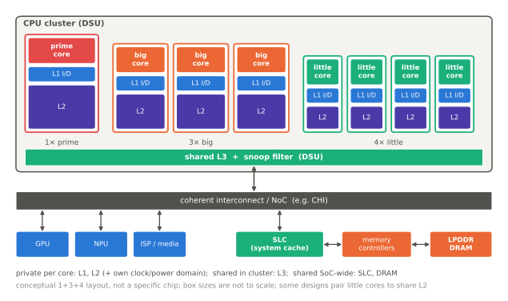

# 이기종 클러스터

!!! spec "규격 · 세대"
    Arm big.LITTLE(2011 발표) → **DynamIQ**(2017, Cortex-A75·A55와 DSU) → DSU 후속 세대(DSU-110, DSU-120 등) · 커널 측: Linux EAS(Energy Aware Scheduling), 디바이스 트리 `cpu-map`·`capacity-dmips-mhz`
    첫 상용 big.LITTLE: Exynos 5410 Octa(2013, Cortex-A15 4 + A7 4) · 구성 변화: `4 + 4` → `2 + 2 + 4`·`1 + 3 + 4` → `1 + 5 + 2`·`1 + 2 + 2 + 3` 등 세분화 → `4 + 4`(빅 코어 위주)·`2 + 6`(고효율 코어 없음)

!!! basic "한눈에 보기"
    스마트폰이 하는 일의 대부분은 가볍습니다(알림 확인, 음악 재생, 화면 스크롤). 가끔 무거운 일(앱 실행, 게임, 사진 처리)이 몰립니다. 그래서 SoC는 **성격이 다른 코어를 섞어** 둡니다.

    1. **큰 코어** — 빠르지만 전력을 많이 씀. 무거운 일이 있을 때만 깨어남
    2. **작은 코어** — 느리지만 전력이 아주 적음. 가벼운 일을 계속 처리
    3. **운영체제의 스케줄러**가 일의 무게를 보고 어느 코어에 맡길지 정함

    자동차의 하이브리드 엔진과 비슷합니다. 시내 저속 주행은 전기 모터(작은 코어), 고속도로 가속은 엔진(큰 코어)이 맡습니다.

## big.LITTLE에서 DynamIQ로 { .l2 }

| 방식 | 구조 | 동작 | 한계 |
|---|---|---|---|
| 클러스터 전환 (초기 big.LITTLE) | 큰 코어 클러스터와 작은 코어 클러스터 | 한 번에 한 클러스터만 사용, 부하에 따라 통째로 전환 | 8코어지만 동시에 4개만 사용 |
| CPU 전환 (IKS) | 큰 코어 1 + 작은 코어 1을 한 쌍으로 | 쌍 안에서 하나만 사용 | 운영체제에는 4코어로 보임 |
| 전역 작업 스케줄링 (HMP → EAS) | 모든 코어를 운영체제에 노출 | 스케줄러가 작업별로 코어 선택, 모든 코어 동시 사용 | 스케줄러가 코어 성능 차이를 알아야 함 |
| **DynamIQ** | **한 클러스터 안에 다른 종류의 코어**를 섞고 DSU로 L3 공유 | 코어별 전원·클럭 제어 확대, 공유 L3로 코어 간 작업 이동 비용 감소 | DSU 설계·검증 복잡 |

## 구성의 변화 { .l2 }

| 구성 예 | 의미 | 대표 사례 (발표 기준) |
|---|---|---|
| `4 + 4` | 큰 코어 4 + 작은 코어 4 | 초기 옥타코어 big.LITTLE (Exynos 5410 등) |
| `1 + 3 + 4` | 프라임 1 + 성능 3 + 효율 4 | Cortex-X 계열 등장 이후 플래그십의 표준형 |
| `1 + 2 + 2 + 3` | 성능 코어를 클럭이 다른 두 그룹으로 나눔 | Snapdragon 8 Gen 2 (X3 1 + A715 2 + A710 2 + A510 3) |
| `4 + 4` (빅 코어 위주) | 최고 성능 4 + 균형 4, 효율 코어 없음 | Dimensity 9300 (Cortex-X4 4 + A720 4) |
| `2 + 6` | 최고 성능 2 + 성능 6, 효율 코어 없음 | Snapdragon 8 Elite (Oryon) |
| 10코어 구성 | 네 그룹 이상으로 세분화 | 2024–2025년 Exynos 플래그십 |

!!! tip "숫자가 많다고 빠른 것이 아니다"
    코어 수는 멀티스레드 점수에는 영향을 주지만, 체감 속도를 좌우하는 것은 **가장 빠른 코어의 단일 스레드 성능**과 **그 코어를 오래 유지할 수 있는 발열 여유**입니다. 구성을 볼 때는 개수보다 "어떤 코어를 몇 GHz로, 몇 개"를 함께 봐야 합니다.

## DSU가 하는 일 { .l2 }

| 기능 | 내용 |
|---|---|
| 공유 L3 캐시 | 클러스터 안 코어들이 공유. 코어 사이 작업 이동 시 캐시 데이터 재사용 |
| 스누프 필터 | 코어 전용 캐시에 무엇이 있는지 추적해 불필요한 스누프 감소 |
| 인터커넥트 연결 | 클러스터를 SoC 인터커넥트(CHI 등)에 연결 |
| 전력 관리 | 코어별·L3 일부 전원 차단, 클러스터 저전력 상태 관리 |

??? expert "전문가 노트 — 전압 도메인의 제약, 효율 코어가 사라지는 이유, 코어 용량 값"
    **전압 도메인이 구성을 제약한다.** 클러스터 안의 코어들이 하나의 전압 레일을 공유하면, 한 코어가 높은 클럭을 요구할 때 같은 레일의 다른 코어도 높은 전압을 써야 합니다. `1 + 2 + 2 + 3`처럼 같은 종류의 코어를 두 그룹으로 나누는 것은 클럭(그리고 가능하면 전압) 단위를 분리해 이 낭비를 줄이려는 것입니다. 레일을 늘리면 PMIC 출력과 보드 부품이 늘어나므로, 구성 결정에는 PMIC·보드 설계도 관여합니다([PMIC와 전원 공급](../power/pmic.md)).

    **효율 코어가 사라지는 이유.** 고효율 코어는 아주 낮은 부하에서 유리하지만, 실제 스마트폰 워크로드에는 "짧고 굵은" 작업(프레임 렌더링 준비, 입력 처리)이 많아 작은 코어가 오래 일하면 오히려 에너지를 더 쓰는 경우가 있습니다. 또 효율 코어 세대가 오르며 면적·전력이 커져 장점이 줄었고, 균형 코어의 낮은 OPP 효율은 좋아졌습니다. 다만 대기 상태·화면 꺼짐 상태의 전력은 여전히 작은 코어가 유리할 수 있어, 각 구성의 실제 효과는 사용 패턴별 측정으로 판단해야 합니다.

    **코어 용량 값.** Linux 스케줄러는 각 CPU의 상대 성능을 `capacity`(가장 빠른 코어 = 1024)로 표현합니다. 디바이스 트리의 `capacity-dmips-mhz`와 최대 주파수로 계산하거나, 아키텍처 성능 카운터(AMU)·펌웨어 정보로 보정합니다. 현재 값은 `/sys/devices/system/cpu/cpu*/cpu_capacity`에서 볼 수 있습니다. 이 값이 실제 성능 비율과 어긋나면 EAS의 작업 배치가 틀어지므로, 벤더는 실측으로 조정합니다([스케줄링과 EAS](scheduling.md)).

    **토폴로지 확인.** `/sys/devices/system/cpu/cpu*/topology/`의 `cluster_id`·`core_cpus_list`, `/sys/devices/system/cpu/cpufreq/policy*/related_cpus`로 어떤 코어가 같은 클럭 정책(주파수 도메인)을 공유하는지 확인할 수 있습니다. 칩셋 분석 자료의 "클러스터 구성"과 커널이 보는 "주파수 도메인"이 다를 수 있다는 점에 주의합니다.

## 칩셋 비교

| 항목 | Snapdragon | Exynos | Dimensity | Apple |
|---|---|---|---|---|
| 최근 구성 경향 | 고효율 코어 없는 `2 + 6` | 10코어 다단 구성 | 빅 코어 위주 `1 + 3 + 4`·`4 + 4` 계열 | 성능 2 + 효율 4 (iPhone, 세대 공통 경향) |
| 클러스터 캐시 | 공유 대형 L2 | 코어 전용 L2 + 공유 L3 | 코어 전용 L2 + 공유 L3 | 공유 대형 L2 |

> 세대별 정확한 구성과 클럭은 [칩셋 세대 인덱스](../reference/chipset-index.md)에서 확인하세요.

## 관련 페이지
- [Arm 코어 계보](arm-cores.md) — 클러스터에 들어가는 코어
- [캐시와 일관성](cache-coherence.md) — DSU와 공유 캐시
- [스케줄링과 EAS](scheduling.md) — 작업을 어느 코어에 보낼까
- [DVFS와 전력 관리](../power/dvfs.md) — 클러스터별 전압·클럭
