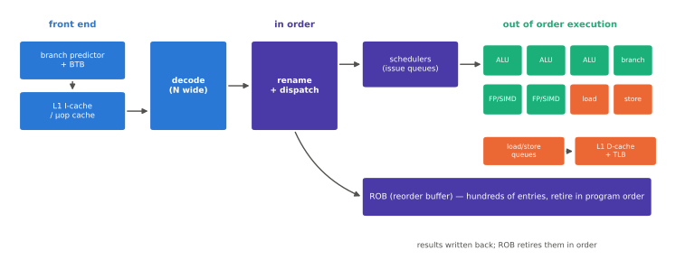

# 코어 마이크로아키텍처

!!! spec "규격 · 세대"
    마이크로아키텍처는 회사별 설계(표준 없음) · 공개 출처: Arm 코어 발표 자료·기술 참조 설명서, 학회 발표(Hot Chips 등), 독립 분석의 마이크로벤치마크와 다이 사진 분석
    이 페이지의 수치는 **공개 분석 기준 대표 범위**이며, 특정 칩의 값은 [칩셋 세대 인덱스](../reference/chipset-index.md)에 출처와 함께 적습니다.

!!! basic "한눈에 보기"
    같은 Arm 명령어를 실행하는 코어라도 내부 구조는 완전히 다릅니다. 고성능 코어의 내부는 크게 세 부분입니다.

    1. **프런트엔드** — 다음에 실행할 명령을 예측해 가져오고(분기 예측, 명령 캐시), 해석합니다(디코드).
    2. **실행 엔진** — 명령의 순서를 바꿔 준비된 것부터 실행합니다(비순차 실행, 여러 실행 유닛).
    3. **메모리 서브시스템** — 데이터를 캐시에서 읽고 씁니다(로드·스토어 유닛, L1·L2, 프리페처).

    고성능 코어 설계의 역사는 "한 사이클에 더 많은 명령을 처리하도록 **더 넓게**, 메모리 지연을 숨기도록 **더 깊게**" 만들어 온 역사입니다.

## 코어의 주요 구조 { .l2 }

| 구조 | 하는 일 | 크면 좋은 점 | 대가 |
|---|---|---|---|
| 분기 예측기 | 분기의 방향과 목표를 예측 | 예측 실패 감소 | 면적, 예측 지연 |
| BTB | 분기 목표 주소 캐시 | 큰 코드에서도 빠른 페치 | 면적 |
| L1 명령 캐시 / µop 캐시 | 명령 또는 해석된 연산 저장 | 디코드 전력·지연 절감 | 면적 |
| 디코드 폭 | 사이클당 해석하는 명령 수 | 높은 IPC 상한 | 디코더 복잡도 |
| 리네임·디스패치 폭 | 사이클당 실행 엔진에 넣는 연산 수 | 높은 IPC 상한 | 전력, 타이밍 |
| ROB (재정렬 버퍼) | 실행 중인 명령을 원래 순서로 추적 | 긴 메모리 지연 동안 더 많은 독립 명령 실행 | 면적, 전력 |
| 실행 유닛 | 정수 ALU, 분기, 로드·스토어, FP/SIMD | 병렬 실행 | 면적, 레지스터 파일 포트 증가 |
| 로드·스토어 큐 | 진행 중인 메모리 접근 추적 | 메모리 수준 병렬성 | 면적, 검색 전력 |
| L1 데이터 캐시·TLB | 데이터와 주소 변환 캐시 | 적중률 | 지연(크면 느려짐) |
| 프리페처 | 접근 패턴을 학습해 미리 가져옴 | 메모리 지연 숨김 | 잘못되면 대역폭·전력 낭비 |

## 넓어진 코어 { .l2 }

공개 자료로 보면 모바일 고성능 코어는 지난 10년 동안 다음 방향으로 바뀌었습니다.

| 항목 | 2010년대 중반 고성능 코어 | 최근 고성능 코어 |
|---|---|---|
| 디코드 폭 | 3–4개 | 8–10개 수준 (예: Apple M1 세대 성능 코어 8개로 분석됨) |
| ROB 크기 | 수십~100여 항목 | 수백 항목 이상 |
| L1 데이터 캐시 | 32 KB 안팎 | 64 KB 이상, 자체 코어는 128 KB급도 있음 |
| L2 | 수백 KB 공유 | 코어당 MB급 또는 클러스터 공유 10 MB 이상 |
| 정수 ALU | 2–3개 | 6–8개 수준 |

> 각 수치는 공개 분석 기준의 대표 범위이며, 코어마다 크게 다릅니다.

??? expert "전문가 노트 — 왜 넓게 가나, 분기 예측과 메모리 병렬성, 추정의 함정"
    **왜 넓게 가나.** 같은 성능을 클럭으로 얻으려면 전압이 올라가 \(V^2\) 효과로 전력이 급증합니다. 반면 폭을 넓히면 면적은 늘지만 낮은 클럭·전압에서 같은 성능을 낼 수 있습니다. 공정 미세화로 트랜지스터는 남는데 전력 예산은 고정된 모바일 환경에서는, "넓고 느린" 코어가 에너지 효율에 유리한 방향이었습니다. 다만 폭을 넓힐수록 실제로 채울 독립 명령이 부족해 수익이 줄어들기 때문에(체감 수확), 분기 예측·메모리 병렬성이 함께 좋아져야 넓은 코어가 의미를 가집니다.

    **분기 예측이 폭을 정한다.** 사이클당 8개 명령을 가져오려면 평균적으로 몇 명령마다 나오는 분기를 매 사이클 여러 개 예측해야 합니다. 현대 예측기는 TAGE 계열처럼 여러 길이의 분기 이력을 쓰는 구조와, 간접 분기·반환 주소 예측기를 함께 씁니다. 예측 실패 한 번에 넓은 코어는 수십 개 명령의 작업을 버리므로, 예측 정확도 0.1%p가 성능에 의미 있는 차이를 냅니다.

    **메모리 수준 병렬성(MLP).** DRAM 접근 수백 사이클을 숨기는 방법은 그동안 다른 독립 명령을 실행하고, 여러 캐시 미스를 **동시에** 진행하는 것입니다. 큰 ROB, 많은 미스 처리 버퍼(MSHR/fill buffer), 강력한 프리페처가 모두 이 목적입니다. 그래서 ROB 크기만 키워서는 안 되고, 로드·스토어 큐와 L1·L2의 동시 미스 처리 능력이 함께 커져야 합니다.

    **추정의 함정.** 자체 코어의 ROB 크기·디코드 폭 같은 수치는 대부분 마이크로벤치마크로 **간접 추정**한 값입니다. 측정 방법(어떤 명령 조합으로 채웠는지)에 따라 값이 다르게 나올 수 있고, 회사가 발표한 값과 정의가 다를 수 있습니다. 이 책은 그런 수치를 "분석 기준 추정"으로 표시하고, 칩 비교의 주된 근거로는 같은 조건의 성능/W 측정을 씁니다.

## 코어 종류별 비교

| 항목 | 최고 성능 코어 | 균형 코어 | 고효율 코어 |
|---|---|---|---|
| 실행 방식 | 넓은 비순차 | 중간 폭 비순차 | 순차 (또는 좁은 비순차) |
| 디코드 폭 | 매우 넓음 | 중간 | 좁음 (2–3) |
| ROB | 매우 큼 | 중간 | 없음 또는 작음 |
| 면적 (상대) | 가장 큼 | 중간 | 가장 작음 |
| 최적 영역 | 높은 클럭의 짧은 고부하 | 중간 부하 | 낮은 부하 |

## 관련 페이지
- [컴퓨터 구조 기초](../basics/computer-architecture.md) — 파이프라인과 비순차 실행의 기초
- [자체 설계 코어](custom-cores.md) — 넓은 코어 설계를 이끈 회사들
- [Arm 코어 계보](arm-cores.md) — Arm 코어의 세대 변화
- [메모리 계층](../basics/memory-hierarchy.md) — 코어가 숨겨야 할 메모리 지연
