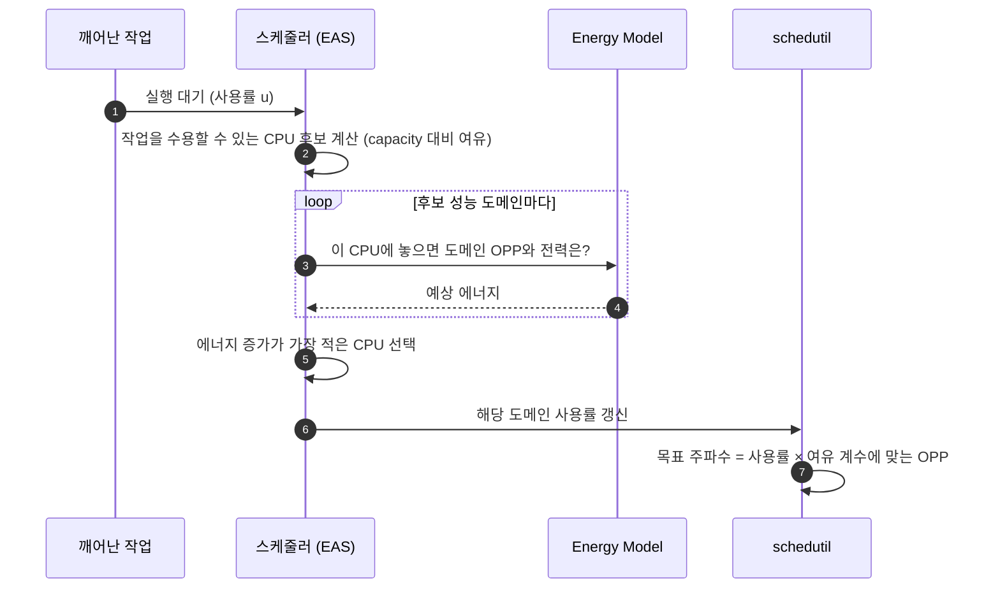
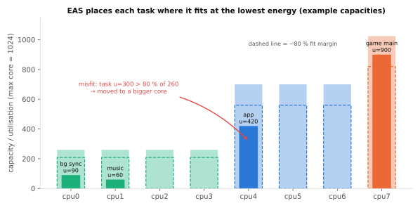

# 스케줄링과 EAS

!!! spec "규격 · 세대"
    Linux 커널 스케줄러(CFS → 6.6부터 **EEVDF**), **EAS**(Energy Aware Scheduling, 5.0에 업스트림 병합), Energy Model 프레임워크, PELT 부하 추적, `schedutil` cpufreq 거버너(4.7), **uclamp**(사용률 클램프, 5.3) · Android 공통 커널(ACK)과 벤더 확장
    클러스터 전환(초기 big.LITTLE) → HMP 스케줄러(벤더 패치) → EAS(업스트림) → EAS + uclamp + 벤더 부하 추적 확장

!!! basic "한눈에 보기"
    이기종 코어는 하드웨어만으로는 쓸모가 없습니다. **"이 작업을 어느 코어에서, 몇 GHz로 돌릴까"**를 매 순간 정하는 운영체제의 판단이 있어야 합니다.

    1. **스케줄러**는 작업(스레드)을 어느 코어에 올릴지 정합니다.
    2. **주파수 거버너**는 각 코어(클러스터)의 클럭을 정합니다.
    3. 둘은 서로의 결정에 영향을 주므로, 현대 Linux는 **에너지 모델**을 바탕으로 둘을 함께 판단합니다(EAS).

    택배 배송에 비유하면, 스케줄러는 "이 짐을 트럭에 실을까 오토바이에 실을까"를 정하고, 거버너는 "이 차를 얼마나 빨리 달리게 할까"를 정합니다. EAS는 "연료비가 가장 적게 드는 조합"을 고르는 배차 담당입니다.

## 구성 요소 { .l2 }

| 구성 요소 | 하는 일 | 확인 위치 |
|---|---|---|
| PELT | 작업과 CPU의 최근 사용률을 지수 가중 평균으로 추적 | 커널 내부 (트레이스로 확인) |
| CPU capacity | 각 코어의 상대 최대 성능 (가장 빠른 코어 = 1024) | `/sys/devices/system/cpu/cpu*/cpu_capacity` |
| Energy Model | 성능 도메인(주파수 도메인)별 OPP의 전력 비용 | `/sys/kernel/debug/energy_model/` (debugfs) |
| EAS | 작업이 깨어날 때 에너지 증가가 가장 적은 CPU 선택 | 스케줄러 내부 |
| `schedutil` | 스케줄러의 사용률 정보로 목표 주파수 결정 | `/sys/devices/system/cpu/cpufreq/policy*/scaling_governor` |
| uclamp | 작업·그룹별 사용률 하한·상한 지정 (예: UI 작업은 최소 성능 보장) | cgroup `cpu.uclamp.min`·`cpu.uclamp.max` |

## EAS의 판단 흐름 { .l2 }

| 상황 | EAS의 동작 |
|---|---|
| 시스템 전체 부하가 낮음 | 에너지 기준으로 작은 코어·낮은 OPP에 배치 |
| 어떤 작업이 작은 코어 용량을 넘김 (misfit) | 더 큰 코어로 이동 |
| 어느 CPU 사용률이 과도 (overutilized) | 에너지 판단을 잠시 끄고 일반 부하 분산으로 전환 |
| 발열로 최대 클럭 제한 | 열 압력(thermal pressure)을 capacity에 반영 |

## Android의 추가 장치 { .l2 }

| 장치 | 역할 |
|---|---|
| 작업 그룹(cgroup) | 앱 상태별로 `top-app`, `foreground`, `background` 등으로 나눔 |
| uclamp 정책 | 화면에 보이는 앱의 UI·렌더링 스레드에 최소 성능 보장, 백그라운드는 상한 제한 |
| CPU 집합(cpuset) | 백그라운드 작업이 큰 코어를 쓰지 못하게 제한 |
| 성능 힌트 API | 앱·게임이 프레임 목표 시간을 알려 주면 시스템이 클럭을 조정 (ADPF) |
| 벤더 확장 | 칩 회사가 커널 벤더 훅으로 부하 추적·배치 정책을 보완 (예: Qualcomm의 WALT 계열) |

??? expert "전문가 노트 — 응답성과 에너지의 줄다리기, 램프업 지연, 측정 방법"
    **램프업 지연.** PELT는 과거 사용률을 지수적으로 평균하므로, 잠자던 작업이 갑자기 무거워지면 사용률이 충분히 오르기까지 시간이 걸립니다. 그동안 작업은 작은 코어·낮은 클럭에 머물러 첫 프레임이 늦어지는 "잰크(jank)"가 생길 수 있습니다. Android가 uclamp로 UI 스레드에 최소 성능을 보장하고, 벤더가 더 빠르게 반응하는 부하 추적을 쓰는 이유입니다. 반대로 너무 빨리 올리면 짧은 스파이크에도 큰 코어·높은 클럭이 켜져 에너지를 낭비합니다.

    **Energy Model의 정확도.** EAS의 판단은 Energy Model 값이 실제 칩의 전력과 맞을 때만 의미가 있습니다. 모델은 보통 OPP별 동적 전력만 담고, 누설 전력·온도·클러스터 공유 전력(L3, DSU)은 근사하거나 빠집니다. 벤더는 실측으로 표를 보정하며, 일부 플랫폼은 펌웨어가 전력 정보를 제공합니다([DVFS와 전력 관리](../power/dvfs.md)).

    **하드웨어 성능 컨트롤러.** Apple 플랫폼은 운영체제의 QoS 등급(사용자 상호작용, 유틸리티, 백그라운드 등)과 하드웨어 성능 컨트롤러가 협력해 코어와 클럭을 고르는 것으로 알려져 있습니다. PC 쪽에서는 Intel Thread Director처럼 하드웨어가 작업 특성을 운영체제에 힌트로 주는 방식도 있습니다. Android도 펌웨어 위임과 하드웨어 피드백(AMU 카운터 기반 주파수 불변 부하 계산 등)을 점점 더 활용합니다.

    **측정 방법.** Perfetto로 `sched`·`cpufreq`·`power` 트레이스를 함께 기록하면 작업이 어느 CPU에서 몇 MHz로 돌았는지 시간축으로 볼 수 있습니다. 앱 성능 문제를 볼 때는 ① 주 스레드가 작은 코어에 머문 구간, ② 큰 코어에 있었지만 낮은 클럭이었던 구간, ③ 실행 대기(runnable)로 밀린 구간을 구분하는 것이 출발점입니다([성능 분석 도구](../software/profiling.md)).

## 칩셋 비교

| 항목 | Android (Snapdragon·Exynos·Dimensity·Tensor) | Apple |
|---|---|---|
| 스케줄러 | Linux EEVDF/CFS + EAS + 벤더 확장 | 자체 커널(XNU) 스케줄러 |
| 작업 중요도 표현 | cgroup + uclamp + 성능 힌트 API | QoS 등급 |
| 주파수 결정 | `schedutil` 등 거버너 → 펌웨어 | 하드웨어·펌웨어 성능 컨트롤러 비중 큼 |
| 공개 정보 | 커널 소스 공개 | 개발자 문서·분석 위주 |

## 관련 페이지
- [이기종 클러스터](clusters.md) — 스케줄러가 다루는 하드웨어
- [DVFS와 전력 관리](../power/dvfs.md) — OPP와 거버너
- [열 관리와 스로틀링](../power/thermal.md) — 열 압력과 capacity
- [성능 분석 도구](../software/profiling.md) — Perfetto로 스케줄링 보기
