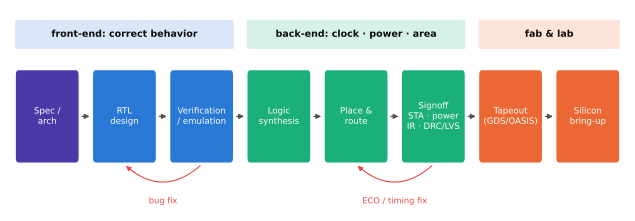
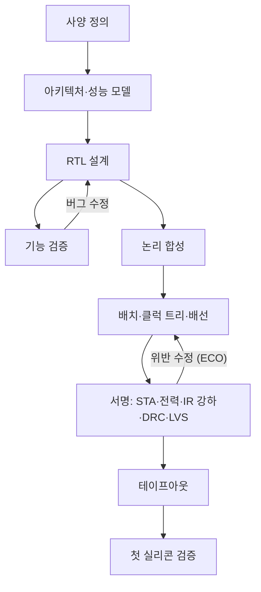

# SoC 설계 흐름

!!! spec "규격 · 세대"
    하드웨어 기술 언어: Verilog(IEEE 1364) → **SystemVerilog**(IEEE 1800) · VHDL(IEEE 1076) · 전원 의도: **UPF**(IEEE 1801) · 타이밍 제약: SDC(Synopsys Design Constraints, 업계 사실상 표준) · 레이아웃 데이터: GDSII → OASIS(SEMI P39)
    손으로 그린 회로도와 레이아웃 → RTL과 논리 합성(1990년대 주류) → 자동 배치·배선과 정적 타이밍 분석 → 전원 의도 기술(UPF)·다중 코너 서명 → 머신러닝 기반 설계 공간 탐색(2020년대 EDA 도구에 도입)

!!! basic "한눈에 보기"
    SoC 설계는 "무엇을 만들지"에서 시작해 "공장에 넘길 도면"으로 끝나는 긴 변환 과정입니다. 각 단계는 앞 단계의 결과를 더 구체적인 형태로 바꿉니다.

    1. **사양과 아키텍처** — 어떤 코어를 몇 개 넣고, 메모리 대역폭은 얼마이며, 전력 목표는 몇 W인지 정합니다.
    2. **RTL 설계** — 회로의 동작을 코드(하드웨어 기술 언어)로 씁니다. 소프트웨어 소스 코드에 해당합니다.
    3. **합성과 물리 설계** — 코드를 실제 트랜지스터 셀의 연결로 바꾸고, 다이 위 어디에 놓고 어떻게 배선할지 정합니다.
    4. **서명(signoff)과 테이프아웃** — 속도·전력·전압 강하·제조 규칙을 모두 만족하는지 최종 확인한 뒤 파운드리에 도면을 넘깁니다.

    요리에 비유하면 메뉴를 정하고(사양), 레시피를 쓰고(RTL), 재료를 손질해 냄비에 담고(합성·배치·배선), 손님상에 내기 전에 간을 보는(서명) 과정입니다.

## 전체 흐름 { .l2 }

그림의 빨간 화살표는 검증에서 RTL로, 서명에서 배치·배선으로 되돌아가는 반복 고리를 나타냅니다.

| 단계 | 입력 → 출력 | 핵심 확인 항목 |
|---|---|---|
| 사양·아키텍처 | 제품 요구 → 블록 구성, 성능·전력·면적 예산 | 성능 모델(사이클 근사 시뮬레이터)로 목표 달성 가능성 |
| RTL 설계 | 블록 사양 → SystemVerilog 코드 | 기능 정확성, 코딩 규칙(lint), 클럭 도메인 교차(CDC) |
| 논리 합성 | RTL + 셀 라이브러리 + 타이밍 제약 → 게이트 넷리스트 | 타이밍·면적, RTL과 넷리스트의 논리 등가성(LEC) |
| 배치·배선 (P&R) | 넷리스트 → 레이아웃 | 혼잡도, 클럭 스큐, 타이밍 수렴 |
| 서명 | 레이아웃 → 최종 확인 보고 | STA(모든 공정·전압·온도 코너), 전력, IR 강하·전자 이동, DRC·LVS |
| 테이프아웃 | GDSII/OASIS → 파운드리 마스크 제작 | 파운드리 데이터 검사 |

## 프론트엔드와 백엔드 { .l2 }

업계에서는 RTL까지를 **프론트엔드**, 합성 이후 레이아웃까지를 **백엔드(물리 설계)**라고 부릅니다. 프론트엔드는 "무엇이 맞는 동작인가", 백엔드는 "그 동작을 목표 클럭·전력·면적 안에 어떻게 넣는가"를 다룹니다. CPU 코어처럼 클럭이 높고 면적에 민감한 블록은 백엔드 팀이 프론트엔드와 함께 반복하며 수렴시키고, 주변 블록은 비교적 자동화된 흐름으로 처리합니다.

| 도구 영역 | Synopsys | Cadence | Siemens EDA |
|---|---|---|---|
| 합성·P&R | Fusion Compiler 계열 | Genus·Innovus 계열 | Aprisa 계열 |
| 정적 타이밍 분석 | PrimeTime | Tempus | — |
| 시뮬레이션 | VCS | Xcelium | Questa |
| 물리 검증 (DRC·LVS) | IC Validator | Pegasus | Calibre |

EDA 시장은 이 세 회사가 대부분을 차지하며, 첨단 공정에서는 파운드리가 도구별 인증(reference flow)을 제공합니다. 전력·열·IR 분석 분야의 강자였던 Ansys는 2025년 7월 Synopsys의 인수가 완료되었습니다.

일정은 회사와 칩마다 다르지만, 플래그십 SoC는 아키텍처 정의부터 양산까지 대략 2–3년이 걸리고 여러 세대 프로젝트가 겹쳐 진행되는 것으로 알려져 있습니다(추정). 테이프아웃 뒤 첫 실리콘이 돌아오기까지는 첨단 공정에서 수 개월이 걸리므로, 그 사이에 소프트웨어 준비와 다음 수정판(metal fix) 계획을 함께 진행합니다.

??? expert "전문가 노트 — 타이밍 수렴, 다중 코너 서명, ECO와 metal fix, ML 기반 최적화"
    **타이밍 수렴.** 미세 공정에서는 셀 지연보다 배선 지연과 배선 저항의 비중이 커져, 합성 단계의 타이밍 예측이 레이아웃 후 결과와 크게 어긋날 수 있습니다. 그래서 합성에 물리 정보를 미리 넣는 물리 인식 합성이 표준이 되었고, CPU 코어처럼 중요한 블록은 데이터 경로를 손으로 배치하거나 맞춤 셀을 쓰기도 합니다. 목표 클럭을 몇 % 올리는 데 면적과 전력이 비선형으로 늘어나는 구간이 있어, 최종 클럭은 이 곡선을 보고 정합니다([성능·전력·면적 (PPA)](../basics/ppa.md)).

    **다중 코너 서명.** STA는 공정 편차(빠른·느린 트랜지스터), 전압, 온도의 조합 코너마다 setup·hold를 확인합니다. 칩 안 위치에 따른 편차(OCV)를 통계적으로 반영하는 방식(AOCV·POCV 등)과, DVFS의 여러 동작점(OPP)마다 별도 모드를 두는 다중 모드·다중 코너(MMMC) 분석이 기본입니다. 동작점이 많을수록 서명 조합이 폭발적으로 늘어 컴퓨팅 자원이 큰 비용이 됩니다([DVFS와 전력 관리](../power/dvfs.md)).

    **ECO와 metal fix.** 서명 막바지나 테이프아웃 뒤에 발견한 문제는 전체를 다시 합성하지 않고 넷리스트·레이아웃을 국소 수정(ECO)해 고칩니다. 설계 단계에서 빈 자리에 예비 셀(spare cell)을 뿌려 두면, 첫 실리콘 이후 버그를 트랜지스터 층은 그대로 두고 **금속 배선 마스크 몇 장만 바꿔** 고칠 수 있습니다. 마스크 전체를 새로 만드는 것보다 비용과 시간이 훨씬 적게 들어, 양산 칩의 "B0·B1" 같은 리비전 이름은 이런 수정판을 뜻하는 경우가 많습니다.

    **ML 기반 최적화.** 주요 EDA 회사는 2020년대부터 강화 학습 등으로 합성·P&R 옵션 조합을 자동 탐색하는 기능을 내놓았습니다. 사람이 며칠씩 걸려 조정하던 도구 설정을 자동화해 PPA를 일부 개선했다는 사례 발표가 있지만, 개선 폭은 블록과 기준에 따라 다르므로 회사 발표 수치를 일반화하기는 어렵습니다.

## 칩셋 비교

| 항목 | Qualcomm·MediaTek·삼성 LSI | Apple | Google Tensor |
|---|---|---|---|
| 설계 범위 | 자체 블록 + 라이선스 IP, 전 과정 사내 수행 | 대부분 블록 자체 설계, 전 과정 사내 수행 | 자체 블록(TPU 등) + 라이선스 IP, 초기 세대는 삼성 LSI와 협력 |
| 물리 설계 | 사내 백엔드 팀 + 일부 외주 | 사내 | 사내 + 협력사 (세대마다 다름, 보도 기준) |
| 주력 EDA | 공개되지 않음 (세 회사 도구 혼용이 일반적) | 공개되지 않음 | 공개되지 않음 |

> 세대별 공정과 테이프아웃 시점은 [칩셋 세대 인덱스](../reference/chipset-index.md)에 모읍니다.

## 관련 페이지
- [IP와 통합](ip-integration.md) — RTL 단계에서 수십 개 IP를 엮는 방법
- [검증과 에뮬레이션](verification.md) — 흐름의 각 단계에서 버그를 찾는 방법
- [성능·전력·면적 (PPA)](../basics/ppa.md) — 설계 흐름이 최적화하는 목표
- [클럭과 전압](../basics/clock-voltage.md) — 타이밍 서명의 기초가 되는 클럭·전압 관계
- [파워 도메인과 게이팅](../power/power-domains.md) — UPF로 기술하는 전원 구획
