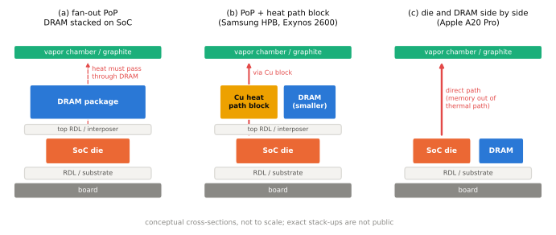
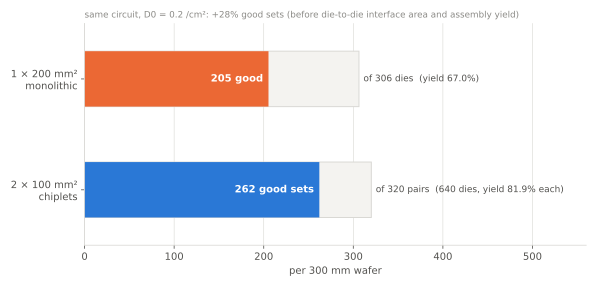

# 패키징

!!! spec "규격 · 세대"
    패키지 외형: JEDEC 패키지 외형 규격(JEP95 계열) · 다이 간 연결: **UCIe**(Universal Chiplet Interconnect Express, 1.0 2022 → 1.1 2023 → 2.0 2024 → 3.0 2025), Open Compute BoW 등 · 회사별 기술: TSMC InFO·CoWoS·SoIC, 삼성 I-Cube·X-Cube·FOPLP, Intel EMIB·Foveros
    와이어 본딩 → **플립칩**(범프로 다이를 뒤집어 연결) → 팬아웃 웨이퍼 레벨 패키지 PoP(TSMC InFO-PoP, 2016년 Apple A10부터) → 방열 블록을 넣은 팬아웃 PoP(삼성 HPB, Exynos 2600) → 다이와 DRAM을 나란히 놓는 모바일 패키지(Apple A20 Pro, 2026) · PC·서버의 칩렛과 2.5D·3D 적층 → 모바일 SoC로의 확대(논의·도입 초기)

!!! basic "한눈에 보기"
    웨이퍼에서 잘라 낸 다이는 머리카락보다 얇은 배선 끝이 드러난 실리콘 조각일 뿐이라, 그대로는 보드에 붙일 수 없습니다. **패키지**는 다이를 보호하고, 미세한 다이의 연결점을 보드가 다룰 수 있는 크기의 솔더볼로 넓혀 주며, 열을 빼내는 길을 만듭니다.

    1. **플립칩** — 다이를 뒤집어 표면의 작은 범프로 기판에 바로 붙입니다. 배선이 짧고 연결점을 다이 전체 면에 둘 수 있습니다.
    2. **팬아웃** — 두꺼운 기판 대신 얇은 재배선층으로 다이 바깥까지 배선을 펼쳐 패키지를 얇게 만듭니다.
    3. **칩렛·적층** — 큰 칩 하나 대신 여러 개의 작은 다이를 옆에 나란히 놓거나(2.5D) 위로 쌓아(3D) 한 패키지로 묶습니다.

    이삿짐에 비유하면, 깨지기 쉬운 물건(다이)을 상자(패키지)에 넣고 손잡이(솔더볼)를 달아 옮기기 쉽게 만드는 일입니다. 칩렛은 큰 가구를 분해해 여러 상자에 나눠 담는 방식입니다.

## 패키지 형태 { .l2 }

| 형태 | 구조 | 장점 | 단점 | 주 사용처 |
|---|---|---|---|---|
| **FCBGA** | 플립칩 + 다층 유기 기판 + 볼 배열 | 핀 수·전력 공급 여유 큼 | 크고 두꺼움 | PC·서버, 노트북용 SoC |
| **FCCSP** | 플립칩 + 다이와 비슷한 크기의 얇은 기판 | 작고 얇음 | 핀 수·배선층 제한 | 스마트폰 AP, 모뎀, 중소형 칩 |
| **팬아웃 (InFO 등)** | 기판 없이 재배선층(RDL)으로 연결을 펼침 | 매우 얇음, 짧은 전기 경로, 열 특성 개선 | 공정 비용, 생산 능력 제약 | 플래그십 스마트폰 SoC |
| **PoP** | SoC 패키지 위에 DRAM 패키지 적층 | 보드 면적 절약, 짧은 DRAM 배선 | 방열 불리, 높이 | 대부분의 스마트폰 SoC |

PoP 구조와 열 경로는 [패키지와 PoP](../memory/packaging.md)에서 자세히 다루므로, 여기서는 SoC 쪽 관점만 정리합니다. SoC 패키지는 아래로는 보드와 연결하는 볼을, 위로는 DRAM 패키지를 받는 볼 패드를 동시에 가져야 하므로, 패키지 배선층 수와 볼 피치가 LPDDR 최대 속도와 전원 공급 품질을 함께 결정합니다. 삼성은 Exynos 2400에서 열 특성 개선을 위해 FOWLP를 적용했다고 발표했습니다(발표 기준).

## 모바일 패키지의 방열 경쟁 { .l2 }

2nm 세대에 들어서며 스마트폰 SoC의 성능 경쟁은 "얼마나 빠른가"보다 "얼마나 오래 버티는가"로 옮겨 가고 있고, 그 병목으로 **패키지의 열 경로**가 주목받고 있습니다. PoP는 DRAM이 SoC 바로 위를 덮고 있어, 다이의 열이 DRAM 패키지를 지나야 기기의 방열 부품에 닿습니다([패키지와 PoP](../memory/packaging.md)). 2025–2026년 플래그십은 이 문제를 서로 다른 방식으로 풀기 시작했습니다.

| 방식 | 구조 | 열 경로 | 사례 (발표·보도 기준) |
|---|---|---|---|
| 기판 기반 PoP (인터포저 PoP) | 유기 기판 위 SoC, 그 위에 인터포저를 두고 DRAM 패키지 적층 | DRAM을 통과 | Snapdragon 8 Elite Gen 5는 유기 기판 기반 iPoP이며 팬아웃을 쓰지 않음(TechInsights 분석) |
| 팬아웃 PoP | 기판 대신 재배선층(RDL)으로 배선을 펼침, DRAM은 그대로 위에 적층 | DRAM을 통과하지만 패키지가 얇고 열 저항이 낮음 | Apple A10–A19 계열(TSMC InFO-PoP), Exynos 2400·2500, Google Tensor |
| 오프셋 PoP | DRAM은 위에 두되 CPU·GPU 같은 발열 블록을 덜 뜨거운 쪽으로 옮겨 배치 | 발열 지점을 분산 | Snapdragon 8 Elite Gen 6 계열(보도 기준) |
| 방열 블록 내장 PoP (**HPB**) | AP 다이 위에 구리 방열 블록을 넣고, DRAM 패키지는 작게 줄여 옆으로 옮김. 열전도가 높은 몰딩 소재(High-κ EMC) 사용 | 구리 블록을 거쳐 바로 위로 | 삼성 Exynos 2600 (Heat Path Block). Exynos 2500 대비 열 저항 최대 16% 감소(삼성 발표 기준) |
| 다이·DRAM 나란히 배치 | SoC 다이와 DRAM을 한 웨이퍼 레벨 패키지 안에 옆으로 배치 | 메모리가 열 경로에서 빠지고, 칩이 베이퍼 챔버에 바로 닿음 | Apple A20 Pro (iPhone 18 Pro, 2026년 9월, Apple 발표). 업계에서는 TSMC WMCM(Wafer-level Multi-Chip Module)으로 부름(TechInsights 분해 분석) |

Apple은 A20 Pro의 패키지를 "M 시리즈에서 가져온 맞춤 패키지"라고 소개하며, 다이와 메모리를 나란히 놓아 **메모리를 열 경로에서 뺐고**, 칩이 새 베이퍼 챔버에 직접 닿게 했다고 밝혔습니다. 베이퍼 챔버는 새 소재를 쓰고 표면적이 iPhone 17 Pro의 3배이며, 지속 성능이 이전 세대보다 최대 40% 높다고 발표했습니다(Apple 발표 기준). 분해 분석 초기 보도로는 LPDDR5X 96비트 인터페이스를 쓰고, 다이 면적은 약 98 mm²로 A19 Pro와 거의 같습니다(보도 기준).

세 방식의 대가는 서로 다릅니다.
- **HPB**는 기존 PoP 생산 흐름을 크게 바꾸지 않고 열 경로만 바꿉니다. 대신 DRAM 패키지가 작아져야 해서 용량·공급처 선택에 제약이 생깁니다.
- **나란히 배치**는 열에는 가장 유리하지만, 패키지 면적이 넓어지고 DRAM이 패키지 공정 안으로 들어옵니다. 그래서 DRAM 공급 일정이 곧 SoC 패키지 일정이 됩니다.
- **오프셋 PoP**는 구조 변경이 가장 적은 대신 효과도 제한적입니다.

Qualcomm이 이후 세대에서 HPB나 DRAM 옆 배치를 쓴다는 보도도 있으나 공식 확인은 없습니다(이 페이지 기준 시점).

## 다음 세대 기판과 부품 { .l2 }

| 기술 | 내용 | 상황 (보도 기준) |
|---|---|---|
| 패널 레벨 패키지 (FOPLP, TSMC CoPoS) | 둥근 웨이퍼 대신 큰 사각 패널 위에서 팬아웃 패키지를 만들어 면적 효율을 높임 | 삼성 FOPLP는 일부 제품에 사용, TSMC CoPoS는 개발 중. 주로 대형 AI 칩 패키지를 겨냥 |
| 유리 기판 (glass core) | 유기 기판의 코어를 유리로 바꿔 휨이 적고 미세 배선·관통 비아(TGV)를 촘촘히 만듦 | Intel 등이 샘플을 공개, 양산은 서버·AI 칩부터로 전망 |
| 실리콘 커패시터 | 패키지 아래나 기판 속에 넣는 딥 트렌치 커패시터. MLCC보다 얇고 기생 인덕턴스(ESL)가 작아 순간 전압 강하를 줄임 | 모바일 SoC 전원 공급용으로 제안·적용 확대 중 |

이 기술들은 서버·AI 칩에서 먼저 쓰이고 있으며, 모바일 SoC에는 비용과 두께가 맞아떨어지는 시점에 들어올 것으로 보입니다.

## 칩렛과 2.5D·3D { .l2 }

| 방식 | 연결 | 예 (회사 기술) | 특징 |
|---|---|---|---|
| 기판 위 멀티칩 | 유기 기판 배선 | 일반 MCM | 저렴, 다이 간 대역폭 낮음 |
| 2.5D (인터포저·브리지) | 실리콘 인터포저 또는 기판 속 실리콘 브리지 | TSMC CoWoS, 삼성 I-Cube, Intel EMIB | 다이 간 고밀도 배선, 서버 GPU·HBM에 사용 |
| 3D 적층 | TSV·하이브리드 본딩으로 다이를 수직 연결 | TSMC SoIC, 삼성 X-Cube, Intel Foveros | 가장 짧은 연결, 열 관리가 어려움 |

칩렛의 경제적 이유는 수율입니다. 가정으로 결함 밀도 0.2 /cm²에서 200 mm² 단일 다이는 웨이퍼당 약 306개 중 수율 약 67.0%로 양품 약 205개가 나옵니다. 같은 회로를 100 mm² 다이 둘로 나누면 웨이퍼당 약 640개 중 수율 약 81.9%로 양품 약 524개, 즉 **두 개 한 쌍 기준 약 262세트**가 됩니다. 실제로는 다이 간 인터페이스 면적, 조립 수율, 패키지 비용이 더해지므로 이 이득이 모두 남지는 않습니다. (가정값이며, 수치는 `tools/soc_numbers.py`에서 계산)

??? expert "전문가 노트 — UCIe와 다이 간 인터페이스, 모바일에 칩렛이 늦은 이유, 전원·열·응력"
    **UCIe와 다이 간 인터페이스.** 칩렛을 서로 다른 회사·공정의 다이로 섞으려면 물리 계층부터 프로토콜까지 공통 규격이 필요합니다. UCIe는 표준 패키지(유기 기판)와 고급 패키지(인터포저·브리지)용 물리 계층을 따로 정의하고, 위에 PCIe·CXL 또는 사용자 정의 스트리밍 프로토콜을 얹습니다. 다이 간 인터페이스는 비트당 에너지와 단위 길이당 대역폭(밀도)이 핵심 지표이며, 단일 다이 안 배선보다는 항상 비싸므로 블록을 어디서 나눌지가 설계의 핵심 결정이 됩니다.

    **모바일에 칩렛이 늦은 이유.** 스마트폰 SoC는 다이가 상대적으로 작아 수율 이득이 서버만큼 크지 않고, 다이 간 인터페이스 전력과 패키지 두께·면적 증가가 그대로 단점이 됩니다. 반대로 노트북·태블릿용 대형 Arm SoC나 차량용 SoC에서는 칩렛 도입이 먼저 논의·진행되고 있으며([Arm PC와 노트북 SoC](../next/arm-pc.md), [차량용 SoC](../next/automotive.md)), 모바일에서는 공정이 다른 블록(아날로그·I/O)을 분리하는 방향이 거론됩니다(논의 중).

    **전원·열·응력.** 패키지는 순간 전류 변화에 따른 전압 강하를 줄이기 위해 기판 속 디커플링 커패시터나 실리콘 커패시터를 넣기도 합니다. 3D 적층은 아래 다이의 열이 위 다이를 지나야 하므로 발열 블록 배치에 제약이 생기고, 서로 다른 재료의 열팽창 차이로 생기는 휨(warpage)과 범프 응력은 얇은 모바일 패키지에서 특히 신뢰성 문제가 됩니다.

    **OSAT와 파운드리.** 전통적인 패키징·시험은 ASE·Amkor 같은 OSAT가 맡았지만, 팬아웃·2.5D·3D 같은 고급 패키징은 파운드리가 직접 제공하는 비중이 커졌습니다. 그 결과 공정·패키지·생산 능력이 한 묶음으로 결정되는 경우가 많아졌습니다([파운드리와 공정](foundry.md)).

## 칩셋 비교

| 항목 | 스마트폰 플래그십 SoC | 노트북용 Arm SoC | 서버·AI 가속기 |
|---|---|---|---|
| 일반적 패키지 | FCCSP 또는 팬아웃 + PoP | FCBGA, 메모리 온 패키지 | FCBGA + 2.5D·3D |
| 칩렛 | 드묾 (도입 초기·논의 중) | 일부 제품에서 사용·논의 | 일반적 |
| 방열 중심 변화 | PoP 열 경로 개선 (HPB, DRAM 옆 배치) | 메모리 옆 배치가 기본 | 패키지 덮개·액체 냉각 |
| 우선순위 | 두께·면적·열 | 메모리 대역폭·전력 공급 | 다이 간 대역폭·HBM |

> 세대별 SoC의 패키지 정보는 공개된 경우 [칩셋 세대 인덱스](../reference/chipset-index.md)에 모읍니다.

## 출처

- 삼성 Exynos 2600 HPB(열 저항 최대 16% 감소, High-κ EMC) — 삼성 발표, SamMobile 정리 <https://www.sammobile.com/news/will-exynos-2600-solve-exynos-cooling-issues/>
- Exynos 2600 FO-WLP PoP와 HPB 구조 — TechInsights <https://techinsights.com/blog/samsung-exynos-2600-mobile-soc-pop-fo-wlp-and-heat-path-block-packaging-technology-advanced>
- Snapdragon 8 Elite Gen 5 iPoP — TechInsights <https://techinsights.com/ko/node/61037>
- Snapdragon 8 Elite Gen 6 오프셋 PoP — Android Headlines <https://www.androidheadlines.com/2026/09/snapdragon-8-elite-gen-6-is-getting-a-key-thermal-upgrade-and-its-about-time.html>
- Apple A20 Pro 패키지·베이퍼 챔버 — Apple Newsroom (2026-09) <https://www.apple.com/newsroom/2026/09/apple-debuts-iphone-18-pro-and-iphone-18-pro-max/>
- A20 Pro WMCM·LPDDR5X 96비트·다이 면적 — TechInsights 분해 분석 보도 <https://www.techtimes.com/articles/327936/20260923/techinsights-teardown-confirms-tsmc-2nm-nanosheet-transistors-now-inside-iphone-18-pro.htm>
- 실리콘 커패시터 — Electronic Design <https://www.electronicdesign.com/technologies/power/article/55132623/empower-semiconductor-silicon-capacitors-the-future-of-mobile-soc-power-delivery>

## 관련 페이지
- [패키지와 PoP](../memory/packaging.md) — DRAM 적층 구조와 열 경로
- [파운드리와 공정](foundry.md) — 패키지와 함께 묶이는 공정 선택
- [열 관리와 스로틀링](../power/thermal.md) — 패키지 열 저항이 정하는 지속 성능
- [Arm PC와 노트북 SoC](../next/arm-pc.md) — 대형 SoC의 패키지 선택
- [시험과 양산](test.md) — 패키지 전후의 시험 단계
