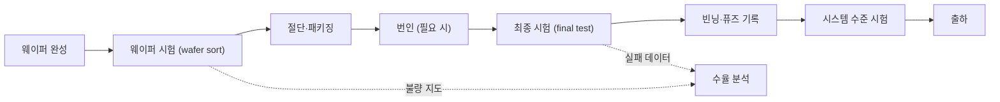

# 시험과 양산

!!! spec "규격 · 세대"
    테스트 접근: **JTAG**(IEEE 1149.1) · 코어 테스트 래퍼(IEEE 1500) · 내부 계측 접근 IJTAG(IEEE 1687) · 신뢰성 인증: JEDEC JESD47(스트레스 시험 기반 인증), JESD22 시험 방법 계열 · 차량용: AEC-Q100
    기능 패턴 위주 시험 → 스캔 설계와 자동 패턴 생성(ATPG) → 스캔 압축·메모리 BIST 보편화 → 칩 안 센서·모니터 데이터를 양산과 현장 수명 관리에 쓰는 **실리콘 수명 관리**(2020년대 확산)

!!! basic "한눈에 보기"
    설계가 완벽해도 공장에서 만든 칩 가운데 일부는 먼지나 공정 편차 때문에 불량입니다. **시험**은 이 불량을 출하 전에 걸러 내고, 정상 칩도 성능에 따라 등급을 나누는 과정입니다.

    1. **시험이 쉬운 설계(DFT)** — 칩 안의 모든 레지스터를 줄줄이 이어(스캔 체인) 밖에서 값을 넣고 읽을 수 있게 만듭니다.
    2. **웨이퍼 시험** — 자르기 전 웨이퍼 상태에서 바늘(프로브)을 대고 불량 다이를 표시합니다.
    3. **패키지 시험** — 포장한 뒤 실제 속도와 온도에서 다시 시험합니다.
    4. **등급 나누기(빈닝)** — 같은 칩이라도 더 빠르게 도는 칩, 전력이 적은 칩을 골라 다른 등급으로 출하합니다.

    과일 선별장에 비유하면, 상한 과일을 골라내고(불량 선별) 크기와 당도에 따라 특·상·중으로 나누는(빈닝) 과정입니다.

## 시험 흐름 { .l2 }

| 단계 | 하는 일 | 주로 잡는 것 |
|---|---|---|
| 웨이퍼 시험 | 프로브 카드로 다이별 스캔·MBIST·전류 시험 | 제조 결함, 비싼 패키징 전에 불량 제거 |
| 번인 | 높은 온도·전압에서 일정 시간 동작시켜 초기 불량을 미리 드러냄 | 초기 수명 불량 (적용 여부·시간은 제품 정책) |
| 최종 시험 | 패키지 상태에서 속도·전압·온도 조건별 시험 | 패키징 결함, 속도 한계 |
| 시스템 수준 시험 (SLT) | 실제 보드에서 OS·부하 프로그램 실행 | 스캔으로 잡기 어려운 경계 결함 |

## DFT의 구성 요소 { .l2 }

| 기법 | 내용 |
|---|---|
| **스캔 체인** | 플립플롭을 시험 모드에서 시프트 레지스터로 연결해 내부 상태를 직접 쓰고 읽음 |
| **ATPG** | 고착 결함(stuck-at), 지연 결함(transition) 모델로 시험 패턴을 자동 생성 |
| 스캔 압축 | 칩 안 압축·해제 회로로 패턴 데이터와 시험 시간을 크게 줄임 |
| **MBIST** | 칩 안 회로가 SRAM에 패턴을 쓰고 읽어 스스로 시험, 불량 행·열을 예비로 교체(리페어) |
| 로직 BIST | 무작위 패턴 생성기와 결과 압축기로 로직을 자체 시험 (차량용에서 현장 시험에 활용) |
| JTAG·IJTAG | 시험·디버그 회로에 접근하는 표준 경로 |

DFT 회로는 칩 면적과 설계 일정을 일부 차지하지만, 이것이 없으면 수십억 개 트랜지스터의 결함을 합리적인 시간 안에 찾을 방법이 없습니다. 시험 시간은 장비 사용 시간으로 곧 비용이 되므로, 패턴 수를 줄이면서 결함 검출률을 유지하는 것이 DFT 설계의 목표입니다.

??? expert "전문가 노트 — 속도 빈닝과 전압 트리밍, 퓨즈, 수율 학습, RMA와 현장 불량"
    **속도 빈닝과 전압 트리밍.** 같은 웨이퍼에서도 트랜지스터 특성이 칩마다 달라, 어떤 칩은 같은 클럭을 더 낮은 전압에서 냅니다. 최종 시험에서 칩별로 동작 가능한 전압·클럭을 측정해 등급을 나누고, 칩마다 다른 전압 테이블을 적용하기도 합니다(적응형 전압 조절, AVS). 기기에서 같은 모델의 칩끼리 전력이 조금씩 다른 이유이며, 특정 기기용으로 높은 클럭을 붙인 특별판 SoC도 이런 선별과 관련이 있는 것으로 알려져 있습니다([DVFS와 전력 관리](../power/dvfs.md)).

    **퓨즈.** 시험 결과는 칩 안의 일회용 퓨즈(eFuse)에 기록됩니다. 칩 등급, 전압 보정값, SRAM 리페어 정보, 비활성화한 블록(예: GPU 코어 일부를 끈 하위 등급), 보안 키·부팅 설정이 대표적입니다. Apple M1의 7코어 GPU판처럼 일부 블록을 끈 하위 제품은 결함이 있는 다이도 판매할 수 있게 해 실질 수율을 높입니다. 보안 관련 퓨즈는 부팅 과정의 신뢰 기반이 됩니다([부팅 과정](../security/boot.md)).

    **수율 학습.** 웨이퍼 시험의 불량 위치 지도(wafer map)와 최종 시험 실패 데이터를 모으면, 특정 공정 단계·장비·웨이퍼 위치와 연관된 결함 패턴을 찾을 수 있습니다. 파운드리와 칩 회사는 이 데이터를 공유해 공정을 조정하며, 양산 초기의 결함 밀도가 빠르게 떨어지는 "수율 램프"가 이렇게 만들어집니다([파운드리와 공정](foundry.md)). 스캔 실패 정보로 결함 위치를 좁히는 진단(diagnosis) 후 물리 분석으로 원인을 확인합니다.

    **RMA와 현장 불량.** 출하 뒤 고장으로 돌아온 칩(RMA)은 다시 시험해 재현 여부를 확인하고, 시험에서 놓친 결함이면 시험 패턴·조건을 보강합니다. 대규모 데이터센터에서 보고된 "조용한 데이터 오류"처럼 드물게 계산을 틀리는 결함이 알려지면서, 출하 후에도 주기적으로 자체 시험을 돌리거나 칩 안 모니터로 노화를 추적하는 방식이 확산되고 있습니다. 차량용 SoC는 기능 안전 요구 때문에 이 현장 시험이 필수에 가깝습니다([차량용 SoC](../next/automotive.md)).

## 칩셋 비교

| 항목 | 스마트폰 SoC | 차량용 SoC | 노트북·서버용 |
|---|---|---|---|
| 번인 | 제품 정책에 따름 | 일반적으로 엄격 | 제품에 따라 적용 |
| 빈닝 활용 | 전압 테이블·특별판 클럭 | 온도 등급 중심 | 코어 수·클럭별 다수 등급 |
| 현장 자체 시험 | 제한적 | 기능 안전 요구로 필수에 가까움 | 데이터센터에서 확대 중 |

## 관련 페이지
- [파운드리와 공정](foundry.md) — 수율과 결함 밀도의 경제학
- [성능·전력·면적 (PPA)](../basics/ppa.md) — 수율 모델과 빈닝의 기초
- [DVFS와 전력 관리](../power/dvfs.md) — 칩별 전압 보정이 적용되는 곳
- [부팅 과정](../security/boot.md) — 퓨즈에 기록된 보안 설정
- [검증과 에뮬레이션](verification.md) — 설계 버그를 찾는 검증과의 차이
