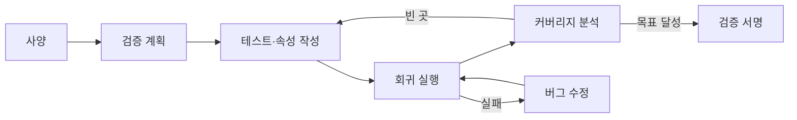

# 검증과 에뮬레이션

!!! spec "규격 · 세대"
    검증 방법론: **UVM**(Accellera 2011 → IEEE 1800.2, 2017·2020 개정) · 검증 언어: SystemVerilog(IEEE 1800, assertion SVA 포함) · 시나리오 기술: Portable Test and Stimulus Standard(Accellera PSS) · 커버리지 교환: UCIS(Accellera)
    지시형 테스트 → 무작위 제약 검증과 커버리지 중심 검증(2000년대) → 형식 검증의 블록 단위 확산 → 하드웨어 에뮬레이터·FPGA 프로토타입에서 OS 부팅까지 하는 **시프트 레프트**(실리콘 전 소프트웨어 개발)

!!! basic "한눈에 보기"
    칩은 한 번 만들면 고칠 수 없으므로, 만들기 전에 최대한 많은 버그를 찾아야 합니다. 검증 방법은 속도와 정밀도가 서로 다릅니다.

    1. **시뮬레이션** — RTL 코드를 컴퓨터에서 그대로 실행합니다. 가장 정밀하지만 매우 느려 칩 전체로는 OS를 부팅할 수 없습니다.
    2. **형식 검증** — 입력을 일일이 넣어 보지 않고 수학적으로 "이런 일은 절대 일어나지 않는다"를 증명합니다.
    3. **에뮬레이션·FPGA 프로토타입** — 전용 하드웨어에 설계를 올려 수천~수백만 배 빠르게 돌립니다. 소프트웨어를 미리 돌려 볼 수 있습니다.
    4. **실리콘 검증** — 실제 칩이 나온 뒤 랩에서 남은 문제를 찾습니다.

    자동차 개발에 비유하면 컴퓨터 시뮬레이션(시뮬레이션), 설계 원리의 증명(형식 검증), 실물 크기 시제품 주행(에뮬레이션), 양산차 시험 주행(실리콘 검증)에 해당합니다.

## 검증 수단 비교 { .l2 }

| 수단 | 속도 (대략) | 보이는 정도 | 주 용도 |
|---|---|---|---|
| RTL 시뮬레이션 (UVM) | 칩 전체 기준 수 Hz–수 kHz (추정) | 모든 신호 | 블록·서브시스템 기능 검증 |
| 형식 검증 | 속도 개념 없음 (증명) | 속성 단위 | 프로토콜·제어 로직, 일관성, 보안 속성, 등가성 |
| 하드웨어 에뮬레이터 | 수백 kHz–수 MHz (추정) | 대부분 신호 (추적 가능) | 칩 전체 검증, 펌웨어·OS 부팅, 전력 분석용 활동 데이터 |
| FPGA 프로토타입 | 수 MHz–수십 MHz (추정) | 제한적 | 드라이버·소프트웨어 개발, 장시간 테스트 |
| 실리콘 (첫 시제품) | 목표 클럭 | 디버그 회로를 통한 제한적 관찰 | 전기 특성, 성능, 남은 버그 |

시뮬레이션과 에뮬레이터 시장은 EDA 3사가 나눠 가지고 있습니다. 하드웨어 에뮬레이터는 Cadence **Palladium**, Synopsys **ZeBu**, Siemens **Veloce** 계열, FPGA 프로토타입은 Cadence Protium, Synopsys HAPS 계열이 대표적입니다.

## 커버리지와 서명 기준 { .l2 }

"검증이 끝났다"는 판단은 버그가 0개라는 뜻이 아니라, **정해 둔 기준을 모두 채웠다**는 뜻입니다.

| 커버리지 | 뜻 |
|---|---|
| 코드 커버리지 | RTL의 줄·분기·조건·토글이 테스트 중에 실행되었는가 |
| 기능 커버리지 | 사양에서 뽑은 중요한 상황(예: 버퍼가 가득 찬 상태에서 취소 요청)이 실제로 발생했는가 |
| assertion 커버리지 | 넣어 둔 SVA 속성이 실제로 검사되었고 위반이 없는가 |
| 버그 발견 추이 | 주간 신규 버그 수가 충분히 줄어들었는가 |

UVM 환경은 무작위 제약 자극 생성기, 버스 프로토콜 모니터, 정답을 계산하는 참조 모델(scoreboard)로 구성되며, 수천~수만 개의 테스트를 매일 밤 회귀 실행합니다.

??? expert "전문가 노트 — 형식 검증의 쓰임, 시프트 레프트, 전력 검증, 실리콘 검증"
    **형식 검증의 쓰임.** 형식 검증은 상태 공간이 폭발하기 때문에 칩 전체가 아니라 블록 단위 속성에 씁니다. 캐시 일관성 프로토콜의 교착 상태 없음, 중재기의 기아(starvation) 없음, 보안 영역 데이터가 비보안 포트로 새지 않음 같은 "절대 일어나면 안 되는 일"에 특히 강합니다. 합성·ECO 전후 넷리스트가 같은 논리인지 확인하는 등가성 검사(LEC)도 형식 기법이며, 모든 설계 흐름에서 필수로 씁니다.

    **시프트 레프트.** 에뮬레이터에 칩 전체를 올리면 부트 ROM → 부트로더 → 커널 부팅까지 실리콘 전에 확인할 수 있습니다. 자주 쓰이는 방식은 CPU 클러스터를 빠른 가상 모델로 바꾸고 나머지만 에뮬레이터에 올리는 하이브리드 구성으로, OS 부팅 시간을 크게 줄입니다. 그 결과 첫 실리콘이 나온 뒤 며칠 만에 OS 부팅을 보고하는 사례가 업계에서 흔해졌고, 드라이버·BSP 개발이 실리콘 일정에 덜 묶이게 되었습니다([Android BSP 구조](../software/android-bsp.md)).

    **전력 검증.** 실제 앱·벤치마크 시나리오를 에뮬레이터에서 돌려 얻은 신호 활동 데이터를 전력 분석 도구에 넣으면, 실리콘 전에 시나리오별 전력과 순간 전류 변화(전압 강하 위험 구간)를 추정할 수 있습니다. 이 결과는 전원망 설계와 DVFS 동작점 계획에 반영됩니다([전력 측정과 분석](../power/measurement.md)).

    **실리콘 검증.** 첫 실리콘이 오면 기능 검증과 함께 전압·온도·클럭을 바꿔 가며 동작 한계를 찾는 특성 평가(characterization)를 합니다. 내부 신호를 직접 볼 수 없으므로 CoreSight 추적, 내부 로직 분석기, 스캔 체인 덤프 같은 디버그 회로가 중요합니다. 여기서 발견된 버그는 소프트웨어 우회(erratum 처리), 펌웨어 설정 변경, metal fix 순서로 대응합니다. Linux 커널의 Arm 코어 erratum 우회 옵션들이 이렇게 실리콘 뒤에 발견된 문제의 흔적입니다.

## 칩셋 비교

| 항목 | 라이선스 코어 중심 SoC | 자체 코어 SoC (Apple, Qualcomm Oryon 등) |
|---|---|---|
| CPU 검증 책임 | 코어 검증은 Arm, 칩 회사는 통합 검증 | 코어 마이크로아키텍처 검증까지 사내 수행 |
| 사전 소프트웨어 | Arm 가상 모델·참조 플랫폼 활용 가능 | 사내 모델·에뮬레이션 환경 구축 |
| 공개 정보 | erratum 문서가 Arm을 통해 공개 | 대부분 비공개 |

## 관련 페이지
- [SoC 설계 흐름](flow.md) — 검증이 들어가는 설계 단계
- [IP와 통합](ip-integration.md) — 통합 단계에서 생기는 버그의 유형
- [캐시와 일관성](../cpu/cache-coherence.md) — 형식 검증이 많이 쓰이는 일관성 프로토콜
- [시험과 양산](test.md) — 설계 검증과 다른, 제조 불량을 찾는 시험
- [Android BSP 구조](../software/android-bsp.md) — 실리콘 전 소프트웨어 준비의 대상
