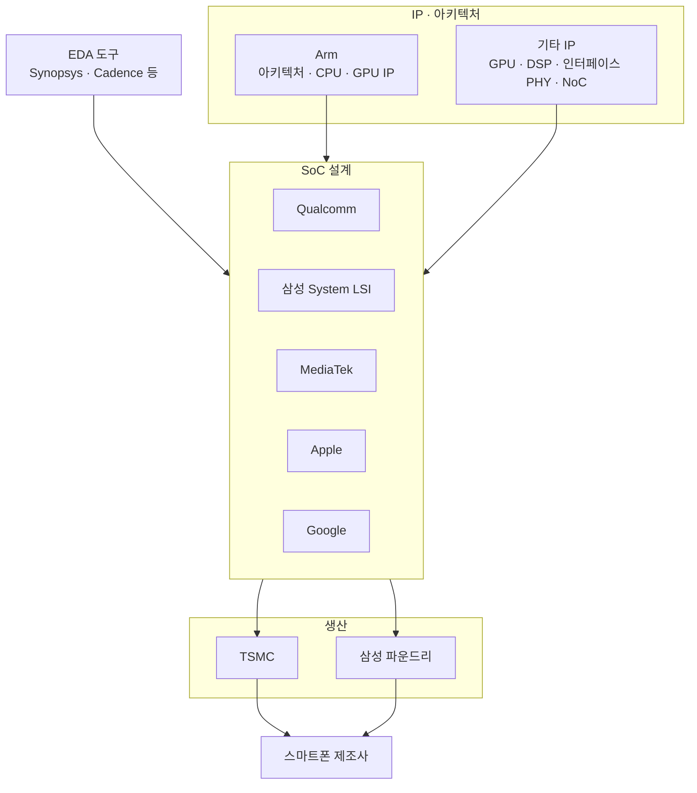

# 주요 제조사와 생태계

!!! spec "규격 · 세대"
    명령어 집합: Arm 아키텍처(Arm Ltd. 라이선스), 일부 마이크로컨트롤러·보조 코어에 RISC-V · 생산: TSMC·삼성 파운드리가 최신 모바일 공정의 대부분을 담당
    수직 통합(통신 칩 회사가 공장까지 보유) → 팹리스 + 파운드리 분업 → IP 라이선스 위에 자체 코어를 얹는 혼합 모델

!!! basic "한눈에 보기"
    스마트폰 SoC 한 개가 나오기까지 여러 회사가 손을 거칩니다.

    1. **설계도(명령어 집합)를 빌려주는 회사** — Arm. "이런 명령어를 알아듣는 CPU"라는 약속을 정하고, 원하면 완성된 코어 설계까지 팝니다.
    2. **칩을 설계하는 회사** — Qualcomm, 삼성 System LSI, MediaTek, Apple, Google. 각 블록을 직접 만들거나 사서 하나의 SoC로 엮습니다.
    3. **칩을 찍어 내는 회사** — TSMC, 삼성 파운드리. 설계 파일을 받아 웨이퍼 위에 칩을 만듭니다.
    4. **도구를 파는 회사** — Synopsys, Cadence 같은 EDA(설계 자동화) 회사, 그리고 메모리·패키지 회사.

    레고에 비유하면 Arm은 블록 규격을 정하고 기본 블록을 팔며, 칩 설계 회사는 그 블록과 직접 깎은 블록으로 작품을 조립하고, 파운드리는 그 조립도를 받아 공장에서 찍어 냅니다.

## 생태계 지도 { .l2 }

| 회사 | 주요 제품 | 설계 방식 | 생산 |
|---|---|---|---|
| **Qualcomm** | Snapdragon 8·7·6·4 계열, Snapdragon X(PC) | 자체 CPU(Oryon), 자체 GPU(Adreno)·NPU(Hexagon)·모뎀 | 주로 TSMC (세대에 따라 삼성 사용 이력) |
| **삼성 System LSI** | Exynos 2x00(플래그십), Exynos 1x80(중급) | Arm CPU·자체 NPU·AMD 기반 GPU(Xclipse)·자체 모뎀 | 삼성 파운드리 |
| **MediaTek** | Dimensity 9000·8000·7000 계열 | Arm CPU·GPU 최신 코어 채택, 자체 APU·모뎀 | 주로 TSMC |
| **Apple** | A 시리즈(iPhone), M 시리즈(Mac·iPad) | CPU·GPU·Neural Engine 모두 자체 설계 | TSMC |
| **Google** | Tensor G 시리즈(Pixel) | Arm CPU 기반, TPU 계열 자체 가속기 | 초기 세대는 삼성과 공동 개발·삼성 생산, Tensor G5부터 TSMC 생산 |
| 기타 | HiSilicon Kirin, UNISOC 등 | 회사마다 다름 | 회사마다 다름 |

## 라이선스의 세 가지 형태 { .l2 }

| 형태 | 받는 것 | 자유도 | 예 |
|---|---|---|---|
| 코어 라이선스 | Arm이 설계한 완성 코어(Cortex·C1 계열)의 RTL | 캐시 크기·코어 수 등 구성 옵션만 선택 | MediaTek, 삼성(현재), Google |
| CSS (Compute Subsystem) | 코어·DSU·인터커넥트까지 검증된 묶음, 물리 설계 참고 포함 | 낮음, 대신 개발 기간 단축 | Arm이 2024년부터 모바일용 CSS를 제공 |
| 아키텍처 라이선스 | 명령어 집합 사용권만 받고 코어는 직접 설계 | 가장 높음, 설계 비용·인력도 가장 큼 | Apple, Qualcomm(Oryon) |

Arm 코어 라이선스는 "같은 코어를 여러 회사가 쓴다"는 뜻이므로, 같은 세대의 Exynos와 Dimensity가 같은 CPU 코어를 쓰는 일이 흔합니다. 차이는 **클럭, 캐시 구성, 공정, 전력 관리, 그리고 CPU 밖의 블록**에서 납니다.

??? expert "전문가 노트 — 설계사와 파운드리의 관계, IP 조달, 공급망 변수"
    **삼성의 두 얼굴.** 삼성전자 안에는 SoC를 설계하는 System LSI 사업부와 칩을 생산하는 파운드리 사업부가 따로 있습니다. 파운드리는 Qualcomm·Google 같은 외부 고객의 칩도 생산하므로, "엑시노스 = 삼성 파운드리"는 맞지만 "삼성 파운드리 = 엑시노스"는 아닙니다. 같은 이유로 Galaxy 스마트폰도 지역·세대에 따라 Snapdragon과 Exynos를 섞어 씁니다.

    **IP 조달의 실제.** SoC 하나에는 수십~수백 개의 IP 블록이 들어갑니다. CPU·GPU 외에도 LPDDR·UFS·PCIe·USB PHY, NoC, 보안 IP, 표준 셀 라이브러리, 메모리 컴파일러 등을 외부에서 사오는 경우가 많고, 특히 PHY(아날로그 성격의 물리 계층 회로)는 공정마다 새로 만들어야 해서 파운드리·IP 회사와의 협력이 일정에 직결됩니다([IP와 통합](../design/ip-integration.md)).

    **자체 코어로 가는 이유와 비용.** 자체 코어는 성능·전력 목표에 맞춰 설계를 깊게 최적화할 수 있고 로열티 구조도 달라집니다. 대신 매년 경쟁력 있는 코어를 내놓으려면 대규모 설계 조직과 여러 세대를 병렬로 개발하는 파이프라인이 필요합니다. 삼성이 Mongoose 코어 개발을 중단하고 Arm 코어로 돌아간 사례는 그 비용을 보여 주며, Qualcomm은 Nuvia를 인수해 Oryon으로 자체 코어에 복귀했습니다. 이 과정에서 Arm과 Qualcomm 사이의 라이선스 분쟁이 있었으므로, 라이선스 조건은 기술만큼이나 제품 전략을 좌우합니다.

    **공급망 변수.** 최신 공정 생산 능력은 소수 파운드리에 몰려 있고, 수출 규제가 특정 회사의 공정·IP 접근을 제한하기도 합니다. 칩셋 비교에서 "왜 이 회사는 이 공정을 썼나"는 기술보다 생산 능력·가격·규제 문제인 경우가 많습니다.

## 칩셋 비교

| 항목 | Snapdragon | Exynos | Dimensity | Apple | Tensor |
|---|---|---|---|---|---|
| CPU | 자체(Oryon) | Arm | Arm | 자체 | Arm |
| GPU | 자체(Adreno) | AMD RDNA 기반(Xclipse) | Arm(Mali·Immortalis) | 자체 | 세대에 따라 다름 |
| NPU | 자체(Hexagon) | 자체 | 자체(APU) | 자체(Neural Engine) | 자체(TPU 계열) |
| 모뎀 | 자체 통합 | 자체 통합 | 자체 통합 | 외장(Qualcomm 또는 자체 C 시리즈) | 외장(삼성) |
| 주 사용처 | 다수 Android 제조사 | 삼성 Galaxy | 다수 Android 제조사 | iPhone·iPad·Mac | Pixel |

> 세대에 따라 바뀌는 항목(GPU 공급원, 생산 파운드리, 모뎀 통합 여부)은 [칩셋 세대 인덱스](../reference/chipset-index.md)에서 세대별로 확인하세요.

## 관련 페이지
- [칩셋 이름 읽는 법](naming.md) — 제품 이름 체계
- [Arm 아키텍처](../cpu/arm-architecture.md) — 라이선스 대상인 명령어 집합
- [자체 설계 코어](../cpu/custom-cores.md) — Apple·Qualcomm 코어
- [파운드리와 공정](../design/foundry.md) — TSMC와 삼성 파운드리
