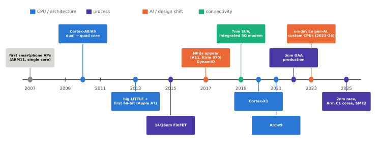
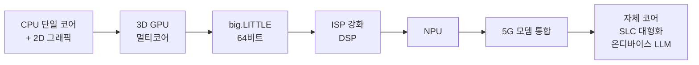

# 모바일 SoC의 역사

!!! spec "규격 · 세대"
    Arm 아키텍처: ARMv6(ARM11) → ARMv7-A(Cortex-A8·A9·A15) → ARMv8-A(64비트, 2011 발표) → Armv9-A(2021) · 공정: 수십 nm 평면 트랜지스터 → 14·16nm FinFET(2015 무렵 스마트폰 도입) → 7nm EUV(2019 무렵) → 3nm GAA(삼성 2022 양산 시작) → 2nm GAA(2025 양산 시작)
    이 페이지의 연표는 **2025년까지 발표된 세대**를 기준으로 썼습니다. 이후 세대는 [칩셋 세대 인덱스](../reference/chipset-index.md)에서 갱신합니다.

!!! basic "한눈에 보기"
    모바일 SoC의 20년은 **"하나씩 더 넣고, 종류별로 나누는"** 역사입니다.

    1. **코어 수 늘리기** (2010년 전후) — 단일 코어에서 듀얼·쿼드 코어로
    2. **코어 종류 나누기** (2013~) — 빠른 코어와 전력을 아끼는 코어를 섞는 big.LITTLE
    3. **64비트와 미세 공정** (2013~2015) — ARMv8 64비트, FinFET 트랜지스터
    4. **전용 가속기** (2017~) — 신경망 전용 NPU, 강력한 ISP
    5. **모뎀 통합** (2019~) — 5G 모뎀까지 한 칩에
    6. **자체 설계 코어와 온디바이스 AI** (2020~) — Arm 코어를 그대로 쓰지 않고 직접 설계, 스마트폰 안에서 생성형 AI 실행

    매년 "더 빠르게"가 목표처럼 보이지만, 실제로 칩 설계를 가장 크게 바꾼 힘은 **전력과 발열**이었습니다.

## 시대별 흐름 { .l2 }

| 시기 | 무엇이 바뀌었나 | 대표 사례 |
|---|---|---|
| 2007–2009 | 스마트폰 AP의 등장. 통신 칩과 별도인 응용 프로세서, 수백 MHz 단일 코어 | 초대 iPhone의 ARM11 기반 칩(삼성 제조), Qualcomm 첫 Snapdragon(QSD8250, Scorpion 코어 1 GHz) |
| 2010–2012 | Cortex-A8·A9, 듀얼·쿼드 코어 경쟁, GPU 성능 경쟁 시작 | Apple A4·A5, 삼성 Hummingbird(→ Exynos 3110), Exynos 4210, NVIDIA Tegra 2·3 |
| 2013 | **이기종 코어(big.LITTLE)** 상용화, **64비트 ARMv8** 스마트폰 칩 등장 | Exynos 5410 Octa(Cortex-A15 4 + A7 4), Apple A7(첫 64비트 스마트폰 SoC) |
| 2014–2016 | 64비트 Android 전환, **FinFET** 공정 도입, 발열 문제 부각 | Snapdragon 810(20nm 평면 공정, 발열 논란), Exynos 7420(14nm FinFET) |
| 2017–2018 | **NPU** 탑재 시작, **DynamIQ** 클러스터 | Apple A11 Bionic(Neural Engine), Kirin 970(NPU), Cortex-A75·A55 기반 Snapdragon 845 |
| 2019–2020 | **7nm EUV**, **5G 모뎀 통합**, Arm Cortex-X 프로그램 | Exynos 980·Kirin 990 5G(통합 5G), Snapdragon 888(통합 X60 모뎀), Cortex-X1 |
| 2021–2022 | **Armv9**, GPU 협력·다변화, **3nm GAA** 양산 시작 | Snapdragon 8 Gen 1·Exynos 2200(AMD RDNA2 기반 Xclipse GPU)·Dimensity 9000, 삼성 3nm GAA |
| 2023–2024 | 작은 코어를 줄이거나 없애는 구성, 온디바이스 생성형 AI, **자체 설계 CPU 복귀** | Dimensity 9300(빅 코어만 8개), Apple A17 Pro(TSMC 3nm), Snapdragon 8 Elite(Oryon 자체 코어) |
| 2025 | 3nm 2세대·**2nm** 경쟁, Arm 코어 브랜드 개편(C1 계열), SME2 행렬 확장 | Exynos 2500(삼성 3nm GAA), Snapdragon 8 Elite Gen 5, Dimensity 9500, Google Tensor G5(TSMC로 생산처 변경) |

## 블록이 들어온 순서 { .l2 }

| 블록 | 처음 역할 | 지금의 역할 |
|---|---|---|
| CPU | 운영체제·앱 실행 전부 | 제어와 단일 스레드 성능 담당, 무거운 연산은 가속기로 넘김 |
| GPU | 게임 3D 렌더링 | UI 합성, 게임, 범용 병렬 연산, 일부 AI 연산 |
| DSP | 음성 코덱·모뎀 신호 처리 | 상시 동작 음성 인식, 센서 처리, 카메라 후처리 보조 |
| ISP | 단일 카메라 색 보정 | 다중 카메라 동시 처리, HDR 합성, AI 기반 노이즈 제거 |
| NPU | 사진 장면 인식 | 생성형 AI, 실시간 번역, 카메라 AI 처리 |
| 캐시 | CPU 전용 L1·L2 | 모든 블록이 함께 쓰는 수 MB 이상의 시스템 레벨 캐시(SLC) |

??? expert "전문가 노트 — 전력 벽, 다크 실리콘, 그리고 '코어 수 경쟁'의 끝"
    **데나드 스케일링의 끝.** 2000년대 중반까지는 트랜지스터를 작게 만들면 전압도 같이 낮아져, 같은 면적의 전력 밀도가 거의 일정했습니다(데나드 스케일링). 문턱 전압을 더 낮추면 누설 전류가 폭증하기 때문에 전압이 1 V 근처에서 잘 내려가지 않게 되자, 트랜지스터는 늘어나는데 전부 동시에 켤 수는 없는 **다크 실리콘(dark silicon)** 문제가 생겼습니다. 모바일 SoC가 같은 일을 더 적은 에너지로 하는 **전용 가속기**와 **이기종 코어**로 간 근본 이유가 이것입니다([트랜지스터와 CMOS](../basics/transistor.md)).

    **옥타코어 경쟁의 의미.** 2013년 무렵 "옥타코어"는 마케팅 용어로 많이 쓰였지만, 초기 big.LITTLE은 클러스터 전환 방식이라 8개 코어가 동시에 돌지 않는 구현도 있었습니다. 이후 모든 코어를 동시에 쓰는 방식(HMP, 이후 EAS)이 표준이 되었고, 최근에는 오히려 **작은 코어를 줄이는** 구성이 늘었습니다. 작은 코어가 차지하는 면적보다 중간급 코어를 낮은 클럭으로 돌리는 편이 실제 워크로드에서 에너지 효율이 비슷하거나 낫다고 판단하는 설계가 나온 것입니다([이기종 클러스터](../cpu/clusters.md)).

    **모뎀 통합이 늦었던 이유.** 모뎀은 통신 규격이 계속 바뀌고, 사업자 인증과 지역별 주파수 대응 때문에 AP와 개발 일정이 맞지 않습니다. 5G 초기 세대에서 외장 모뎀을 쓴 플래그십이 있었던 것도 이 때문입니다. 통합 모뎀은 전력과 기판 면적에서 이득이 크지만, 다이 면적을 상당히 차지합니다([모뎀의 통합](../connectivity/modem.md)).

    **연표를 읽을 때 주의할 점.** "최초" 타이틀은 발표일·출시일·양산일 중 무엇을 기준으로 하느냐에 따라 회사마다 다르게 주장합니다. 이 책은 특별히 적지 않으면 **제품 출시 기준**으로 쓰고, 다툼이 있는 "세계 최초"는 피합니다.

## 제조사별 흐름 비교

| 제조사 | CPU 코어 전략의 흐름 | GPU |
|---|---|---|
| Qualcomm | Scorpion·Krait(자체) → Kryo(초기 자체, 이후 Arm 코어 기반) → Oryon(자체, Nuvia 인수 후) | Adreno (자체) |
| 삼성 System LSI | Arm 코어 → Mongoose(자체, M1–M5 세대 이후 중단) → Arm Cortex·C1 코어 | Mali → Xclipse(AMD RDNA 기반) |
| MediaTek | Arm 코어 (Cortex-X·C1 최신 코어를 빠르게 채택) | Mali·Immortalis |
| Apple | Arm 코어(A4–A5) → A6부터 자체 코어 | PowerVR 기반 → 자체 GPU |
| Google | Arm 코어 (Tensor) | Mali → 세대에 따라 변경 |

## 관련 페이지
- [주요 제조사와 생태계](ecosystem.md) — 회사별 역할과 관계
- [Arm 코어 계보](../cpu/arm-cores.md) — Cortex-A·X에서 C1까지
- [공정 노드와 미세화](../basics/process-node.md) — FinFET과 GAA
- [칩셋 세대 인덱스](../reference/chipset-index.md) — 세대별 사양 표
