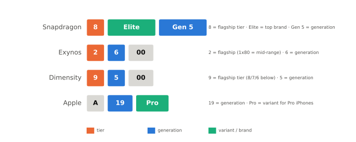

# 칩셋 이름 읽는 법

!!! spec "규격 · 세대"
    이름 체계는 표준이 아니라 각 회사의 마케팅 규칙 · 세대마다 바뀌는 일이 잦음 (예: Snapdragon 8xx 세 자리 → 8 Gen N → 8 Elite → 8 Elite Gen 5, Apple A10 Fusion → A11–A16 Bionic → A17 Pro → A18·A18 Pro, Arm Cortex-X·A → C1 계열)
    이 페이지는 **2025년까지의 이름 체계**를 기준으로 씁니다.

!!! basic "한눈에 보기"
    칩셋 이름에는 보통 세 가지 정보가 들어 있습니다.

    1. **등급** — 플래그십인가, 중급인가 (Snapdragon **8** vs **7**, Dimensity **9**000 vs **8**000)
    2. **세대** — 몇 번째 제품인가 (Exynos 2**4**00 → 2**5**00, A18 → A19)
    3. **변형** — 같은 칩의 고성능판·특별판인가 (Pro, Plus, for Galaxy, Max)

    다만 회사마다 규칙이 다르고 중간에 바뀌기도 해서, **숫자가 크다고 반드시 더 좋은 칩은 아닙니다.** 이름보다 어떤 코어·공정·GPU를 썼는지 확인하는 습관이 중요합니다.

## 제조사별 이름 체계 { .l2 }

| 제조사 | 플래그십 | 중급·보급 | 변형 표기 | 내부 부품 번호 |
|---|---|---|---|---|
| Qualcomm | Snapdragon 8 계열 (8 Gen 1–3 → 8 Elite → 8 Elite Gen 5) | 8s, 7, 6, 4 계열 | `+`(중간 개선판), `s`(한 단계 아래 플래그십), `for Galaxy`(고클럭 맞춤판) | `SM8xx0` 형식 (예: SM8750 = 8 Elite) |
| 삼성 | Exynos 2x00 (2100, 2200, 2400, 2500, 2600…) | Exynos 1x80 (1280, 1380, 1480, 1580…) | 거의 없음 | `S5E9xxx` 형식 |
| MediaTek | Dimensity 9000 계열 (9000, 9200, 9300, 9400, 9500…) | 8000·7000·6000 계열 | `+`(고클럭판) | `MT6xxx` 형식 |
| Apple | A 시리즈 (2023년 A17 Pro부터 Pro 아이폰용은 이름 뒤에 Pro), Mac·iPad는 M 시리즈 | 별도 중급 브랜드 없음. 기본 iPhone·SE·16e도 A 시리즈를 쓰되 이전 세대 칩이나 GPU 코어를 줄인 판을 씀 | A: Fusion(A10) → Bionic(A11–A16) → Pro(A17 Pro부터), iPad용 X·Z(A12X·A12Z 등), M: Pro·Max·Ultra | 공개 이름 위주. 내부 식별자는 `T8xxx` 형식 (예: A19와 A19 Pro는 모두 T8150이고 리비전으로 구분) |
| Google | Tensor G1–G5… | — | — | 공개 이름 위주 |

!!! tip "부품 번호가 더 정확할 때"
    마케팅 이름은 바뀌어도 부품 번호는 회사 내부 규칙을 오래 유지합니다. 커널 소스, 디바이스 트리, 벤치마크 결과에는 마케팅 이름 대신 `sm8750`, `s5e9945` 같은 부품 번호나 코드 이름이 나오는 경우가 많으므로, 둘의 대응표를 만들어 두면 자료를 찾기 쉽습니다. 대응표는 [칩셋 세대 인덱스](../reference/chipset-index.md)에 모읍니다.

## Arm 코어 이름 { .l2 }

SoC 이름만큼 헷갈리는 것이 CPU 코어 이름입니다.

| 시기 | 고성능 | 성능·효율 균형 | 고효율 |
|---|---|---|---|
| 2020–2024 | Cortex-X1 → X2 → X3 → X4 → X925 | Cortex-A78 → A710 → A715 → A720 → A725 | Cortex-A55 → A510 → A520 |
| 2025~ | C1-Ultra | C1-Premium · C1-Pro | C1-Nano |

2025년에 Arm은 모바일용 코어와 GPU 이름을 **C1 계열**(CPU), **G1 계열**(GPU, 예: Mali G1-Ultra)로 개편하고, 이를 묶은 모바일 플랫폼을 **Lumex**라고 불렀습니다. 같은 세대의 코어를 여러 회사가 쓰므로, "Cortex-X925를 쓴 칩"이라는 정보만으로 두 칩의 CPU 구조가 상당히 비슷하다는 것을 알 수 있습니다([Arm 코어 계보](../cpu/arm-cores.md)).

## 사양표 읽는 법 { .l2 }

제조사 사양표에서 확인할 항목과 함정입니다.

| 항목 | 예시 표기 | 확인할 점 |
|---|---|---|
| CPU 구성 | `1 + 3 + 4`, `2 + 6` | 숫자는 코어 개수, 순서는 보통 빠른 코어부터. 코어 종류와 각 클러스터 최대 클럭을 함께 봐야 함 |
| 최대 클럭 | 4.32 GHz | 가장 빠른 코어 하나가 짧게 내는 값. 지속 클럭은 발열에 따라 더 낮음 |
| 공정 | 3nm, N3E, SF3 | 회사마다 같은 "3nm"도 세대가 다름 ([공정 노드와 미세화](../basics/process-node.md)) |
| GPU | Adreno 8xx, Xclipse 9xx | 이름 숫자는 회사 내부 서열일 뿐, 회사 간 비교는 불가 |
| NPU 성능 | xx TOPS | 정밀도(INT8·INT4)와 측정 조건이 빠지면 비교 불가 ([TOPS와 정밀도](../npu/tops.md)) |
| 메모리 | LPDDR5X 10.7 Gbps | 핀당 데이터 레이트. 대역폭은 버스 폭을 곱해야 함 ([LPDDR](../memory/lpddr.md)) |
| 저장장치 | UFS 4.0 | 실제 탑재는 스마트폰 제조사가 결정 |

??? expert "전문가 노트 — 변형판, 코드 이름, 이름이 숨기는 차이"
    **같은 이름, 다른 칩.** 같은 세대 안에서도 "고클럭판"은 대개 같은 다이를 더 높은 클럭 빈(bin)으로 골라 파는 것이고, 한 단계 아래 등급(예: 8s, 중급 브랜드로 내린 구세대 플래그십)은 다른 다이이거나 일부 블록을 끈 다이일 수 있습니다. 사양표의 코어 구성·GPU 이름·모뎀 사양이 하나라도 다르면 별개 칩으로 보고 비교하는 것이 안전합니다.

    **코드 이름과 커널.** 업스트림 Linux 커널은 Qualcomm 칩을 `sm8650`, `sm8750` 같은 부품 번호로, 디바이스 트리 호환 문자열은 `qcom,sm8750` 같은 형식으로 부릅니다. Android 공통 커널과 벤더 커널에서는 내부 코드 이름(플랫폼 이름)이 함께 쓰여서, 소스 트리를 볼 때 마케팅 이름·부품 번호·코드 이름 세 가지를 오가야 합니다.

    **Apple 이름의 의미.** A 시리즈는 A11부터 A16까지 이름 뒤에 "Bionic"을 붙였고, 2023년 A17 Pro부터 Bionic을 빼고 Pro 아이폰용 칩에 "Pro"를 붙였습니다. 이후로는 같은 세대에 기본판과 Pro판이 함께 나옵니다(A18·A18 Pro, A19·A19 Pro). Pro판은 기본판보다 GPU 코어 수·캐시 등이 더 많은 구성입니다(예: A18은 GPU 5코어, A18 Pro는 6코어). 그 전에는 기본 아이폰이 전년도 Pro 아이폰의 칩을 그대로 쓰는 경우가 많았습니다(iPhone 14는 A15, iPhone 15는 A16). M 시리즈의 Max·Ultra는 블록 수를 크게 늘리거나(Max) 두 다이를 이어 붙인(Ultra) 구성입니다. 이름 하나로 다이 구성이 바뀐다는 점에서 Android 쪽의 "고클럭판"과 성격이 다릅니다.

    **같은 이름, 다른 GPU 코어 수.** Apple은 같은 칩 이름 안에서도 GPU 코어 일부를 끈 판을 씁니다. iPhone 13의 A15는 GPU가 4코어로 iPhone 13 Pro의 A15(5코어)보다 하나 적고, iPhone 16e의 A18은 GPU가 4코어로 iPhone 16의 A18(5코어)보다 하나 적으며, iPhone Air의 A19 Pro는 GPU가 5코어로 iPhone 17 Pro의 A19 Pro(6코어)보다 하나 적습니다. 그래서 Apple 칩은 이름만이 아니라 **어느 기기에 들어간 칩인지**까지 확인해야 정확히 비교할 수 있습니다([칩셋 세대 인덱스](../reference/chipset-index.md)).

## 칩셋 비교

| 항목 | Snapdragon | Exynos | Dimensity | Apple |
|---|---|---|---|---|
| 세대 표기 | 이름 개편이 잦음 | 앞 두 자리 증가 | 천 단위 증가 | 숫자 1씩 증가 |
| 같은 세대 변형 | 많음 (`+`, `s`, for Galaxy) | 적음 | 있음 (`+`) | A: 기본·Pro (같은 이름에도 GPU 코어 수가 다른 판), M: Pro·Max·Ultra |
| 이름에서 알 수 있는 것 | 등급과 대략의 시기 | 등급과 세대 | 등급과 세대 | 세대와 Pro 여부 (기기별 GPU 코어 수는 따로 확인) |

## 관련 페이지
- [모바일 SoC의 역사](history.md) — 세대가 바뀐 흐름
- [이기종 클러스터](../cpu/clusters.md) — `1 + 3 + 4` 같은 구성의 의미
- [칩셋 세대 인덱스](../reference/chipset-index.md) — 이름 ↔ 부품 번호 ↔ 사양
