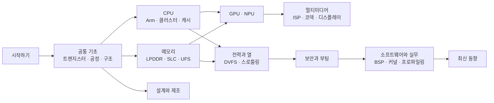

# 학습 로드맵

!!! basic "한눈에 보기"
    수준과 목적에 따라 읽는 순서를 추천합니다. 각 페이지 안에서도 기초 → 중급 → 전문가 순서로 깊어지므로,
    처음에는 기초 부분(한눈에 보기)만 읽고 넘어가도 됩니다.

## 경로 1 — 스마트폰 칩이 궁금한 사람 { .l1 }

목표: 칩셋 사양표를 읽고, 리뷰의 "발열", "지속 성능", "NPU TOPS" 같은 말을 이해하기

1. [SoC란 무엇인가](what-is-soc.md) → [모바일 SoC의 역사](history.md) → [칩셋 이름 읽는 법](naming.md)
2. [공정 노드와 미세화](../basics/process-node.md) → [메모리 계층](../basics/memory-hierarchy.md)
3. [이기종 클러스터](../cpu/clusters.md) → [LPDDR](../memory/lpddr.md)
4. [TOPS와 정밀도](../npu/tops.md) → [열 관리와 스로틀링](../power/thermal.md)
5. [벤치마크 읽는 법](../software/benchmarks.md) → [제조사별 비교](../reference/vendor-compare.md)

## 경로 2 — 앱·시스템 소프트웨어 개발자 { .l2 }

목표: 코어 배치·캐시·메모리 대역폭이 앱 성능과 배터리에 주는 영향을 이해하고, 프로파일러 결과를 해석하기

1. 공통 기초 전체 (특히 [컴퓨터 구조 기초](../basics/computer-architecture.md), [메모리 계층](../basics/memory-hierarchy.md), [클럭과 전압](../basics/clock-voltage.md))
2. CPU: [이기종 클러스터](../cpu/clusters.md) → [캐시와 일관성](../cpu/cache-coherence.md) → [스케줄링과 EAS](../cpu/scheduling.md)
3. 메모리: [LPDDR](../memory/lpddr.md) → [메모리 컨트롤러와 SLC](../memory/controller-slc.md) → [UFS 저장장치](../memory/ufs.md)
4. 전력: [DVFS와 전력 관리](../power/dvfs.md) → [열 관리와 스로틀링](../power/thermal.md)
5. 가속기: [GPU 연산](../gpu/compute.md), [AI 소프트웨어 스택](../npu/software.md)
6. 실무: [성능 분석 도구](../software/profiling.md) → [벤치마크 읽는 법](../software/benchmarks.md)

## 경로 3 — SoC 설계·커널·펌웨어 엔지니어 { .l3 }

목표: 블록 간 트레이드오프, 마이크로아키텍처, 전력 관리 구조, 보안 부팅 체인, 설계 흐름을 깊게 이해하기

- 각 페이지의 **전문가 노트**와 **규격 · 세대 박스**를 레퍼런스로 활용하고, [표준 인덱스](../reference/standards.md)로 원문 위치 찾기
- 아키텍처: [Arm 아키텍처](../cpu/arm-architecture.md) → [코어 마이크로아키텍처](../cpu/microarchitecture.md) → [캐시와 일관성](../cpu/cache-coherence.md) → [버스와 인터커넥트](../basics/interconnect.md)
- 메모리 시스템: [LPDDR](../memory/lpddr.md) → [메모리 컨트롤러와 SLC](../memory/controller-slc.md) → [메모리 보호와 IOMMU](../memory/iommu.md)
- 전력: [DVFS와 전력 관리](../power/dvfs.md) → [파워 도메인과 게이팅](../power/power-domains.md) → [PMIC와 전원 공급](../power/pmic.md)
- 보안: [부팅 과정](../security/boot.md) → [TrustZone과 TEE](../security/trustzone.md) → [가상화](../security/virtualization.md)
- 설계와 제조: [SoC 설계 흐름](../design/flow.md) → [검증과 에뮬레이션](../design/verification.md) → [시험과 양산](../design/test.md)
- 커널: [Android BSP 구조](../software/android-bsp.md) → [Linux 커널과 SoC 지원](../software/linux-kernel.md)

## 자매 핸드북과 함께 읽기

| 주제 | 이 책 | 자매 핸드북 |
|---|---|---|
| 모뎀 | [모뎀의 통합](../connectivity/modem.md) — 칩 안의 위치, 전력·면적 | [Cellular Handbook](https://goodhosup.github.io/cellular/) — LTE·5G NR 프로토콜 |
| Wi-Fi | [Wi-Fi·Bluetooth 콤보](../connectivity/wifi-bt.md) — SoC와의 인터페이스 | [Wi-Fi Handbook](https://goodhosup.github.io/wifi/) — 802.11 PHY·MAC |
| Bluetooth | [Wi-Fi·Bluetooth 콤보](../connectivity/wifi-bt.md) — HCI·공존 인터페이스 | [Bluetooth Handbook](https://goodhosup.github.io/bluetooth/) — Classic·LE·LE Audio |
