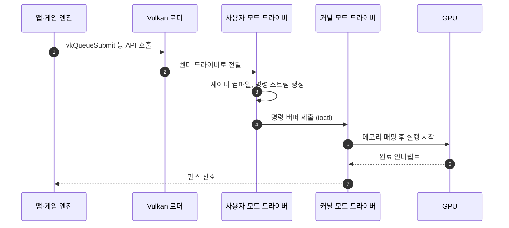

# 그래픽 API와 드라이버

!!! spec "규격 · 세대"
    Khronos **OpenGL ES** 2.0(2007) → 3.0(2012) → 3.1(2014, 컴퓨트 셰이더) → 3.2(2015) · **Vulkan** 1.0(2016) → 1.1(2018) → 1.2(2020) → 1.3(2022) → 1.4(2024), 셰이더 중간 표현 **SPIR-V** · Apple **Metal**(2014) → Metal 3(2022) → Metal 4(2025 발표)
    Android: Vulkan 지원(Android 7.0), Play 스토어 등을 통한 GPU 드라이버 업데이트(Android 10), Android Baseline Profile(Vulkan 기능 기준선), OpenGL ES를 Vulkan 위에서 구현하는 **ANGLE** 도입 확대(이 페이지 기준 시점)

!!! basic "한눈에 보기"
    앱은 GPU에 직접 명령하지 않고 **그래픽 API**라는 공용 언어로 요청합니다. 드라이버가 이 요청을 각 GPU가 알아듣는 명령으로 번역합니다.

    1. **OpenGL ES** — 오래된 공용 언어. 쓰기 쉽지만 드라이버가 뒤에서 많은 일을 대신합니다.
    2. **Vulkan** — 새 공용 언어. 앱이 세세한 것까지 직접 지정하는 대신 CPU 부담이 적고 예측 가능합니다.
    3. **Metal** — Apple 기기 전용 언어입니다.

    식당에 비유하면 OpenGL ES는 "알아서 맛있게 해 주세요"라고 주문하는 방식이고, Vulkan은 재료·순서·불 세기까지 적어 주는 주문서입니다. 주문서가 길어지지만 주방(드라이버)이 추측할 일이 줄어 빠르고 일정해집니다.

## API 비교 { .l2 }

| 항목 | OpenGL ES | Vulkan | Metal |
|---|---|---|---|
| 관리 주체 | Khronos | Khronos | Apple |
| 플랫폼 | Android, 임베디드 다수 | Android, Windows, Linux 등 (Apple에서는 변환 계층 경유) | iOS, macOS 등 Apple 플랫폼 |
| 상태 관리 | 드라이버가 전역 상태 추적 | 앱이 파이프라인 객체로 미리 지정 | 파이프라인 상태 객체 |
| 멀티스레드 명령 기록 | 사실상 단일 컨텍스트 | 여러 스레드가 명령 버퍼를 동시에 기록 | 지원 |
| 메모리·동기화 | 드라이버가 처리 | 앱이 명시적으로 관리 (배리어, 세마포어) | 중간 수준 (자동 추적 옵션 있음) |
| 셰이더 | GLSL ES 소스를 드라이버가 컴파일 | SPIR-V 중간 표현을 드라이버가 컴파일 | MSL을 중간 표현으로 미리 컴파일 가능 |
| 타일 기반 GPU 고려 | 확장 기능으로 일부 | 렌더 패스·서브패스·load/store 지정 | 타일 메모리·imageblock 직접 노출 |

## Android GPU 드라이버 구조 { .l2 }

| 계층 | 역할 | 예 |
|---|---|---|
| 사용자 모드 드라이버 (UMD) | API 구현, 셰이더 컴파일러, 명령 스트림 생성. 앱 프로세스 안에서 동작 | vendor 파티션의 Vulkan·EGL 라이브러리 |
| 커널 모드 드라이버 (KMD) | GPU 메모리 관리, 명령 제출·스케줄링, 전원·클럭 제어 | Qualcomm KGSL, Arm Mali kbase(벤더 배포판) · 업스트림 msm, Panfrost·Panthor |
| 버퍼 할당·공유 | 카메라·비디오·디스플레이와 같은 버퍼를 압축 형식 그대로 공유 | gralloc HAL, dma-buf |
| 화면 합성 | 앱 프레임을 모아 디스플레이로 | SurfaceFlinger, Hardware Composer HAL |
| ANGLE | OpenGL ES 호출을 Vulkan으로 변환 | 벤더 GLES 드라이버 대신 쓰는 선택지 |

Android는 Project Treble 이후 GPU 드라이버를 vendor 파티션에 두어, 운영체제 업데이트와 드라이버 업데이트를 분리할 수 있게 했습니다. Android 10부터는 일부 기기에서 앱 스토어로 GPU 드라이버만 따로 업데이트하는 **업데이트 가능 드라이버**가 도입됐고, 게임별로 새 드라이버를 시험 적용하는 기능도 제공됩니다.

## 셰이더 컴파일과 파이프라인 캐시 { .l2 }

| 단계 | 내용 | 끊김(stutter)과의 관계 |
|---|---|---|
| 오프라인 컴파일 | HLSL·GLSL → SPIR-V (빌드 시점) | 기기 무관, 런타임 비용 없음 |
| 드라이버 컴파일 | SPIR-V + 파이프라인 상태 → GPU 기계어 | 처음 보는 조합이면 수 ms–수십 ms가 걸릴 수 있어 프레임 끊김 원인 (추정 범위) |
| 파이프라인 캐시 | 컴파일 결과를 저장해 다음 실행에서 재사용 | 앱의 `VkPipelineCache`, 드라이버·OS의 디스크 캐시 |
| 사전 준비 | 로딩 화면에서 미리 파이프라인 생성, 그래픽 파이프라인 라이브러리 확장으로 일부만 먼저 컴파일 | 게임 중 컴파일을 피함 |

??? expert "전문가 노트 — 드라이버 버전 파편화, ANGLE 전환, 파이프라인 폭발"
    **드라이버 파편화.** Android에서는 같은 GPU라도 기기·펌웨어 버전마다 드라이버 버전이 다르고, 셰이더 컴파일러 버그도 드라이버 버전에 묶여 있습니다. 게임 회사가 GPU 모델·드라이버 버전별 예외 처리 목록을 유지하는 이유입니다. 업데이트 가능 드라이버는 이 문제를 줄이려는 시도지만, 실제 배포 범위는 SoC 회사·기기 제조사의 참여에 달려 있습니다. Vulkan의 `VkPhysicalDeviceDriverProperties`로 드라이버 이름·버전을 확인할 수 있습니다.

    **ANGLE 전환.** OpenGL ES 드라이버를 벤더마다 따로 유지하는 비용이 크기 때문에, Android는 OpenGL ES를 Vulkan 위에서 구현하는 ANGLE을 점점 더 넓게 쓰는 방향으로 가고 있습니다. 이렇게 되면 벤더는 Vulkan 드라이버 품질에 집중하고, OpenGL ES 동작은 플랫폼 공통 코드로 일관성을 얻습니다. 다만 변환 계층의 오버헤드와 오래된 앱의 비표준 동작 호환성이 과제입니다.

    **파이프라인 조합 폭발.** Vulkan 1.0 모델에서는 셰이더와 블렌딩·정점 형식·렌더 패스 같은 상태를 묶은 파이프라인마다 컴파일이 필요해, 큰 게임은 조합이 수만 개에 이를 수 있습니다. 동적 상태 확장, 그래픽 파이프라인 라이브러리, 셰이더 객체 확장은 이 조합을 줄이거나 나눠 컴파일하도록 돕지만, 타일 기반 GPU에서는 렌더 패스 정보를 모르면 최적화가 어려운 경우가 있어 벤더별 지원 수준이 다릅니다.

    **오픈소스 드라이버.** Mesa 프로젝트에는 Adreno용 freedreno·Turnip(Vulkan), Mali용 Panfrost·PanVK, Apple GPU용 Asahi 드라이버 등이 있으며, 업스트림 Linux 커널에도 대응 KMD가 들어 있습니다. 상용 Android 기기는 대부분 벤더 드라이버를 쓰지만, 오픈소스 드라이버 코드는 하드웨어 동작을 이해하는 좋은 자료입니다([Linux 커널과 SoC 지원](../software/linux-kernel.md)).

## 칩셋 비교

| 항목 | Snapdragon (Adreno) | Exynos (Xclipse) | Dimensity·Tensor (Mali·PowerVR) | Apple |
|---|---|---|---|---|
| 주 API | Vulkan, OpenGL ES | Vulkan, OpenGL ES | Vulkan, OpenGL ES | Metal |
| 드라이버 개발 | Qualcomm 자체 | Samsung·AMD 협력 | IP 회사 기본 드라이버 + SoC 회사 통합 | Apple 자체 |
| 업데이트 경로 | OS·펌웨어 업데이트, 일부 기기에서 단독 드라이버 업데이트 | OS·펌웨어 업데이트 중심 | OS·펌웨어 업데이트 중심 | OS 업데이트에 포함 |
| 오픈소스 대안 | freedreno·Turnip | 공개 정보 적음 | Panfrost·PanVK (Mali) | Asahi (macOS 기기용 Linux) |

> 세대별 지원 API 버전은 [칩셋 세대 인덱스](../reference/chipset-index.md)에 모읍니다.

## 관련 페이지
- [모바일 GPU 구조](architecture.md) — 렌더 패스 지정이 중요한 이유
- [Android BSP 구조](../software/android-bsp.md) — vendor 파티션과 HAL
- [Linux 커널과 SoC 지원](../software/linux-kernel.md) — GPU 커널 드라이버의 위치
- [성능 분석 도구](../software/profiling.md) — GPU 프로파일러와 프레임 분석
- [GPU 연산](compute.md) — 같은 드라이버 위의 연산 API
