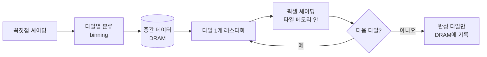

# 모바일 GPU 구조

!!! spec "규격 · 세대"
    렌더링 방식: **IMR**(즉시 렌더링, 데스크톱 GPU의 전통) ↔ **TBR**(타일 기반 렌더링, Adreno·Mali 계열) ↔ **TBDR**(타일 기반 지연 렌더링, PowerVR·Apple GPU) · 텍스처 압축: ETC2(OpenGL ES 3.0 필수), **ASTC**(Khronos 표준, OpenGL ES 3.2·Vulkan에서 널리 지원)
    프레임버퍼 압축: Arm **AFBC**(Mali 계열), Qualcomm **UBWC**(Snapdragon 계열), Apple의 무손실 압축 등 벤더별 방식 · 타일 기반 렌더링은 초기 모바일 GPU부터 주류이며, 렌더 패스마다 타일·직접 모드를 고르는 하이브리드 방식(Qualcomm FlexRender 등)이 이후 추가

!!! basic "한눈에 보기"
    GPU는 화면의 수백만 픽셀 색을 **동시에** 계산하는 장치입니다. 단순한 계산기를 아주 많이 두고, 같은 명령을 여러 픽셀에 한꺼번에 적용합니다.

    1. **꼭짓점 처리** — 3D 물체의 꼭짓점을 화면 좌표로 옮깁니다.
    2. **래스터화** — 삼각형이 덮는 픽셀을 찾습니다.
    3. **픽셀 처리** — 픽셀마다 텍스처·조명을 계산해 색을 정합니다.

    모바일 GPU의 특징은 **화면을 작은 타일로 나눠 하나씩 완성**한다는 점입니다. 벽화를 그릴 때 벽 전체를 오가며 칠하지 않고, 작은 화판을 책상 위에 놓고 한 칸씩 완성해 벽에 붙이는 것과 같습니다. 붓과 물감(데이터)을 책상(칩 안 메모리)에 두고 작업하므로 먼 창고(DRAM)를 오가는 일이 줄어 전력을 아낍니다.

## 즉시 렌더링과 타일 기반 렌더링 { .l2 }

| 방식 | 동작 | 장점 | 단점 |
|---|---|---|---|
| IMR (Immediate Mode) | 삼각형이 들어오는 대로 바로 픽셀을 그려 DRAM의 프레임버퍼에 씀 | 구조가 단순, 꼭짓점이 아주 많은 장면에 강함 | 겹쳐 그리기(overdraw)·깊이 검사마다 DRAM 트래픽 발생 |
| TBR (Tile-Based) | 먼저 삼각형을 타일별로 분류(binning)한 뒤, 타일마다 칩 안 타일 메모리에서 렌더링하고 결과만 DRAM에 씀 | 색·깊이 버퍼 읽기·쓰기가 칩 안에서 끝나 대역폭과 전력 절감 | binning 단계의 중간 데이터 저장, 꼭짓점이 많으면 부담 |
| TBDR (Tile-Based Deferred) | TBR에 더해, 타일 안에서 보이는 면을 먼저 정한 뒤 보이는 픽셀만 셰이딩 (HSR) | 가려진 픽셀 셰이딩을 하드웨어가 거의 없앰 | 하드웨어 복잡도, 투명·깊이 수정 셰이더에서는 이점 감소 |

대역폭 감각을 잡기 위해 예를 들면, 2400 × 1080 화면에 픽셀당 4바이트 색을 60 fps로 **한 번만** 쓰는 데도 약 **0.62 GB/s**가 듭니다. IMR에서는 겹쳐 그리기와 깊이 버퍼 읽기·쓰기, 블렌딩 읽기가 여기에 몇 배로 더해지지만, 타일 기반에서는 이 대부분이 칩 안에서 끝납니다. (수치는 `tools/soc_numbers.py`에서 계산)

## 셰이더 코어와 실행 단위 { .l2 }

GPU 코어는 CPU 코어처럼 명령 하나를 빠르게 처리하기보다, **같은 명령을 여러 스레드에 동시에** 실행하는 SIMT 방식으로 처리량을 높입니다. 함께 움직이는 스레드 묶음을 벤더마다 다르게 부릅니다.

| 용어 | 쓰는 곳 | 뜻 |
|---|---|---|
| warp | NVIDIA, Arm Mali(Valhall 이후) | 한 명령을 같이 실행하는 스레드 묶음 (Mali Valhall은 16스레드로 알려짐) |
| wave(wavefront) | AMD RDNA(Xclipse), Qualcomm Adreno | AMD RDNA는 wave32·wave64 두 모드 지원 |
| SIMD-group | Apple Metal | Apple GPU는 32스레드 |
| subgroup | Vulkan·OpenCL 공통 용어 | 실제 크기는 드라이버가 `subgroupSize`로 보고 |

| 블록 | 역할 |
|---|---|
| 셰이더 코어(Mali 코어, Adreno SP, Apple GPU 코어 등) | ALU·레지스터 파일·스케줄러를 묶은 기본 단위. 칩 등급에 따라 개수를 늘리거나 줄임 |
| ALU | FP32·FP16·정수 곱셈-덧셈. 모바일은 FP16을 FP32의 두 배 속도로 처리하는 설계가 흔함 |
| 텍스처 유닛 | 텍스처 주소 계산, 필터링, 압축 해제 |
| 레지스터 파일 | 스레드별 변수 저장. 셰이더가 레지스터를 많이 쓰면 동시에 띄울 수 있는 워프 수(점유율)가 줄어듦 |
| 타일 메모리 | 타일의 색·깊이를 보관하는 칩 안 SRAM (Qualcomm은 GMEM이라 부름) |
| 고정 기능 | 래스터라이저, 깊이·스텐실 검사, 블렌딩, 레이 트레이싱 유닛 |

GPU는 메모리를 기다리는 워프를 잠시 세우고 준비된 다른 워프를 실행하는 방식으로 지연을 숨깁니다. 그래서 CPU처럼 큰 캐시와 분기 예측에 기대기보다, 많은 워프를 띄워 둘 레지스터 용량이 중요합니다.

## 대역폭을 아끼는 기법 { .l2 }

| 기법 | 내용 |
|---|---|
| 프레임버퍼 압축 (AFBC, UBWC 등) | 렌더 타깃을 블록 단위로 무손실 압축해 DRAM에 씀. GPU·디스플레이·비디오 블록이 같은 형식을 이해하면 압축 상태 그대로 주고받음 |
| 텍스처 압축 (ETC2, ASTC) | 텍스처를 고정 비율로 손실 압축해 저장, 텍스처 유닛이 읽을 때 해제 |
| 트랜잭션 제거 (transaction elimination) | 이전 프레임과 같은 타일은 다시 쓰지 않음 (Mali 계열 기능) |
| 타일 메모리 안 버퍼 폐기 | 깊이 버퍼·MSAA 샘플처럼 다음에 쓰지 않을 데이터는 DRAM에 쓰지 않고 버림 (API의 load/store 지정과 연동) |
| 하이브리드 렌더링 (FlexRender 등) | 작은 렌더 패스나 꼭짓점이 많은 패스는 직접 모드로, 나머지는 binning 모드로 선택 |

??? expert "전문가 노트 — binning의 비용, 렌더 패스 설계, 점유율과 레지스터 압력"
    **binning의 비용.** 타일 기반 GPU는 모든 꼭짓점 위치를 먼저 계산해 타일별 목록을 DRAM에 저장한 뒤 다시 읽습니다. 꼭짓점이 아주 많은 장면에서는 이 중간 데이터가 대역폭을 잡아먹으므로, 벤더들은 위치 계산만 먼저 하고 나머지 꼭짓점 속성은 보이는 삼각형에 대해서만 계산하는 방식을 씁니다. Arm은 5세대 GPU 아키텍처(2023)에서 이런 **지연 꼭짓점 셰이딩**을 내세웠고, Qualcomm은 렌더 패스별로 binning·직접 모드를 고르는 방식을 씁니다.

    **렌더 패스 설계가 곧 대역폭.** 타일 기반 GPU의 이점은 "렌더 패스 안에서 끝나는 데이터는 DRAM에 가지 않는다"는 데서 나옵니다. Vulkan의 `loadOp`·`storeOp`를 `CLEAR`·`DONT_CARE`로 정확히 지정하고, 지연 셰이딩의 G-buffer는 서브패스 입력이나 타일 메모리 접근 확장으로 처리하면 G-buffer 전체를 DRAM에 쓰지 않을 수 있습니다. 반대로 렌더 패스를 쪼개거나 중간에 렌더 타깃을 읽어 오면 타일을 강제로 DRAM에 내보내는 "플러시"가 일어나 IMR보다 나빠질 수 있습니다.

    **점유율과 레지스터 압력.** 셰이더 하나가 쓰는 레지스터 수가 늘면 코어에 동시에 상주할 수 있는 워프 수가 줄어 메모리 지연을 숨기기 어려워집니다. 모바일에서 `mediump`(FP16)을 적극적으로 쓰라는 권고는 ALU 처리량뿐 아니라 레지스터 사용량을 절반으로 줄여 점유율을 높이는 효과도 노린 것입니다. 벤더 프로파일러(Snapdragon Profiler, Arm Performance Studio, Xcode GPU 도구)는 셰이더별 레지스터 수와 점유율을 보여 줍니다.

    **이론 연산량의 함정.** FP32 이론 성능은 ALU 수 × 2 × 클럭으로 계산하지만, 모바일 GPU는 대개 전력·발열 한계 때문에 최고 클럭을 오래 유지하지 못하고, 실제 게임은 대역폭이나 고정 기능 단계에서 먼저 막히는 경우가 많습니다. 같은 TFLOPS라도 아키텍처에 따라 실제 프레임 속도는 크게 다를 수 있으므로, 칩 비교는 지속 성능과 전력을 함께 봐야 합니다([벤치마크 읽는 법](../software/benchmarks.md)).

## 칩셋 비교

| 항목 | Qualcomm Adreno | Arm Mali·Immortalis | Samsung Xclipse | Apple GPU | Imagination PowerVR |
|---|---|---|---|---|---|
| 렌더링 방식 | TBR + 직접 모드 하이브리드 | TBR | AMD RDNA 계열 구조 기반 (모바일용 조정) | TBDR | TBDR |
| 프레임버퍼 압축 | UBWC | AFBC | 벤더 방식 | 자체 무손실 압축 | 자체 방식 |
| 타일 메모리 | 전용 GMEM | 타일 버퍼 | 해당 구조 공개 정보 적음 | 타일 메모리 (Metal imageblock 등으로 노출) | 타일 버퍼 |
| 공개 정보 수준 | 개발자 가이드, 오픈소스 드라이버(freedreno) | 개발자 문서, 오픈소스 드라이버(Panfrost·Panthor) | 공개 정보 적음 | 개발자 문서, 분석 위주 | 개발자 문서 |

> 세대별 GPU 이름·코어 수·클럭은 [칩셋 세대 인덱스](../reference/chipset-index.md)에 모읍니다.

## 관련 페이지
- [주요 GPU 계열](families.md) — 각 벤더 GPU의 계보와 특징
- [그래픽 API와 드라이버](apis.md) — 렌더 패스를 지정하는 API
- [LPDDR](../memory/lpddr.md) — GPU가 나눠 쓰는 DRAM 대역폭
- [메모리 컨트롤러와 SLC](../memory/controller-slc.md) — GPU 트래픽을 받아 주는 시스템 캐시
- [디스플레이 파이프라인](../media/display.md) — 압축된 프레임버퍼를 받아 화면에 내보내는 블록
