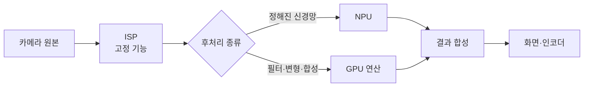

# GPU 연산

!!! spec "규격 · 세대"
    Khronos **OpenCL** 1.2 → 2.x → 3.0(2020, 선택 기능 중심으로 재정리) · OpenGL ES 3.1 컴퓨트 셰이더(2014) · **Vulkan compute**(1.0부터, subgroup 연산은 1.1에서 핵심 기능, 행렬 연산용 `VK_KHR_cooperative_matrix` 확장 2023) · Apple Metal compute·Metal Performance Shaders
    Android: RenderScript 폐기(Android 12에서 지원 중단 발표), NNAPI 폐기 발표(Android 15) → GPU 연산은 Vulkan·OpenCL(벤더 제공)과 LiteRT(구 TensorFlow Lite) GPU 위임 등 라이브러리 경로가 중심(이 페이지 기준 시점)

!!! basic "한눈에 보기"
    GPU는 그림만 그리는 장치가 아닙니다. 수천 개의 단순 계산을 동시에 하는 능력은 사진 보정, 영상 효과, AI 모델 실행에도 그대로 쓸 수 있습니다. 이것을 **GPU 연산(GPGPU)**이라고 합니다.

    1. **같은 계산을 많은 데이터에** — 픽셀마다, 행렬 원소마다 같은 공식을 적용하는 일에 강합니다.
    2. **프로그래밍이 유연함** — NPU보다 다양한 연산을 쓸 수 있고, 새 모델 구조에도 빨리 대응합니다.
    3. **전력 효율은 NPU보다 낮음** — 정해진 신경망 연산만 놓고 보면 전용 NPU가 보통 더 적은 전력으로 처리합니다.

    주방에 비유하면 GPU는 무엇이든 썰 수 있는 숙련된 요리사 여럿이고, NPU는 감자만 아주 빠르게 써는 전용 기계입니다. 감자가 산더미면 기계가 낫지만, 새 메뉴가 생기면 요리사가 먼저 대응합니다.

## 연산 API와 경로 { .l2 }

| 경로 | 특징 | 주 사용처 |
|---|---|---|
| OpenCL | C 계열 커널 언어, 오래된 이식성 표준. Android 필수 구성은 아니지만 다수 SoC 회사가 드라이버 제공 | 카메라·이미지 처리, 일부 AI 런타임 |
| Vulkan compute | 그래픽과 같은 드라이버·메모리 모델, SPIR-V 셰이더, subgroup 연산 | 게임 안 연산, 크로스 플랫폼 AI 런타임 |
| OpenGL ES 컴퓨트 셰이더 | 기존 GLES 앱에 연산 추가 | 레거시 그래픽 효과 |
| Metal compute·MPS | Apple 플랫폼 표준, 최적화된 연산 라이브러리 | Apple 기기의 이미지·AI 처리 |
| AI 런타임 GPU 위임 | LiteRT GPU 위임, 벤더 SDK 등이 위 API 위에서 동작 | 앱 개발자가 직접 커널을 쓰지 않는 경우 |

연산 커널은 **작업 그룹(workgroup)** 단위로 실행되며, 한 그룹은 같은 셰이더 코어에서 돌면서 공유 메모리(Vulkan의 shared memory, OpenCL의 local memory, Metal의 threadgroup memory)를 함께 씁니다. 행렬 곱처럼 같은 데이터를 여러 번 쓰는 계산은 데이터를 공유 메모리에 올려 재사용해야 DRAM 대역폭에 막히지 않습니다.

## GPU와 NPU의 역할 분담 { .l2 }

| 관점 | GPU | NPU |
|---|---|---|
| 연산 형태 | 범용 병렬 연산 (FP32·FP16, 정수) | 행렬·합성곱 중심, 저정밀 정수·부동소수에 특화 |
| 유연성 | 새 연산자·모델 구조를 커널로 바로 구현 | 지원 연산자 목록 밖이면 다른 장치로 넘김 |
| 전력 효율 | 같은 신경망 연산에서 보통 NPU보다 낮음 | 높음 |
| 화면과의 경합 | 게임·UI 렌더링과 같은 자원을 나눔 | 그래픽과 독립 |
| 잘 맞는 일 | 전처리·후처리, 연산자 다양성이 큰 모델, 그래픽과 묶인 효과 | 상시 동작 AI, 큰 모델의 주 연산 |

최근에는 경계가 흐려지고 있습니다. GPU 코어 안에 행렬 연산 유닛을 넣거나(예: 2025년 Apple GPU의 Neural Accelerator 발표, Arm의 GPU용 신경망 가속 발표), Vulkan 확장으로 GPU의 행렬 연산을 직접 쓰게 하는 흐름이 있어, 그래픽 안의 AI(업스케일링 등)는 GPU에서 처리하는 경우가 늘고 있습니다(이 페이지 기준 시점).

이론 연산량은 그래픽과 같은 방식으로 셉니다. 예를 들어 ALU 1024개가 1 GHz로 돌면 FP32 약 **2.05 TFLOPS**이고, FP16을 두 배 속도로 처리하는 설계라면 FP16 약 **4.10 TFLOPS**입니다. 입력은 가상의 값입니다. (수치는 `tools/soc_numbers.py`에서 계산)

??? expert "전문가 노트 — 메모리 한계 판단, 공유 메모리와 zero-copy, 정밀도와 정확도"
    **연산 한계인가, 메모리 한계인가.** 커널의 산술 강도(바이트당 연산 수)가 "이론 FLOPS ÷ 메모리 대역폭"보다 낮으면 ALU를 늘려도 빨라지지 않습니다. 예를 들어 이미지 필터처럼 픽셀을 한 번 읽고 몇 번 계산하는 커널은 거의 항상 대역폭에 묶이고, 큰 행렬 곱은 타일링을 잘하면 연산에 묶입니다. 온디바이스 LLM의 토큰 생성 단계가 GPU에서도 대역폭에 막히는 이유가 이것입니다([온디바이스 LLM](../npu/llm.md)).

    **통합 메모리와 zero-copy.** 모바일 SoC는 CPU·GPU·NPU가 같은 DRAM을 쓰므로, 버퍼를 복사하지 않고 넘길 수 있습니다(dma-buf, `AHardwareBuffer`, OpenCL·Vulkan의 외부 메모리 가져오기). 다만 캐시 일관성 방식(하드웨어 일관성 지원 여부, 캐시 비우기·무효화 필요성)과 압축 형식(UBWC·AFBC 등)이 장치마다 달라, 형식을 맞추지 못하면 압축 해제 복사나 캐시 관리 비용이 생깁니다([캐시와 일관성](../cpu/cache-coherence.md)).

    **subgroup과 행렬 확장.** subgroup 연산(셔플·리덕션·투표)은 공유 메모리를 거치지 않고 워프 안 스레드끼리 값을 주고받아 리덕션·정렬·행렬 곱을 빠르게 합니다. 행렬 확장은 GPU가 가진 행렬 유닛을 API로 노출하지만, 지원하는 타일 크기·데이터 형식이 벤더마다 달라 런타임이 기기별로 커널을 고르는 구조가 일반적입니다.

    **정밀도와 정확도.** 모바일 GPU는 FP16 처리량이 높아 AI·이미지 처리에서 FP16을 많이 쓰지만, 누적 합처럼 오차가 쌓이는 부분은 FP32로 두는 혼합 정밀도가 안전합니다. 또 GPU의 초월 함수·나눗셈은 API가 허용하는 오차 범위 안에서 벤더마다 결과가 조금씩 다를 수 있어, 비트 단위로 같은 결과가 필요한 검증에서는 주의가 필요합니다.

## 칩셋 비교

| 항목 | Snapdragon | Exynos | Dimensity·Tensor | Apple |
|---|---|---|---|---|
| GPU 연산 API | Vulkan, OpenCL (Adreno 드라이버 제공) | Vulkan, OpenCL (기기별 차이) | Vulkan, OpenCL (기기별 차이) | Metal, MPS |
| AI 경로 | 벤더 SDK·런타임이 NPU·GPU·CPU 분배 | 벤더 SDK·런타임 | 벤더 SDK·런타임 | Core ML이 Neural Engine·GPU·CPU 분배 |
| 그래픽 안 AI | 업스케일링·프레임 생성 등 | 엔진 기반 | Arm 신경망 그래픽 기술 발표 | MetalFX, GPU 행렬 가속 (발표 기준) |

> 세대별 GPU 연산 성능 공개 값은 [칩셋 세대 인덱스](../reference/chipset-index.md)에 모읍니다.

## 관련 페이지
- [NPU란 무엇인가](../npu/what-is-npu.md) — GPU와 다른 전용 가속기의 구조
- [AI 소프트웨어 스택](../npu/software.md) — 런타임이 장치를 고르는 방식
- [ISP와 카메라 파이프라인](../media/isp.md) — GPU 연산이 들어가는 카메라 후처리
- [그래픽 API와 드라이버](apis.md) — 연산 API가 쓰는 드라이버 계층
- [온디바이스 LLM](../npu/llm.md) — 대역폭이 정하는 생성 속도
