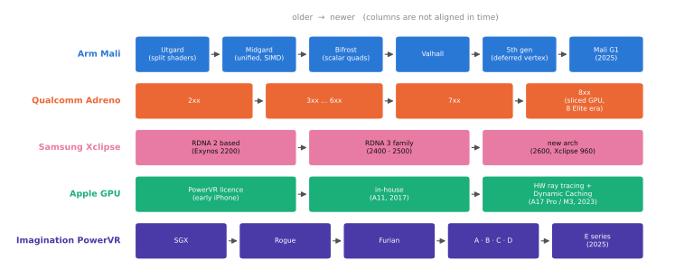

# 주요 GPU 계열

!!! spec "규격 · 세대"
    **Qualcomm Adreno**(2009년 AMD의 모바일 그래픽 사업 인수에서 출발) · **Arm Mali**(Utgard → Midgard → Bifrost → Valhall → 5세대 아키텍처, 상위 등급은 2022년부터 **Immortalis** 브랜드, 2025년 **Mali G1** 계열부터 Ultra·Premium·Pro 등급의 Mali 이름으로 통합) · **Samsung Xclipse**(AMD RDNA 계열 기반, Exynos 2200·2022년부터) · **Apple GPU**(초기 iPhone은 PowerVR 라이선스, A11·2017년부터 자체 설계라고 발표) · **Imagination PowerVR**(TBDR의 원조 계열) · **Google Tensor**(G1–G4는 Arm Mali, G5는 Imagination PowerVR 채택으로 발표)
    모바일 하드웨어 레이 트레이싱 첫 적용: Exynos 2200(2022년 초) → Immortalis-G715 탑재 Dimensity·Adreno 740 탑재 Snapdragon 8 Gen 2(2022년 말) → Apple A17 Pro(2023)

!!! basic "한눈에 보기"
    스마트폰 GPU는 크게 **직접 설계한 GPU**와 **사 온 GPU 설계(IP)**로 나뉩니다.

    1. **직접 설계** — Qualcomm(Adreno), Apple(Apple GPU)은 GPU를 스스로 설계합니다.
    2. **IP 라이선스** — MediaTek·Google 등은 Arm(Mali·Immortalis)이나 Imagination(PowerVR)의 설계를 사서 칩에 넣습니다.
    3. **협력 설계** — Samsung은 AMD와 손잡고 데스크톱·콘솔 계열 GPU 구조(RDNA)를 모바일에 맞춰 Xclipse로 넣었습니다.

    자동차로 치면 엔진을 직접 만드는 회사, 엔진 전문 회사에서 사 오는 회사, 다른 회사와 공동 개발하는 회사가 있는 것과 같습니다. 직접 만들면 차체(SoC)에 딱 맞출 수 있지만 개발비가 크고, 사 오면 빠르고 검증된 대신 차별화가 어렵습니다.

## 계열별 개요 { .l2 }

| 계열 | 출신 | 렌더링 방식 | 쓰는 곳 | 특징 |
|---|---|---|---|---|
| Adreno | ATI·AMD의 모바일 그래픽(Imageon) 사업을 Qualcomm이 인수 | TBR + 직접 모드 하이브리드 | Snapdragon | 전용 GMEM, UBWC, 오랜 Android 게임 최적화 경험 |
| Mali·Immortalis | Arm (Falanx 인수로 시작) | TBR | Dimensity, 과거 Exynos·Tensor, 다수의 중저가 SoC | 가장 널리 라이선스되는 모바일 GPU IP, AFBC |
| Xclipse | AMD RDNA 계열 기반, Samsung이 SoC에 통합 | 데스크톱 계열 구조를 모바일에 맞춤 | Exynos 2200 이후 플래그십 Exynos | 데스크톱·콘솔과 같은 계열의 구조와 기능 |
| Apple GPU | PowerVR 기반에서 자체 설계로 전환 | TBDR | A·M 시리즈 | Metal 전용 최적화, 같은 구조를 아이폰·맥으로 확장 |
| PowerVR | Imagination Technologies | TBDR | 일부 MediaTek·중국 SoC, Tensor G5 | 숨은 면 제거(HSR)의 원조, IP 라이선스 |

## 계보의 흐름 { .l2 }

| 계열 | 아키텍처 단위의 변화 |
|---|---|
| Arm Mali | **Utgard**(꼭짓점·픽셀 셰이더가 분리된 초기 구조) → **Midgard**(통합 셰이더, SIMD 벡터 방식) → **Bifrost**(스칼라 기반 쿼드 실행으로 전환) → **Valhall**(더 넓은 워프, 실행 엔진 재설계) → **5세대 아키텍처**(지연 꼭짓점 셰이딩). 2025년에는 Immortalis 이름을 접고 Ultra·Premium·Pro 등급으로 나눈 Mali G1 계열(Mali G1-Ultra 등)을 발표했습니다 |
| Qualcomm Adreno | 숫자 세대(2xx → 3xx → … → 7xx)마다 셰이더 구조와 렌더링 기능을 키웠고, Snapdragon 8 Elite 세대의 Adreno(8xx)에서 GPU를 여러 슬라이스로 나누는 구조로 재편했다고 발표했습니다 |
| Samsung Xclipse | RDNA 2 기반(Exynos 2200)에서 시작해 Exynos 2400·2500에서 RDNA 3 계열로 갱신했고, Exynos 2600의 Xclipse 960은 새 아키텍처라고만 발표했습니다(RDNA 4 계열이라는 보도가 있음). 향후 자체 GPU 개발 여부는 보도 수준입니다 |
| Apple GPU | 자체 설계 전환 후 매년 개선, A17 Pro·M3 세대(2023)에서 하드웨어 레이 트레이싱·메시 셰이딩과 함께 칩 안 메모리를 동적으로 나눠 쓰는 Dynamic Caching을 소개했습니다. 2025년 세대(A19·M5)에서는 GPU 코어마다 행렬 연산 가속기(Neural Accelerator)를 넣었다고 발표했습니다 |
| PowerVR | SGX → Rogue → Furian → A·B·C·D·E 시리즈(알파벳 세대 이름, E 시리즈는 2025년 발표)로 이어졌고, 최근 세대에서 레이 트레이싱과 연산 기능을 강화했습니다 |

## 설계 철학의 차이 { .l2 }

| 관점 | 자체 설계 (Adreno, Apple) | IP 라이선스 (Mali, PowerVR) | 협력 설계 (Xclipse) |
|---|---|---|---|
| SoC 맞춤 | 메모리 시스템·디스플레이·전력 관리와 깊게 맞춤 | 표준 인터페이스(AMBA)로 붙이고 코어 수로 등급 조절 | AMD 구조를 Samsung SoC 환경에 맞추는 통합 작업 필요 |
| 드라이버 | SoC 회사가 직접 개발 | IP 회사가 기본 드라이버 제공, SoC 회사가 통합·튜닝 | 공동 개발 |
| 등급 확장 | 칩 등급별로 별도 구성 | 같은 IP에서 코어 수만 바꿔 플래그십부터 보급형까지 | 주로 플래그십 |
| 장점 | 차별화, 전력 최적화 | 개발 기간 단축, 검증된 생태계 | 데스크톱 계열 기능·도구와의 친화성 |

??? expert "전문가 노트 — IP 모델의 경제학, Tensor의 선택, 같은 계열 안의 차이"
    **IP 모델의 경제학.** GPU를 새로 설계하는 데는 하드웨어뿐 아니라 셰이더 컴파일러·드라이버·적합성 테스트·게임 회사 지원까지 큰 고정 비용이 듭니다. 매년 여러 등급의 칩을 내는 회사에게는 같은 IP의 코어 수만 바꿔 쓰는 쪽이 효율적이고, Arm Mali가 가장 많이 쓰이는 모바일 GPU가 된 배경입니다. 반대로 플래그십 한두 개에 집중하는 회사는 차별화를 위해 자체 설계나 협력 설계를 택합니다.

    **Tensor의 선택.** Google Tensor는 초기 세대에서 Samsung 설계 기반 SoC에 Arm Mali를 썼고, TSMC 생산으로 바뀐 Tensor G5에서 Imagination PowerVR로 GPU를 바꿨다고 발표했습니다. 이런 교체는 드라이버 스택 전체가 바뀐다는 뜻이므로, 게임 호환성과 드라이버 성숙도가 초기 평가의 중요한 변수가 됩니다. 같은 Android라도 GPU 계열이 바뀌면 셰이더 컴파일러의 버그·최적화 특성이 달라집니다.

    **같은 계열, 다른 칩.** 같은 IP 이름(예: 같은 Immortalis)이라도 SoC마다 코어 수, 클럭, SLC 크기, DRAM 속도, 열 설계가 달라 실제 성능이 크게 다릅니다. IP 이름은 "엔진 모델"이고 실제 성능은 "차 전체"가 정한다고 보는 편이 정확합니다. 비교할 때는 GPU 이름보다 SoC 단위의 지속 성능과 전력을 봐야 합니다.

    **용어 주의.** 벤더마다 "코어"의 의미가 다릅니다. Mali의 코어, Apple의 GPU 코어, Adreno의 SP·슬라이스, AMD의 CU·WGP는 서로 크기가 다른 단위라 코어 수를 직접 비교할 수 없습니다. 이 책은 세대별 코어 수를 본문에 쓰지 않고 [칩셋 세대 인덱스](../reference/chipset-index.md)에 출처와 함께 모읍니다.

## 칩셋 비교

| 항목 | Snapdragon | Exynos | Dimensity | Apple | Tensor |
|---|---|---|---|---|---|
| 플래그십 GPU | Adreno (자체 설계) | Xclipse (AMD RDNA 계열 기반, 2022년 이후) | Arm Immortalis·Mali 상위 계열 | Apple GPU (자체 설계) | G1–G4 Arm Mali, G5 PowerVR (발표 기준) |
| 이전 계열 | Adreno 계속 | Arm Mali | Arm Mali (과거 Helio 일부는 PowerVR) | PowerVR 기반 | — |
| 그래픽 API | OpenGL ES, Vulkan | OpenGL ES, Vulkan | OpenGL ES, Vulkan | Metal | OpenGL ES, Vulkan |

> 세대별 GPU 이름과 공개된 구성은 [칩셋 세대 인덱스](../reference/chipset-index.md)에 모읍니다.

## 관련 페이지
- [모바일 GPU 구조](architecture.md) — 계열을 가로지르는 공통 구조
- [그래픽 API와 드라이버](apis.md) — 계열마다 다른 드라이버 스택
- [자체 설계 코어](../cpu/custom-cores.md) — CPU에서의 자체 설계·라이선스 선택
- [IP와 통합](../design/ip-integration.md) — 라이선스 IP를 SoC에 넣는 과정
- [주요 제조사와 생태계](../getting-started/ecosystem.md) — GPU 공급 관계의 큰 그림
