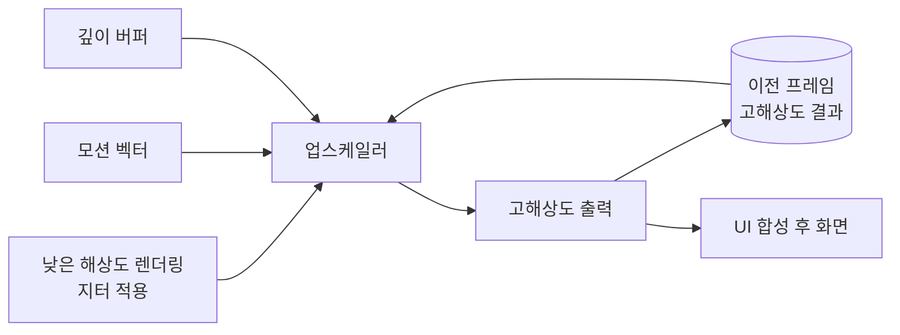

# 레이 트레이싱과 업스케일링

!!! spec "규격 · 세대"
    API: Vulkan 레이 트레이싱 확장(`VK_KHR_acceleration_structure`·`VK_KHR_ray_query`·`VK_KHR_ray_tracing_pipeline`, 2020년 최종) · Metal 레이 트레이싱 API · 업스케일링: Qualcomm **Snapdragon GSR**(1세대 공간, 2세대 시간 방식) · **Arm ASR**(Accuracy Super Resolution, 2024, AMD FSR 2 기반) · Apple **MetalFX**(2022, 공간·시간 업스케일링, Metal 4(2025)에서 프레임 보간·디노이저 추가)
    모바일 하드웨어 레이 트레이싱: Exynos 2200(2022) → Immortalis-G715·Adreno 740 세대(2022년 말) → Apple A17 Pro(2023) → 이후 플래그십 GPU 대부분이 지원(이 페이지 기준 시점)

!!! basic "한눈에 보기"
    **레이 트레이싱**은 빛이 물체에 부딪히고 반사되는 경로를 따라가며 그림을 그리는 방식입니다. 반사·그림자·유리 표현이 자연스럽지만 계산이 매우 많습니다. **업스케일링**은 반대로 계산을 줄이는 기술로, 작은 해상도로 그린 뒤 똑똑하게 키웁니다.

    1. **광선 쏘기** — 픽셀마다 광선을 쏘아 어떤 물체에 처음 닿는지 찾습니다.
    2. **가속 구조** — 모든 삼각형을 검사하지 않도록 장면을 상자 계층(BVH)으로 미리 정리합니다.
    3. **업스케일링** — 낮은 해상도로 그린 뒤 이전 프레임 정보까지 활용해 높은 해상도로 복원합니다.

    도서관에서 책 한 권을 찾을 때 모든 책장을 훑지 않고 "층 → 구역 → 서가" 순서로 좁혀 가는 것이 BVH입니다. 업스케일링은 스케치를 작게 그린 뒤 이전 그림을 참고해 세밀하게 확대하는 화가와 같습니다.

## 하드웨어 레이 트레이싱의 구조 { .l2 }

| 단계 | 하는 일 | 하드웨어 가속 여부 |
|---|---|---|
| 가속 구조 생성 | 삼각형을 감싸는 상자(AABB)를 나무 구조(BVH)로 정리 | 주로 GPU 연산 셰이더·드라이버 |
| BVH 순회 | 광선이 어느 상자를 지나는지 위에서 아래로 따라감 | 전용 유닛이 가속하는 설계와 셰이더가 일부 맡는 설계가 있음 |
| 광선-삼각형 교차 | 광선이 삼각형에 닿는 지점 계산 | 전용 유닛 가속 |
| 셰이딩 | 닿은 지점의 색, 반사·그림자 광선 추가 | 일반 셰이더 코어 |
| 디노이즈 | 픽셀당 광선이 적어 생기는 잡음 제거 | 셰이더(시간 누적·필터) |

모바일 게임은 장면 전체를 레이 트레이싱하기보다, 기존 래스터화에 **그림자·반사·주변광 차폐 등 일부 효과만** 레이 트레이싱을 섞는 하이브리드 방식이 일반적입니다. Vulkan의 `ray query`는 일반 셰이더 안에서 광선 질의를 할 수 있어 이런 하이브리드에 잘 맞습니다.

## 업스케일링과 프레임 생성 { .l2 }

| 방식 | 입력 | 특징 | 예 |
|---|---|---|---|
| 공간 업스케일링 | 현재 프레임 하나 | 가볍고 통합이 쉬움, 세부 복원에 한계 | Snapdragon GSR 1세대, MetalFX 공간 |
| 시간 업스케일링 | 현재 프레임 + 모션 벡터 + 깊이 + 이전 결과 | 세부 복원이 좋음, 엔진 통합 필요, 고스팅 관리 | Snapdragon GSR 2세대, Arm ASR, MetalFX 시간 |
| 신경망 업스케일링 | 시간 방식 입력 + 학습된 모델 | 품질 향상 기대, 행렬 연산 성능 필요 | Arm Neural Super Sampling(2025 발표, 2026년 이후 GPU 대상), Samsung ENSS(Exynos 2600) |
| 프레임 생성(보간) | 연속한 두 프레임 + 모션 정보 | 렌더링하지 않은 중간 프레임을 만들어 화면 갱신 빈도를 높임, 입력 지연은 줄지 않음 | Qualcomm Adreno Frame Motion Engine, MetalFX 프레임 보간(Metal 4) |

업스케일링의 이득은 픽셀 수에서 옵니다. 가로·세로를 각각 2/3로 렌더링하면 픽셀 수는 약 **44%**, 각각 1/2이면 **25%**가 됩니다. 셰이딩 비용이 픽셀 수에 비례한다고 가정하면 그만큼 GPU 일이 줄고, 남은 시간을 업스케일러 실행과 발열 여유에 씁니다. (수치는 `tools/soc_numbers.py`에서 계산)

??? expert "전문가 노트 — 모바일 RT의 병목, BVH 갱신 비용, 업스케일러 통합의 함정"
    **모바일 RT의 병목은 메모리.** BVH 순회는 광선마다 다른 노드를 읽는 불규칙한 메모리 접근이라 캐시 적중률이 낮고, 같은 워프 안 광선들이 서로 다른 경로로 갈라지면 SIMT 효율도 떨어집니다. 타일 메모리로 대역폭을 아끼는 모바일 GPU 구조와 가장 맞지 않는 작업이 레이 트레이싱인 셈입니다. 벤더들이 광선 정렬·재배치, 압축된 BVH 노드 형식, 순회 전용 하드웨어를 연구하는 이유이며, 실제 게임이 광선 수를 크게 줄이고 디노이즈에 의존하는 이유입니다.

    **BVH 갱신 비용.** 움직이는 물체가 있으면 매 프레임 BVH를 다시 만들거나 고쳐야 합니다. 일반적으로 정적인 배경은 한 번 만든 하위 구조(BLAS)를 재사용하고, 물체 배치만 담은 상위 구조(TLAS)를 매 프레임 갱신합니다. 변형되는 캐릭터처럼 꼭짓점이 바뀌는 물체는 전체 재구성 대신 갱신(refit)을 써서 품질을 조금 잃고 시간을 아낍니다.

    **업스케일러 통합의 함정.** 시간 업스케일러는 정확한 모션 벡터와 카메라 지터, 깊이가 있어야 하며, 파티클·투명 물체처럼 모션 벡터가 없는 요소에서 고스팅이 생기기 쉽습니다. UI는 업스케일링 뒤에 원래 해상도로 합성해야 글자가 흐려지지 않습니다. 모바일에서는 업스케일러 자체의 실행 시간과 대역폭도 무시할 수 없어, 고해상도 출력 버퍼를 DRAM에 여러 번 쓰지 않도록 패스 구성을 줄이는 최적화가 중요합니다.

    **프레임 생성과 체감.** 보간으로 화면 갱신 빈도는 높아지지만, 게임 로직과 입력 반영은 실제 렌더링 프레임 기준이므로 반응 속도는 그대로이거나 약간 나빠집니다. 원래 프레임 속도가 너무 낮으면 보간 오류가 눈에 띄므로, 대개 일정 수준 이상의 기본 프레임 속도를 전제로 씁니다. 고주사율 디스플레이·가변 주사율과의 연동은 [디스플레이 파이프라인](../media/display.md)에서 다룹니다.

## 칩셋 비교

| 항목 | Snapdragon | Exynos | Dimensity | Apple |
|---|---|---|---|---|
| 하드웨어 레이 트레이싱 | 지원 (Adreno 740 세대부터) | 지원 (Xclipse, RDNA 계열 방식) | 지원 (Immortalis 계열부터) | 지원 (A17 Pro부터) |
| 업스케일링 | Snapdragon GSR | 엔진·타사 업스케일러, Exynos 2600부터 ENSS | Arm ASR 등 | MetalFX |
| 프레임 생성 | Adreno Frame Motion Engine | Exynos 2600의 신경망 프레임 생성 발표 | 벤더 기술 발표 | MetalFX 프레임 보간 (Metal 4) |
| API 경로 | Vulkan 확장 | Vulkan 확장 | Vulkan 확장 | Metal |

> 세대별 레이 트레이싱 지원 여부는 [칩셋 세대 인덱스](../reference/chipset-index.md)에 모읍니다.

## 관련 페이지
- [모바일 GPU 구조](architecture.md) — RT 유닛이 들어가는 셰이더 코어
- [주요 GPU 계열](families.md) — 계열별 RT 도입 시점
- [그래픽 API와 드라이버](apis.md) — Vulkan·Metal 레이 트레이싱 API
- [열 관리와 스로틀링](../power/thermal.md) — 업스케일링이 지키는 발열 여유
- [디스플레이 파이프라인](../media/display.md) — 프레임 보간과 화면 주사율
