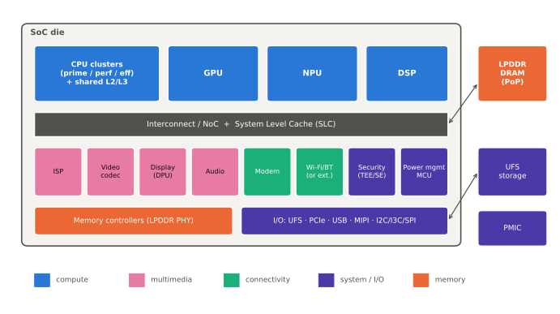

---
hide:
  - navigation
---

# SoC Handbook

**Snapdragon, Exynos, Dimensity, Apple Silicon, Tensor — 스마트폰 한 대를 움직이는 칩 한 개의 구조.**
처음 공부하는 사람은 "이 블록이 왜 필요한가"부터, 현업 엔지니어는 마이크로아키텍처와 전력·공정 디테일까지 한 페이지 안에서 단계적으로 읽을 수 있도록 만든 한글 모바일 SoC 핸드북입니다.

## 이 핸드북을 읽는 법

모든 페이지는 같은 틀을 따르고, 난이도를 신호 막대 아이콘으로 구분합니다.

| 표시 | 대상 | 내용 |
|---|---|---|
| 기초 | 처음 공부하는 사람, 비전공자 | 개념, 비유, "왜 이렇게 만들었나" — 수식 없이 |
| 중급 | 전공자, 앱·시스템 소프트웨어 개발자 | 구조, 파라미터 표, 블록 그림, 칩셋 비교 |
| 전문가 | SoC 설계·검증, 커널·펌웨어, 성능·전력 엔지니어 | 마이크로아키텍처, 수식, 트레이드오프, 커널 코드 위치, 실무 팁 (접힌 상자) |

!!! spec "규격 · 세대 박스"
    각 페이지 맨 위의 이 상자에는 관련 표준(Arm 아키텍처 버전, JEDEC LPDDR, UFS, MIPI, AMBA 등)과 해당 기능이 처음 들어간 칩셋 세대가 적혀 있습니다.

    세대별 코어 구성·클럭·공정 같은 숫자는 매년 바뀌므로 본문에 흩어 쓰지 않고 [칩셋 세대 인덱스](reference/chipset-index.md) 한 곳에 기준 시점과 출처를 붙여 모읍니다.

약어 위에 마우스를 올리면 풀네임이 툴팁으로 나옵니다. 예: SLC, DVFS, NoC

## 섹션

-   :material-flag-checkered: **시작하기**

    ---

    SoC의 정의, 모바일 SoC의 역사, 제조사와 생태계, 칩셋 이름 읽는 법, 학습 로드맵

    [:octicons-arrow-right-24: 시작하기](getting-started/index.md)

-   :material-sine-wave: **공통 기초**

    ---

    트랜지스터와 CMOS, 공정 노드, 컴퓨터 구조, 메모리 계층, 클럭과 전압, 인터커넥트, PPA

    [:octicons-arrow-right-24: 공통 기초](basics/index.md)

-   :material-cpu-64-bit: **CPU**

    ---

    Arm 아키텍처, Cortex·C1 코어 계보, 자체 설계 코어, 이기종 클러스터, 캐시 일관성, EAS

    [:octicons-arrow-right-24: CPU](cpu/index.md)

-   :material-gamepad-variant: **GPU**

    ---

    타일 기반 렌더링, Adreno·Mali·Xclipse·Apple GPU, Vulkan, 레이 트레이싱, GPU 연산

    [:octicons-arrow-right-24: GPU](gpu/index.md)

-   :material-brain: **NPU와 AI**

    ---

    NPU 구조, Hexagon·삼성 NPU·APU·Neural Engine, TOPS의 함정, 온디바이스 LLM

    [:octicons-arrow-right-24: NPU와 AI](npu/index.md)

-   :material-camera-iris: **멀티미디어**

    ---

    ISP와 카메라 파이프라인, MIPI CSI-2, 비디오 코덱, 디스플레이, 오디오 DSP, 센서 허브

    [:octicons-arrow-right-24: 멀티미디어](media/index.md)

-   :material-memory: **메모리와 저장장치**

    ---

    LPDDR4X–6, 메모리 컨트롤러와 SLC, PoP 패키지, UFS, SMMU와 MTE

    [:octicons-arrow-right-24: 메모리와 저장장치](memory/index.md)

-   :material-access-point-network: **연결**

    ---

    통합 모뎀, Wi-Fi·Bluetooth 콤보, GNSS·UWB, PCIe·USB, 저속 주변장치

    [:octicons-arrow-right-24: 연결](connectivity/index.md)

-   :material-thermometer: **전력과 열**

    ---

    DVFS, 파워 게이팅, PMIC, 스로틀링, 대기 전력, 전력 측정

    [:octicons-arrow-right-24: 전력과 열](power/index.md)

-   :material-shield-lock: **보안과 부팅**

    ---

    보안 부팅 체인, TrustZone과 TEE, 보안 프로세서, 키 관리, 하드웨어 공격, 가상화

    [:octicons-arrow-right-24: 보안과 부팅](security/index.md)

-   :material-factory: **설계와 제조**

    ---

    RTL에서 테이프아웃까지, IP 통합, 검증, 파운드리, 패키징, 시험과 빈닝

    [:octicons-arrow-right-24: 설계와 제조](design/index.md)

-   :material-tools: **소프트웨어와 실무**

    ---

    Android BSP와 GKI, 커널 SoC 지원, Perfetto, 벤치마크 읽는 법, 개발 보드

    [:octicons-arrow-right-24: 소프트웨어와 실무](software/index.md)

-   :material-rocket-launch: **최신 동향**

    ---

    2nm GAA 경쟁, Arm PC, 차량용 SoC, RISC-V

    [:octicons-arrow-right-24: 최신 동향](next/index.md)

-   :material-bookshelf: **레퍼런스**

    ---

    칩셋 세대 인덱스, 제조사별 비교, 표준 인덱스, 약어 사전, 계산기

    [:octicons-arrow-right-24: 레퍼런스](reference/index.md)

## 자매 핸드북

- [Bluetooth Handbook](https://goodhosup.github.io/bluetooth/) — Classic · LE · LE Audio
- [Cellular Handbook](https://goodhosup.github.io/cellular/) — LTE · 5G NR · 6G
- [Wi-Fi Handbook](https://goodhosup.github.io/wifi/) — IEEE 802.11 · Wi-Fi 6/7/8

!!! note "출처와 저작권"
    본문과 그림은 직접 작성했습니다. 표준 문서(Arm 아키텍처 매뉴얼, JEDEC, MIPI, JEDEC UFS 등)와 제조사 발표·학회 논문은 문서·발표 이름만 출처로 인용하며, 제조사 다이 사진이나 블록도, 발표 슬라이드를 복제하지 않습니다.
    공식 발표가 아닌 수치(분해 분석, 벤치마크 측정)는 "추정"으로 표기합니다. 정확한 값은 항상 제조사 최신 자료로 확인하세요.
