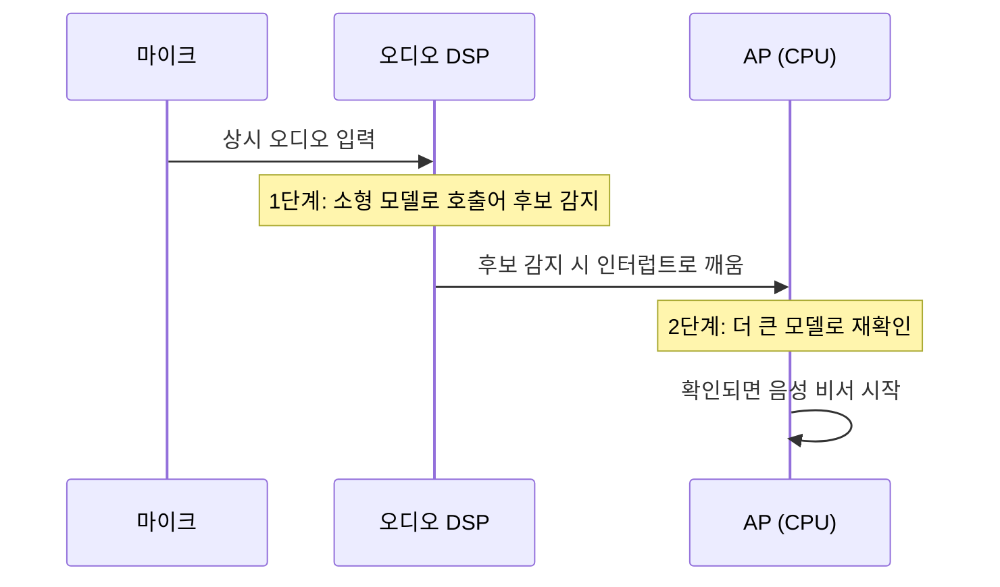

# 오디오와 DSP

!!! spec "규격 · 세대"
    오디오 버스: I2S·TDM(디지털 오디오 직렬), PDM(디지털 마이크), MIPI **SoundWire**(2014 발표, 오디오 코덱·앰프 연결) · 무선: Bluetooth Classic A2DP(SBC·AAC 등) → **Bluetooth LE Audio**(Core 5.2의 등시 채널 기반, LC3 코덱, Auracast 브로드캐스트) · 유선: USB Audio Class
    흐름: CPU 소프트웨어 처리 → 오디오 DSP 오프로드(재생·통화) → 상시 저전력 음성 호출어 감지(Apple은 2015년 A9 세대부터 전원 연결 없이 "Hey Siri" 상시 감지) → Bluetooth 코덱 인코딩의 DSP 오프로드

!!! basic "한눈에 보기"
    음악 재생이나 "헤이, ○○" 같은 음성 호출은 계산량은 작지만 **오래, 끊김 없이** 돌아야 합니다. 이런 일을 큰 CPU에 맡기면 CPU가 계속 깨어 있어야 해서 배터리가 빨리 닳습니다. 그래서 SoC에는 오디오를 전담하는 작은 **DSP(Digital Signal Processor)**가 있습니다.

    1. **재생 오프로드** — 음악 파일을 큰 덩어리로 DSP에 넘기고 CPU는 잠듭니다. DSP가 복호·음향 효과·출력을 맡습니다.
    2. **호출어 감지** — DSP가 아주 적은 전력으로 마이크를 계속 듣다가, 호출어 같은 소리가 나면 그때 CPU를 깨웁니다.
    3. **통화 처리** — 에코 제거, 잡음 억제, 여러 마이크를 이용한 빔포밍을 실시간으로 처리합니다.
    4. **무선 이어폰** — Bluetooth로 보낼 오디오를 DSP가 압축해 무선 칩으로 넘깁니다.

    식당의 **야간 경비원**에 비유할 수 있습니다. 사장(CPU)이 밤새 가게를 지킬 필요 없이, 경비원이 조용히 지키다가 손님이 오면 그때 사장을 부릅니다.

## 오디오 서브시스템 구성 { .l2 }

| 구성 요소 | 역할 | 비고 |
|---|---|---|
| 오디오 DSP | 복호·인코딩, 음향 효과, 통화 처리, 호출어 1단계 감지 | Qualcomm은 Hexagon DSP를 오디오 용도로 씀 |
| 저전력 오디오 영역 | DSP, 오디오 인터페이스, 작은 메모리를 묶은 별도 전원 영역 | AP가 잠들어도 동작 |
| 오디오 인터페이스 | I2S·TDM·SoundWire·PDM 컨트롤러 | 외부 칩과 연결 |
| 외부 오디오 코덱 칩 | DAC·ADC, 헤드폰 앰프, 마이크 바이어스 | 아날로그 회로는 보통 SoC 밖 또는 PMIC 쪽 |
| 스마트 앰프 | 스피커 보호(온도·변위 제한)를 위한 피드백 처리 | 앰프 칩 또는 DSP에서 처리 |

PCM 오디오 데이터량은 작습니다. 48 kHz, 24비트, 스테레오는 48,000 × 24 × 2 ≈ **2.3 Mbps**로, 카메라·디스플레이의 수 Gbps와 비교하면 천분의 일 수준입니다. 오디오의 어려움은 대역폭이 아니라 **지연과 끊김 없음, 그리고 상시 동작 전력**입니다. (수치는 `tools/soc_numbers.py`에서 계산)

## 저전력 음성 호출어 감지 { .l2 }

1단계 감지기는 오탐을 어느 정도 허용하는 대신 매우 작게 만들어 DSP 안의 작은 메모리에 상주시키고, 2단계 확인은 AP나 NPU에서 더 정확한 모델로 합니다. 호출어 직전의 오디오는 DSP가 버퍼에 보관해 두었다가 AP에 넘겨, 사용자가 말을 끊지 않아도 명령 전체가 인식되게 합니다.

??? expert "전문가 노트 — 재생 오프로드의 전력, 지연 예산, Bluetooth LE Audio 오프로드"
    **재생 오프로드의 전력.** 일반 재생 경로는 CPU가 짧은 주기로 PCM 버퍼를 채워야 해서 CPU가 자주 깨어납니다. 압축 오프로드(compress offload)는 압축된 스트림을 큰 버퍼로 DSP에 넘기므로 AP가 수 초 단위로 잠들 수 있어, 화면을 끈 음악 재생 전력이 크게 줄어듭니다. Linux에서는 ALSA ASoC 프레임워크와 compress API가 이 경로를 표현하고, Qualcomm 계열은 `sound/soc/qcom/`, DSP 펌웨어 로딩은 `drivers/remoteproc/`의 원격 프로세서 드라이버가 맡습니다.

    **지연 예산.** 게임·악기 앱·통화는 짧은 지연이 중요합니다. 버퍼가 크면 전력은 줄지만 지연이 늘고, 작으면 지연은 줄지만 CPU가 자주 깨어나고 버퍼 언더런 위험이 커집니다. Android는 저지연 경로(AAudio의 MMAP 모드 등)와 고효율 오프로드 경로를 따로 두어 용도별로 고르게 합니다. 통화의 에코 제거는 스피커 출력과 마이크 입력의 시간 정렬이 정확해야 하므로, 두 경로가 같은 클럭 영역에서 처리되는 것이 유리합니다.

    **Bluetooth LE Audio 오프로드.** LE Audio는 등시 채널(isochronous channel) 위에서 LC3 코덱으로 오디오를 보내며, 낮은 비트레이트에서도 음질을 유지하도록 설계되었습니다. 인코딩을 DSP에서 하고 결과를 Bluetooth 컨트롤러로 바로 넘기면, AP가 오디오 패킷 타이밍에 관여하지 않아도 되어 전력과 지연이 모두 줄어듭니다. Android는 Bluetooth 오디오 HAL을 통해 이 하드웨어 오프로드 경로를 지원합니다. 다만 등시 채널의 타이밍은 컨트롤러가 정하므로, DSP와 Bluetooth 칩 사이의 클럭 동기와 버퍼 관리가 구현의 핵심입니다([Wi-Fi·Bluetooth 콤보](../connectivity/wifi-bt.md)).

    **DSP의 다른 역할.** Hexagon처럼 범용성이 높은 DSP는 오디오뿐 아니라 센서 처리·카메라 후처리·신경망 연산에도 쓰여 왔고, 최근에는 신경망용 텐서 가속기를 붙여 NPU로 발전했습니다. 그래서 같은 이름의 DSP 계열이라도 SoC 안에는 오디오용, 센서용, 연산용 인스턴스가 따로 있는 경우가 많습니다([센서 허브](sensor-hub.md)).

## 칩셋 비교

| 항목 | Snapdragon | Exynos | Dimensity | Apple |
|---|---|---|---|---|
| 오디오 처리 | 저전력 오디오 영역의 Hexagon DSP | 자체 오디오 서브시스템(DSP 포함) | 자체 오디오 DSP | 자체 오디오 처리, 상시 동작 영역 |
| 무선 오디오 | 자사 Bluetooth 칩·aptX 계열과 연계 | 외부·자사 Bluetooth 칩과 연계 | 자사 연결 칩과 연계 | 자사 이어폰과 수직 통합 |
| 공개 정보 | 업스트림 ASoC·remoteproc 드라이버 존재 | 벤더 커널 중심 | 벤더 커널 중심 | 비공개 |

> 세대별 오디오 기능과 지원 코덱은 [칩셋 세대 인덱스](../reference/chipset-index.md)에 모읍니다.

## 관련 페이지
- [센서 허브](sensor-hub.md) — 같은 상시 저전력 영역을 쓰는 센서 처리
- [Wi-Fi·Bluetooth 콤보](../connectivity/wifi-bt.md) — LE Audio의 무선 쪽
- [NPU란 무엇인가](../npu/what-is-npu.md) — DSP에서 발전한 신경망 가속기
- [대기 전력과 저전력 상태](../power/idle.md) — AP가 잠든 동안의 전력
- [파워 도메인과 게이팅](../power/power-domains.md) — 저전력 오디오 영역의 전원 분리
