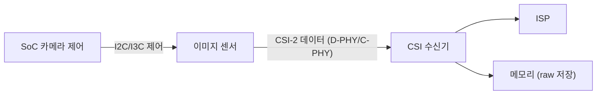

# 이미지 센서 인터페이스

!!! spec "규격 · 세대"
    MIPI **CSI-2**(Camera Serial Interface 2, 프로토콜 계층) + 물리 계층 MIPI **D-PHY**(v1.0 2009 → v2.x) 또는 **C-PHY**(v1.0 2014 → v2.x) · 장거리(차량)용 MIPI A-PHY · 센서 제어는 I2C 또는 I3C(CCI, Camera Control Interface)
    스마트폰 적용: D-PHY 기반 CSI-2가 오랫동안 표준 → 고화소 센서와 함께 C-PHY 지원이 플래그십 SoC·센서에 확산. 한 SoC가 D-PHY·C-PHY를 모두 받는 겸용 PHY가 일반적

!!! basic "한눈에 보기"
    카메라 센서와 SoC 사이에는 **사진 데이터를 쏟아 붓는 고속 전용 도로**가 있습니다. 이것이 MIPI CSI-2입니다.

    1. **한 방향 고속 도로** — 센서에서 SoC로만 대량의 화소 데이터가 흐릅니다.
    2. **여러 차선** — 선(레인)을 늘리면 그만큼 더 많은 데이터를 보낼 수 있습니다.
    3. **별도의 작은 제어선** — 노출·게인 같은 설정은 I2C·I3C라는 느린 선으로 따로 보냅니다.
    4. **한 도로에 여러 차** — 한 링크로 영상, 위상차 정보, HDR용 장·단 노출 프레임을 섞어 보내고 꼬리표(virtual channel)로 구분합니다.

    고화소·고프레임 센서일수록 보내야 할 데이터가 커서, 차선을 늘리거나 차선당 속도가 빠른 새 물리 계층(C-PHY)을 씁니다.

## D-PHY와 C-PHY { .l2 }

| 항목 | D-PHY | C-PHY |
|---|---|---|
| 신호 방식 | 차동 쌍(선 2개)마다 1비트, 별도 클럭 레인 | 선 3개(trio)로 3상 심볼, 클럭을 심볼에 내장 |
| 레인 구성 | 데이터 레인 1·2·4개 + 클럭 레인 1개 | trio 1–3개가 일반적 |
| 부호화 효율 | 심볼(비트)당 1비트 | 심볼당 약 2.28비트 (7심볼에 16비트) |
| 대표 최대 속도 | v2.x 기준 레인당 4.5 Gbps | v2.0 기준 trio당 6 Gsps → 약 13.7 Gbps |
| 대표 최대 링크 | 4레인 18 Gbps | 3 trio 약 41.1 Gbps |
| 장단점 | 단순, 생태계 넓음 | 같은 핀 수로 더 높은 대역폭, 회로가 복잡 |

D-PHY는 고속 전송(HS)과 저전력 제어(LP) 두 모드를 오가며, 프레임 사이 블랭킹 동안 저전력 상태로 들어가 전력을 아낍니다. 표의 최대 속도는 규격 버전 기준이며, 실제 제품의 지원 속도는 SoC와 센서마다 다릅니다. (수치는 `tools/soc_numbers.py`에서 계산)

## CSI-2 패킷과 virtual channel { .l2 }

| 요소 | 내용 |
|---|---|
| 짧은 패킷 | 프레임 시작·끝, 라인 시작·끝 같은 동기 신호 |
| 긴 패킷 | 헤더 + 한 줄 분량의 화소 데이터 + 오류 검출 코드 |
| 데이터 타입 | RAW8·RAW10·RAW12 등 raw 포맷, YUV, 임베디드 메타데이터 |
| virtual channel | 한 링크 위의 논리 스트림 번호. 기본 4개이며 CSI-2 v2.0 이후 확장 가능 |

virtual channel은 **한 센서의 여러 스트림**(예: HDR용 장·단 노출 프레임, 위상차 AF 데이터)이나 **한 링크를 공유하는 여러 센서**(브리지 칩을 거치는 경우)를 구분하는 데 씁니다. SoC 쪽 CSI 수신기는 virtual channel과 데이터 타입별로 데이터를 나눠 ISP 또는 메모리로 보냅니다.

??? expert "전문가 노트 — 센서 대역폭 계산, 블랭킹과 오버헤드, 신호 무결성"
    **센서 대역폭 계산.** 화소 데이터 속도는 다음과 같습니다.

    $$
    R = W \times H \times b \times f
    $$

    1200만 화소(4000 × 3000), 10비트, 30 fps면 3.6 Gbps, 4K(3840 × 2160) 10비트 60 fps 영상 읽기면 약 4.98 Gbps입니다. 약 5000만 화소(8192 × 6144) 10비트 30 fps 전체 읽기는 약 15.1 Gbps로, D-PHY 4레인 최대치(18 Gbps)에 바짝 붙고 C-PHY 3 trio(약 41.1 Gbps)에서는 여유가 있습니다. 고화소 센서가 C-PHY로 옮겨 간 이유입니다. (수치는 `tools/soc_numbers.py`에서 계산)

    **블랭킹과 오버헤드.** 실제 링크에는 수평·수직 블랭킹, 패킷 헤더·푸터, 임베디드 데이터 줄이 더해집니다. 센서는 한 프레임을 프레임 시간보다 짧게 읽어 내는 경우가 많아(롤링 셔터 왜곡을 줄이기 위해), **읽기 구간의 순간 속도**가 평균 속도보다 높습니다. 링크 설계는 평균이 아니라 이 순간 속도를 기준으로 하며, 여기에 마진을 둡니다. 정확한 오버헤드 비율은 센서 모드마다 다르므로 데이터시트의 모드별 링크 속도를 기준으로 봐야 합니다.

    **신호 무결성과 EMI.** 카메라 모듈은 플렉스 케이블로 메인 보드에 연결되므로, 수 Gbps 신호의 반사·손실·누화가 문제가 됩니다. 수신기는 이퀄라이저와 디스큐(deskew) 보정을 쓰고, 고속 신호가 셀룰러·Wi-Fi 수신 대역에 간섭하지 않도록 링크 속도를 일부러 조정하기도 합니다. C-PHY는 클럭 레인이 없고 심볼 전환에 클럭을 실어 보내므로 레인 간 스큐에 비교적 강합니다.

    **커널에서 보이는 모습.** Linux에서 CSI-2 수신기와 센서는 V4L2 서브디바이스와 media controller 그래프로 표현되고, 디바이스 트리의 `data-lanes`, `link-frequencies` 같은 속성으로 레인 수와 링크 속도를 지정합니다. 센서 드라이버는 `drivers/media/i2c/`에 있습니다.

## 칩셋 비교

| 항목 | 플래그십 스마트폰 SoC | 보급형 스마트폰 SoC | 차량용 SoC |
|---|---|---|---|
| 물리 계층 | D-PHY·C-PHY 겸용이 일반적 | D-PHY 중심 | 직렬화 칩을 거친 장거리 링크(A-PHY 또는 독자 규격) |
| 동시 센서 수 | 여러 개(광각·초광각·망원·전면) | 적음 | 많음(서라운드 뷰 등) |
| 우선순위 | 고화소·고프레임 대역폭 | 비용·핀 수 | 케이블 길이·기능 안전 |

> 세대별 SoC의 CSI 포트 수와 지원 PHY는 [칩셋 세대 인덱스](../reference/chipset-index.md)에 모읍니다.

## 관련 페이지
- [ISP와 카메라 파이프라인](isp.md) — 수신한 raw 데이터의 처리
- [디스플레이 파이프라인](display.md) — 같은 D-PHY·C-PHY를 쓰는 출력 쪽 MIPI DSI
- [저속 주변장치 (I2C·I3C·SPI·UART)](../connectivity/low-speed.md) — 센서 제어 버스
- [UFS 저장장치](../memory/ufs.md) — 또 다른 MIPI 물리 계층인 M-PHY
- [차량용 SoC](../next/automotive.md) — 다수 카메라와 장거리 링크
