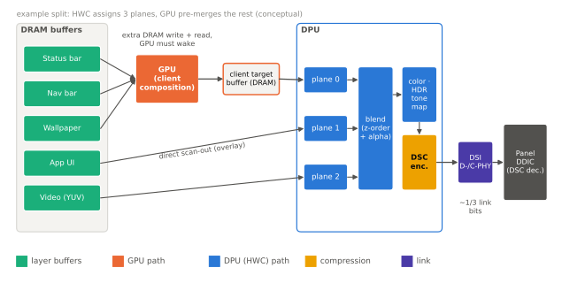

# 디스플레이 파이프라인

!!! spec "규격 · 세대"
    MIPI **DSI**(Display Serial Interface) → **DSI-2**(2016, C-PHY 지원) · 물리 계층 MIPI D-PHY·C-PHY · VESA **DSC**(Display Stream Compression, 1.1 → 1.2 계열) · 외부 출력: DisplayPort(USB-C Alt Mode)·HDMI · HDR: HDR10(PQ)·HLG·Dolby Vision
    스마트폰 적용: 60 Hz 고정 → 90·120 Hz 고주사율(2019–2020년형 플래그십 무렵부터 확산) → LTPO 가변 주사율 OLED(스마트폰은 2020년 무렵 플래그십부터, 이후 확산)

!!! basic "한눈에 보기"
    스마트폰 화면은 한 장의 그림이 아니라 **여러 장의 투명 필름을 겹친 것**입니다. 상태 표시줄, 앱 화면, 동영상, 키보드가 각각 따로 그려지고, 마지막에 겹쳐져 패널로 나갑니다. 이 겹치기를 전담하는 블록이 **DPU(Display Processing Unit)**입니다.

    1. **겹치기(합성)** — 여러 레이어를 위치·투명도에 맞춰 합칩니다. GPU를 쓰지 않아 전력이 적게 듭니다.
    2. **다듬기** — 색 보정, 밝기에 맞춘 톤 조정, 크기 조절을 지나가면서 처리합니다.
    3. **보내기** — 완성된 화면을 정해진 박자(주사율)에 맞춰 패널로 보냅니다. 늦으면 화면이 끊기므로 절대 기다려 주지 않습니다.

    방송국의 **주조정실**에 비유할 수 있습니다. 카메라·자막·광고 화면을 실시간으로 겹쳐 정해진 시각에 송출하고, 한 프레임도 늦으면 안 됩니다.

## 합성과 오버레이 평면 { .l2 }

| 구성 요소 | 역할 |
|---|---|
| 오버레이 평면(plane) | 메모리의 버퍼 하나를 읽어 화면의 한 영역에 배치. 크기 조절·회전·포맷 변환 포함 |
| 합성기(mixer/blender) | 평면들을 z 순서와 알파 값에 따라 섞음 |
| 후처리 | 색 공간 변환, 감마, 디스플레이 색 보정, HDR 톤 매핑, 화면 밝기에 따른 보정 |
| 압축기 | DSC로 링크 데이터량을 줄임 |
| 인터페이스 | MIPI DSI(내장 패널), DisplayPort(외부 출력) |

평면 수는 DPU마다 한정되어 있어, Android의 **SurfaceFlinger**가 HWC(Hardware Composer) HAL에 "이 레이어들을 DPU로 합성할 수 있나"를 묻고, 넘치는 레이어만 GPU로 미리 합성합니다(client composition). DPU로 모두 처리할수록 GPU를 깨우지 않아 전력이 줄어듭니다.

## 링크 대역폭과 DSC { .l2 }

| 예시 | 계산 | 결과 |
|---|---|---|
| QHD+(1440 × 3120), 24비트, 120 Hz 비압축 | 1440 × 3120 × 24 × 120 | 약 12.9 Gbps |
| 같은 화면, DSC 8 bpp (3:1) | 위 값 ÷ 3 | 약 4.31 Gbps |
| 4K(3840 × 2160), 30비트, 120 Hz 비압축 (외부 출력) | 3840 × 2160 × 30 × 120 | 약 29.9 Gbps |
| 전체 화면 레이어 하나 DRAM 읽기 (4바이트/화소, 120 Hz) | 1440 × 3120 × 4 × 120 | 약 2.16 GB/s |

블랭킹을 뺀 활성 화소만 계산한 값이며, 실제 링크는 이보다 조금 더 필요합니다. **DSC**는 시각적으로 손실이 드러나지 않도록 설계된 경량 압축으로, 링크 레인 수와 전력을 줄이고 패널 쪽 프레임 메모리 크기도 줄입니다. (수치는 `tools/soc_numbers.py`에서 계산)

??? expert "전문가 노트 — LTPO와 가변 주사율, 명령 모드와 비디오 모드, HDR 톤 매핑"
    **LTPO와 가변 주사율.** LTPO(Low-Temperature Polycrystalline Oxide) 백플레인은 산화물 TFT의 낮은 누설 덕분에 화소 전압을 오래 유지할 수 있어, 정지 화면에서 주사율을 크게 낮출 수 있습니다. 패널 구동 전력은 대략 주사율에 비례해 줄어들지만, 낮은 주사율에서는 깜빡임·밝기 변화가 보이지 않도록 패널 쪽 보상이 필요합니다. SoC 쪽에서는 "콘텐츠가 바뀔 때만 프레임을 보낸다"는 정책과 터치 입력 시 즉시 주사율을 올리는 반응성이 함께 설계되어야 하며, Android는 앱이 원하는 프레임 속도를 알리는 API(frame rate 힌트)로 이를 돕습니다.

    **명령 모드와 비디오 모드.** DSI 비디오 모드는 SoC가 매 프레임 화소를 계속 흘려보내고, 명령 모드는 패널 안의 프레임 메모리에 바뀐 내용만 써 넣습니다. 명령 모드는 정지 화면에서 SoC와 링크를 쉬게 할 수 있고, 패널이 보내는 TE(tearing effect) 신호에 맞춰 쓰기 시점을 맞춰 화면 찢어짐을 막습니다. 어느 모드를 쓸지는 패널 설계와 가변 주사율 방식에 따라 달라집니다.

    **끊기면 안 되는 트래픽.** DPU는 정해진 시각까지 화소를 내보내지 못하면 언더런(underrun)이 나 화면이 깨집니다. 그래서 메모리 컨트롤러·인터커넥트에서 가장 높은 실시간 QoS 우선순위를 받고, DRAM 주파수 전환 시점도 디스플레이 블랭킹 구간에 맞추곤 합니다. 레이어 수가 많고 해상도·주사율이 높을수록 이 대역폭이 커지므로, 버퍼 압축 포맷과 SLC 활용이 전력에 직접 영향을 줍니다.

    **HDR 톤 매핑과 커널 구조.** HDR 콘텐츠는 패널이 낼 수 있는 최대 밝기보다 높은 휘도로 마스터링되는 경우가 많아, DPU가 콘텐츠 메타데이터와 현재 패널 밝기를 보고 톤 매핑을 합니다. SDR UI와 HDR 영상이 한 화면에 섞일 때 두 레이어의 밝기 관계를 맞추는 것도 DPU 후처리의 몫입니다. 업스트림 Linux에서는 DRM/KMS의 plane·CRTC·connector 객체로 DPU를 표현하며, Qualcomm 계열은 `drivers/gpu/drm/msm/disp/dpu1/`이 대표적입니다.

## 칩셋 비교

| 항목 | Snapdragon | Exynos | Dimensity | Apple |
|---|---|---|---|---|
| 디스플레이 블록 | DPU(Adreno DPU로 부름) | 자체 DPU | 자체 디스플레이 엔진 | 자체 디스플레이 파이프라인 |
| 소프트웨어 | Android HWC + 업스트림 DRM 드라이버 존재 | Android HWC + 벤더 커널 | Android HWC + 벤더 커널 | 비공개 (iOS·macOS) |
| 특징 | 외부 디스플레이·고주사율 지원 강조 | 삼성 OLED 패널과 함께 최적화 | 고주사율·화질 처리 기능 강조 | ProMotion(가변 주사율) 등 패널과 수직 통합 |

> 세대별 최대 해상도·주사율·외부 출력 사양은 [칩셋 세대 인덱스](../reference/chipset-index.md)에 모읍니다.

## 관련 페이지
- [비디오 코덱](video-codec.md) — 디코드된 영상이 오버레이 평면으로 오는 길
- [모바일 GPU 구조](../gpu/architecture.md) — DPU가 다 못한 합성을 맡는 GPU
- [메모리 컨트롤러와 SLC](../memory/controller-slc.md) — 실시간 QoS와 디스플레이 대역폭
- [이미지 센서 인터페이스](camera-interface.md) — 같은 D-PHY·C-PHY를 쓰는 입력 쪽 CSI-2
- [대기 전력과 저전력 상태](../power/idle.md) — 정지 화면과 Always-On Display의 전력
