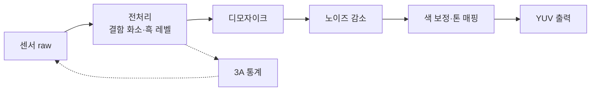

# ISP와 카메라 파이프라인

!!! spec "규격 · 세대"
    ISP 내부 처리는 표준이 없고 제조사마다 다릅니다. 입력은 MIPI CSI-2([이미지 센서 인터페이스](camera-interface.md)), 출력은 메모리의 YUV·raw 버퍼이며, 소프트웨어 쪽은 Android Camera2 API·Camera HAL3, Apple AVFoundation이 표준 경로입니다.
    제조사 브랜드: Qualcomm **Spectra**, MediaTek **Imagiq**, Samsung Exynos ISP, Apple A 시리즈 내장 ISP, Google Tensor ISP. 흐름: 단일 프레임 처리 → 다중 프레임 합성(HDR+, Smart HDR 등) → ISP와 NPU가 함께 처리하는 계산 사진(computational photography)

!!! basic "한눈에 보기"
    **ISP(Image Signal Processor)**는 카메라 센서가 보낸 "날것의" 빛 신호를 우리가 보는 사진과 영상으로 바꾸는 전용 처리 블록입니다. 센서의 각 화소는 사실 빨강·초록·파랑 중 **한 가지 색의 밝기만** 기록하므로, 그대로 보면 흐릿한 모자이크에 가깝습니다.

    1. **색 채우기** — 이웃 화소의 정보를 보고 각 화소의 빠진 두 색을 추정합니다(디모자이크).
    2. **자동 조정** — 밝기(노출), 초점, 색 온도를 매 프레임 자동으로 맞춥니다(3A).
    3. **다듬기** — 노이즈를 지우고, 선명도를 올리고, 색과 명암을 보기 좋게 바꿉니다.
    4. **여러 장 합치기** — 셔터 한 번에 여러 장을 찍어 어두운 곳과 밝은 곳을 모두 살립니다.

    필름 사진의 **현상소**에 비유할 수 있습니다. 같은 필름이라도 현상소 솜씨에 따라 사진이 달라지듯, 같은 센서를 써도 ISP와 그 튜닝에 따라 스마트폰마다 사진 색감이 다릅니다.

## 파이프라인 단계 { .l2 }

| 단계 | 하는 일 | 비고 |
|---|---|---|
| 전처리 | 흑 레벨 보정, 결함 화소 보정, 렌즈 음영(비네팅) 보정 | raw 영역에서 처리 |
| 3A 통계 | 노출(AE)·초점(AF)·화이트 밸런스(AWB)용 통계 수집 | 통계는 하드웨어, 판단 알고리즘은 보통 펌웨어·소프트웨어 |
| 디모자이크 | Bayer 배열(2×2마다 R·G·G·B)에서 화소마다 RGB 세 값을 복원 | 쿼드 Bayer 센서는 재배열(remosaic) 단계가 추가됨 |
| 노이즈 감소 | 공간(한 프레임 안)·시간(여러 프레임 사이) 노이즈 제거 | 디테일 손실과의 균형이 핵심 |
| 색·톤 처리 | 색 보정 행렬, 감마·톤 매핑, 선명도, 색 공간 변환 | 제조사 "색감"이 정해지는 곳 |
| 출력 | YUV로 변환해 미리보기·인코더·사진 경로로 동시에 보냄 | 해상도별 여러 출력 스트림 |

## 다중 프레임과 계산 사진 { .l2 }

센서 한 장의 다이내믹 레인지와 신호 대 잡음비에는 물리적 한계가 있으므로, 최근 스마트폰은 셔터를 누르기 전부터 프레임을 링 버퍼에 쌓아 두고(**zero shutter lag**), 여러 장을 정렬·합성합니다.

| 기법 | 방법 | 얻는 것 |
|---|---|---|
| HDR 합성 | 노출이 다른 프레임 또는 한 프레임 안의 장·단 노출 화소를 합침 | 하늘과 그늘을 동시에 살림 |
| 다중 프레임 노이즈 감소 | 같은 노출의 짧은 프레임 여러 장을 정렬해 평균 | 야간 노이즈 감소, 흔들림 억제 |
| 세그먼트별 처리 | 신경망으로 하늘·피부·머리카락 등을 구분해 영역마다 다르게 처리 | 인물·풍경 표현 개선 |
| 보케·인물 모드 | 깊이 추정(듀얼 카메라, 위상차 화소, 신경망)으로 배경 흐림 | 큰 센서·렌즈 효과 흉내 |

정렬과 합성처럼 규칙적인 연산은 ISP 하드웨어가, 장면 분할과 신경망 기반 노이즈 제거는 **NPU**가 맡고, 둘 사이를 메모리 또는 전용 경로로 잇는 것이 공통된 방향입니다. Google은 HDR+ 같은 다중 프레임 알고리즘을 오래 써 왔고, Tensor에서는 ISP와 TPU(NPU)를 함께 쓰는 처리를 강조합니다. Apple은 Smart HDR·Deep Fusion·Photonic Engine 같은 이름으로 ISP와 Neural Engine의 협업을 설명합니다.

??? expert "전문가 노트 — 메모리 트래픽, 3A 루프의 지연, 튜닝과 품질 평가"
    **메모리 트래픽.** 다중 프레임 처리는 연산보다 **메모리 이동**이 부담입니다. 1200만 화소 10비트 raw 한 장은 약 15 MB이고, 8장을 버퍼에 쌓으면 약 120 MB입니다(패킹 없이 16비트로 저장하면 더 큼). 이 버퍼를 정렬·합성·NPU 처리 단계마다 다시 읽고 쓰므로, ISP 내부 단계를 메모리를 거치지 않고 바로 잇거나(on-the-fly 연결), raw·YUV 압축 포맷을 쓰거나, SLC를 활용해 DRAM 왕복을 줄이는 설계가 중요합니다. (수치는 `tools/soc_numbers.py`에서 계산)

    **3A 루프의 지연.** 3A 알고리즘은 프레임 N의 통계로 프레임 N+2 이후의 노출·게인을 정하는 식의 **파이프라인 지연**을 갖습니다. 센서 레지스터 쓰기가 I2C·I3C 같은 저속 버스로 이뤄지고 적용 시점이 프레임 경계에 묶여 있기 때문입니다. 밝기가 급변하는 장면에서 노출이 출렁이는(헌팅) 현상은 이 지연과 제어 이득의 균형 문제이며, Android Camera HAL3가 요청마다 결과 메타데이터를 되돌려 주는 구조도 이 프레임 단위 제어를 반영합니다.

    **위상차 AF와 쿼드 Bayer.** 최근 센서는 화소 일부 또는 전체를 둘로 나눠 위상차를 측정하고(PDAF·듀얼 픽셀 계열), 4개 또는 9개 화소가 같은 색 필터를 공유하는 배열을 씁니다. 어두운 곳에서는 묶어서(binning) 감도를 높이고, 밝은 곳에서는 재배열해 고해상도를 얻습니다. 재배열을 센서 안에서 할지 ISP에서 할지는 제조사 선택이며 대역폭·화질 트레이드오프가 있습니다.

    **튜닝과 품질 평가.** 같은 ISP 하드웨어라도 센서·렌즈 조합마다 수천 개의 파라미터를 맞추는 **튜닝**이 결과를 좌우합니다. 업스트림 Linux에는 `drivers/media/platform/qcom/camss/`처럼 센서 수신·raw 저장 경로를 다루는 드라이버가 있지만, 상용 ISP 처리 알고리즘과 튜닝 데이터는 대부분 벤더 Camera HAL과 비공개 라이브러리에 있습니다. 공개 영역에서는 libcamera 프로젝트가 소프트웨어 ISP·3A 구조를 참고할 만한 사례입니다.

## 칩셋 비교

| 항목 | Snapdragon | Exynos | Dimensity | Apple | Tensor |
|---|---|---|---|---|---|
| ISP 브랜드 | Spectra | Exynos ISP | Imagiq | (이름 없이 A 시리즈 ISP) | Tensor ISP |
| 다중 ISP·동시 카메라 | 여러 ISP 인스턴스로 다중 카메라 동시 처리 강조 | 다중 카메라 동시 처리 | 다중 카메라 동시 처리 | 다중 카메라 동시 처리 | 다중 카메라 동시 처리 |
| NPU 연계 | Hexagon NPU와의 연계(AI ISP) 강조 | NPU 연계 | APU 연계 | Neural Engine 연계(Deep Fusion 등) | TPU 연계(HDR+ 계열 처리) |
| 소프트웨어 | 휴대폰 제조사가 자체 알고리즘을 얹는 경우가 많음 | 삼성 카메라 앱과 함께 튜닝 | 휴대폰 제조사 튜닝 | 칩·기기·앱 수직 통합 | 칩·기기·앱 수직 통합 |

> 세대별 ISP 비트 수·지원 화소 수·동시 카메라 수는 [칩셋 세대 인덱스](../reference/chipset-index.md)에 모읍니다.

## 관련 페이지
- [이미지 센서 인터페이스](camera-interface.md) — 센서 데이터가 ISP로 들어오는 길
- [비디오 코덱](video-codec.md) — ISP 출력을 압축하는 다음 단계
- [NPU란 무엇인가](../npu/what-is-npu.md) — 계산 사진에 쓰이는 신경망 가속
- [메모리 컨트롤러와 SLC](../memory/controller-slc.md) — 다중 프레임 버퍼의 메모리 트래픽
- [저속 주변장치 (I2C·I3C·SPI·UART)](../connectivity/low-speed.md) — 센서 제어 버스
