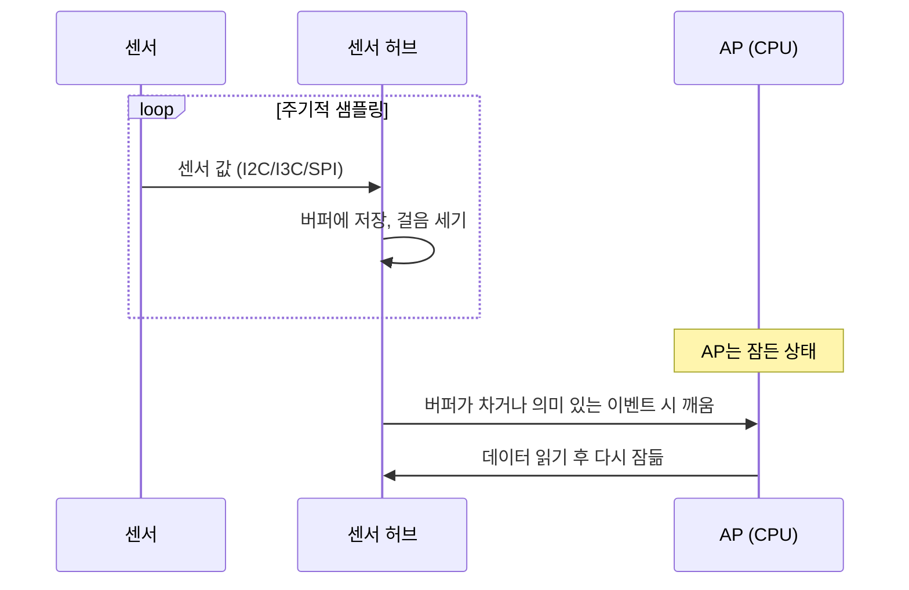

# 센서 허브

!!! spec "규격 · 세대"
    Android Sensors HAL·센서 배칭(Android 4.4에서 걸음 감지·걸음 수 센서와 함께 도입) · Android **CHRE**(Context Hub Runtime Environment)와 Context Hub HAL · 센서 버스: I2C·I3C·SPI ([저속 주변장치](../connectivity/low-speed.md))
    흐름: AP가 직접 센서 처리 → 별도 모션 코프로세서 칩(Apple M7, 2013) → SoC 안의 상시 저전력 영역으로 통합(Apple은 2015년 A9 세대에 모션 코프로세서를 SoC에 통합, Qualcomm SLPI·Samsung CHUB·MediaTek SCP 등 벤더별 이름)

!!! basic "한눈에 보기"
    스마트폰은 주머니 속에서 화면이 꺼진 채로도 걸음 수를 세고, 들어 올리면 화면을 켜고, 넘어지면 감지합니다. 이 일을 큰 CPU가 하면 하루도 버티기 어렵습니다. **센서 허브**는 SoC 안에서 **혼자 따로 깨어 있는 아주 작은 컴퓨터**입니다.

    1. **항상 켜진 작은 섬** — 메인 CPU와 전원이 분리된 영역에 작은 프로세서와 메모리가 있어, 나머지 칩이 잠들어도 동작합니다.
    2. **모았다가 한 번에** — 센서 값을 계속 모아 두었다가(배칭), 필요할 때만 메인 CPU를 깨워 한꺼번에 넘깁니다.
    3. **스스로 판단** — 걸음 세기, 자세 인식, 들어 올림 감지 같은 간단한 판단은 센서 허브가 직접 끝냅니다.

    회사의 **당직실**에 비유할 수 있습니다. 밤새 전 직원이 출근해 있을 필요 없이, 당직자가 전화를 받아 처리하다가 큰일이 생겼을 때만 담당자를 깨웁니다.

## 상시 저전력 영역의 구성 { .l2 }

| 구성 요소 | 역할 | 비고 |
|---|---|---|
| 저전력 프로세서 | 센서 드라이버·알고리즘 실행 | 작은 Arm Cortex-M급 코어나 DSP가 쓰임 |
| 전용 SRAM | 코드·데이터·센서 버퍼 | DRAM을 깨우지 않기 위해 칩 안 메모리 사용 |
| 센서 버스 컨트롤러 | I2C·I3C·SPI로 센서와 통신 | 센서 인터럽트 수신 |
| 상시 전원·클럭 | AP가 꺼져도 유지되는 전원 도메인과 저속 클럭 | [파워 도메인과 게이팅](../power/power-domains.md) |
| AP와의 통로 | 메일박스·공유 메모리·인터럽트 | 깨우기와 데이터 전달 |

센서 데이터량 자체는 작습니다. 가속도 센서 3축 16비트를 100 Hz로 읽으면 100 × 3 × 16 = **4.8 kbps**이고, 6축(가속도+자이로, 샘플당 12바이트) 데이터를 1분 동안 모아도 100 × 12바이트 × 60 = 약 **72 KB**입니다. 이 정도는 칩 안 SRAM에 충분히 담을 수 있어, 1분에 한 번만 AP를 깨워도 됩니다. (수치는 `tools/soc_numbers.py`에서 계산)

## 오프로드되는 기능 { .l2 }

| 기능 | 센서 허브가 하는 일 | AP가 깨어나는 시점 |
|---|---|---|
| 걸음 수·걸음 감지 | 가속도 패턴에서 걸음을 세어 누적 | 앱이 값을 요청할 때 |
| 활동 인식 | 걷기·달리기·차량 이동 같은 상태 분류 | 상태가 바뀔 때 |
| 들어 올림·자세 | 기기를 집거나 뒤집는 동작 인식 | 화면을 켜야 할 때 |
| 의미 있는 움직임 | 위치가 바뀔 만한 움직임 감지 | 위치 서비스가 필요할 때 |
| 센서 배칭 | 원시 값을 모아 둠 | 버퍼가 차기 전 |

??? expert "전문가 노트 — 깨우기 비용, CHRE와 nanoapp, 시간 동기"
    **깨우기 비용.** AP를 한 번 깨우는 데는 전원 영역 복구, 클럭·PLL 안정화, DRAM 셀프 리프레시 탈출, 커널 처리 비용이 듭니다. 센서 이벤트마다 AP를 깨우면 이 고정 비용이 쌓여 대기 전력이 크게 늘어납니다. Android 센서 API의 wake-up 센서와 non-wake-up 센서 구분, 그리고 최대 보고 지연(max report latency) 설정은 이 비용을 줄이기 위한 장치입니다. 센서 허브의 가치는 연산 속도가 아니라 **AP 깨우기 횟수를 줄이는 것**에 있습니다([대기 전력과 저전력 상태](../power/idle.md)).

    **CHRE와 nanoapp.** Android의 CHRE는 센서 허브 위에서 도는 작은 앱(nanoapp)을 위한 표준 런타임으로, 제조사가 센서 허브 펌웨어마다 다른 인터페이스를 쓰지 않고도 상시 동작 기능을 만들 수 있게 합니다. nanoapp은 센서·위치·Wi-Fi 스캔·오디오 같은 이벤트를 구독하고 AP 쪽 앱과 메시지를 주고받습니다. 메모리와 연산 자원이 매우 작으므로, 상시 동작 기계학습 모델은 이 제약에 맞게 아주 작게 만들어야 합니다.

    **시간 동기와 센서 융합.** 자세 추정, 카메라 흔들림 보정, AR 추적은 센서 값과 카메라 프레임의 **타임스탬프**가 정확히 맞아야 합니다. 센서 허브의 시계와 AP의 시계는 서로 다른 클럭 영역이므로, 두 시간 축을 주기적으로 맞추는 동기화가 필요합니다. 가속도·자이로·지자기 값을 합쳐 회전 벡터를 만드는 센서 융합도 보통 센서 허브에서 처리합니다.

    **커널에서 보이는 모습.** 센서 허브 펌웨어는 AP의 Linux 커널이 원격 프로세서로 올리고 관리하는 경우가 많습니다. 업스트림 기준으로 Qualcomm 계열은 `drivers/remoteproc/`의 원격 프로세서 드라이버와 메시지 통로(rpmsg·GLINK 계열), MediaTek 계열은 `drivers/remoteproc/mtk_scp.c`가 해당합니다. 센서 HAL과 실제 센서 드라이버는 대부분 벤더 펌웨어 쪽에 있습니다.

## 칩셋 비교

| 항목 | Snapdragon | Exynos | Dimensity | Apple | Tensor |
|---|---|---|---|---|---|
| 상시 영역 이름 | SLPI(Sensor Low Power Island), 이후 통합 센싱 허브 계열 | CHUB(Context Hub) | SCP 계열 | 상시 동작 프로세서(모션 코프로세서 계승) | 저전력 상시 처리 영역 |
| 처리 코어 | Hexagon DSP 계열 | 저전력 MCU급 코어 | 저전력 MCU급 코어 | 비공개 | 공개 정보 제한적 |
| 소프트웨어 | Android Sensors HAL (CHRE 적용은 기기별) | Android Sensors HAL (CHRE 적용은 기기별) | Android Sensors HAL (CHRE 적용은 기기별) | Core Motion 등 iOS 프레임워크 | Android Sensors HAL·CHRE, 상시 기능(예: Now Playing) |

표의 처리 코어와 이름은 공개 커널 소스·발표 자료에서 확인되는 범위로 적었으며, 세대마다 바뀔 수 있습니다.

> 세대별 상시 처리 영역의 구성은 [칩셋 세대 인덱스](../reference/chipset-index.md)에 모읍니다.

## 관련 페이지
- [오디오와 DSP](audio-dsp.md) — 같은 상시 저전력 영역의 음성 호출어 감지
- [저속 주변장치 (I2C·I3C·SPI·UART)](../connectivity/low-speed.md) — 센서 연결 버스
- [대기 전력과 저전력 상태](../power/idle.md) — AP 깨우기 비용과 대기 전력
- [파워 도메인과 게이팅](../power/power-domains.md) — 상시 전원 영역(AON)
- [GNSS·UWB·위성](../connectivity/gnss-uwb.md) — 상시 위치 처리와의 연계
