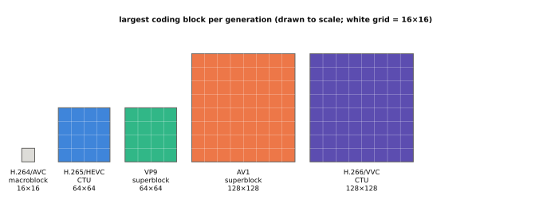
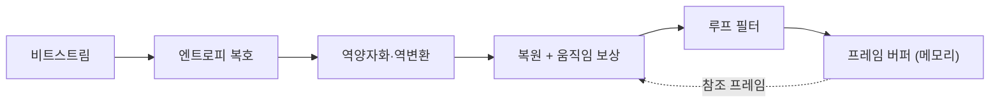

# 비디오 코덱

!!! spec "규격 · 세대"
    ITU-T·ISO/IEC 공동 규격: **H.264/AVC**(2003) → **H.265/HEVC**(2013) → **H.266/VVC**(2020) · 로열티 프리 계열: Google **VP9**(2013) → AOMedia **AV1**(2018) · HDR: HDR10(SMPTE ST 2084 PQ), HLG(ITU-R BT.2100), HDR10+, Dolby Vision
    스마트폰 적용: HEVC 하드웨어 코덱은 2010년대 중반 플래그십부터 일반화. AV1 하드웨어 디코드는 MediaTek Dimensity 1000(2019 발표)이 스마트폰 SoC 중 초기 사례이며 이후 주요 제조사로 확산. 8K 인코딩은 Exynos 9820(2018 발표)이 사양에 먼저 넣었고, 실제 8K 녹화 기능을 단 스마트폰은 2020년형 플래그십(Snapdragon 865, Exynos 990 세대)부터. VVC 하드웨어 지원은 도입 초기 단계(이 페이지 기준 시점)

!!! basic "한눈에 보기"
    압축하지 않은 4K 영상은 1초에 수 기가비트가 넘어, 그대로는 저장도 전송도 할 수 없습니다. **비디오 코덱**은 이를 수백분의 일로 줄이는 압축·복원 방식이고, SoC에는 이를 전담하는 하드웨어 블록이 있습니다.

    1. **이전 장면 재활용** — 연속된 프레임은 대부분 비슷하므로, "앞 프레임의 이 조각이 여기로 조금 움직였다"는 정보만 보냅니다(움직임 보상).
    2. **덜 보이는 정보 버리기** — 사람 눈이 잘 못 느끼는 세밀한 변화는 거칠게 저장합니다(변환과 양자화).
    3. **자주 나오는 것은 짧게** — 남은 정보를 확률에 맞춰 최대한 짧은 비트로 적습니다(엔트로피 부호화).

    새 코덱일수록 같은 화질을 더 적은 비트로 담지만, 그 대가로 계산이 훨씬 복잡해집니다. 그래서 새 코덱은 **하드웨어 블록이 들어간 칩**이 나와야 스마트폰에서 제대로 쓰입니다.

## 코덱 세대 비교 { .l2 }

| 항목 | H.264/AVC | H.265/HEVC | VP9 | AV1 | H.266/VVC |
|---|---|---|---|---|---|
| 표준화 | ITU-T·ISO/IEC | ITU-T·ISO/IEC | Google | AOMedia | ITU-T·ISO/IEC |
| 라이선스 | 특허 풀 | 여러 특허 풀 | 로열티 프리 표방 | 로열티 프리 표방 | 특허 풀 |
| 압축 효율 (직전 세대 대비, 같은 화질) | 기준 | 비트 약 절반이 목표 | HEVC와 비슷한 수준 | HEVC·VP9보다 개선 | HEVC 대비 비트 약 절반이 목표 |
| 주요 블록 크기 | 매크로블록 16×16 | CTU 최대 64×64 | 슈퍼블록 64×64 | 슈퍼블록 최대 128×128 | CTU 최대 128×128 |
| 주 사용처 | 범용, 화상 통화 | 녹화·스트리밍·방송 | 웹 스트리밍 | 웹 스트리밍 확산 | 방송·차세대 서비스 |

압축 효율은 표준화 단체가 내건 목표치이며, 실제 이득은 인코더 구현과 콘텐츠에 따라 크게 달라집니다. 스마트폰 녹화는 호환성 때문에 H.264·HEVC가 주류이고, AV1은 스트리밍 **디코드** 쪽에서 먼저 확산되었습니다.

## 하드웨어 코덱 블록 { .l2 }

| 구분 | 하드웨어 코덱 | 소프트웨어 코덱 (CPU) |
|---|---|---|
| 전력 | 매우 낮음 | 높음 (고해상도에서 큰 차이) |
| 유연성 | 칩 출시 후 새 코덱·프로필 추가 불가 | 업데이트로 새 코덱 지원 가능 |
| 화질 조정 | 레이트 제어 등 일부 파라미터만 | 인코더 알고리즘 전체 조정 가능 |
| 주 용도 | 카메라 녹화, 영상 재생, 화상 통화 | 하드웨어가 없는 코덱, 특수 포맷 |

디코더와 인코더는 보통 별도 블록이거나 한 블록 안의 분리된 경로이며, 해상도·프레임 수·비트 깊이(8·10비트)·크로마 포맷(4:2:0 등)·프로필별로 지원 범위가 정해집니다. HDR10·Dolby Vision 지원은 10비트 코덱 경로뿐 아니라 메타데이터 처리, 디스플레이 쪽 톤 매핑까지 함께 맞아야 합니다([디스플레이 파이프라인](display.md)).

??? expert "전문가 노트 — 압축 비율 감각, 참조 프레임 대역폭, Android MediaCodec"
    **압축 비율 감각.** 4K(3840 × 2160) 60 fps, 10비트 4:2:0(화소당 평균 15비트) 원본은 약 7.46 Gbps입니다. 이를 예시로 50 Mbps에 담으면 약 150분의 1 압축입니다. 8K 30 fps는 같은 포맷에서 약 14.9 Gbps입니다. 녹화 비트레이트는 제조사 설정이므로 예시 값일 뿐입니다. (수치는 `tools/soc_numbers.py`에서 계산)

    **참조 프레임 대역폭.** 코덱 블록의 병목은 연산보다 **참조 프레임 읽기**인 경우가 많습니다. 움직임 보상은 여러 참조 프레임의 임의 위치를 읽으므로 DRAM 접근이 불규칙합니다. 하드웨어 코덱은 참조 영역 캐시, 프레임 버퍼 압축(벤더별 무손실·손실 압축 포맷), SLC 활용으로 이를 줄입니다. 이 압축 포맷은 디스플레이·GPU와 공유되어야 하므로 SoC 안의 블록 간 포맷 협상이 중요합니다.

    **인코더 품질은 하드웨어마다 다르다.** 디코더는 규격대로 복원하면 결과가 같지만, 인코더는 움직임 탐색 범위, 모드 결정, 레이트 제어가 구현마다 달라 **같은 비트레이트에서도 화질이 다릅니다.** 하드웨어 인코더는 실시간·저전력을 위해 탐색을 줄이므로, 같은 비트레이트에서 느린 소프트웨어 인코더보다 화질이 낮은 경우가 많습니다. 녹화 품질 비교는 비트레이트와 화질 지표를 함께 봐야 합니다.

    **Android MediaCodec.** 앱은 `MediaCodec` API로 코덱을 쓰고, 그 아래에서 Codec 2.0(Codec2) 프레임워크가 벤더 하드웨어 코덱을 감쌉니다(이전 세대는 OpenMAX IL). 지원 해상도·프로필은 `MediaCodecInfo`와 `media_codecs*.xml` 설정으로 노출됩니다. 업스트림 Linux에는 V4L2 stateful·stateless 코덱 인터페이스가 있고, Qualcomm 계열은 `drivers/media/platform/qcom/venus/`가 대표적인 예입니다. Apple 플랫폼은 VideoToolbox가 하드웨어 코덱 경로입니다.

## 칩셋 비교

| 항목 | Snapdragon | Exynos | Dimensity | Apple | Tensor |
|---|---|---|---|---|---|
| AV1 | 디코드 지원 (세대별 확인) | 디코드 지원 (세대별 확인) | 디코드 조기 도입 | 디코드 지원 (최근 세대) | 디코드 지원 |
| HDR 녹화 | HDR10·HDR10+ 등 | HDR10+ 강조 | HDR 녹화 지원 | Dolby Vision 녹화 강조 | HDR 녹화 지원 |
| 특징 | 휴대폰 제조사가 녹화 포맷을 선택 | 삼성 기기와 함께 최적화 | 휴대폰 제조사가 녹화 포맷을 선택 | ProRes 등 전문가 포맷도 지원 | ISP·TPU 후처리와 연계 |

> 세대별 코덱 지원 목록과 최대 해상도·프레임은 [칩셋 세대 인덱스](../reference/chipset-index.md)에 모읍니다.

## 관련 페이지
- [ISP와 카메라 파이프라인](isp.md) — 인코더에 들어가는 영상의 출처
- [디스플레이 파이프라인](display.md) — 디코드한 영상과 HDR 톤 매핑
- [메모리 컨트롤러와 SLC](../memory/controller-slc.md) — 참조 프레임 트래픽
- [Android BSP 구조](../software/android-bsp.md) — Codec2와 벤더 HAL
