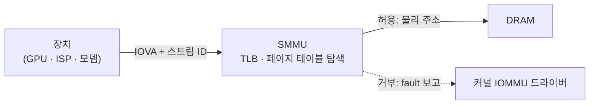

# 메모리 보호와 IOMMU

!!! spec "규격 · 세대"
    Arm SMMU 아키텍처(SMMUv2 → **SMMUv3**), Arm 아키텍처 MTE(Armv8.5-A, **Memory Tagging Extension**), 2단계 주소 변환(EL2 가상화) · Linux IOMMU 프레임워크·DMA API, Android pKVM
    장치가 물리 주소로 직접 접근(DMA) → 장치별 IOMMU로 주소 변환·격리 → 하이퍼바이저의 2단계 변환으로 운영체제까지 격리 → MTE로 메모리 오류 탐지(2023년형 Pixel부터 개발자 옵션 형태로 활용 시작)

!!! basic "한눈에 보기"
    SoC 안에서 메모리를 읽고 쓰는 것은 CPU만이 아닙니다. GPU, NPU, ISP, 코덱, 모뎀도 DRAM에 직접 접근합니다(**DMA**). 만약 이 장치들이 아무 주소나 마음대로 읽고 쓸 수 있다면 어떻게 될까요?

    1. 버그 있는 드라이버가 다른 앱의 메모리를 덮어쓸 수 있습니다.
    2. 해킹당한 장치 펌웨어(예: 모뎀)가 운영체제 커널 메모리를 훔쳐볼 수 있습니다.

    **IOMMU(Arm에서는 SMMU)**는 장치용 **주소 변환기 겸 경비원**입니다. 장치에게는 가상 주소만 주고, 허락된 영역만 실제 메모리로 연결해 줍니다. CPU에서 앱마다 주소 공간을 나누는 MMU를 장치에도 둔 것입니다.

    **MTE**는 방향이 조금 다릅니다. 메모리와 포인터에 작은 "색깔 표"를 붙여, 프로그램이 자기 것이 아닌 메모리를 잘못 건드리면 바로 잡아냅니다.

## SMMU가 하는 일 { .l2 }

| 기능 | 내용 | 효과 |
|---|---|---|
| 주소 변환 | 장치의 I/O 가상 주소(IOVA) → 물리 주소 | 흩어진 물리 메모리를 장치에는 연속된 버퍼로 보이게 |
| 접근 제어 | 매핑되지 않은 주소 접근 시 오류(fault) 발생 | 장치 버그·공격으로부터 메모리 격리 |
| 장치별 컨텍스트 | 스트림 ID로 장치·기능을 구분해 각자 다른 페이지 테이블 사용 | 장치 간 격리 |
| 2단계 변환 | 운영체제의 변환 위에 하이퍼바이저의 변환을 한 번 더 | 가상 머신·보호 영역 격리 |
| 캐시 (TLB) | 변환 결과를 캐시 | 변환 비용 감소 |

## MTE가 하는 일 { .l2 }

| 요소 | 내용 |
|---|---|
| 메모리 태그 | 16바이트 단위 메모리마다 4비트 태그 |
| 포인터 태그 | 64비트 포인터의 상위 비트(사용하지 않는 비트)에 4비트 태그 |
| 검사 | 로드·스토어 시 포인터 태그와 메모리 태그를 비교, 다르면 오류 |
| 모드 | 동기(정확한 위치, 느림) / 비동기(나중에 보고, 빠름) / 비대칭 |
| 잡는 버그 | 버퍼 넘침, 해제 후 사용(use-after-free) — 메모리 안전성 취약점의 주요 원인 |

Android는 Pixel 8 세대(Tensor G3)부터 개발자 옵션 등으로 MTE를 켤 수 있게 했고, 일부 보안 중심 배포판은 이를 적극 활용합니다. MTE 지원 여부는 CPU 코어뿐 아니라 메모리 시스템(태그 저장 공간)과 운영체제 설정이 모두 갖춰져야 합니다.

??? expert "전문가 노트 — 변환 비용, 장치 격리와 보안 부팅, MTE의 비용과 한계"
    **변환 비용.** SMMU의 TLB 미스는 페이지 테이블 탐색을 위해 추가 메모리 접근을 일으키며, 2단계 변환이 켜져 있으면 최악의 경우 탐색 횟수가 크게 늘어납니다. GPU·ISP처럼 대량 데이터를 흘리는 장치는 큰 페이지(2 MB 등) 매핑과 TLB 프리페치로 이 비용을 줄입니다. 카메라 고해상도 촬영에서 SMMU 설정이 성능 문제의 원인이 되는 경우도 있습니다.

    **장치 격리와 보안.** 모뎀·Wi-Fi 칩처럼 외부 무선 입력을 직접 처리하는 장치는 공격 표면이 넓습니다. 이런 장치의 펌웨어가 침해되어도 SMMU가 접근 가능한 메모리를 공유 버퍼로 제한하면 피해가 그 안에 머뭅니다. Android pKVM은 2단계 변환으로 **커널조차 접근할 수 없는 보호 영역**을 만들고, SMMU도 하이퍼바이저가 관리하게 해 장치를 통한 우회를 막습니다([가상화](../security/virtualization.md)).

    **MTE의 비용과 한계.** 태그 저장에 메모리의 일부(16바이트당 4비트, 약 3%)가 쓰이고, 태그 설정·검사로 성능과 전력 비용이 듭니다. 4비트 태그라 무작위로 맞을 확률(1/16)이 있어 공격을 확률적으로만 막으며, 탐지 도구로서의 가치(개발·테스트 단계에서 버그 발견)가 특히 큽니다. 동기 모드는 정확한 위치를 알려 주지만 느리고, 비동기 모드는 빠르지만 보고가 늦습니다.

    **포인터 인증과의 관계.** PAC(Armv8.3)은 반환 주소·함수 포인터 위조를 막고, BTI(Armv8.5)는 엉뚱한 위치로의 분기를 막으며, MTE는 데이터 메모리 오류를 잡습니다. 세 기능은 서로 다른 공격 단계를 막으므로 함께 쓰일 때 효과가 큽니다([Arm 아키텍처](../cpu/arm-architecture.md)).

## 칩셋 비교

| 항목 | 일반적인 Android SoC | Apple |
|---|---|---|
| 장치 IOMMU | Arm SMMU 또는 호환 구현 (회사별 확장) | 자체 IOMMU (DART로 알려짐) |
| 2단계 변환 활용 | pKVM 등으로 확대 중 | 자체 보안 구조 |
| MTE | 코어·플랫폼·OS 설정에 따라 다름 | Apple은 자체 메모리 안전 기능을 발표 |

## 관련 페이지
- [Arm 아키텍처](../cpu/arm-architecture.md) — MTE·PAC·BTI 확장
- [가상화](../security/virtualization.md) — 2단계 변환과 pKVM
- [TrustZone과 TEE](../security/trustzone.md) — 보안 세계 메모리 격리
- [버스와 인터커넥트](../basics/interconnect.md) — 버스 위의 보안 속성
