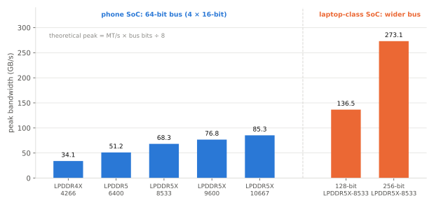

# LPDDR

!!! spec "규격 · 세대"
    JEDEC JESD209 계열: **LPDDR4**(JESD209-4, 2014) → **LPDDR4X**(I/O 전압 하향) → **LPDDR5**(JESD209-5, 2019) → **LPDDR5X**(2021, 이후 개정으로 최대 속도 확장) → **LPDDR6**(JESD209-6, 2025 발표)
    스마트폰 플래그십 적용: LPDDR5는 2020년형, LPDDR5X는 2023년형 무렵부터 주류. LPDDR6 탑재 SoC는 발표·도입 초기 단계(이 페이지 기준 시점)

!!! basic "한눈에 보기"
    **LPDDR(Low Power DDR)**은 스마트폰·노트북용 저전력 DRAM입니다. PC의 DDR과 같은 원리지만, 배터리를 위해 여러 가지를 바꿨습니다.

    1. **낮은 전압** — 신호 전압을 크게 낮춰 데이터를 주고받는 에너지를 줄입니다.
    2. **좁은 채널 여러 개** — 16비트 같은 좁은 채널을 여러 개 두어, 필요 없는 채널은 쉬게 합니다.
    3. **깊은 절전 모드** — 화면이 꺼진 동안 DRAM은 데이터만 유지하며 최소 전력으로 버팁니다(셀프 리프레시).

    DRAM은 작은 커패시터에 전하를 담아 0과 1을 저장하는데, 전하가 조금씩 새기 때문에 **주기적으로 다시 채워야(리프레시)** 합니다. 데이터를 쓰지 않아도 DRAM이 전력을 쓰는 이유입니다.

## 세대별 비교 { .l2 }

| 항목 | LPDDR4X | LPDDR5 | LPDDR5X | LPDDR6 (발표 기준) |
|---|---|---|---|---|
| 대표 최대 속도 (핀당) | 4266 MT/s | 6400 MT/s | 8533 MT/s → 개정으로 9600·10667 MT/s | 10.6 Gbps대에서 시작, 그 이상으로 확장 계획 |
| 채널 구조 | 16비트 채널 | 16비트 채널 | 16비트 채널 | 서브채널 둘로 나뉜 채널 (구조 변경) |
| 클럭 구조 | CK 기반 | 데이터용 별도 고속 클럭(**WCK**) 도입 | WCK | 고속화에 맞춰 변경 |
| 뱅크 구성 | 8뱅크 | 뱅크 그룹 모드 등 여러 모드 | LPDDR5 계승 | 변경 |
| 신뢰성 | — | 링크 ECC 등 선택 기능 | 강화 | 메모리 내부·링크 오류 정정 강화 |
| 64비트 피크 대역폭 | 약 34.1 GB/s | 약 51.2 GB/s | 약 68.3–85.3 GB/s | 더 높음 |

64비트 피크 대역폭은 핀당 속도 × 64 ÷ 8로 계산한 이론값이며, 실제 유효 대역폭은 리프레시·뱅크 충돌·읽기·쓰기 전환 등으로 이보다 낮습니다. (수치는 `tools/soc_numbers.py`에서 계산)

노트북급 SoC는 같은 LPDDR5X-8533이라도 버스를 128·256비트로 넓혀 대역폭을 2–4배로 늘립니다.

## DRAM 내부 구조 { .l2 }

| 단위 | 뜻 | 성능에 주는 영향 |
|---|---|---|
| 채널 | 독립적으로 명령을 받는 데이터 통로 | 채널 수 × 폭 = 총 버스 폭 |
| 랭크 | 같은 채널을 공유하는 다이 묶음 | 용량 확장 |
| 뱅크 | 다이 안의 독립 메모리 배열 | 여러 뱅크를 번갈아 써서 지연 숨김 |
| 행(row) | 뱅크 안에서 한 번에 열리는 줄 (페이지) | 같은 행을 이어서 읽으면 빠름 (row hit) |
| 열(column) | 행 안의 위치 | 버스트 단위로 읽음 |

DRAM 접근은 "행 열기(activate) → 열 읽기·쓰기 → 행 닫기(precharge)" 순서입니다. 이미 열린 행을 다시 읽으면 빠르고, 다른 행을 읽어야 하면 닫고 여는 시간이 듭니다. 메모리 컨트롤러가 요청 순서를 바꿔 같은 행 접근을 모으는 이유입니다([메모리 컨트롤러와 SLC](controller-slc.md)).

## 저전력 기능 { .l2 }

| 기능 | 내용 |
|---|---|
| 낮은 I/O 전압 | LPDDR4X에서 I/O 전압을 크게 낮춤(약 0.6 V), 이후 세대도 낮은 I/O 전압 유지 |
| 셀프 리프레시 | SoC가 잠든 동안 DRAM이 스스로 리프레시, 데이터 유지 |
| 부분 배열 리프레시 | 쓰지 않는 영역은 리프레시하지 않음 |
| 온도 보정 리프레시 | 온도에 따라 리프레시 주기 조절 (뜨거울수록 자주) |
| 주파수·전압 단계 | 부하에 따라 DRAM 속도와 일부 전압을 바꿈 (DRAM DVFS) |

??? expert "전문가 노트 — 대역폭은 AI의 병목, 전송 에너지, DRAM 주파수 전환의 비용"
    **대역폭은 AI의 병목.** 온디바이스 LLM의 토큰 생성 단계는 토큰 하나를 만들 때마다 모델 가중치 전체를 메모리에서 한 번씩 읽어야 하므로, 연산 성능보다 **메모리 대역폭**이 속도의 상한을 정합니다. 70억 매개변수 모델을 INT4(약 3.5 GB)로 돌리면, LPDDR5X-8533 64비트(약 68.3 GB/s)에서 이론 상한은 약 19.5 토큰/s입니다. 실제로는 다른 블록과 대역폭을 나누고 유효 대역폭이 피크보다 낮아 이보다 느립니다. 플래그십 SoC가 LPDDR 최고 속도를 경쟁적으로 채택하는 이유입니다([온디바이스 LLM](../npu/llm.md)).

    **데이터 이동의 에너지.** 칩 밖 DRAM에서 데이터를 가져오는 비트당 에너지는 칩 안 SRAM 접근보다 훨씬 큽니다. 같은 연산이라도 데이터를 SLC·로컬 메모리에 붙잡아 두면 전력이 크게 줄어드는 이유이며, NPU 설계가 가중치 재사용과 타일링에 집중하는 이유입니다. LPDDR 세대가 오를수록 비트당 에너지는 줄었지만, 대역폭 수요 증가가 그보다 빨라 DRAM 전력의 총량은 여전히 중요한 비중을 차지합니다.

    **DRAM 주파수 전환.** 메모리 컨트롤러는 부하에 따라 DRAM 클럭을 바꾸는데, 전환 중에는 트레이닝된 타이밍 파라미터를 바꾸고 잠시 접근을 멈춰야 합니다. 디스플레이처럼 끊기면 안 되는 트래픽이 있어 전환 시점과 빈도를 신중하게 정하며, 여러 주파수의 트레이닝 결과를 미리 저장해 두고 빠르게 바꾸는 기능을 씁니다. Android 기기에서 DRAM 주파수는 버스 대역폭 투표(devfreq·interconnect 프레임워크)로 결정되는 경우가 많습니다.

    **용량과 채널 수.** 같은 64비트 버스라도 다이 수·랭크 구성에 따라 용량(8 GB, 12 GB, 16 GB …)이 정해집니다. 버스 폭을 넓히면 대역폭은 늘지만 PHY 면적과 패키지 핀 수가 늘어나므로, 노트북·태블릿용 대형 SoC(예: Apple M 시리즈 상위판)는 128비트 이상의 넓은 버스를 쓰는 반면, 스마트폰 SoC는 64비트가 일반적입니다.

## 칩셋 비교

| 항목 | 스마트폰 플래그십 SoC | 노트북용 Arm SoC |
|---|---|---|
| 버스 폭 | 64비트가 일반적 | 128비트 이상도 흔함 |
| 메모리 배치 | SoC 위 PoP 적층이 일반적 | 패키지 옆 배치(메모리 온 패키지) 또는 보드 |
| 최대 속도 | 해당 시점 LPDDR 최고 속도 빠르게 채택 | 비슷하거나 약간 보수적 |

> 세대별 SoC가 지원하는 LPDDR 종류와 최대 속도는 [칩셋 세대 인덱스](../reference/chipset-index.md)에 모읍니다.

## 관련 페이지
- [메모리 컨트롤러와 SLC](controller-slc.md) — DRAM 요청의 스케줄링
- [패키지와 PoP](packaging.md) — DRAM의 물리적 배치
- [메모리 계층](../basics/memory-hierarchy.md) — 지연과 대역폭의 구분
- [온디바이스 LLM](../npu/llm.md) — 대역폭이 정하는 생성 속도
