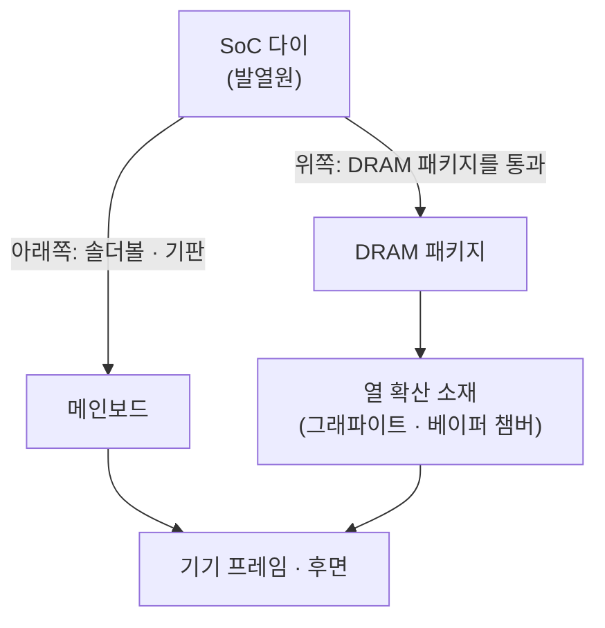

# 패키지와 PoP

!!! spec "규격 · 세대"
    패키지 형태는 회사·파운드리별 기술 · 관련 표준: JEDEC 패키지 외형 규격(PoP 볼 배열 등), LPDDR 다이 패키지
    와이어 본딩 + 기판 기반 PoP → 플립칩 → **팬아웃 웨이퍼 레벨 패키지(FOWLP)** 기반 PoP(TSMC InFO 계열 등, 2016년 무렵부터 스마트폰 SoC에 사용) → 노트북급 SoC의 메모리 온 패키지(옆 배치) → 스마트폰에서도 PoP 열 경로 개선(삼성 HPB 2025, Apple A20 Pro의 다이·DRAM 나란히 배치 2026) → 칩렛·2.5D/3D 적층(논의·확대 중)

!!! basic "한눈에 보기"
    스마트폰 메인보드를 보면 SoC 위에 또 다른 칩이 붙어 있는 경우가 많습니다. **DRAM을 SoC 바로 위에 쌓은 것**으로, 이를 **PoP(Package on Package)**라고 합니다.

    1. **공간 절약** — 보드에서 DRAM 자리를 따로 쓰지 않습니다.
    2. **짧은 배선** — SoC와 DRAM 사이 신호 길이가 짧아 고속 신호가 깨끗하고 전력이 덜 듭니다.
    3. **대가는 열** — SoC 위를 DRAM이 덮고 있어, SoC의 열이 위쪽으로 빠져나가기 어렵습니다.

    2층 주택에 비유하면, 1층(SoC)과 2층(DRAM)이 계단(짧은 배선)으로 연결되어 편하지만, 1층 난방열이 지붕으로 빠져나가는 길을 2층이 막고 있는 셈입니다.

## 패키지 구조의 종류 { .l2 }

| 구조 | 모양 | 장점 | 단점 | 주 사용처 |
|---|---|---|---|---|
| 기판 기반 PoP | SoC 패키지 위에 DRAM 패키지를 솔더볼로 적층 | 성숙한 기술, 메모리 공급처 유연 | 두께, 기판 배선 길이 | 다양한 스마트폰 SoC |
| **팬아웃 PoP (FOWLP 계열)** | 두꺼운 기판 대신 재배선층(RDL)으로 다이 주변까지 배선을 펼침 | 얇음, 전기·열 특성 개선 | 공정 비용, 공급 제약 | 플래그십 스마트폰 SoC |
| 방열 블록 내장 PoP | AP 다이 위에 구리 블록을 넣고 DRAM 패키지를 작게 줄여 옆으로 옮김 | PoP 구조를 유지하면서 열 경로 확보 | DRAM 패키지 크기 제약 | Exynos 2600 (삼성 HPB) |
| 메모리 온 패키지 (옆 배치) | SoC 다이 옆에 DRAM 패키지를 같은 기판에 배치 | 넓은 버스, 방열 유리 | 면적 큼 | 노트북·태블릿용 Arm SoC, 스마트폰은 Apple A20 Pro부터 |
| 보드 위 별도 배치 | DRAM을 보드에 따로 실장 | 방열·교체 유연 | 배선 길이, 공간 | 일부 PC·임베디드 |

## 열 경로 { .l2 }

PoP 구조에서 SoC의 열은 DRAM 패키지를 거쳐 위로, 또는 솔더볼과 보드를 거쳐 아래로 빠져나갑니다. DRAM 자체도 온도가 오르면 리프레시를 자주 해야 하고 신뢰성 한계가 있어, **SoC 지속 성능의 상한이 패키지 열 저항에 좌우**됩니다. 팬아웃 패키지나 열 전달 구조를 개선한 패키지가 지속 성능 개선을 앞세워 발표되는 이유입니다([열 관리와 스로틀링](../power/thermal.md)).

실제 제품도 이 방향으로 움직이고 있습니다.
- **삼성 Exynos 2600의 HPB(Heat Path Block):** 다이 위에 구리 블록을 두고 DRAM을 옆으로 비켜 놓아, 그림의 "위쪽" 경로가 DRAM 대신 구리를 지나게 했습니다. 삼성은 Exynos 2500 대비 열 저항이 최대 16% 낮다고 발표했습니다.
- **Apple A20 Pro:** 다이와 DRAM을 아예 나란히 놓아 위쪽 경로에서 DRAM을 뺐습니다.

두 방식의 구조 비교는 [패키징](../design/packaging.md#모바일-패키지의-방열-경쟁)에 그림과 함께 정리했습니다.

??? expert "전문가 노트 — 신호 무결성, 열과 성능의 교환, 패키지 선택의 경제학"
    **신호 무결성.** LPDDR5X의 핀당 수 Gbps 신호는 수 mm의 배선에서도 반사·누화·손실이 문제가 됩니다. PoP는 SoC와 DRAM 사이 거리를 최소화하지만, 패키지 기판·볼 배열 설계가 여전히 최대 속도를 정합니다. 그래서 같은 SoC라도 기기 제조사의 보드·패키지 구현에 따라 지원 DRAM 속도가 달라질 수 있습니다.

    **열과 성능의 교환.** PoP의 열 저항이 높으면 같은 냉각 구조에서 SoC가 낼 수 있는 지속 전력이 낮아집니다. 설계자는 ① 열 저항이 낮은 패키지(팬아웃, 열 전달용 구조 추가), ② DRAM을 옆에 두는 배치(면적 증가), ③ SoC 전력 자체를 낮추는 설계 중에서 고릅니다. 스마트폰은 면적 제약 때문에 오랫동안 ①과 ③의 조합이었지만, 2026년 Apple A20 Pro가 ②를 택했고 삼성 HPB는 ①과 ②의 중간(DRAM을 일부 비켜 놓는 방식)에 해당합니다.

    **패키지 선택의 경제학.** 고급 패키지는 생산 능력이 한정되고 비용이 높아, 파운드리 선택과 함께 묶여 결정되는 경우가 많습니다. 파운드리마다 자사 고급 패키지 기술을 제공하며, 칩 회사는 공정·패키지·생산 능력을 한 묶음으로 협상합니다([패키징](../design/packaging.md)).

    **넓은 I/O 모바일 DRAM.** 온디바이스 AI는 용량보다 대역폭을 더 요구합니다. 그래서 핀당 속도를 낮추는 대신 I/O 수를 크게 늘린 모바일 DRAM이 개발되고 있습니다. 이름은 LPW(Low Power Wide I/O), LLW(Low Latency Wide I/O)이고, "모바일 HBM"으로도 불립니다. 삼성은 LPDDR5X 대비 전력 54% 감소와 200 GB/s 이상의 대역폭을 내세웠고, 첫 탑재 제품을 2028년으로 예고했습니다(ISSCC 2025 기조연설, 보도 기준). 적층 연결에는 삼성의 수직 와이어 본딩(VWB), SK hynix의 수직 팬아웃(VFO) 같은 기술이 거론됩니다. I/O가 넓어지면 PoP 볼 배열로는 수용하기 어려워, SoC 옆이나 같은 패키지 안에 두는 배치와 함께 논의됩니다([온디바이스 LLM](../npu/llm.md)).

    **분해 분석에서 보이는 것.** 기기 분해 사진에서 SoC 위에 메모리 회사 표기가 찍힌 패키지가 보이면 PoP 구조입니다. 이 표기로 DRAM 제조사·용량·세대를 추정할 수 있어, 같은 모델이라도 생산 시기에 따라 메모리 공급사가 다른 경우를 확인할 수 있습니다.

## 배치 비교

| 항목 | 스마트폰 PoP | 노트북 메모리 온 패키지 |
|---|---|---|
| 보드 면적 | 최소 | 큼 |
| 메모리 버스 폭 | 64비트가 일반적 | 128비트 이상 가능 |
| 방열 | 불리 (DRAM이 위를 덮음). 2025년부터 HPB·옆 배치로 개선 | 유리 |
| 두께 | 두 패키지 높이 합 | 얇음 |

## 관련 페이지
- [LPDDR](lpddr.md) — 패키지 안의 DRAM
- [열 관리와 스로틀링](../power/thermal.md) — 패키지 열 저항과 지속 성능
- [패키징](../design/packaging.md) — 반도체 패키징 기술 전반
- [SoC란 무엇인가](../getting-started/what-is-soc.md) — SoC 밖에 남는 칩들
