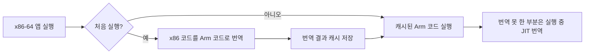

# Arm PC와 노트북 SoC

!!! spec "규격 · 세대"
    ISA: Armv8-A(AArch64) → Armv9-A · 펌웨어·OS 요구: Arm SystemReady, Windows on Arm, macOS(Apple Silicon)
    Windows on Arm 첫 상용 노트북: Snapdragon 835 탑재 기기(2017년 무렵) → Snapdragon 8cx(2018) → **Snapdragon X Elite/Plus**(2024, Copilot+ PC) → **Snapdragon X2 Elite**(2025년 9월 발표, 2026년 상반기 기기 출시)
    Apple: **M1**(2020, Rosetta 2와 함께 Mac 전환 시작) → M2 → M3 → M4 → M5(2025년) → M6(2026년 8월 발표, Apple의 첫 2nm 칩)
    x86 에뮬레이션: macOS **Rosetta 2**(2020), Windows 11 **Prism**(24H2, 2024)

!!! basic "한눈에 보기"
    Arm 노트북 SoC는 **스마트폰 SoC를 노트북 크기로 키운 칩**입니다. 저전력 설계 철학은 그대로 두고, 노트북이 허락하는 더 큰 전력과 공간을 씁니다.

    1. **같은 뿌리** — CPU·GPU·NPU·ISP·보안 블록을 한 칩에 모은 구조는 스마트폰과 같습니다.
    2. **더 넓은 길** — 메모리와 칩을 잇는 버스를 2배, 4배, 8배로 넓혀 GPU와 AI에 데이터를 더 많이 보냅니다.
    3. **더 큰 전력 한도** — 손에 쥐는 폰은 몇 와트에서 오래 버텨야 하지만, 팬이 있는 노트북은 수십 와트까지 씁니다.
    4. **통역사** — 기존 Windows·Mac 앱은 대부분 x86용이라, 실행할 때 Arm 명령어로 번역해 주는 에뮬레이터가 필요합니다.

    비유하면 스마트폰 SoC가 연비 좋은 경차 엔진이라면, 노트북 SoC는 같은 엔진 기술로 만든 더 큰 엔진에 넓은 연료 라인을 붙인 것입니다.

## 스마트폰 SoC와의 차이 { .l2 }

| 항목 | 스마트폰 플래그십 SoC | Arm 노트북 SoC |
|---|---|---|
| 전력 한도 | 지속 수 W 수준, 순간 최대는 더 높음 | 팬리스 10 W 안팎부터 팬 장착 수십 W까지 (기기별 설정) |
| CPU 구성 | 성능 코어 소수 + 효율 코어 다수 | 성능 코어 수를 크게 늘림, 상위판은 10코어 이상이 일반적 |
| 메모리 버스 | 64비트 LPDDR | 128비트 이상, 상위판은 256·512비트 |
| 메모리 배치 | SoC 위 PoP 적층 | 패키지 안 옆 배치(메모리 온 패키지) 또는 보드 실장 |
| 외부 I/O | USB, UFS, 카메라·디스플레이 MIPI | PCIe(NVMe SSD), USB4·Thunderbolt, 외부 디스플레이 다수 |
| 모뎀 | 대개 통합 | 대개 없음 또는 별도 모듈 |
| 부팅·펌웨어 | 제조사 부트로더 + Android | UEFI·ACPI(Windows) 또는 Apple 자체 부팅 체인 |

### 메모리 버스 폭과 대역폭

| 버스 폭 (LPDDR5X-8533 가정) | 피크 대역폭 | 대표 사례 |
|---|---|---|
| 64비트 | 약 68.3 GB/s | 스마트폰 플래그십 |
| 128비트 | 약 136.5 GB/s | Snapdragon X Elite(LPDDR5X-8448, 공식 135 GB/s), Apple M 기본형 |
| 256비트 | 약 273.1 GB/s | Apple M4 Pro(공식 273 GB/s) |
| 512비트 | 약 546.1 GB/s | Apple M4 Max 상위판(공식 546 GB/s) |

버스 폭이 넓을수록 GPU 성능과 온디바이스 LLM의 생성 속도 상한이 올라갑니다. 대신 메모리 PHY 면적, 패키지 핀 수, 메모리 칩 개수가 함께 늘어나 비용과 대기 전력이 커집니다. (수치는 `tools/soc_numbers.py`에서 계산)

## x86 앱 호환: Rosetta 2와 Prism { .l2 }

| 항목 | Rosetta 2 (macOS) | Prism (Windows 11) |
|---|---|---|
| 방식 | 설치·첫 실행 때 미리 번역(AOT) + JIT | JIT 번역 + 번역 캐시 |
| 하드웨어 도움 | Apple SoC가 x86식 메모리 순서(TSO) 모드 등을 제공한다고 알려짐 | 일반 Arm 코어 위에서 소프트웨어로 처리하는 부분이 많음 |
| 제약 | 커널 확장·가상 머신 안의 x86 OS는 불가 | 커널 드라이버는 에뮬레이션 불가(Arm용 드라이버 필요), 일부 명령어 확장 지원이 단계적으로 추가됨 |
| 전환 전략 | 몇 년 안에 Mac 전체를 Arm으로 전환 | x86과 Arm 기기가 오래 공존 |

에뮬레이션의 실질적인 걸림돌은 성능보다 **드라이버와 안티치트·보안 소프트웨어**입니다. 커널에서 도는 코드는 번역할 수 없으므로 Arm용으로 다시 만들어야 하고, 프린터·VPN·게임 안티치트처럼 커널 구성 요소가 있는 소프트웨어가 Windows on Arm의 호환성 문제로 자주 꼽힙니다.

??? expert "전문가 노트 — 메모리 모델과 TSO, 통합 메모리, 노트북 SoC의 전력 관리"
    **메모리 순서 모델.** x86은 비교적 강한 메모리 순서(TSO)를 보장하지만 Arm은 약한 메모리 모델을 씁니다. x86 코드를 그대로 번역하면 멀티스레드 프로그램이 다른 순서로 메모리를 관찰할 수 있으므로, 에뮬레이터는 메모리 접근마다 배리어를 넣거나(느림), 하드웨어가 제공하는 TSO 모드를 켜야 합니다. Apple SoC는 Rosetta 2 실행 중 코어를 TSO 모드로 바꾸는 기능을 갖는 것으로 알려져 있고, 이것이 번역 코드의 성능을 크게 돕습니다. Arm 아키텍처 자체에도 이후 이런 수요를 반영한 기능이 논의되어 왔습니다([Arm 아키텍처](../cpu/arm-architecture.md)).

    **통합 메모리.** Apple M 시리즈는 CPU·GPU·NPU가 같은 물리 메모리를 공유하는 통합 메모리 구조를 내세웁니다. 스마트폰 SoC도 원래 그렇지만, 노트북에서는 독립 GPU의 VRAM 복사가 없어진다는 점이 차별점이 됩니다. 넓은 버스와 대용량 메모리를 함께 쓰면 큰 LLM을 GPU에서 돌릴 수 있어, 상위 Mac이 로컬 LLM 실행 기기로 쓰이는 배경이 되었습니다([온디바이스 LLM](../npu/llm.md)).

    **전력 관리의 차이.** 스마트폰 SoC는 화면이 꺼진 동안 아주 깊은 절전 상태로 빨리 들어가는 데 맞춰져 있고, Arm 노트북이 x86 노트북보다 대기 시간과 배터리 사용 시간에서 유리하다고 평가받는 이유도 이 유산에 있습니다. 반대로 노트북은 장시간 고부하(컴파일, 렌더링)를 오래 유지해야 하므로 지속 전력 한도(PL1에 해당하는 개념)와 냉각 설계를 기기 제조사가 정합니다. 같은 SoC라도 팬리스 기기와 팬 장착 기기의 성능이 크게 다른 이유입니다([열 관리와 스로틀링](../power/thermal.md)).

    **Windows on Arm의 플랫폼 요구.** Windows는 UEFI와 ACPI로 하드웨어를 찾으므로, 디바이스 트리와 제조사 부트로더를 쓰는 스마트폰 Android와 펌웨어 구조가 다릅니다. Arm은 SystemReady 인증으로 이런 표준 부팅 환경을 정의해 왔고, 이를 지키는 SoC는 일반 Linux 배포판도 부팅하기 쉬워집니다([부팅 과정](../security/boot.md)).

## 칩셋 비교

| 접근 | Apple M 시리즈 | Qualcomm Snapdragon X 계열 | MediaTek · NVIDIA 등 |
|---|---|---|---|
| CPU | 자체 설계 코어 | 자체 설계 Oryon 코어 | Arm Cortex 코어 기반 (보도·발표 기준) |
| OS | macOS (자사 기기 전용) | Windows 11 (여러 PC 제조사) | Chromebook(MediaTek Kompanio), Windows용 칩은 보도·발표 단계 |
| 메모리 | 128비트부터 상위판 512비트까지 | 128비트 중심 | 제품별 |
| GPU | 자체 GPU | 자체 Adreno GPU | NVIDIA 협력 제품은 NVIDIA GPU (GB10 등 발표 기준) |
| x86 호환 | Rosetta 2 | Prism | Prism (Windows용인 경우) |

> 세대별 코어 구성과 공정은 [칩셋 세대 인덱스](../reference/chipset-index.md)에 모읍니다.

## 관련 페이지
- [자체 설계 코어](../cpu/custom-cores.md) — Apple 코어와 Oryon의 설계 방향
- [LPDDR](../memory/lpddr.md) — 버스 폭과 대역폭 계산
- [패키지와 PoP](../memory/packaging.md) — PoP와 메모리 온 패키지의 차이
- [온디바이스 LLM](../npu/llm.md) — 넓은 메모리 버스가 LLM 속도에 주는 영향
- [Arm 아키텍처](../cpu/arm-architecture.md) — 메모리 모델과 ISA 버전
