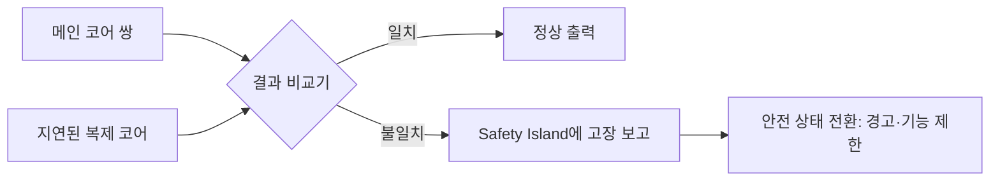

# 차량용 SoC

!!! spec "규격 · 세대"
    기능 안전: **ISO 26262**(2011 초판, 2018 2판 — Part 11에 반도체 지침 추가) · 의도된 기능의 안전: ISO 21448(SOTIF) · 사이버 보안: ISO/SAE 21434, UN R155
    부품 신뢰성: **AEC-Q100**(집적회로 스트레스 시험, 온도 등급 Grade 0–3) · 품질 경영: IATF 16949
    대표 플랫폼: Snapdragon Cockpit(SA8155P, SA8295P 등) · Snapdragon Ride · Exynos Auto V 시리즈 · MediaTek Dimensity Auto · NVIDIA DRIVE(Xavier → Orin → Thor) · Tesla FSD 칩(HW3, 2019)

!!! basic "한눈에 보기"
    차량용 SoC는 스마트폰 SoC와 비슷한 블록을 쓰지만, **우선순위가 거꾸로**입니다. 스마트폰은 "더 빠르게, 더 오래"가 먼저지만, 자동차는 "고장 나도 위험하지 않게, 15년 동안"이 먼저입니다.

    1. **콕핏(Cockpit)** — 계기판, 내비게이션, 음악, 뒷좌석 화면을 그리는 칩입니다. 스마트폰 SoC와 가장 닮았습니다.
    2. **ADAS·자율주행** — 카메라·레이더로 차선과 사람을 찾고 브레이크·조향을 돕는 칩입니다. 틀리면 사고로 이어지므로 안전 규칙이 훨씬 엄격합니다.
    3. **안전 감시자** — 큰 칩 안에 작은 "감시용 섬(Safety Island)"을 두고, 두 개의 코어가 같은 계산을 동시에 해서 답이 다르면 바로 알아챕니다.
    4. **긴 수명** — 영하 40도부터 뜨거운 엔진룸 가까이까지 견디고, 차가 팔리는 동안 10년 이상 같은 칩을 계속 공급해야 합니다.

    비유하면 스마트폰 SoC가 스포츠카라면, 차량용 SoC는 안전벨트와 에어백을 모두 단 버스입니다.

## 콕핏과 ADAS { .l2 }

| 항목 | 콕핏(IVI·클러스터) SoC | ADAS·자율주행 SoC |
|---|---|---|
| 주요 일 | 여러 디스플레이, 그래픽, 음성 비서, 카메라 뷰 | 센서 융합, 인식(NPU), 경로 계획 |
| 대표 OS | Android Automotive OS, Linux, QNX (하이퍼바이저 위 여러 OS) | QNX·Linux·RTOS, 안전 인증 OS |
| 안전 등급 | 주로 QM ~ ASIL B (계기판 경고 표시 등) | ASIL B ~ D (시스템 수준에서 이중화 포함) |
| 핵심 블록 | GPU, 디스플레이 파이프라인, 오디오 DSP | NPU, ISP, 비전 가속기, Safety Island |
| 스마트폰과 닮은 정도 | 높음 (모바일 SoC 파생이 많음) | 낮음 (전용 설계가 많음) |

최근에는 콕핏과 ADAS를 **한 칩 또는 한 컴퓨터로 합치는 중앙 집중형 구조**가 늘고 있습니다. Qualcomm Snapdragon Ride Flex처럼 한 SoC에서 콕핏과 ADAS를 함께 돌리는 제품이 발표되었고, 이 경우 서로 다른 안전 등급의 소프트웨어를 하이퍼바이저로 격리하는 것이 핵심이 됩니다.

### 주요 플랫폼 (발표 기준)

| 회사 | 콕핏 | ADAS·자율주행 | 비고 |
|---|---|---|---|
| Qualcomm | Snapdragon Cockpit (SA8155P, SA8295P, Cockpit Elite) | Snapdragon Ride, Ride Flex, Ride Elite | Snapdragon Digital Chassis 브랜드로 묶음 |
| 삼성 | Exynos Auto V 시리즈 (V9, V920 등) | — | 차량용 텔레매틱스 모뎀도 공급 |
| MediaTek | Dimensity Auto Cockpit (NVIDIA GPU 협력 제품 포함) | — | 스마트폰 SoC 기술 기반 |
| NVIDIA | DRIVE 플랫폼 일부 콕핏 활용 | DRIVE Orin, DRIVE Thor | 자율주행 컴퓨터와 소프트웨어 스택을 함께 제공 |
| Tesla | — | FSD 칩(자체 설계, HW3부터) | 차량 회사의 자체 설계 사례, 삼성 파운드리 생산(HW3, 보도·발표 기준) |

## 기능 안전과 신뢰성 { .l2 }

| 요구 | 내용 | SoC 설계에 주는 영향 |
|---|---|---|
| **ASIL** (QM, A–D) | 위험의 심각도·노출·통제 가능성으로 정하는 안전 등급, D가 가장 엄격 | 안전 메커니즘 범위, 고장 진단률 목표, 개발 프로세스 |
| 하드웨어 지표 | 단일점 고장 지표(SPFM), 잠재 고장 지표(LFM), 확률적 고장률(PMHF) | ASIL D 목표: SPFM ≥ 99%, LFM ≥ 90%, PMHF < 10 FIT |
| **AEC-Q100** | 온도·습도·수명 스트레스 시험 | Grade 1(−40~125 °C), Grade 2(−40~105 °C) 등 온도 등급에 맞춘 설계·패키지 |
| 장기 공급 | 차량 개발 3–5년 + 판매·서비스 10년 이상 | 공정·IP를 오래 유지, 단종 계획(PCN)을 길게 |
| 결함 관리 | 0 ppm 지향의 불량률 목표 | 번인, 추가 시험 항목, 현장 고장 추적 |

FIT(Failures In Time)는 10억 시간당 고장 수입니다. 예를 들어 10 FIT인 부품을 차량 수명 동안 1만 시간 운행한다고 가정하면(가정), 100만 대 중 약 100대에서 고장이 기대되고, 100 FIT면 약 1,000대입니다. 안전 목표는 "고장이 나지 않는다"가 아니라 **"고장이 나도 탐지해 안전한 상태로 간다"**로 정해지는 이유입니다. (수치는 `tools/soc_numbers.py`에서 계산)

??? expert "전문가 노트 — 락스텝과 Split-Lock, Safety Island, 혼합 등급 하이퍼바이저"
    **락스텝 코어.** 두 코어가 같은 명령을 한두 사이클 시차를 두고 실행하고, 출력을 비교기에서 매 사이클 비교합니다. 시차를 두는 이유는 전원 잡음이나 방사선 같은 공통 원인 고장이 두 코어에 똑같이 나타나 비교를 통과하는 것을 막기 위해서입니다. Arm의 AE(Automotive Enhanced) 코어 일부는 **Split-Lock**을 지원해, 평소에는 두 코어를 각각 독립적으로 쓰다가(성능) 안전이 필요한 작업에서는 락스텝으로 묶을 수 있습니다(안전). 메모리와 버스에는 ECC·패리티, 클럭·전압 모니터, 워치독이 함께 들어가 SPFM 목표를 맞춥니다.

    **Safety Island.** 대형 SoC 안에 작은 독립 영역을 두고 Cortex-R 계열 같은 실시간 코어를 락스텝으로 돌립니다. 이 영역은 별도 전원·클럭 도메인을 가져 메인 부분이 멈춰도 살아 있고, 메인 블록의 고장 보고를 모아 안전 상태 전환(예: 운전자에게 경고, 기능 축소)을 결정합니다. 스마트폰 SoC의 AON(Always-On) 영역이나 센서 허브와 위치는 비슷하지만, 목적이 저전력이 아니라 **독립성과 진단**이라는 점이 다릅니다([파워 도메인과 게이팅](../power/power-domains.md)).

    **혼합 등급 하이퍼바이저.** 콕핏 SoC 하나에서 계기판(안전 관련, RTOS)과 인포테인먼트(Android Automotive OS)를 함께 돌리려면, 한쪽의 오류가 다른 쪽에 번지지 않음을 보여야 합니다(freedom from interference). QNX Hypervisor, Green Hills INTEGRITY, Xen 같은 타입 1 하이퍼바이저가 쓰이며, CPU 시간뿐 아니라 GPU·디스플레이 레이어·메모리 대역폭을 나누는 하드웨어 지원(SMMU 스트림 분리, QoS)이 필요합니다([가상화](../security/virtualization.md)).

    **공정과 수명.** 차량용 SoC는 높은 온도에서 오래 쓰이므로 전자 이동(electromigration), 핫 캐리어, 바이어스 온도 불안정성(NBTI) 같은 노화가 스마트폰보다 크게 문제됩니다. 같은 공정이라도 차량용 설계 규칙과 수명 모델을 따로 쓰고, 최신 공정 도입은 스마트폰보다 한두 세대 늦는 것이 일반적이었습니다. 다만 ADAS 연산 수요가 커지면서 차량용 SoC도 첨단 공정으로 빠르게 옮겨 가는 추세입니다.

## 칩셋 비교

| 접근 | Qualcomm | 삼성 | MediaTek | NVIDIA | Tesla |
|---|---|---|---|---|---|
| 주력 영역 | 콕핏 + ADAS + 연결 | 콕핏 | 콕핏 | ADAS·자율주행 중심 | 자사 차량 ADAS |
| 기술 기반 | 스마트폰 Snapdragon | 스마트폰 Exynos | 스마트폰 Dimensity + NVIDIA GPU 협력 | 데이터센터·GPU | 자체 설계 NPU |
| 소프트웨어 | SDK + 파트너 스택 | SDK | SDK | DRIVE OS·자율주행 스택 제공 | 자체 스택 |
| 고객 | 다수 완성차 | 일부 완성차 | 다수 완성차 (발표 기준) | 다수 완성차 | 자사 |

> 세대별 차량용 칩의 공정과 사양은 [칩셋 세대 인덱스](../reference/chipset-index.md)에 모읍니다.

## 관련 페이지
- [가상화](../security/virtualization.md) — 하이퍼바이저로 여러 OS를 격리하는 방법
- [파워 도메인과 게이팅](../power/power-domains.md) — 독립 전원 도메인과 항상 켜진 영역
- [주요 NPU 계열](../npu/families.md) — ADAS 인식에 쓰이는 NPU
- [디스플레이 파이프라인](../media/display.md) — 여러 화면을 동시에 그리는 콕핏의 핵심
- [시험과 양산](../design/test.md) — 번인과 불량률 관리
