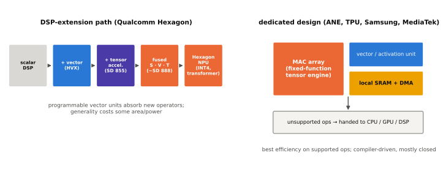

# 주요 NPU 계열

!!! spec "규격 · 세대"
    각 회사의 자체 아키텍처이며 공개 규격이 없습니다. 이 페이지는 공식 발표와 개발자 문서에 근거한 아키텍처 수준의 흐름만 다룹니다(이 페이지 기준 시점).
    첫 등장(발표 기준): Hexagon HVX — Snapdragon 820 · Apple Neural Engine — A11 Bionic(2017) · MediaTek APU — Helio P60(2018) · Samsung NPU — Exynos 9820(2018 발표) · Hexagon 텐서 가속기 — Snapdragon 855 · Google TPU — Tensor(2021) · Arm Ethos-N — 2019 발표

!!! basic "한눈에 보기"
    스마트폰 NPU는 회사마다 출발점이 다릅니다. 그래서 이름도, 구조도, 개발 도구도 제각각입니다.

    1. **DSP에서 자란 계열** — 원래 소리·신호를 처리하던 프로세서에 행렬 엔진을 붙였습니다(Qualcomm).
    2. **처음부터 AI 전용으로 만든 계열** — 신경망만 생각하고 새로 설계했습니다(Apple, Samsung, MediaTek, Google).
    3. **사서 쓰는 계열** — Arm 같은 IP 회사의 설계를 라이선스해 칩에 넣습니다.

    자동차에 비유하면, 트럭 엔진을 개조해 경주차를 만든 회사와 처음부터 경주용 엔진을 설계한 회사가 있는 셈입니다. 둘 다 빨라질 수 있지만, 정비 방법(소프트웨어)은 서로 호환되지 않습니다.

## 계열별 흐름 { .l2 }

| 계열 | 출발점 | 구조의 변화 (아키텍처 수준) |
|---|---|---|
| Qualcomm **Hexagon NPU** | 오디오·모뎀·센서용 Hexagon DSP | 스칼라 DSP → 넓은 벡터 확장(HVX) → 텐서 가속기 추가(Snapdragon 855) → 스칼라·벡터·텐서를 하나의 가속기로 융합(Snapdragon 888 무렵) → "Hexagon NPU"로 명칭 정리, 트랜스포머·INT4 지원 강화 |
| Samsung **NPU** | Exynos용 신경망 전용 블록 | 첫 NPU(Exynos 9820) → 코어 수·MAC 수 확장, 최근 세대는 생성형 AI 대응을 위해 연산 유닛과 메모리 구조를 키움 |
| MediaTek **APU / NPU** | AI Processing Unit (Helio P60) | 전용 AI 코어 + DSP·벡터 유닛 혼합 → Dimensity 세대마다 APU 버전 갱신 → 최근 세대는 "NPU" 명칭도 함께 쓰며 생성형 AI·온디바이스 LLM을 전면에 내세움 |
| Apple **Neural Engine** | iPhone용 신경망 전용 블록 (A11) | 초기에는 Face ID·사진 처리 등 시스템 기능 위주 → A12부터 Core ML로 앱이 사용 → 코어 수 확대, M 시리즈 Mac과 같은 계열 설계 공유 |
| Google **TPU** (Tensor) | 데이터센터 TPU와 Edge TPU 연구 | Pixel Visual Core(Pixel 2)·Pixel Neural Core(Pixel 4) 같은 전용 칩 → Tensor SoC 안의 TPU로 통합 → Gemini Nano 등 Google 자체 모델에 맞춰 설계 |
| Arm **Ethos** | Arm의 머신러닝 IP (Project Trillium) | 모바일·임베디드용 Ethos-N, 마이크로컨트롤러용 마이크로 NPU Ethos-U 계열 → 이후 Arm은 모바일 AI를 CPU 행렬 확장(SME2)과 Ethos-U 쪽에 더 무게를 두는 흐름 |

"첫 등장" 세대는 해당 회사가 공식 발표에서 그 블록을 처음 내세운 시점을 뜻합니다. 그 이전에도 DSP나 GPU로 신경망을 돌리는 일은 흔했습니다.

## 설계 철학의 차이 { .l2 }

| 관점 | DSP 확장형 (Hexagon) | 전용 설계형 (ANE·TPU·Samsung·MediaTek) |
|---|---|---|
| 프로그래밍 가능성 | 높음 — 벡터 유닛에 직접 커널 작성 가능(공개 SDK 범위 안에서) | 낮거나 비공개 — 컴파일러가 만든 그래프만 실행 |
| 새 연산 대응 | 벡터·스칼라 유닛으로 구현해 흡수하기 쉬움 | 하드웨어에 없는 연산은 다른 블록으로 넘기는 경우가 많음 |
| 효율 | 범용성 유지 비용이 있음 | 지원 연산에서는 면적·전력 효율을 최대로 끌어올리기 쉬움 |
| 소프트웨어 | 자체 SDK + 표준 프레임워크 백엔드 | 자체 SDK 또는 OS 프레임워크(Core ML 등) 전용 |

실제로는 두 방향이 수렴하고 있습니다. DSP 계열은 텐서 엔진을 키우고, 전용 설계 계열은 트랜스포머의 소프트맥스·정규화 같은 연산을 위해 벡터 엔진과 프로그래밍 가능성을 늘려 왔습니다.

## 생성형 AI 이후의 변화 { .l2 }

| 변화 | 이유 |
|---|---|
| INT4·혼합 정밀도 지원 | LLM 가중치를 작게 저장해 메모리 대역폭과 용량을 아끼기 위해 |
| 트랜스포머 연산 가속 | 어텐션, 소프트맥스, 레이어 정규화가 합성곱보다 중요해짐 |
| 로컬 메모리·DMA 강화 | 가중치 재사용이 적은 연산에서 DRAM 왕복을 줄이기 위해 |
| 상시 동작 저전력 경로 | 음성 호출어·센서 AI를 아주 작은 전력으로 처리하기 위해 (일부는 센서 허브·별도 저전력 NPU) |

??? expert "전문가 노트 — Hexagon의 융합 구조, ANE의 폐쇄성, Tensor TPU의 공동 설계"
    **Hexagon의 융합 구조.** Hexagon 계열은 스칼라 스레드가 제어를, HVX가 넓은 벡터 연산을, 텐서 유닛이 행렬 곱셈을 맡고, 셋이 같은 로컬 메모리(타이트하게 결합된 SRAM)를 공유하는 방향으로 발전했습니다. 데이터가 블록 사이를 오갈 때 DRAM을 거치지 않는 것이 핵심이며, Qualcomm이 공개한 발표에 따르면 마이크로 타일 단위로 레이어를 깊게 융합하는 기법도 강조됩니다. 개발자는 QNN(Qualcomm AI Engine Direct)으로 그래프를 넘기고, 필요하면 Hexagon SDK로 맞춤 연산을 작성할 수 있습니다.

    **Neural Engine의 폐쇄성.** Apple은 Neural Engine의 명령어 집합이나 내부 구조를 공개하지 않고, 개발자는 Core ML을 통해서만 사용합니다. Core ML이 모델을 CPU·GPU·Neural Engine 중 어디에 배치할지 정하며, 개발자는 허용할 계산 장치 범위만 지정할 수 있습니다. 그래서 같은 모델이라도 연산 종류와 형상에 따라 일부만 Neural Engine에서 돌고 나머지는 GPU·CPU로 가는 일이 생기며, Xcode의 성능 리포트로 배치를 확인하는 것이 실무의 출발점입니다.

    **Tensor TPU의 공동 설계.** Google은 모델(Gemini Nano, 카메라·음성 모델)과 TPU를 함께 설계한다는 점을 강조합니다. 하드웨어가 범용 벤치마크보다 자사 모델의 연산 패턴에 맞춰 최적화되므로, 공개 벤치마크 점수와 Pixel의 실제 AI 기능 체감이 다르게 나타날 수 있습니다. 서드파티 앱은 주로 Android의 표준 경로(LiteRT, AICore 등)를 통해 접근합니다.

    **IP 모델과 자체 설계.** Arm Ethos 같은 라이선스 NPU는 설계·검증 비용을 줄여 주지만, 플래그십 스마트폰 SoC 회사들은 대부분 자체 NPU를 택했습니다. NPU가 카메라·음성·생성형 AI 기능의 차별화 지점이 되면서 소프트웨어 스택까지 직접 통제하려는 이유가 큽니다. 반면 웨어러블·IoT처럼 전력 예산이 작은 기기에서는 Ethos-U 같은 마이크로 NPU IP가 널리 쓰입니다([IP와 통합](../design/ip-integration.md)).

## 칩셋 비교

| 항목 | Snapdragon | Exynos | Dimensity | Apple | Tensor |
|---|---|---|---|---|---|
| 블록 이름 | Hexagon NPU | NPU (+ DSP) | APU / NPU | Neural Engine | TPU |
| 출발점 | DSP 확장 | 전용 설계 | 전용 설계 | 전용 설계 | 데이터센터·Edge TPU 연구 |
| 대표 개발 경로 | QNN, LiteRT·ONNX Runtime 백엔드 | Exynos AI Studio, LiteRT | NeuroPilot, LiteRT | Core ML | LiteRT, AICore |
| 공개 정보 수준 | SDK 문서 상세, 내부 구조 일부 공개 | 제한적 | SDK 문서 중심 | 매우 제한적 | 제한적 |

> 세대별 NPU 명칭·버전과 발표 TOPS는 [칩셋 세대 인덱스](../reference/chipset-index.md)에 모읍니다.

## 관련 페이지
- [NPU란 무엇인가](what-is-npu.md) — 스칼라·벡터·텐서 유닛의 역할
- [AI 소프트웨어 스택](software.md) — 계열별 SDK와 표준 프레임워크
- [주요 GPU 계열](../gpu/families.md) — 같은 회사들의 GPU 선택과 비교
- [주요 제조사와 생태계](../getting-started/ecosystem.md) — 자체 설계와 IP 라이선스의 구도
