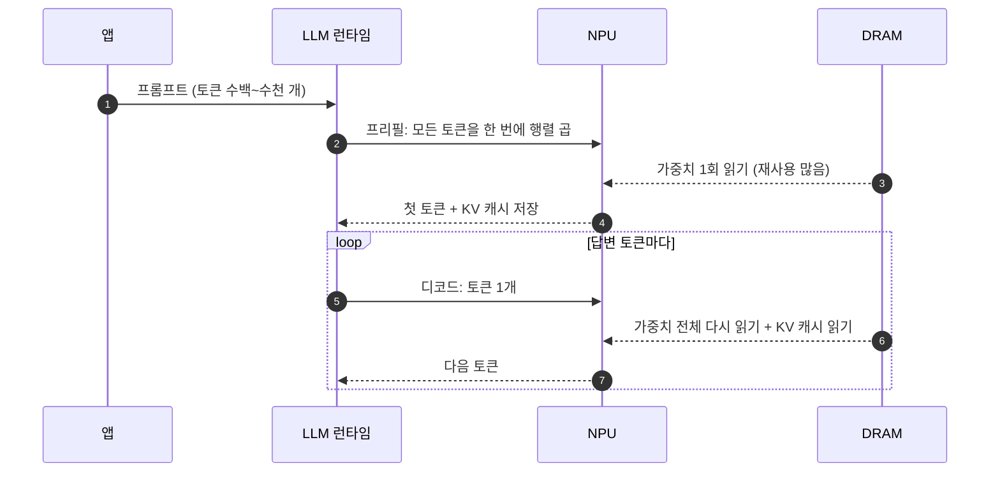

# 온디바이스 LLM

!!! spec "규격 · 세대"
    표준 규격은 없고 런타임·형식이 빠르게 바뀌는 분야입니다. 주요 경로: Android **AICore**(Gemini Nano), **LiteRT**·LiteRT-LM, **ExecuTorch**, llama.cpp(GGUF 형식), MLC LLM · Apple **Foundation Models** 프레임워크와 Core ML · 회사별 SDK(Qualcomm AI Engine Direct, MediaTek NeuroPilot 등)
    흐름: 2023년 말 발표된 Android 플래그십 SoC부터 온디바이스 생성형 AI를 전면에 내세움 → 2024년 이후 스마트폰 OS 차원의 온디바이스 모델(수십억 매개변수급) 기본 탑재 확산(이 페이지 기준 시점)

!!! basic "한눈에 보기"
    LLM(대규모 언어 모델)은 문장을 **한 토큰(단어 조각)씩** 이어 쓰는 프로그램입니다. 스마트폰에서 돌릴 때는 두 단계로 나뉩니다.

    1. **프리필(prefill)** — 질문 전체를 한꺼번에 읽어 들입니다. 계산이 많지만 한 번에 몰아서 처리할 수 있어 NPU가 잘합니다.
    2. **디코드(decode)** — 답을 한 토큰씩 만듭니다. 토큰 하나마다 **모델 전체를 메모리에서 한 번씩 읽어야** 해서, 계산보다 메모리 속도가 발목을 잡습니다.
    3. 그래서 모델을 **작게 줄이는 일(양자화)**과 **메모리 대역폭**이 체감 속도를 정합니다.

    도서관에 비유하면, 프리필은 질문지를 한 번에 훑어보는 일이고, 디코드는 답의 글자 하나를 쓸 때마다 서고 전체를 한 바퀴 돌고 와야 하는 일입니다. 사서(NPU)가 아무리 빨라도 복도(메모리 버스)가 좁으면 속도가 나지 않습니다.

## 프리필과 디코드 { .l2 }

| 항목 | 프리필 | 디코드 |
|---|---|---|
| 한 번에 처리하는 토큰 | 프롬프트 전체 | 1개 (배치 1) |
| 연산 형태 | 행렬 × 행렬 | 행렬 × 벡터 |
| 병목 | 연산 (TOPS, 이용률) | **메모리 대역폭** |
| 체감 지표 | 첫 토큰까지의 시간 | 초당 토큰 수 |

프리필 연산량은 대략 매개변수 수 × 2 × 프롬프트 토큰 수입니다. 예를 들어 7B 모델에 1000토큰 프롬프트를 넣으면 약 $1.4 \times 10^{13}$ 연산이고, 유효 10 TOPS를 가정하면 약 **1.4초**가 걸립니다(가상의 예, 어텐션 연산 제외). (수치는 `tools/soc_numbers.py`에서 계산)

## 디코드 속도의 상한 { .l2 }

디코드에서는 토큰마다 가중치 전체를 한 번 읽는다고 보면 상한을 쉽게 구할 수 있습니다.

$$
\text{토큰/s 상한} \approx \frac{\text{메모리 대역폭 (GB/s)}}{\text{모델 크기 (GB)}}
$$

LPDDR5X-8533 64비트 버스(약 68.3 GB/s) 기준 상한은 다음과 같습니다. (수치는 `tools/soc_numbers.py`에서 계산)

| 모델 | INT4 크기 | INT4 상한 | INT8 크기 | INT8 상한 |
|---|---|---|---|---|
| 1B | 0.5 GB | 약 136.5 토큰/s | 1 GB | 약 68.3 토큰/s |
| 3B | 1.5 GB | 약 45.5 토큰/s | 3 GB | 약 22.8 토큰/s |
| 7B | 3.5 GB | 약 19.5 토큰/s | 7 GB | 약 9.8 토큰/s |

이 값은 스케일·임베딩·KV 캐시 읽기를 빼고, DRAM을 다른 블록과 나누지 않으며, 피크 대역폭을 100% 쓴다고 본 이론 상한입니다. 실제 속도는 이보다 낮습니다. 같은 7B INT4라도 LPDDR5X-10667(약 85.3 GB/s)이면 상한이 약 24.4 토큰/s로 올라가므로, 플래그십 SoC가 최고 속도 LPDDR을 경쟁적으로 채택합니다([LPDDR](../memory/lpddr.md)).

## 모델 크기와 메모리 { .l2 }

| 요소 | 내용 |
|---|---|
| 가중치 양자화 | 가중치만 INT4(그룹별 스케일), 활성화는 INT8·FP16으로 두는 방식이 흔함 |
| KV 캐시 | 앞 토큰들의 어텐션 키·값을 저장해 재계산을 피함. 문맥 길이에 비례해 커짐 |
| 메모리 상주 | 모델이 RAM을 계속 차지하면 다른 앱이 종료될 수 있어, OS가 모델 적재·해제를 관리 |
| 모델 크기 | 스마트폰 기본 탑재 모델은 공개된 사례 기준 1B–4B급이 중심이며, 7B급 이상은 고용량 RAM 기기·데모 위주 |

KV 캐시 크기는 $2 \times \text{레이어 수} \times \text{KV 헤드 수} \times \text{헤드 차원} \times \text{문맥 길이} \times \text{바이트}$입니다. 예를 들어 32레이어, KV 헤드 8개, 헤드 차원 128, FP16, 문맥 4096토큰이라면 약 **0.54 GB**입니다(가상의 구성). (수치는 `tools/soc_numbers.py`에서 계산)

??? expert "전문가 노트 — 산술 강도, KV 캐시 압축, 추측 디코딩, 메모리 압박"
    **디코드의 산술 강도.** 배치 1 디코드에서 INT4 가중치 1바이트(가중치 2개)는 MAC 2번, 즉 연산 4개에만 쓰입니다. 산술 강도가 약 4 ops/byte인데, 가상의 8.2 TOPS·68.3 GB/s NPU의 경계점은 약 120 ops/byte이므로 MAC의 대부분이 놀게 됩니다. 그래서 디코드 성능은 NPU·GPU·CPU 중 어느 블록이 **DRAM 대역폭을 더 잘 끌어다 쓰는지**에 좌우되며, 실제로 CPU나 GPU 경로가 NPU와 비슷한 디코드 속도를 내는 경우도 있습니다. 여러 요청을 묶는 배치는 산술 강도를 높이지만, 스마트폰은 보통 사용자 한 명의 요청 하나를 처리합니다. (수치는 `tools/soc_numbers.py`에서 계산)

    **KV 캐시 줄이기.** 쿼리 헤드 여러 개가 KV 헤드 하나를 공유하는 grouped-query attention은 KV 캐시를 헤드 공유 비율만큼 줄이며, 최근 소형 모델에서 표준처럼 쓰입니다. 그 밖에 KV 캐시 자체의 INT8·INT4 양자화, 슬라이딩 윈도 어텐션, 오래된 토큰 제거 같은 기법이 쓰입니다. 문맥이 길어질수록 디코드마다 읽는 KV 캐시가 가중치 못지않게 커지므로, 긴 문서 요약에서는 KV 캐시가 새로운 대역폭 병목이 됩니다.

    **추측 디코딩.** 작은 초안 모델(draft)이 토큰 $k$개를 먼저 제안하면, 큰 모델이 이를 프리필처럼 한 번에 검증합니다. 큰 모델의 가중치를 한 번 읽어 여러 토큰을 얻으므로 메모리 한계를 우회하는 효과가 있습니다. 토큰마다 채택될 확률이 $\alpha$로 독립이라고 단순화하면, 검증 한 번에 얻는 기대 토큰 수는 $(1-\alpha^{k+1})/(1-\alpha)$이며, 예를 들어 $\alpha = 0.7$, $k = 4$이면 약 **2.77개**입니다(가상의 값). 초안 모델의 비용과 거부된 토큰의 낭비가 있어 실제 속도 향상은 이보다 작습니다. (수치는 `tools/soc_numbers.py`에서 계산)

    **메모리 압박과 지속 성능.** 3.5 GB 모델은 12 GB RAM 기기에서도 큰 부담이라, OS는 모델을 메모리에 상주시킬지, 필요할 때 저장장치에서 읽어 올지(UFS 읽기 속도와 앱 종료 사이의 균형) 정해야 합니다([UFS 저장장치](../memory/ufs.md)). 또한 긴 생성은 NPU와 DRAM을 수십 초 이상 계속 돌리므로 발열로 클럭과 DRAM 주파수가 내려가면서 후반 토큰 속도가 떨어질 수 있습니다([열 관리와 스로틀링](../power/thermal.md)).

## 칩셋 비교

| 항목 | Android 플래그십 (Snapdragon·Exynos·Dimensity) | Google Tensor | Apple |
|---|---|---|---|
| OS 기본 모델 경로 | AICore·제조사 자체 모델 (기기별 다름) | AICore + Gemini Nano | Foundation Models 프레임워크 |
| 서드파티 실행 경로 | 회사별 SDK, LiteRT, ExecuTorch, llama.cpp 등 | LiteRT, AICore | Core ML, MLX 등 |
| 메모리 버스 | 64비트 LPDDR5X급이 일반적 | 64비트 LPDDR | 64비트 LPDDR (iPhone) |
| 디코드 병목 | DRAM 대역폭 | DRAM 대역폭 | DRAM 대역폭 |

> 세대별 지원 LPDDR 속도와 회사가 발표한 온디바이스 모델 규모는 [칩셋 세대 인덱스](../reference/chipset-index.md)에 모읍니다.

## 관련 페이지
- [LPDDR](../memory/lpddr.md) — 디코드 속도를 정하는 대역폭
- [TOPS와 정밀도](tops.md) — INT4 양자화와 TOPS 표기
- [메모리 컨트롤러와 SLC](../memory/controller-slc.md) — NPU와 다른 블록의 대역폭 경쟁
- [AI 소프트웨어 스택](software.md) — LLM 런타임과 백엔드 선택
- [열 관리와 스로틀링](../power/thermal.md) — 긴 생성에서의 지속 성능
