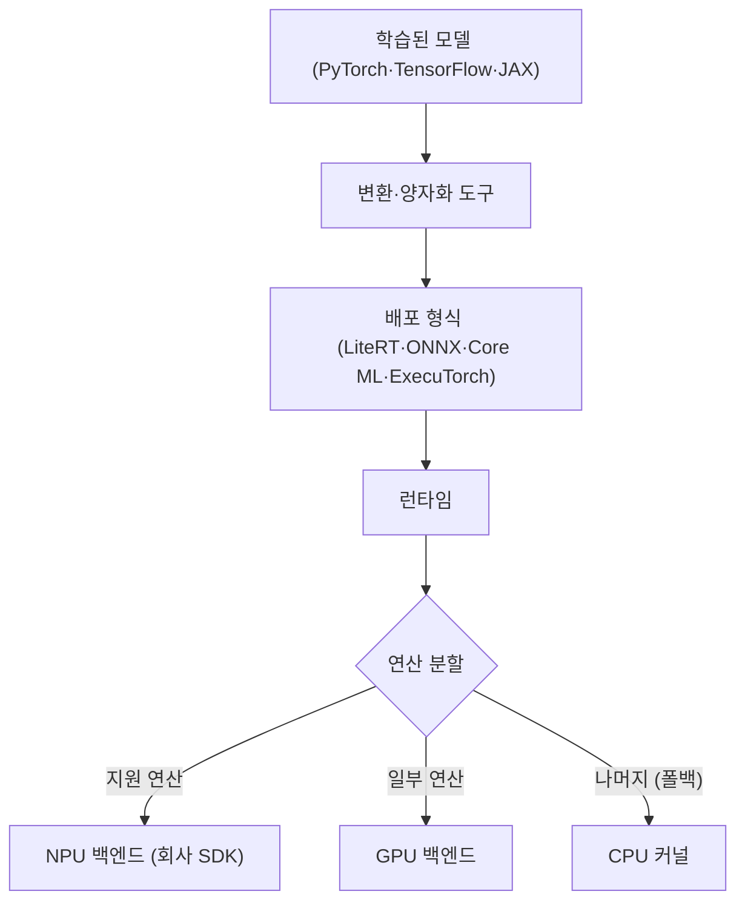

# AI 소프트웨어 스택

!!! spec "규격 · 세대"
    Android **NNAPI**(Android 8.1, 2017 도입 → Android 15에서 지원 중단(deprecated) 발표) · **TensorFlow Lite → LiteRT**(2024년 9월 명칭 변경, GPU·NPU 가속 경로 제공) · **Core ML**(iOS 11, 2017) · **ONNX Runtime**(실행 공급자 구조) · **ExecuTorch**(PyTorch의 온디바이스 런타임, 2024년 베타 → 2025년 10월 1.0 정식 출시)
    회사별 SDK: Qualcomm **AI Engine Direct(QNN)**(이전 SNPE의 후속) · MediaTek **NeuroPilot** · Samsung **Exynos AI Studio**(모델 변환·최적화 툴체인)와 Exynos AI LiteCore(런타임, 이전 명칭과 공개 범위는 시점에 따라 바뀌어 옴) · Google **AICore**(시스템 모델 서비스)

!!! basic "한눈에 보기"
    NPU는 일반 프로그램처럼 코드를 바로 실행하지 못합니다. 모델을 NPU가 알아듣는 형태로 바꾸고, NPU가 못 하는 부분은 다른 프로세서에 맡기는 **소프트웨어 층**이 필요합니다.

    1. **변환기** — 학습한 모델(PyTorch 등)을 스마트폰용 형식으로 바꾸고, 숫자를 짧게 줄입니다(양자화).
    2. **런타임** — 앱 안에서 모델을 불러와 실행합니다.
    3. **가속 백엔드(델리게이트)** — 모델의 각 부분을 NPU·GPU·CPU 중 어디서 돌릴지 정하고, NPU가 못 하는 연산은 CPU로 돌려보냅니다(폴백).

    통역에 비유하면, 런타임은 회의 진행자, 백엔드는 언어별 통역사입니다. NPU 통역사가 모르는 단어가 나오면 CPU 통역사에게 넘기는데, 이렇게 넘길 때마다 시간이 걸립니다.

## 스택의 층 { .l2 }

| 층 | 하는 일 | 예 |
|---|---|---|
| 프레임워크 | 모델 학습·정의 | PyTorch, TensorFlow, JAX |
| 변환·최적화 | 그래프 변환, 양자화, 연산 융합 | LiteRT 변환기, coremltools, ONNX 내보내기, ExecuTorch 내보내기 |
| 런타임 | 모델 적재, 메모리 계획, 실행 순서 | LiteRT, ONNX Runtime, ExecuTorch, Core ML |
| 가속 백엔드 | 그래프 일부를 하드웨어에 위임 | LiteRT 델리게이트, ONNX Runtime 실행 공급자, ExecuTorch 백엔드 |
| 회사 SDK·드라이버 | NPU 컴파일러, 펌웨어 인터페이스 | QNN, NeuroPilot, Samsung Exynos용 SDK, Apple 비공개 드라이버 |

## NNAPI 이후의 Android { .l2 }

| 시기 | 경로 | 특징 |
|---|---|---|
| Android 8.1 이후 | **NNAPI** — OS 표준 API, 벤더가 HAL 드라이버 구현 | 한 API로 여러 SoC를 지원하려 했으나, 연산 지원 범위와 드라이버 품질이 기기마다 달랐음 |
| NNAPI와 병행 | 회사별 SDK를 앱이 직접 사용, 또는 LiteRT·ONNX Runtime의 회사별 백엔드 | 성능은 좋지만 SoC마다 별도 빌드·검증 필요 |
| Android 15 이후 | NNAPI 지원 중단 발표, Google은 LiteRT 중심의 GPU·NPU 가속 경로를 권장 | 회사 NPU를 LiteRT 백엔드로 연결하는 방향 (이 페이지 기준 시점) |
| OS 차원 모델 | **AICore** — 시스템이 Gemini Nano 같은 모델을 관리, 앱은 API로 사용 | 모델 업데이트·메모리 관리를 OS가 담당 |

NNAPI의 교훈은 "공통 API만으로는 최신 연산과 성능을 따라가기 어렵다"는 것이었습니다. 새 모델 구조가 나오면 표준 API·HAL을 개정하고 모든 벤더 드라이버가 따라와야 했기 때문에, 업계는 런타임 단의 백엔드 플러그인과 회사 SDK를 직접 묶는 쪽으로 옮겨 갔습니다.

## 연산 지원과 폴백 { .l2 }

| 상황 | 결과 | 대응 |
|---|---|---|
| 모든 연산이 NPU 지원 | 그래프 전체가 NPU에서 한 번에 실행 | 이상적 |
| 중간에 미지원 연산 하나 | 그래프가 NPU–CPU–NPU로 쪼개져 데이터 왕복·동기화 비용 발생 | 연산 교체, 맞춤 연산 구현, 모델 구조 수정 |
| 정밀도 미지원 (예: FP32 연산) | 형식 변환 또는 CPU 실행 | 양자화·FP16 변환 |
| 동적 형상 | 일부 NPU는 고정 형상만 컴파일 | 입력 크기 고정, 여러 형상 미리 컴파일 |

??? expert "전문가 노트 — 분할 비용, 사전 컴파일과 캐시, 드라이버 버전, 디버깅 순서"
    **분할 비용.** 런타임은 그래프를 하드웨어가 지원하는 연속 구간(파티션)으로 나눕니다. 파티션 경계마다 텐서를 공유 메모리에 내려놓고, 캐시 일관성을 맞추고, 다른 프로세서에 작업을 넘기는 동기화가 필요합니다. 연산 자체는 빠르게 끝나도 경계가 많으면 전체 지연이 CPU 단독 실행보다 나빠지는 경우가 있어, 백엔드는 너무 작은 파티션은 아예 위임하지 않는 정책을 쓰기도 합니다. 공유 메모리 버퍼(Android의 AHardwareBuffer·dmabuf 등)로 복사를 없애는 것도 중요합니다([메모리 보호와 IOMMU](../memory/iommu.md)).

    **사전 컴파일과 캐시.** NPU 컴파일은 수 초 이상 걸릴 수 있어, 앱 첫 실행 때 컴파일한 결과를 기기에 캐시하거나, 개발 단계에서 특정 SoC용으로 미리 컴파일(AOT)한 바이너리를 배포합니다. 사전 컴파일은 첫 실행 지연을 없애지만 SoC·SDK 버전별로 바이너리를 따로 관리해야 하고, 기기 위 컴파일은 범용적이지만 첫 실행이 느립니다. Qualcomm은 QNN의 컨텍스트 바이너리, Apple은 Core ML 모델의 기기 위 컴파일과 캐시 방식을 씁니다.

    **드라이버와 펌웨어 버전.** Android에서 NPU 드라이버와 펌웨어는 보통 벤더 파티션에 들어가 SoC 회사 → 스마트폰 제조사의 업데이트 경로를 따릅니다. 그래서 같은 SoC라도 기기·펌웨어 버전마다 지원 연산과 성능이 다를 수 있고, 앱은 런타임에 기능을 확인하고 폴백 경로를 갖춰야 합니다. 앱에 회사 SDK 라이브러리를 직접 넣는 방식은 이 문제를 줄이지만, 앱 크기와 SoC별 검증 부담이 늘어납니다([Android BSP 구조](../software/android-bsp.md)).

    **디버깅 순서.** 성능이 기대보다 낮으면 ① 백엔드 로그·프로파일러로 그래프 중 몇 퍼센트가 NPU에 위임됐는지, ② 파티션 수와 경계 위치, ③ 양자화가 실제로 적용됐는지(FP32 연산이 남았는지), ④ 첫 실행 컴파일 시간과 반복 실행 시간을 분리했는지를 차례로 확인합니다. 정확도가 떨어지면 정밀도별 층 단위 출력 비교로 문제가 생긴 연산을 찾습니다([성능 분석 도구](../software/profiling.md)).

## 칩셋 비교

| 항목 | Snapdragon | Exynos | Dimensity | Apple | Tensor |
|---|---|---|---|---|---|
| 회사 SDK | AI Engine Direct (QNN), Qualcomm AI Hub | Exynos AI Studio·LiteCore | NeuroPilot | 없음 (Core ML이 유일한 공개 경로) | 별도 공개 SDK보다 Android 표준 경로 중심 |
| 표준 런타임 백엔드 | LiteRT, ONNX Runtime, ExecuTorch 백엔드 제공 | LiteRT, ExecuTorch 백엔드 (지원 SoC는 시점별 확인) | LiteRT, ExecuTorch 백엔드 제공 | Core ML (ONNX Runtime·ExecuTorch의 Core ML 백엔드 경유 가능) | LiteRT |
| OS 모델 서비스 | 기기 제조사·AICore | 기기 제조사(Galaxy AI)·AICore | 기기 제조사·AICore | Foundation Models | AICore (Gemini Nano) |

> 세대별 SDK 버전과 지원 연산 변화는 [칩셋 세대 인덱스](../reference/chipset-index.md)에 모읍니다.

## 관련 페이지
- [NPU란 무엇인가](what-is-npu.md) — 정적 컴파일과 지원 연산의 한계
- [주요 NPU 계열](families.md) — 계열별 SDK의 배경
- [GPU 연산](../gpu/compute.md) — GPU 백엔드로 넘어가는 연산
- [온디바이스 LLM](llm.md) — LLM 전용 런타임
- [성능 분석 도구](../software/profiling.md) — 위임 비율과 파티션 확인
