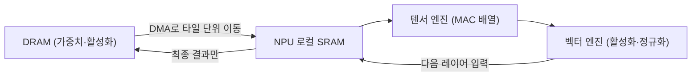
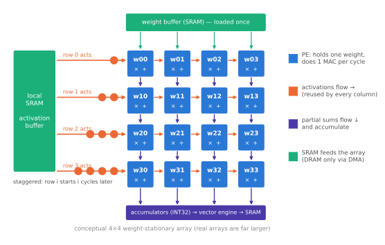

# NPU란 무엇인가

!!! spec "규격 · 세대"
    NPU는 표준 규격이 아니라 SoC 회사별 자체 설계(또는 Arm Ethos 같은 라이선스 IP)입니다. 공통 기반: 정수·부동소수점 형식(INT8·INT4·FP16·BF16, 최근 FP8 계열), 모델 교환 형식(TFLite/LiteRT 플랫버퍼, ONNX)
    흐름: DSP·GPU로 신경망 처리(2015년 전후) → 첫 전용 NPU 탑재 플래그십(2017년형: Apple A11 Neural Engine, Huawei Kirin 970) → 대부분의 플래그십이 전용 NPU 탑재(2018–2019년형) → 생성형 AI 대응(INT4·트랜스포머 연산 지원, 2023년형 이후)

!!! basic "한눈에 보기"
    신경망 계산의 대부분은 **"숫자 두 개를 곱해서 누적 합에 더하기"**를 엄청나게 많이 반복하는 일입니다. NPU는 이 한 가지 일만 아주 잘하도록 만든 계산기 묶음입니다.

    1. **곱셈-누적기(MAC)를 수천 개** 깔아 두고 한꺼번에 돌립니다.
    2. 숫자를 짧게(8비트, 4비트) 써서 회로를 작게 하고 전력을 아낍니다.
    3. 칩 안에 **전용 메모리(SRAM)**를 두고, 한 번 가져온 데이터를 여러 번 재사용해 DRAM 왕복을 줄입니다.

    공장에 비유하면 CPU는 무엇이든 만들 수 있는 숙련공 몇 명, GPU는 같은 일을 하는 작업자 수백 명, NPU는 **한 가지 부품만 찍어 내는 자동화 생산 라인**입니다. 라인은 융통성이 없지만, 그 부품을 만드는 데는 비교가 안 될 만큼 빠르고 전기를 적게 씁니다.

## 연산 유닛의 종류 { .l2 }

| 유닛 | 구조 | 잘하는 일 | 대표 예 |
|---|---|---|---|
| 스칼라 | 일반 프로세서 코어 | 제어 흐름, 주소 계산, 작은 연산 | NPU 내부 제어 코어, Hexagon 스칼라 스레드 |
| 벡터 | 넓은 SIMD 레지스터(수백~수천 비트) | 활성화 함수, 정규화, 요소별 연산, 전·후처리 | Hexagon HVX 계열, 각 NPU의 벡터 엔진 |
| 텐서(행렬) | MAC을 2차원으로 배열한 엔진 | 행렬 곱셈·합성곱 (전체 연산량의 대부분) | 시스톨릭 배열, 내적(dot-product) 배열 |
| DMA·데이터 이동 | 주소 패턴을 따라 데이터를 옮기는 엔진 | DRAM ↔ 로컬 SRAM 타일 이동, 레이아웃 변환 | 모든 NPU |

**시스톨릭 배열(systolic array)**은 MAC을 격자로 놓고, 입력이 한쪽에서 들어와 이웃 MAC으로 한 칸씩 흘러가게 만든 구조입니다. 예를 들어 32×32 배열(MAC 1024개)이라면 한 사이클에 새로 넣는 값은 가장자리의 32 + 32개뿐인데 곱셈은 1024번 일어나므로, 들어온 값 하나가 **32번 재사용**됩니다. 내적 배열 방식은 여러 곱을 한꺼번에 더하는 덧셈 트리를 쓰는데, 재사용을 로컬 버퍼에서 얻는다는 점만 다르고 목표는 같습니다.

## 데이터 흐름과 로컬 메모리 { .l2 }

| 데이터 흐름 방식 | 배열에 붙잡아 두는 것 | 특징 |
|---|---|---|
| 가중치 고정 (weight stationary) | 가중치 | 같은 가중치를 많은 입력에 적용하는 합성곱·배치 연산에 유리 |
| 출력 고정 (output stationary) | 부분합(누적값) | 누적값을 밖으로 내보내지 않아 쓰기 트래픽이 적음 |
| 입력 고정 (input stationary) | 입력 활성화 | 입력이 크고 가중치가 작은 경우에 유리 |

가중치 고정 배열에서는 가중치를 한 번 올려 두고, 활성화 한 줄이 여러 열의 가중치에 재사용되며 부분합이 아래로 흘러 누적됩니다.

NPU 컴파일러는 모델을 **타일**로 쪼개 로컬 SRAM에 맞추고, 앞 레이어의 출력을 DRAM에 내보내지 않은 채 다음 레이어로 넘기는 **레이어 융합(fusion)**을 시도합니다. DRAM 접근은 SRAM 접근보다 에너지가 훨씬 크기 때문에, 같은 TOPS라도 이 스케줄링을 잘하는 NPU가 실제로 더 빠르고 전력도 적게 씁니다([메모리 계층](../basics/memory-hierarchy.md)).

## 왜 CPU·GPU가 아닌가 { .l2 }

| 항목 | CPU | GPU | NPU |
|---|---|---|---|
| 설계 목표 | 단일 스레드 지연 최소화 | 대량 병렬 처리량 | 신경망 연산의 에너지 효율 |
| 면적 대부분이 쓰이는 곳 | 분기 예측·비순차 실행·캐시 | 셰이더 코어·레지스터 파일·텍스처 | MAC 배열·로컬 SRAM |
| 프로그램 방식 | 범용 코드 | 셰이더·컴퓨트 커널 | 컴파일러가 만든 정적 스케줄 |
| 강점 | 어떤 연산이든 실행, 작은 모델의 낮은 지연 | 유연성, FP16 연산, 새 연산 대응 | 지원되는 연산의 전력당 성능 |
| 약점 | 와트당 연산량이 낮음 | 그래픽과 자원 경쟁, 정수 저정밀 효율 | 지원하지 않는 연산은 실행 불가 → 다른 블록으로 넘김 |

현실의 SoC는 셋을 함께 씁니다. 짧은 전처리나 작은 모델은 CPU(NEON·SME 같은 확장 포함), 새 연산이나 FP16 위주 작업은 GPU, 대량의 정형화된 행렬 연산은 NPU가 맡는 식입니다([AI 소프트웨어 스택](software.md)).

??? expert "전문가 노트 — DSP에서 NPU로, 정적 스케줄링, 루프라인으로 보는 병목"
    **DSP 계보.** 모바일 NPU의 상당수는 오디오·모뎀용 DSP에서 출발했습니다. Qualcomm Hexagon은 원래 VLIW 기반 DSP로, 하드웨어 멀티스레딩과 넓은 벡터 확장(HVX)을 더해 카메라·컴퓨터 비전 연산을 맡다가, 이후 텐서 가속기를 붙여 NPU가 되었습니다. VLIW·정적 스케줄링 철학은 그대로 남아 있어, 성능은 컴파일러가 명령과 데이터 이동을 얼마나 빈틈없이 배치하느냐에 크게 좌우됩니다. 반대로 Apple Neural Engine이나 Google TPU처럼 처음부터 신경망 전용으로 설계한 계열도 있습니다.

    **정적 스케줄과 지원 연산.** NPU는 보통 실행 직전(또는 앱 설치·빌드 시점)에 모델 그래프 전체를 컴파일해 타일 크기, SRAM 배치, DMA 시점을 미리 확정합니다. 덕분에 캐시 미스나 분기 예측 같은 런타임 비용이 거의 없지만, 입력 크기가 바뀌는 동적 형상(dynamic shape)이나 드문 연산에는 약합니다. 지원되지 않는 연산 하나가 그래프를 쪼개면 그 지점마다 CPU·GPU와 데이터를 주고받아야 하므로, 전체 속도가 크게 떨어질 수 있습니다.

    **루프라인으로 보는 병목.** 어떤 연산이 연산 한계인지 메모리 한계인지는 **산술 강도**(바이트당 연산 수)로 판단합니다. 예를 들어 피크 8.2 TOPS인 가상의 NPU가 68.3 GB/s DRAM에 붙어 있다면 경계점(ridge point)은 약 **120 ops/byte**입니다. 바이트당 연산이 이보다 적은 연산은 MAC을 다 놀리지 못하고 메모리를 기다립니다. 합성곱처럼 재사용이 많은 연산은 경계점을 넘기 쉽지만, LLM의 토큰 생성 단계는 가중치 1바이트당 연산이 몇 개에 불과해 철저히 메모리 한계에 놓입니다([온디바이스 LLM](llm.md)). (수치는 `tools/soc_numbers.py`에서 계산)

    **정밀도와 면적.** 정수 곱셈기의 면적은 대략 비트 폭의 제곱에 비례해 커지므로, INT8 MAC은 FP16·FP32 MAC보다 훨씬 작고 전력도 적습니다. 그래서 NPU는 INT8을 기본으로 두고 INT4·FP16을 같은 데이터패스의 변형으로 지원하는 경우가 많습니다. 다만 누적기는 오버플로를 막기 위해 INT32 같은 넓은 폭을 유지하며, 결과를 다시 좁은 형식으로 바꾸는 재양자화(requantization) 단계가 벡터 엔진의 주요 일거리가 됩니다([TOPS와 정밀도](tops.md)).

## 칩셋 비교

| 접근 방식 | 대표 계열 | 특징 |
|---|---|---|
| DSP에서 확장한 NPU | Qualcomm Hexagon | 스칼라·벡터·텐서를 한 블록에 묶음, VLIW 기반 정적 스케줄링 |
| 전용 설계 NPU (자체) | Samsung NPU, MediaTek APU/NPU, Apple Neural Engine, Google TPU | 신경망 전용 MAC 배열 + 벡터 엔진 + 로컬 SRAM |
| 라이선스 NPU IP | Arm Ethos 계열 등 | SoC 회사가 IP로 사서 통합, 저전력·소형 기기 중심 |
| CPU 행렬 확장 | Arm SME·SME2 지원 코어 | 별도 블록 없이 CPU에서 행렬 연산, 지연이 짧은 작은 작업에 유리 |

> 세대별 NPU 구성과 발표 TOPS는 [칩셋 세대 인덱스](../reference/chipset-index.md)에 모읍니다.

## 관련 페이지
- [주요 NPU 계열](families.md) — 회사별 NPU의 출발점과 변화
- [TOPS와 정밀도](tops.md) — MAC 배열의 피크 성능 계산
- [메모리 계층](../basics/memory-hierarchy.md) — 로컬 SRAM과 DRAM의 에너지 차이
- [GPU 연산](../gpu/compute.md) — GPU로 신경망을 돌리는 경우
- [AI 소프트웨어 스택](software.md) — 컴파일러와 연산 폴백
