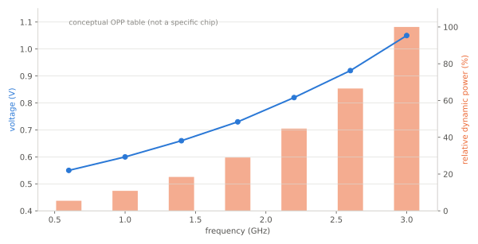
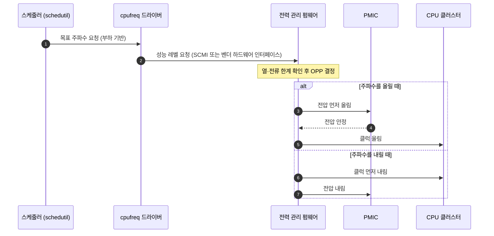

# DVFS와 전력 관리

!!! spec "규격 · 세대"
    Arm SCMI (System Control and Management Interface — 성능 도메인 프로토콜) · Linux 커널 cpufreq·OPP(`operating-points-v2` 디바이스 트리 바인딩)·Energy Model · ACPI CPPC (PC·서버 계열)
    고정 클럭 → 운영체제가 직접 클럭을 바꾸는 DVFS → 클러스터별 전압 도메인(big.LITTLE) → 코어별·도메인별 세분화와 펌웨어(전력 관리 마이크로컨트롤러) 위임

!!! basic "한눈에 보기"
    **DVFS(Dynamic Voltage and Frequency Scaling)**는 할 일이 많을 때는 칩을 빠르게, 적을 때는 느리게 돌리면서 **전압도 함께 낮추는** 기술입니다.

    1. 클럭(주파수)을 낮추면 같은 시간에 하는 일이 줄어 전력이 줄어듭니다.
    2. 클럭이 낮으면 트랜지스터가 느리게 스위칭해도 되므로 **전압을 낮출 수 있습니다.**
    3. 전력은 전압의 **제곱**에 비례하므로, 전압을 조금만 낮춰도 전력이 크게 줄어듭니다.

    자동차에 비유하면 고속도로에서는 높은 기어로 달리고 골목에서는 낮은 기어로 엔진 회전수를 낮추는 것과 같습니다. 스마트폰이 메신저를 볼 때와 게임을 할 때 발열과 배터리 소모가 크게 다른 이유가 여기에 있습니다.

## 동적 전력 공식 { .l2 }

CMOS 회로의 동적 전력은 다음과 같습니다.

$$
P_{dyn} = \alpha \cdot C \cdot V^2 \cdot f
$$

| 기호 | 뜻 | 설계에서 줄이는 방법 |
|---|---|---|
| \(\alpha\) | 활동률 (한 클럭에 실제로 스위칭하는 비율) | 클럭 게이팅으로 쓰지 않는 회로의 스위칭을 멈춤 |
| \(C\) | 스위칭되는 정전 용량 | 공정 미세화, 회로 면적 축소 |
| \(V\) | 공급 전압 | **DVFS** — 낮은 클럭에서 전압을 함께 낮춤 |
| \(f\) | 클럭 주파수 | **DVFS** |

예를 들어 한 코어를 **3.0 GHz · 1.0 V**에서 **1.5 GHz · 0.7 V**로 내리면 동적 전력은 \(0.7^2 \times 0.5 = 0.245\), 즉 약 **24.5%**가 됩니다. 같은 일을 끝내는 데 시간은 두 배 걸리므로 일 하나에 드는 에너지는 \(0.245 \times 2 = 0.49\), 약 **49%**입니다. 클럭만 반으로 낮추고 전압을 그대로 두면 전력은 50%이지만 에너지는 100%로 그대로입니다. **에너지를 아끼는 것은 클럭이 아니라 전압**입니다. (수치는 `tools/soc_numbers.py`에서 계산)

## OPP 테이블과 제어 구조 { .l2 }

칩은 아무 전압·클럭 조합이나 쓰지 않고, 출하 시험에서 안정성이 확인된 **동작점(OPP, Operating Performance Point)** 목록 중에서 고릅니다.

| 구성 요소 | 역할 | 위치 |
|---|---|---|
| OPP 테이블 | (주파수, 전압) 쌍의 목록. 칩마다 빈(bin)에 따라 전압이 다를 수 있음 | 디바이스 트리 또는 펌웨어 |
| cpufreq 거버너 | 부하를 보고 목표 주파수를 정함 (현재 Android 기본은 `schedutil`) | Linux 커널 |
| Energy Model | 각 OPP의 전력 비용을 스케줄러에 알려 줌 → EAS가 작업 배치에 사용 | Linux 커널 |
| 전력 관리 펌웨어 | 실제 PLL·레귤레이터를 조작하고, 열·전류 한계를 반영해 최종 값을 정함 | SoC 안의 전용 마이크로컨트롤러 |
| PMIC | 요청된 전압을 공급 | 외부 전원 칩 |

주파수를 올릴 때는 **전압이 먼저**, 내릴 때는 **클럭이 먼저**입니다. 순서가 바뀌면 낮은 전압에서 높은 클럭으로 동작하는 순간이 생겨 오동작합니다.

??? expert "전문가 노트 — 누설 전력, race-to-idle, 펌웨어 위임"
    **누설 전력과 race-to-idle.** 위 계산은 동적 전력만 본 것입니다. 실제로는 전압에 따라 커지는 **누설(정적) 전력**이 있어서, 낮은 클럭에서 오래 켜져 있는 것보다 빨리 끝내고 파워 게이팅으로 완전히 끄는 쪽(race-to-idle)이 유리한 구간이 있습니다. 전압을 더 낮출 수 없는 최저 OPP 근처에서는 클럭을 낮춰도 에너지가 줄지 않으므로, 에너지 효율이 가장 좋은 OPP("효율 최적점")는 보통 최저 클럭보다 조금 위에 있습니다. EAS가 Energy Model을 쓰는 이유가 이것입니다.

    **펌웨어 위임.** 최근 SoC는 커널이 레귤레이터를 직접 만지지 않고 "성능 레벨"만 요청하며, 실제 OPP 선택은 전력 관리 펌웨어가 합니다. 업스트림 커널 기준으로 Arm 표준 경로는 `drivers/cpufreq/scmi-cpufreq.c`, Qualcomm 계열은 `drivers/cpufreq/qcom-cpufreq-hw.c`가 이 방식입니다. 그래서 커널 로그의 요청 주파수와 실제 주파수가 다를 수 있고, 실제 값은 하드웨어 카운터나 벤더 트레이스로 확인해야 합니다.

    **빈닝과 AVS.** 같은 모델의 칩도 공정 편차로 속도가 다릅니다. 빠른 칩은 같은 클럭을 더 낮은 전압으로 낼 수 있으므로, 출하 시험에서 칩별 전압 표를 퓨즈에 기록하거나(빈닝), 동작 중 링 오실레이터 같은 센서로 전압을 미세 조정합니다(AVS, Adaptive Voltage Scaling).

    **실무 체크리스트.** ① 전력 분석 전 OPP 테이블과 실제 동작 주파수를 함께 기록, ② 열 스로틀링 상한이 걸렸는지 먼저 확인(→ [열 관리와 스로틀링](thermal.md)), ③ 클러스터가 전압 도메인을 공유하면 한 코어의 높은 요청이 클러스터 전체 전압을 올린다는 점 고려, ④ 벤치마크 비교 시 지속 성능(수 분 이상)과 순간 성능을 구분.

## 칩셋 비교

| 항목 | Snapdragon | Exynos | Dimensity | Apple |
|---|---|---|---|---|
| 커널 쪽 인터페이스 | 벤더 cpufreq 하드웨어 드라이버 (업스트림 공개) | 벤더 드라이버 (Android 커널 트리 공개) | 벤더 드라이버 (Android 커널 트리 공개) | 비공개 (iOS) |
| 공개 정보 수준 | 업스트림 커널로 상당 부분 확인 가능 | 공개 커널 소스 중심 | 공개 커널 소스 중심 | 공개 분석·특허 위주 |

> 세대별 클러스터 구성과 최대 클럭은 [칩셋 세대 인덱스](../reference/chipset-index.md)에 기준 시점과 함께 모아 둡니다.

## 관련 페이지
- [파워 도메인과 게이팅](power-domains.md) — 클럭 게이팅·파워 게이팅·리텐션
- [이기종 클러스터](../cpu/clusters.md) — 클러스터별 전압 도메인
- [스케줄링과 EAS](../cpu/scheduling.md) — Energy Model을 쓰는 작업 배치
- [열 관리와 스로틀링](thermal.md) — 열 한계가 OPP 상한을 정하는 방식
