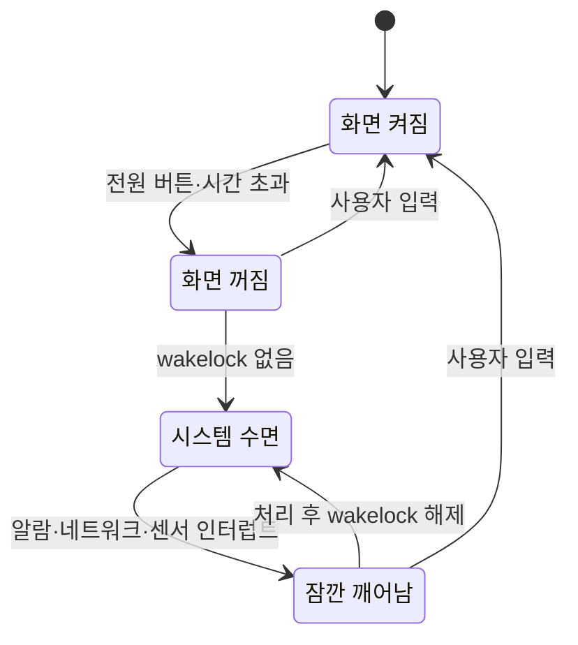

# 대기 전력과 저전력 상태

!!! spec "규격 · 세대"
    Arm PSCI (`CPU_SUSPEND`·`CPU_OFF`·`SYSTEM_SUSPEND`, 1.0부터 OS 주도 모드 선택 지원) · Arm 아키텍처 `WFI`·`WFE` 명령 · Linux cpuidle(거버너 `menu`·`teo`, 디바이스 트리 `idle-states` 바인딩)·system suspend(`s2idle`·`deep`)·wakeup source · JEDEC LPDDR 셀프 리프레시 · Android Doze·wakelock
    코어 대기(WFI)만 지원 → 코어별 전원 차단 → 클러스터 전원 차단 → 시스템 전체 수면과 AON 영역(센서 허브·저전력 처리기)에 일을 넘기는 구조

!!! basic "한눈에 보기"
    스마트폰은 하루 대부분을 **화면이 꺼진 채** 보내고, 화면이 켜져 있어도 CPU는 짧은 일과 긴 쉼을 반복합니다. 그래서 "쉴 때 얼마나 적게 쓰는가"가 배터리 시간을 크게 좌우합니다.

    1. **얕은 잠** — 코어가 클럭만 멈추고 기다립니다. 바로 깨어나지만 전력이 조금 남습니다.
    2. **깊은 잠** — 코어, 이어서 클러스터 전체의 전원을 끕니다. 전력은 거의 없지만 깨어나는 데 시간과 에너지가 듭니다.
    3. **시스템 수면** — 화면이 꺼지고 할 일이 없으면 SoC 대부분이 꺼지고, DRAM은 스스로 데이터를 유지하며, 항상 켜진 작은 영역만 깨어날 신호를 기다립니다.

    집에 비유하면 얕은 잠은 소파에서 졸기, 깊은 잠은 침대에 눕기, 시스템 수면은 집 전체 전등을 끄고 현관 센서등만 켜 두는 것입니다. 깊이 잘수록 아끼지만, 금방 다시 일어날 거라면 소파가 낫습니다.

## CPU 대기 상태 { .l2 }

| 상태 | 무엇이 꺼지나 | 깨어나는 시간 | 비고 |
|---|---|---|---|
| WFI (클럭 정지) | 코어 클럭 | 매우 짧음 | 모든 코어가 지원하는 기본 대기 |
| 코어 리텐션 | 코어 대부분, 상태는 유지 | 짧음 | 지원 여부는 코어·SoC마다 다름 |
| 코어 전원 차단 | 코어 전원 (L1·코어 전용 캐시 내용 소실) | 중간 | 상태 저장·복원, 캐시 플러시 필요 |
| 클러스터 전원 차단 | 클러스터 공유 캐시·로직까지 | 김 | 클러스터의 모든 코어가 쉬어야 진입 |
| 시스템 수면 | SoC 대부분, DRAM은 셀프 리프레시 | 가장 김 | 화면 꺼짐·wakelock 없음 조건 |

각 상태에는 진입·탈출 지연과 **최소 체류 시간(target residency)**이 정의되어 있습니다. cpuidle 거버너는 다음 타이머·인터럽트까지 쉴 시간을 예측해, 지연 요구를 만족하면서 체류 시간이 충분한 가장 깊은 상태를 고릅니다.

손익분기 시간은 상태 전환에 드는 추가 에너지를 두 상태의 전력 차이로 나눈 값입니다.

$$
t_{be} = \frac{E_{전환}}{P_{얕은} - P_{깊은}}
$$

가정으로 코어 전원 차단의 진입·탈출 에너지를 30 µJ, WFI 전력을 50 mW, 전원 차단 상태 전력을 5 mW로 두면 \(t_{be}\)는 약 **0.67 ms**입니다. 이보다 짧게 쉴 거라면 WFI에 머무는 편이 낫습니다. (가정값이며, 수치는 `tools/soc_numbers.py`에서 계산)

## 시스템 수면 { .l2 }

Android는 할 일이 없으면 커널이 스스로 시스템 수면에 들어가는 **자동 수면** 구조입니다. 앱·드라이버가 **wakelock**(커널에서는 wakeup source)을 잡고 있는 동안에는 수면에 들어가지 않으므로, 해제되지 않는 wakelock은 대기 전력 문제의 가장 흔한 원인입니다. 프레임워크는 Doze와 앱 대기 버킷으로 화면이 꺼진 동안 앱의 작업·네트워크·알람을 묶어서 처리해 깨어나는 횟수를 줄입니다.

| 수면 중 켜진 것 | 이유 |
|---|---|
| AON 영역의 타이머·깨우기 로직 | 알람·인터럽트를 받아 SoC를 깨움 |
| DRAM 셀프 리프레시 | 데이터 유지 ([LPDDR](../memory/lpddr.md)) |
| 모뎀의 저전력 수신 주기 | 기지국 호출(paging) 확인 ([모뎀의 통합](../connectivity/modem.md)) |
| 센서 허브·저전력 오디오 처리 | 걸음 수, 화면 들기 감지, 음성 호출어 ([센서 허브](../media/sensor-hub.md)) |

5000 mAh · 3.87 V 배터리(약 19.35 Wh)라면 평균 대기 전력이 20 mW일 때 약 **40.3일**, 40 mW일 때 약 **20.2일**을 버티는 계산이 됩니다. 실제 대기 전력은 네트워크 상태·앱 구성에 따라 크게 달라지므로 이 값은 감각을 위한 가정 계산입니다. (수치는 `tools/soc_numbers.py`에서 계산)

??? expert "전문가 노트 — 상태 선택, 클러스터 조율, 수면 진입의 함정, 디버깅"
    **상태 선택과 예측 오차.** cpuidle 거버너가 쉴 시간을 짧게 예측하면 얕은 상태만 써서 전력을 남기고, 길게 예측하면 깊이 들어갔다가 곧 깨어나 전환 에너지를 낭비합니다. `menu` 거버너는 다음 타이머와 과거 패턴으로, `teo`는 타이머 이벤트와 실제 깨어남의 관계를 통계로 보정해 예측합니다. 디바이스 트리 `idle-states`의 `entry-latency-us`·`exit-latency-us`·`min-residency-us` 값이 실제 칩과 맞지 않으면 어떤 거버너도 올바른 판단을 하지 못합니다.

    **클러스터 조율.** 클러스터 전원 차단은 마지막 코어가 잠들 때만 가능합니다. PSCI의 플랫폼 조율 모드에서는 펌웨어가 코어들의 요청을 모아 결정하고, OS 주도 모드에서는 커널이 "이 코어가 마지막"임을 알고 클러스터 상태까지 요청합니다. Linux는 후자를 PSCI 전원 도메인(genpd)으로 표현하며, 이 경우 클러스터 상태도 손익분기 판단에 포함됩니다.

    **수면 진입의 함정.** 시스템 수면은 모든 드라이버의 suspend 콜백이 성공해야 완료됩니다. 한 드라이버가 실패하거나 진입 직전 인터럽트가 들어오면 수면이 취소되고 다시 시도하는 일이 반복되어, 화면이 꺼져 있는데도 전력이 줄지 않습니다. 또한 수면 상태에 들어갔더라도 공유 레일 투표나 클럭 하나가 남아 있으면 SoC가 가장 깊은 상태에 도달하지 못합니다([파워 도메인과 게이팅](power-domains.md)).

    **디버깅.** `/sys/kernel/debug/wakeup_sources`(또는 `/sys/class/wakeup/`)로 어떤 wakeup source가 얼마나 오래 잡혔는지, `/sys/power/suspend_stats`로 수면 성공·실패 횟수를, `dumpsys batterystats`로 앱별 wakelock과 깨어난 이유를 봅니다. cpuidle 상태별 체류 시간은 `/sys/devices/system/cpu/cpu*/cpuidle/state*/time`에 있으며, 벤더 디버그 노드가 SoC 전체 수면 상태 진입 횟수를 따로 보여 주는 경우가 많습니다.

## 칩셋 비교

| 항목 | Android (Snapdragon·Exynos·Dimensity·Tensor) | Apple |
|---|---|---|
| 코어·클러스터 대기 요청 | PSCI + Linux cpuidle | 자체 커널·펌웨어 (비공개) |
| 시스템 수면 | 커널 자동 수면 + wakelock + Doze | 자체 전원 관리, 앱 백그라운드 실행 제한 |
| 화면 꺼짐 중 처리 | 센서 허브·저전력 DSP 등 AON 쪽 처리기 (구성은 SoC마다 다름) | 저전력 보조 처리기 활용으로 알려짐 |

> 세대별 클러스터 구성은 [칩셋 세대 인덱스](../reference/chipset-index.md)에 모읍니다.

## 관련 페이지
- [파워 도메인과 게이팅](power-domains.md) — 대기 상태가 실제로 끄는 회로
- [LPDDR](../memory/lpddr.md) — 셀프 리프레시와 DRAM 대기 전력
- [센서 허브](../media/sensor-hub.md) — 화면이 꺼진 동안 일을 맡는 처리기
- [이기종 클러스터](../cpu/clusters.md) — 클러스터 단위 전원 차단의 전제
- [전력 측정과 분석](measurement.md) — 대기 전력 측정
