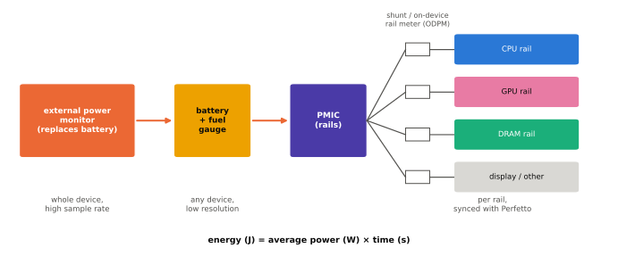

# 전력 측정과 분석

!!! spec "규격 · 세대"
    Android Power Stats HAL(AIDL `android.hardware.power.stats` — 레일별 에너지 계량기와 상태 체류 시간) · Perfetto `android.power` 데이터 소스(전원 레일·배터리 카운터) · `batterystats`·Battery Historian · Linux 레귤레이터·hwmon 프레임워크
    배터리 잔량 변화로 추정 → 외부 전원 측정기(배터리 대신 전원 공급)로 기기 전체 측정 → 기기 안 레일별 전력 계측(Pixel의 ODPM 등)과 트레이스 동기화

!!! basic "한눈에 보기"
    "이 칩은 전력 효율이 좋다"는 말을 확인하려면 전력을 직접 재야 합니다. 재는 위치에 따라 보이는 것이 다릅니다.

    1. **기기 전체** — 배터리 자리에 정밀 전원 측정기를 연결하면 기기가 쓰는 총 전력을 아주 촘촘한 시간 간격으로 볼 수 있습니다.
    2. **레일별** — 일부 기기는 PMIC 안에 계측 회로가 있어 CPU·GPU·메모리·화면 같은 전원 레일별로 에너지를 따로 셉니다.
    3. **배터리 게이지** — 별도 장비 없이 배터리 전류·잔량으로 보는 방법입니다. 간편하지만 해상도와 정확도가 낮습니다.

    가계부에 비유하면 기기 전체 측정은 통장 잔고, 레일별 측정은 항목별 지출 내역입니다. 잔고만 보면 얼마 썼는지는 알지만 어디에 썼는지는 모릅니다.

## 측정 방법 비교 { .l2 }

| 방법 | 보이는 것 | 장점 | 한계 |
|---|---|---|---|
| 외부 전원 측정기 (예: Monsoon 계열 장비) | 기기 전체 전력, 높은 샘플링 속도 | 정확하고 기기 소프트웨어와 무관 | 배터리 분리·전원 연결 개조 필요, 블록별 구분 불가 |
| 기기 내 레일 계측 (Pixel의 ODPM 등) | 레일별 누적 에너지 | 블록별 분리, Perfetto 트레이스와 동기화 | 지원 기기가 제한적, 레일 구성·샘플링 간격이 기기마다 다름 |
| 배터리 연료 게이지 | 배터리 전류·잔량 | 모든 기기에서 가능 | 해상도·갱신 주기가 낮음, 충전 중에는 의미 없음 |
| 벤더 프로파일러 | 블록별 전력 추정·카운터 | 칩 내부 활동과 함께 볼 수 있음 | 벤더 도구·개발 기기 필요, 일부는 모델 기반 추정 |

Perfetto 설정에서 `android.power` 데이터 소스에 `collect_power_rails: true`를 켜면, 레일 계측을 지원하는 기기에서 레일별 에너지가 CPU 주파수·스케줄링 트레이스와 같은 시간축에 기록됩니다. 어떤 레일이 있는지는 기기마다 다르므로 먼저 Power Stats HAL이 보고하는 레일 목록을 확인합니다([성능 분석 도구](../software/profiling.md)).

## 무엇을 비교할 것인가 { .l2 }

| 지표 | 계산 | 쓰는 곳 |
|---|---|---|
| 평균 전력 (W) | 에너지 ÷ 시간 | 발열, 지속 성능 한계와 비교 |
| 작업당 에너지 (J) | 평균 전력 × 작업 시간 | 같은 일을 끝내는 비용 (사진 처리, 앱 실행) |
| 프레임당 에너지 (mJ/frame) | 평균 전력 ÷ 프레임 레이트 | 게임·UI 효율 비교 |
| 성능/와트 | 성능 점수 ÷ 평균 전력 | 아키텍처·공정 효율 비교 |
| 배터리 사용 시간 | 배터리 에너지(Wh) ÷ 평균 전력 | 사용자 체감 지표 |

예를 들어 60 fps에서 3.0 W를 쓰면 프레임당 **50 mJ**, 120 fps에서 4.8 W를 쓰면 프레임당 **40 mJ**입니다. 전력은 120 fps 쪽이 높지만 프레임 하나를 만드는 효율은 오히려 좋을 수 있으며, 반대로 프레임 수가 늘어난 만큼 총 전력과 발열은 커집니다. 5000 mAh · 3.87 V 배터리(약 19.35 Wh)로 평균 1.5 W를 쓰는 작업이라면 약 **12.9시간**이 이론 상한입니다. (가정값이며, 수치는 `tools/soc_numbers.py`에서 계산)

성능/와트는 한 점이 아니라 **곡선**으로 비교해야 합니다. CPU·GPU를 여러 고정 주파수에서 돌려 (전력, 성능) 점을 이으면 칩마다 곡선이 나오며, 두 칩을 "같은 전력에서의 성능" 또는 "같은 성능에서의 전력"으로 비교할 수 있습니다. 최고 클럭 한 점만 비교하면 공격적인 클럭 설정을 효율 차이로 오해하기 쉽습니다.

??? expert "전문가 노트 — 레일 해석, 측정 조건 통제, 화면과 무선의 비중, 소프트웨어 추정의 한계"
    **레일 해석.** 레일은 블록과 1:1이 아닙니다. 한 레일에 여러 블록이 붙거나 한 블록이 여러 레일을 쓰므로(코어 로직·SRAM·입출력 전압 분리), "CPU 레일"에 공유 캐시나 다른 로직이 섞여 있을 수 있습니다. 또 레일 계측은 대개 PMIC 출력 쪽에서 재므로 PMIC 자체 손실은 빠지고, 외부 측정기 값과 레일 합계가 일치하지 않는 것이 정상입니다([PMIC와 전원 공급](pmic.md)).

    **측정 조건 통제.** 온도가 오르면 누설과 스로틀링 때문에 결과가 달라지므로 시작 온도를 맞추고, 화면 밝기 고정, 비행기 모드 또는 고정된 네트워크 조건, 백그라운드 동기화 정지, 충전 케이블 분리를 기본으로 합니다. 같은 시나리오를 여러 번 반복해 편차를 함께 적고, 첫 실행의 앱 로딩·컴파일 효과는 따로 떼어 봅니다([열 관리와 스로틀링](thermal.md)).

    **화면과 무선의 비중.** 실제 사용에서는 SoC보다 디스플레이 패널과 셀룰러 무선이 더 큰 비중을 차지하는 경우가 많습니다. 배터리 사용 시간 시험으로 SoC 효율을 비교하려면 패널 크기·밝기·주사율과 네트워크 조건이 같은지 먼저 확인해야 하며, 다르면 SoC 비교라기보다 기기 비교가 됩니다.

    **소프트웨어 추정의 한계.** `batterystats`의 앱별 전력은 실측이 아니라 기기 제조사가 넣은 전력 프로파일(`power_profile.xml`의 구성 요소별 평균 전류)에 사용 시간을 곱한 추정입니다. 앱 간 상대 비교에는 쓸 만하지만 절대값은 실측과 다를 수 있으며, 레일 계측을 지원하는 기기에서는 이를 보정에 쓰기도 합니다.

## 칩셋 비교

| 항목 | Snapdragon | Exynos · Tensor | Dimensity | Apple |
|---|---|---|---|---|
| 벤더 프로파일러 | Snapdragon Profiler | 벤더 도구 (공개 범위 제한적) | 벤더 도구 (공개 범위 제한적) | Xcode Instruments (에너지 영향 지표 중심) |
| 기기 내 레일 계측 공개 | 기기 제조사에 따라 다름 | Pixel 기기는 ODPM 레일을 Perfetto로 노출 | 기기 제조사에 따라 다름 | 레일별 값 비공개 |
| 외부 측정 | 배터리 대체 전원 측정기로 공통 가능 | 공통 | 공통 | 공통 (분해·개조 난도 높음) |

> 세대별 SoC 사양은 [칩셋 세대 인덱스](../reference/chipset-index.md)에 모읍니다.

## 관련 페이지
- [성능 분석 도구](../software/profiling.md) — Perfetto로 전력과 트레이스 함께 보기
- [벤치마크 읽는 법](../software/benchmarks.md) — 성능/와트 수치를 읽을 때의 주의점
- [DVFS와 전력 관리](dvfs.md) — 주파수별 전력 곡선의 원리
- [열 관리와 스로틀링](thermal.md) — 측정 결과를 바꾸는 온도 효과
- [대기 전력과 저전력 상태](idle.md) — 화면 꺼짐 대기 전력 측정
