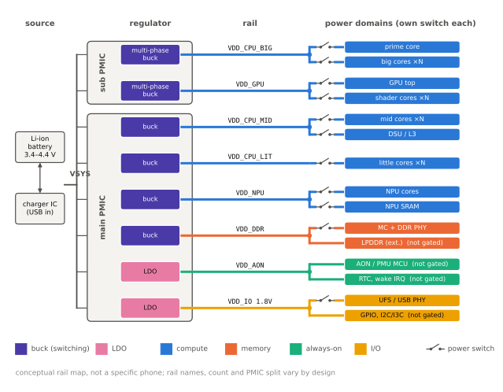
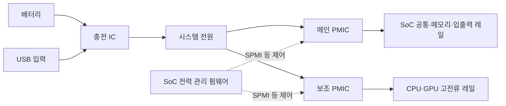

# PMIC와 전원 공급

!!! spec "규격 · 세대"
    MIPI SPMI (System Power Management Interface — SoC와 PMIC 사이 전원 제어 버스) · I2C(일부 PMIC·충전 IC 제어) · USB Power Delivery(충전 전력 협상) · Linux 레귤레이터 프레임워크, 디바이스 트리 `*-supply` 바인딩
    단일 PMIC → 메인 PMIC와 보조 PMIC 분리 → CPU 고성능 코어용 다상(multi-phase) 벅과 클러스터·코어별 레일 → 고속 전압 전환과 펌웨어 기반 레일 제어

!!! basic "한눈에 보기"
    배터리는 약 3~4 V대의 전압 하나만 내놓지만, SoC는 1 V에도 못 미치는 코어 전압부터 메모리·입출력·카메라용 전압까지 수십 가지 전압이 필요합니다. 이 전압들을 만들어 나눠 주는 칩이 **PMIC(Power Management IC)**입니다.

    1. **벅(buck) 컨버터** — 스위치를 아주 빠르게 켜고 끄며 전압을 낮춥니다. 효율이 높아 큰 전류가 필요한 CPU·GPU에 씁니다.
    2. **LDO(저전압 강하 레귤레이터)** — 남는 전압을 열로 버려 깨끗한 전압을 만듭니다. 효율은 낮지만 잡음이 적어 아날로그·센서·소전류 회로에 씁니다.
    3. **전원 순서와 보호** — 켜질 때 전압을 정해진 순서로 올리고, 과전류·과열이 생기면 차단합니다.

    수도에 비유하면 벅은 효율 좋은 감압 펌프, LDO는 물을 조금 흘려보내며 수압을 정확히 맞추는 밸브입니다. 충전 IC와 배터리 잔량을 재는 연료 게이지도 PMIC 주변에 함께 있습니다.

## 레귤레이터 종류 { .l2 }

| 항목 | 벅 컨버터 (스위칭) | LDO (선형) |
|---|---|---|
| 원리 | 스위치·인덕터로 에너지를 나눠 전달 | 트랜지스터가 저항처럼 동작해 전압 차이를 열로 소비 |
| 효율 | 높음 (부하 구간에 따라 달라짐) | 대략 출력 전압 ÷ 입력 전압 |
| 잡음 | 스위칭 리플 있음 | 낮음 |
| 부품 | 외부 인덕터·커패시터 필요 | 커패시터 정도 |
| 용도 | CPU·GPU·NPU 코어, DRAM, 메인 레일 | PLL, 아날로그, 센서, 카메라, 소전류 레일 |

예를 들어 0.8 V · 2.0 A(1.6 W)를 공급하는 벅의 효율이 85%라면 입력 전력은 약 **1.88 W**, 손실은 약 **0.28 W**입니다. 1.0 V에서 0.8 V를 만드는 LDO는 효율이 약 **80%**에 그치고, 0.1 A를 흘리면 약 **20 mW**를 열로 버립니다. 그래서 LDO는 보통 벅 출력에서 조금만 낮춰 쓰도록 배치합니다. (가정값이며, 수치는 `tools/soc_numbers.py`에서 계산)

## 스마트폰 전원 구성 { .l2 }

레일 하나에는 보통 여러 파워 도메인이 달리며, 각 도메인은 전원 스위치로 따로 끌 수 있습니다([파워 도메인과 게이팅](power-domains.md)).

| 구성 요소 | 역할 |
|---|---|
| 메인 PMIC | 대부분의 SoC 레일, 전원 순서 제어, 실시간 시계, 온도·전압 측정용 ADC |
| 보조 PMIC | CPU 고성능 코어·GPU처럼 전류가 큰 레일 전담, 다상 벅 |
| 충전 IC | 배터리 충전, 입력 전류 제한, 고속 충전용 스위치드 커패시터 회로 |
| 연료 게이지 | 배터리 전류를 적산해 잔량·건강 상태 추정 |
| 제어 버스 | SPMI 또는 I2C 등. 전압 변경·상태 읽기·인터럽트 전달 |

고성능 CPU 코어는 순간 전류가 수 A에 이르므로 벅 여러 개를 위상을 엇갈려 병렬로 돌리는 **다상(multi-phase) 벅**을 씁니다. 위상을 나누면 각 인덕터의 전류가 줄고, 리플이 서로 상쇄되며, 부하가 급변할 때 응답도 빨라집니다. 부하가 가벼울 때는 위상 일부를 꺼서 경부하 효율을 지킵니다.

??? expert "전문가 노트 — 전압 전환 속도, 경부하 효율, 레일 분리의 손익"
    **전압 전환 속도와 DVFS.** DVFS로 클럭을 올리려면 먼저 전압이 목표에 도달해야 하므로, 레귤레이터의 전압 상승 속도(slew rate)와 제어 버스 지연이 곧 성능 응답성입니다. 그래서 CPU 레일 제어는 운영체제의 일반 레귤레이터 경로를 거치지 않고 SoC 안 전력 관리 펌웨어가 SPMI로 직접 다루는 구조가 많습니다([DVFS와 전력 관리](dvfs.md)). 전압 변경 명령에서 안정까지의 시간은 PMIC·보드 설계마다 다르며 공개 자료가 드뭅니다.

    **경부하 효율.** 벅은 중간 부하에서 효율이 가장 좋고, 아주 가벼운 부하에서는 스위칭 손실 비중이 커집니다. 대기 중에는 스위칭 횟수를 줄이는 펄스 건너뛰기 모드나 저전력 모드로 바꾸고, 필요하면 LDO로 넘깁니다. 화면이 꺼진 대기 전력의 상당 부분이 이런 경부하 효율에 달려 있습니다([대기 전력과 저전력 상태](idle.md)).

    **레일 분리의 손익.** 코어마다 레일을 따로 두면 각자 필요한 전압만 쓰므로 전력이 줄지만, 벅·인덕터·패키지 볼·보드 면적이 늘어납니다. 스마트폰은 보통 클러스터 단위 레일을 쓰고, 일부 설계는 SoC 안에 디지털 LDO를 두어 공유 레일에서 코어별 전압을 조금씩 낮춥니다. 어떤 방식이 이득인지는 코어 간 부하 차이와 LDO 손실(입출력 전압 차 × 전류)의 비교로 정해집니다.

    **전원 분배망.** PMIC 출력이 정확해도 보드 배선·패키지·다이 내부 배선의 저항과 인덕턴스 때문에 트랜지스터에 도달하는 전압은 떨어집니다. PMIC는 원격 감지(remote sense)로 SoC 근처 전압을 되먹임하고, 패키지 안 커패시터로 순간 전류를 받쳐 주며, 남는 오차는 전압 가드밴드로 흡수합니다.

## 칩셋 비교

| 항목 | Snapdragon | Exynos · Tensor | Dimensity | Apple |
|---|---|---|---|---|
| PMIC 조달 | Qualcomm 자체 PMIC(PM 접두사 이름) 세트 | Samsung 자체 PMIC (S2MPS·S2MPG 계열 이름) | MediaTek 자체 PMIC (MT63xx 계열 이름) | 자체 설계 PMIC로 알려짐 |
| SoC–PMIC 제어 | SPMI (업스트림 드라이버 공개) | 벤더 인터페이스 (Tensor는 ACPM 펌웨어 경유, 공개 커널 소스) | 벤더 인터페이스·SPMI (공개 커널 소스) | 비공개 |
| 충전 | Qualcomm 고속 충전 계열 + USB Power Delivery | USB Power Delivery 중심 | MediaTek 고속 충전 계열 + USB Power Delivery | USB Power Delivery |

> 세대별 PMIC 조합은 기기마다 다르며, SoC 세대 정보는 [칩셋 세대 인덱스](../reference/chipset-index.md)에 모읍니다.

## 관련 페이지
- [DVFS와 전력 관리](dvfs.md) — PMIC에 전압 변경을 요청하는 흐름
- [파워 도메인과 게이팅](power-domains.md) — 레일과 도메인의 관계
- [클럭과 전압](../basics/clock-voltage.md) — 레귤레이터 프레임워크와 전압 강하
- [PCIe·USB](../connectivity/pcie-usb.md) — 충전 입력이 들어오는 USB 포트
- [전력 측정과 분석](measurement.md) — 레일별 전력 측정
