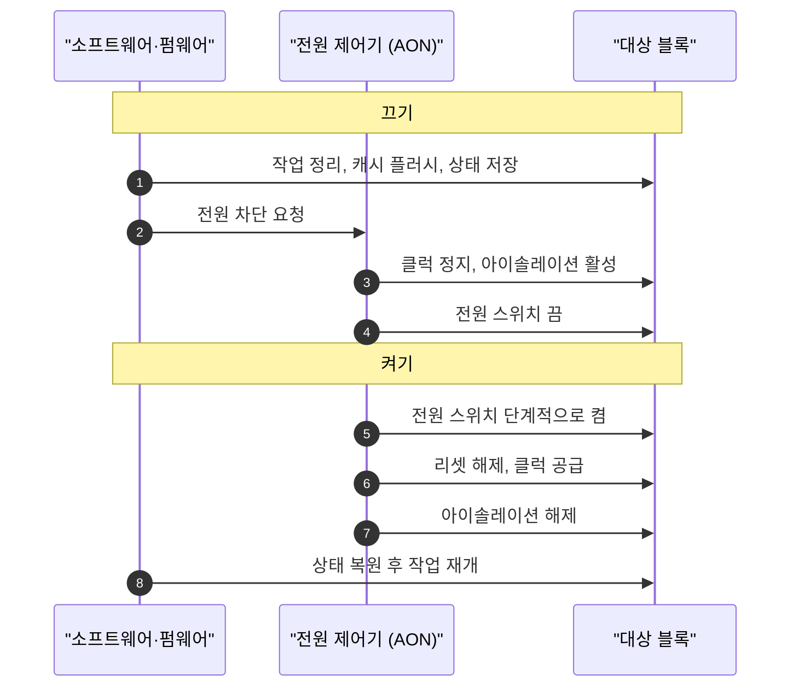

# 파워 도메인과 게이팅

!!! spec "규격 · 세대"
    IEEE 1801 (UPF, Unified Power Format — 전원 의도 기술 형식) · Arm PSCI(코어·클러스터 전원 상태 요청) · Arm SCMI 전원 도메인 프로토콜 · Linux generic power domain(genpd)·runtime PM, 디바이스 트리 `power-domains` 바인딩
    칩 전체 상시 전원 → 클럭 게이팅 보편화 → 블록별 파워 게이팅 → 코어별 파워 게이팅·리텐션과 전력 관리 펌웨어가 관리하는 수십 개 이상의 도메인

!!! basic "한눈에 보기"
    SoC 안에는 CPU·GPU·NPU·ISP·모뎀 등 수십 개의 블록이 있지만, 동시에 모두 일하는 경우는 드뭅니다. 쉬는 블록을 내버려 두면 전력이 새므로, 두 단계로 끕니다.

    1. **클럭 게이팅** — 블록의 박자(클럭)만 멈춥니다. 스위칭 전력은 사라지지만 전기는 계속 흘러 누설 전력은 남습니다. 켜고 끄는 데 거의 시간이 들지 않습니다.
    2. **파워 게이팅** — 블록의 전원 자체를 끊습니다. 누설 전력까지 사라지지만, 안에 있던 내용(상태)이 지워지고 다시 켜는 데 시간이 걸립니다.
    3. **리텐션** — 전원을 끄면서도 꼭 필요한 기억만 아주 낮은 전압으로 붙잡아 두어, 빨리 다시 시작할 수 있게 합니다.

    사무실에 비유하면 클럭 게이팅은 "자리 비움", 파워 게이팅은 "퇴근하며 책상 정리", 리텐션은 "메모 한 장만 남기고 퇴근"에 가깝습니다. 함께 전원을 켜고 끄는 블록의 묶음을 **파워 도메인**이라고 합니다.

## 게이팅 방식 비교 { .l2 }

| 방식 | 없애는 전력 | 상태 | 전환 비용 | 쓰는 곳 |
|---|---|---|---|---|
| 클럭 게이팅 | 동적 전력 | 유지 | 매우 작음 (수 사이클 수준) | 레지스터 묶음·파이프라인 단계마다 자동 삽입, 코어 대기(WFI) |
| 파워 게이팅 | 동적 + 누설 | 소실 | 상태 저장·복원, 전원 안정 대기, 돌입 전류 관리 | 코어, GPU 셰이더 묶음, 멀티미디어 블록 |
| 리텐션 (상태 유지 전원 차단) | 대부분의 누설 | 일부 유지 | 중간 | 코어 레지스터·캐시 일부, 깊은 대기 상태 |
| 전압 낮춤 (리텐션 전압) | 누설 일부 | 유지 | 전압 전환 시간 | SRAM 배열, 셀프 리프레시 중인 DRAM 주변 |

파워 게이팅은 블록과 전원 레일 사이에 큰 **전원 스위치 트랜지스터**를 두고 이를 끄는 방식입니다. 스위치를 한꺼번에 켜면 큰 돌입 전류가 흘러 이웃 블록의 전압이 흔들리므로, 스위치를 여러 단으로 나눠 차례로 켭니다.

## 도메인 경계의 회로 { .l2 }

| 회로 | 역할 | 없으면 생기는 문제 |
|---|---|---|
| 아이솔레이션 셀 | 꺼진 도메인의 출력을 0 또는 1로 고정 | 떠 있는 신호가 켜진 블록으로 들어가 오동작·누설 전류 |
| 레벨 시프터 | 전압이 다른 도메인 사이 신호의 전압 수준 변환 | 신호가 제대로 인식되지 않거나 관통 전류 발생 |
| 리텐션 플립플롭 | 주 전원이 꺼져도 별도 저전압 전원으로 값 유지 | 다시 켤 때 모든 상태를 소프트웨어로 복원해야 함 |
| 전원 스위치 | 도메인 전원 연결·차단 | 파워 게이팅 불가 |
| AON 영역 | 항상 켜진 작은 영역: 전원 제어기, 깨우기 로직, 타이머 | 꺼진 블록을 다시 깨울 주체가 없음 |

이 순서를 설계 단계에서 칩 전체에 일관되게 기술하는 형식이 **UPF**입니다. 어떤 도메인이 어떤 레일에 붙는지, 경계마다 어떤 아이솔레이션·레벨 시프터가 필요한지, 어떤 전원 상태 조합이 허용되는지를 적어 두면, 합성·배치 도구가 셀을 넣고 검증 도구가 잘못된 전원 시퀀스를 찾아냅니다.

## 도메인과 레일의 관계 { .l2 }

파워 도메인(전원 스위치로 끄는 단위)과 전압 레일(PMIC가 공급하는 전압 하나)은 1:1이 아닙니다. 레일 하나에 여러 도메인이 붙고, 각 도메인은 스위치로 따로 꺼집니다. 레일을 공유하면 PMIC 출력 수와 보드 부품이 줄지만, 공유한 도메인 중 **가장 높은 전압을 요구하는 쪽**에 맞춰 레일 전압이 정해집니다. 그래서 전력 관리 펌웨어는 여러 블록의 전압 요청을 모아(투표·집계) 최댓값으로 레일을 설정합니다.

??? expert "전문가 노트 — 누설과 손익분기, 공유 레일 집계, 소프트웨어 인터페이스"
    **누설 비중과 손익분기.** 미세 공정에서 누설 전력은 온도가 오를수록 빠르게 커지므로, 뜨거운 칩일수록 파워 게이팅의 이득이 큽니다. 반면 끄고 켜는 데는 상태 저장·복원, 캐시 재충전, 전원 스위치 구동 에너지가 듭니다. 그래서 "얼마 이상 쉴 때만 끈다"는 최소 체류 시간이 상태마다 정해지며, 이 판단은 cpuidle 같은 상위 계층이 합니다([대기 전력과 저전력 상태](idle.md)). 끄고 나서 곧바로 깨어나면 오히려 에너지를 더 씁니다.

    **공유 레일 집계.** Qualcomm 플랫폼의 업스트림 디바이스 트리에는 `CX`, `MX`처럼 여러 블록이 공유하는 레일이 "전원 도메인"으로 표현되고, 각 드라이버가 필요한 성능 수준을 투표하면 전력 관리 펌웨어가 이를 집계합니다(Linux `rpmhpd` 드라이버). 한 블록이 높은 수준을 놓지 않으면 다른 블록이 모두 쉬어도 레일 전압이 내려가지 않으므로, 대기 전력 디버깅에서 "누가 투표를 잡고 있는가"를 확인하는 것이 출발점이 됩니다.

    **소프트웨어 인터페이스.** CPU 코어와 클러스터의 전원 상태는 PSCI 호출로 보안 펌웨어(TF-A 등)에 요청하고, 그 밖의 장치 도메인은 Linux genpd와 runtime PM으로 관리합니다. 드라이버가 장치를 쓰지 않을 때 runtime PM 참조 수를 놓으면 genpd가 도메인을 끄고, SCMI 전원 도메인 프로토콜이나 벤더 인터페이스로 펌웨어에 실제 차단을 요청합니다. 참조 수가 새는 드라이버 하나가 도메인 전체를 켜 둔 채로 만드는 일이 흔합니다.

    **검증의 어려움.** 전원 상태 조합이 늘수록 "A가 꺼진 동안 B가 A에 접근" 같은 버그 경로가 폭발적으로 늘어납니다. 꺼진 블록에 버스 접근이 들어오면 응답이 없어 시스템이 멈출 수 있으므로, 인터커넥트는 꺼진 도메인 앞에서 접근을 막거나 오류로 돌려보내는 장치를 둡니다([버스와 인터커넥트](../basics/interconnect.md)).

## 칩셋 비교

| 항목 | Snapdragon | Exynos · Tensor | Dimensity | Apple |
|---|---|---|---|---|
| 공유 레일 관리 | 전력 관리 펌웨어가 투표 집계 (업스트림 드라이버 공개) | 전력 관리 펌웨어·벤더 드라이버 (Android 커널 소스 공개) | 전력 관리 펌웨어·벤더 드라이버 (Android 커널 소스 공개) | 비공개 |
| CPU 코어 전원 상태 요청 | PSCI | PSCI | PSCI | 자체 펌웨어·커널 (비공개) |
| 공개 정보 수준 | 디바이스 트리로 도메인 구조 상당 부분 확인 | 공개 커널 소스 중심 | 공개 커널 소스 중심 | 공개 분석 위주 |

> 세대별 블록 구성은 [칩셋 세대 인덱스](../reference/chipset-index.md)에 모읍니다.

## 관련 페이지
- [클럭과 전압](../basics/clock-voltage.md) — 클럭·전압·파워 도메인의 기본 개념
- [DVFS와 전력 관리](dvfs.md) — 켜져 있는 동안의 전압·클럭 조절
- [대기 전력과 저전력 상태](idle.md) — 언제 어떤 깊이로 끌지 정하는 정책
- [PMIC와 전원 공급](pmic.md) — 도메인에 전압을 공급하는 레일
- [SoC 설계 흐름](../design/flow.md) — UPF가 쓰이는 설계 단계
