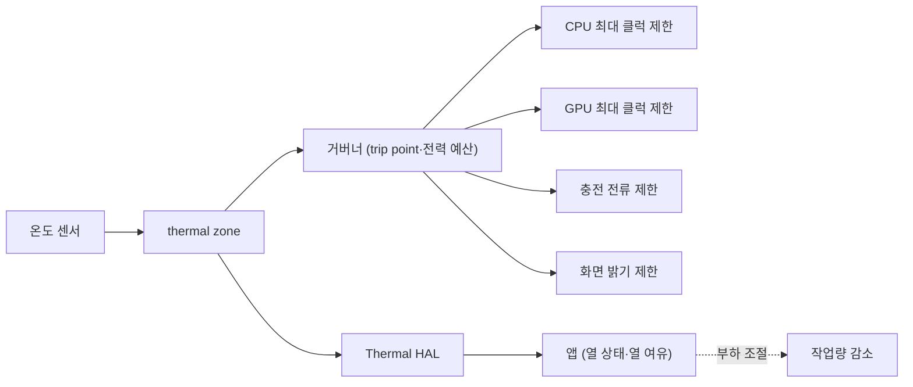

# 열 관리와 스로틀링

!!! spec "규격 · 세대"
    Linux thermal framework(thermal zone·trip point·cooling device·거버너 `step_wise`·`power_allocator`) · Android Thermal HAL(AIDL `android.hardware.thermal`)·`PowerManager` 열 상태 API·ADPF 열 여유(`getThermalHeadroom`, Android 11부터) · Arm SCMI 센서 프로토콜
    고정 온도 임계값에서 클럭 차단 → 다단계 trip point와 cooling device → 전력 예산 기반 제어와 표면 온도(skin) 추정 → 앱이 열 여유를 보고 스스로 부하를 조절하는 구조

!!! basic "한눈에 보기"
    칩이 쓴 전력은 결국 모두 열이 됩니다. 스마트폰에는 팬이 없으므로 열은 칩 → 기판 → 케이스 → 손과 공기로 천천히 빠져나가고, 그 속도보다 빨리 열을 만들면 온도가 계속 오릅니다.

    1. **칩 내부 온도** — 트랜지스터가 안전하게 동작할 수 있는 한계가 있습니다. 이를 넘지 않도록 칩 곳곳에 온도 센서를 둡니다.
    2. **표면 온도** — 사람이 손으로 느끼는 케이스 온도입니다. 실제로 스마트폰 성능을 오래 묶어 두는 것은 대부분 이쪽입니다.
    3. **스로틀링** — 온도가 한계에 가까워지면 클럭과 전압을 낮춰 열 발생을 줄입니다.

    주전자에 비유하면, 불(전력)을 세게 하면 물이 금방 끓지만 계속 세게 둘 수는 없습니다. 짧게 센 불을 쓰는 것이 **순간(peak) 성능**, 넘치지 않게 오래 유지할 수 있는 불 세기가 **지속(sustained) 성능**입니다.

## 온도의 종류와 열 경로 { .l2 }

| 온도 | 측정·추정 방법 | 한계를 정하는 것 |
|---|---|---|
| 접합 온도 (Tj) | 다이 안 여러 곳의 디지털 온도 센서 | 신뢰성·누설 증가·타이밍 여유. 칩별 한계는 대부분 비공개 |
| 패키지·보드 온도 | 보드 위 서미스터 | 부품 신뢰성 |
| 배터리 온도 | 배터리 팩 서미스터 | 충전 안전, 수명 |
| 표면(skin) 온도 | 직접 재지 않고 여러 센서 값으로 추정하는 경우가 많음 | 사용자 안전·불쾌감. 제조사 정책 |

정상 상태에서 온도 상승은 열 저항으로 근사할 수 있습니다.

$$
\Delta T = P \times R_\theta
$$

가정으로 기기 표면에서 주변 공기까지의 유효 열 저항을 4 °C/W, 주변 온도를 25 °C, 표면 한계를 43 °C로 두면, 계속 쓸 수 있는 전력은 \((43 - 25) / 4 = 4.5\) W입니다. 실제 값은 기기 크기·재질·케이스·쥐는 방법에 따라 크게 달라지지만, **지속 성능이 칩이 아니라 기기의 방열 능력으로 정해진다**는 점은 같습니다. 순간 성능은 기판·케이스·베이퍼 챔버의 **열 용량**이 열을 머금는 동안만 유지됩니다. (가정값이며, 수치는 `tools/soc_numbers.py`에서 계산)

| 방열 수단 | 역할 |
|---|---|
| 열 전도 패드·그래파이트 시트 | 칩의 열을 넓은 면으로 퍼뜨림 |
| 베이퍼 챔버 | 얇은 판 속 액체의 증발·응축으로 열을 빠르게 넓게 퍼뜨림 |
| 금속 프레임·중판 | 열 용량과 확산 면적 제공 |

## 제어 루프 { .l2 }

Linux thermal framework는 센서 묶음을 **thermal zone**으로, 온도를 낮추는 수단을 **cooling device**로 표현합니다. trip point를 넘으면 거버너가 cooling device 단계를 올리며, CPU에서는 이것이 DVFS의 최대 OPP 상한으로 나타납니다. Arm이 제안한 `power_allocator` 거버너는 온도 목표에서 전체 전력 예산을 계산해 CPU·GPU 등에 나눠 줍니다. Android는 이 위에 Thermal HAL을 두어 온도와 열 상태(LIGHT·MODERATE·SEVERE·CRITICAL 등 단계)를 프레임워크와 앱에 전달합니다.

??? expert "전문가 노트 — 전력 예산 제어, 누설의 양의 되먹임, 열 여유 API, 측정 함정"
    **전력 예산 제어.** 단순 단계 제어는 온도가 trip point를 넘나들며 클럭이 출렁이는 문제가 있습니다. 전력 예산 방식은 PID 제어기로 "목표 온도를 지키는 데 허용되는 총 전력"을 정하고, 각 cooling device의 전력 모델(Energy Model)로 이를 OPP 상한으로 바꿉니다. 그래서 Energy Model이 부정확하면 스로틀링도 부정확해집니다([DVFS와 전력 관리](dvfs.md)). 벤더는 여기에 표면 온도 추정 모델, 게임·카메라 같은 사용 상황별 정책을 더합니다.

    **누설의 양의 되먹임.** 누설 전력은 온도에 따라 크게 늘어납니다. 뜨거워질수록 같은 클럭에서도 전력이 늘고, 그 전력이 다시 온도를 올립니다. 같은 벤치마크를 차가운 기기와 뜨거운 기기에서 돌리면 전력과 결과가 다른 이유이며, 정밀한 열 모델은 온도별 누설 항을 따로 둡니다.

    **열 여유 API.** ADPF의 `getThermalHeadroom(forecastSeconds)`는 지정한 시간 뒤의 열 여유를 0 이상의 값으로 예측해 돌려주며, 1.0은 SEVERE 단계에 도달하는 지점을 뜻합니다. 게임은 이 값이 1.0에 가까워지기 전에 해상도·프레임 목표를 스스로 낮춰, 시스템이 갑자기 클럭을 깎아 프레임이 크게 흔들리는 상황을 피할 수 있습니다. 호출 빈도 제한과 기기별 정확도 차이가 있으므로 추세를 보는 용도로 쓰는 것이 안전합니다.

    **측정 함정.** 지속 성능 비교는 ① 시작 온도와 주변 온도 고정, ② 케이스 유무와 거치 방법 기록, ③ 충전 중 여부(충전 자체가 발열원), ④ 화면 밝기 고정, ⑤ 수 분~수십 분 반복 실행 후 마지막 구간의 성능과 전력을 함께 보는 것이 기본입니다. 첫 회 점수만 보면 순간 성능과 기기 열 용량을 재는 셈이 됩니다([벤치마크 읽는 법](../software/benchmarks.md)).

## 칩셋 비교

| 항목 | Android (Snapdragon·Exynos·Dimensity·Tensor) | Apple |
|---|---|---|
| 커널 열 제어 | Linux thermal framework + 벤더 확장·펌웨어 제어 | 자체 커널·펌웨어 (비공개) |
| 앱에 노출 | Thermal HAL → 열 상태·열 여유 API (ADPF) | `ProcessInfo.thermalState` (nominal·fair·serious·critical) |
| 표면 온도 정책 | 기기 제조사가 HAL·설정으로 정함 | 제조사가 기기별로 일괄 관리 |
| 방열 설계 | 기기 제조사 선택 (베이퍼 챔버 채택은 제품마다 다름) | 제조사 일괄 설계 |

> 같은 SoC도 기기에 따라 지속 성능이 크게 다르므로, 세대별 SoC 사양은 [칩셋 세대 인덱스](../reference/chipset-index.md)에 따로 모읍니다.

## 관련 페이지
- [DVFS와 전력 관리](dvfs.md) — 스로틀링이 OPP 상한으로 바뀌는 과정
- [스케줄링과 EAS](../cpu/scheduling.md) — 열 압력이 CPU capacity에 반영되는 방식
- [트랜지스터와 CMOS](../basics/transistor.md) — 온도에 따라 늘어나는 누설 전력
- [전력 측정과 분석](measurement.md) — 지속 전력을 재는 방법
- [벤치마크 읽는 법](../software/benchmarks.md) — 순간 성능과 지속 성능 구분
