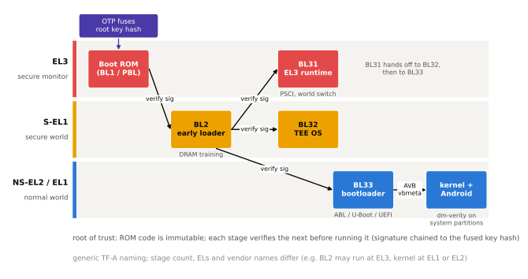
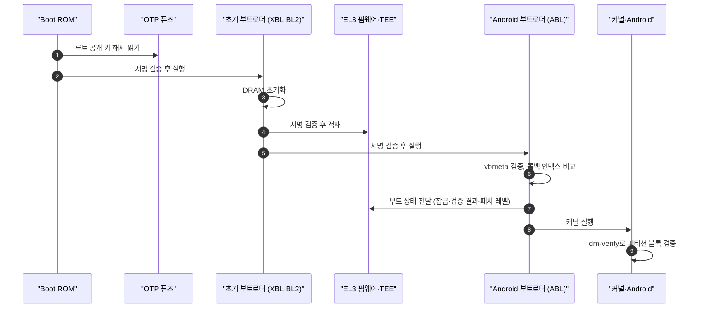

# 부팅 과정

!!! spec "규격 · 세대"
    Arm **TBBR**(Trusted Board Boot Requirements)과 그 참조 구현 **TF-A**(BL1·BL2·BL31·BL32·BL33) · UEFI(ABL 계열 부트로더) · **Android Verified Boot 2.0**(AVB, Android 8.0) · dm-verity · 롤백 보호(rollback index)
    서명 없는 부트로더 → ROM 기반 서명 검증(secure boot) → 퓨즈에 키 해시와 롤백 카운터 저장 → 부트 상태를 키 관리(KeyMint)에 묶는 구조

!!! basic "한눈에 보기"
    스마트폰 전원을 켜면 바로 Android가 뜨는 것이 아니라, **작은 프로그램이 다음 프로그램을 확인하고 넘겨주는 릴레이**가 여러 번 일어납니다.

    1. **Boot ROM** — 칩을 만들 때 회로에 새겨져 바꿀 수 없는 첫 코드입니다.
    2. **부트로더 여러 단계** — DRAM을 켜고, 보안 펌웨어를 올리고, Android 부트로더를 실행합니다.
    3. **커널과 Android** — 부트로더가 커널과 시스템 이미지가 진짜인지 확인한 뒤 실행합니다.

    공항 보안 검색에 비유하면, 각 검색대가 다음 구역으로 가는 사람의 신분증(서명)을 확인합니다. 첫 검색대(ROM)는 절대 바뀌지 않으므로, 이후 모든 확인의 출발점이 됩니다.

## 부팅 단계 { .l2 }

| 일반 단계 (TF-A 이름) | 하는 일 | Qualcomm | Exynos·Tensor | MediaTek | Apple |
|---|---|---|---|---|---|
| ROM (BL1) | 최소 초기화, 다음 단계 서명 검증 | PBL (Primary Boot Loader) | iROM → BL1 | BootROM | Boot ROM |
| 초기 부트로더 (BL2) | DRAM 트레이닝, 이미지 적재·검증 | XBL (eXtensible Boot Loader) | BL2·부트로더 단계 | Preloader | iBoot 계열 |
| EL3 런타임 (BL31) | 보안 모니터, PSCI 처리 | XBL이 적재하는 보안 펌웨어 | EL3 모니터 | TF-A BL31 | 해당 개념 비공개 |
| 보안 OS (BL32) | TEE 실행 | QTEE | TEEGRIS·Trusty 등 | 벤더 선택 TEE | Secure Enclave는 별도 프로세서 |
| 일반 부트로더 (BL33) | 커널 검증·실행, fastboot | ABL (UEFI 기반) | 벤더 부트로더 (Pixel은 ABL 계열) | LK 계열 | iBoot |

개발 보드와 많은 Arm 플랫폼은 BL33으로 **U-Boot**나 UEFI(EDK2)를 씁니다. 스마트폰 벤더의 실제 구성은 이름과 단계 수가 다르지만, "ROM → DRAM 초기화 → EL3 펌웨어·TEE → 일반 부트로더 → 커널"이라는 뼈대는 같습니다.

## Android Verified Boot { .l2 }

| 요소 | 내용 |
|---|---|
| vbmeta | 각 파티션의 해시·해시 트리 루트와 서명을 모은 메타데이터 |
| dm-verity | 시스템 파티션 블록을 읽을 때마다 해시 트리로 확인 (런타임 검증) |
| 롤백 인덱스 | 이미지 버전 번호. 저장된 값보다 낮은 이미지는 거부 |
| 부트 상태 | GREEN(제조사 키로 검증), YELLOW(사용자 키), ORANGE(잠금 해제), RED(검증 실패) |
| 잠금 상태 | 잠금 해제 시 사용자 데이터를 지우고 부트 상태를 ORANGE로 표시 |

롤백 인덱스는 변조할 수 없는 곳에 저장해야 의미가 있습니다. Android 부트로더는 보통 eMMC·UFS의 **RPMB**(Replay Protected Memory Block)나 TEE·보안 칩의 저장소를 쓰고, 부트로더 자체의 롤백은 SoC의 **퓨즈 카운터**로 막습니다.

??? expert "전문가 노트 — 퓨즈와 OTP, 안티 롤백, 루트 오브 트러스트의 전달"
    **퓨즈와 OTP.** SoC에는 한 번만 쓸 수 있는 eFuse 배열이 있습니다. Qualcomm은 이를 **QFPROM**이라 부르며, 루트 공개 키 해시, secure boot 활성화 비트, 디버그 비활성화 비트, 롤백 카운터, 칩별 보정값 등이 들어갑니다. 출하 라인에서 secure boot 비트를 태우면 그 칩은 OEM 키로 서명된 이미지만 부팅합니다. 퓨즈 영역의 읽기 권한도 보안 세계에서만 허용되도록 나뉘는 경우가 많습니다.

    **안티 롤백 퓨즈.** 퓨즈 카운터는 한 번 올리면 되돌릴 수 없고 비트 수도 한정되어 있습니다. 예를 들어 카운터에 32비트가 배정되어 있다면 버전을 올릴 수 있는 횟수도 그만큼으로 제한되므로(가정), 벤더는 보안 취약점을 고친 업데이트에서만 카운터를 올립니다. 그래서 같은 기기라도 특정 업데이트 이후에는 이전 부트로더로 되돌릴 수 없게 됩니다.

    **루트 오브 트러스트 전달.** AVB의 결과는 화면 경고로 끝나지 않습니다. 부트로더는 검증된 부트 키의 해시, 부트 상태, 잠금 여부, OS·패치 레벨을 TEE의 KeyMint에 전달하고, KeyMint는 이 값을 키 생성 조건과 키 증명(attestation) 인증서에 넣습니다. 잠금 해제된 기기에서 만든 키는 증명서에 그 사실이 드러나므로, 은행 앱 같은 서버는 기기 상태를 원격으로 판단할 수 있습니다([TrustZone과 TEE](trustzone.md)).

    **ROM 취약점의 무게.** Boot ROM은 패치할 수 없으므로, 여기서 발견된 버그는 해당 칩 세대 전체에 영구히 남습니다. USB 다운로드 모드(Qualcomm EDL, MediaTek BROM 모드 등)의 처리 코드가 특히 공격 표면이 되며, 실제로 공개된 ROM 취약점 사례들이 있습니다. 벤더가 ROM 코드를 최소화하고 다운로드 모드 진입에도 서명된 프로그래머를 요구하는 이유입니다.

## 칩셋 비교

| 항목 | Snapdragon | Exynos | Dimensity | Tensor | Apple |
|---|---|---|---|---|---|
| 첫 부트로더 이름 | PBL → XBL | iROM → BL1·BL2 | BootROM → Preloader | BootROM → BL1·BL2 계열 | Boot ROM → iBoot |
| Android 부트로더 | ABL (UEFI 기반, 소스 일부 공개) | 벤더 부트로더 | LK 계열 | ABL 계열 | 해당 없음 (iOS) |
| 기기 소유자 키 지원 | 기기 제조사 정책 | 기기 제조사 정책 | 기기 제조사 정책 | Pixel은 사용자 키(YELLOW) 지원 | 지원하지 않음 |
| 다운로드 모드 | EDL | Download 모드 | BROM·Preloader 모드 | 벤더 모드 | DFU |

> 세대별 SoC의 보안 기능 도입 시점은 [칩셋 세대 인덱스](../reference/chipset-index.md)에 모읍니다.

## 관련 페이지
- [TrustZone과 TEE](trustzone.md) — BL31·BL32가 만드는 보안 세계
- [하드웨어 공격과 대응](attacks.md) — 부팅 검증을 노리는 글리치 공격
- [UFS 저장장치](../memory/ufs.md) — 롤백 인덱스를 담는 RPMB
- [Android BSP 구조](../software/android-bsp.md) — 부트로더·파티션 구성
- [대기 전력과 저전력 상태](../power/idle.md) — BL31이 처리하는 PSCI 전원 요청
