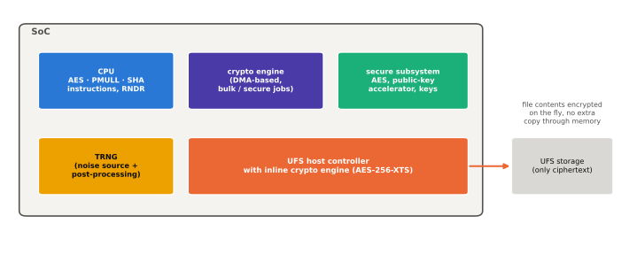
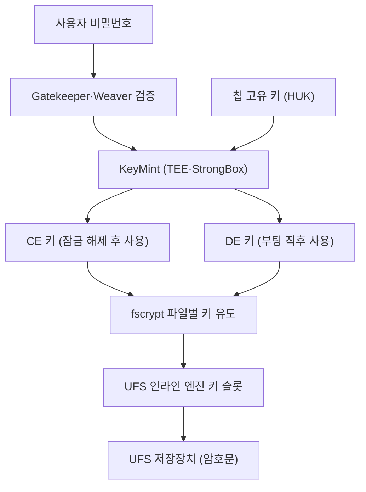

# 암호 가속과 키 관리

!!! spec "규격 · 세대"
    Armv8-A **Cryptographic Extension**(AES·SHA-1·SHA-256), Armv8.2 선택 확장(SHA-512·SHA-3·SM3·SM4), Armv8.5 **RNG**(`RNDR`) · JEDEC UFSHCI 3.0 이후 **인라인 암호화** 레지스터 · Linux `blk-crypto`·`fscrypt` · Android 파일 기반 암호화(FBE, Android 7.0 도입, Android 10부터 신규 기기 필수), 메타데이터 암호화(Android 9), 하드웨어 래핑 키(Android 11부터 지원 경로)
    소프트웨어 암호화 → CPU 암호 명령 → 저장장치 경로의 인라인 암호 엔진 → 키를 소프트웨어에 노출하지 않는 하드웨어 래핑 키

!!! basic "한눈에 보기"
    스마트폰 저장장치의 데이터는 모두 암호화되어 있습니다. 문제는 **속도**와 **키를 어디에 두느냐**입니다.

    1. **암호 가속** — 암호화는 계산이 많아, 전용 명령과 전용 회로로 빠르고 적은 전력으로 처리합니다.
    2. **인라인 암호화** — 데이터가 저장장치로 오가는 길목에서 바로 암호화·복호화해, CPU가 따로 일하지 않게 합니다.
    3. **키 계층** — 칩 안에 숨긴 뿌리 키에서 다른 키를 단계적으로 만들어, 뿌리 키는 절대 밖으로 나오지 않게 합니다.

    수도관에 정수 필터를 다는 것과 비슷합니다. 물(데이터)을 한 통씩 떠서 따로 거르는 대신, 관 중간의 필터(인라인 엔진)가 흐르는 물을 그대로 처리합니다.

## 암호 하드웨어의 위치 { .l2 }

| 위치 | 예 | 주 용도 |
|---|---|---|
| CPU 명령 | Arm AES·PMULL·SHA 명령, `RNDR` | TLS, 앱 암호, 커널 암호 API |
| 저장장치 인라인 엔진 | UFS 호스트 컨트롤러의 ICE (Inline Crypto Engine) | 파일 내용·메타데이터 암호화 (AES-256-XTS) |
| 범용 암호 엔진 | Qualcomm Crypto Engine 등 DMA 기반 엔진 | 대량 데이터, 보안 세계 전용 작업 |
| 보안 서브시스템 내부 | Secure Enclave AES 엔진, 보안 칩의 공개 키 가속기 | 키 계층, 서명, 키 증명 |
| 난수 생성기 | 하드웨어 TRNG (잡음원 + 후처리) | 키 생성, 커널 엔트로피 풀 |

UFS 4.0의 HS-G5 2레인 원시 링크 속도는 약 46.6 Gbps, 바이트로 약 5.8 GB/s입니다. 인라인 엔진은 이 속도를 따라가야 하므로 링크 쪽에 붙은 전용 파이프라인으로 만들며, CPU에서 같은 양을 처리하면 상당한 CPU 시간과 전력을 쓰게 됩니다. (수치는 `tools/soc_numbers.py`에서 계산)

## 파일 기반 암호화와 키 흐름 { .l2 }

| 키 | 언제 쓸 수 있나 | 보호하는 것 |
|---|---|---|
| DE (Device Encrypted) | 부팅 직후, 잠금 해제 전 | 알람·전화 수신 등 잠금 화면에서 필요한 데이터 |
| CE (Credential Encrypted) | 첫 잠금 해제 이후 | 대부분의 사용자 데이터 |
| 메타데이터 키 | 부팅 시 | 파일 시스템 메타데이터, 파일 이름 외 구조 정보 |

??? expert "전문가 노트 — 하드웨어 래핑 키, 키 래더, 인라인 암호화의 소프트웨어 경로, RNG"
    **하드웨어 래핑 키.** 일반 인라인 암호화에서는 커널이 원시 키를 알고 인라인 엔진의 키 슬롯에 씁니다. 커널 메모리가 유출되면 키도 유출됩니다. 하드웨어 래핑 키 방식에서는 커널이 **래핑된(암호화된) 키**만 보관하고, 키 슬롯에 넣을 때 하드웨어가 내부에서 풀어 씁니다. 키는 부팅마다 바뀌는 일시 키로 다시 래핑되어 메모리에 머물므로, 메모리 덤프를 다른 부팅에 재사용할 수도 없습니다. 이를 위해 SoC는 TEE와 인라인 엔진 사이에 소프트웨어를 거치지 않는 키 전달 경로를 갖춰야 합니다.

    **키 래더.** 키 래더는 칩 고유 루트 키에서 출발해 "용도·문맥 → 하위 키"를 하드웨어 KDF로 여러 단계 유도하는 구조입니다. 각 단계의 키는 하드웨어 레지스터 안에서만 존재하고 소프트웨어는 결과를 사용할 핸들만 받습니다. DRM의 콘텐츠 키, 저장장치 키, 보안 부팅 이미지 복호화 키가 같은 루트에서 서로 독립적으로 나오며, 한 용도의 키가 유출되어도 다른 용도로 거슬러 올라갈 수 없습니다.

    **소프트웨어 경로.** 업스트림 Linux는 `blk-crypto`(5.8)로 인라인 암호화를 블록 계층 기능으로 표준화했고, `fscrypt`가 파일별 키를 만들어 요청에 붙입니다. 인라인 하드웨어가 없거나 키 슬롯이 모자라면 `blk-crypto-fallback`이 CPU로 대신 처리합니다. AES 명령이 없는 저가 Arm 코어를 위해 Google은 **Adiantum**(Android 9)을 도입했지만, 현재 SoC는 대부분 AES 명령을 갖추어 AES-256-XTS가 기본입니다.

    **RNG.** 하드웨어 난수 생성기는 링 오실레이터 지터 같은 물리 잡음원과 건강성 검사(health test), 조건화(conditioning), 결정적 난수 생성기(DRBG)로 구성되는 것이 일반적입니다(NIST SP 800-90A·B 계열 구조). Armv8.5의 `RNDR`·`RNDRRS`는 이런 엔진을 명령으로 노출하는 방법이며, Linux는 여러 출처의 엔트로피를 섞어 쓰므로 한 출처에 대한 의존을 줄입니다.

## 칩셋 비교

| 항목 | Snapdragon | Exynos | Dimensity | Tensor | Apple |
|---|---|---|---|---|---|
| 저장장치 인라인 암호화 | UFS ICE | UFS 인라인 암호화 | UFS 인라인 암호화 | UFS 인라인 암호화 | 저장장치 경로의 전용 AES 엔진 |
| 하드웨어 래핑 키 | 지원 (Android 문서 기준 대표 플랫폼) | 기기·세대별 | 기기·세대별 | Pixel 기기에서 사용 | Secure Enclave가 키를 직접 관리 |
| 키 계층의 뿌리 | 칩 고유 키 + QTEE | 칩 고유 키 + TEE·Knox Vault | 칩 고유 키 + TEE | 칩 고유 키 + Titan M2 | Secure Enclave UID 키 |

> 세대별 SoC 정보는 [칩셋 세대 인덱스](../reference/chipset-index.md)에 모읍니다.

## 관련 페이지
- [UFS 저장장치](../memory/ufs.md) — 인라인 엔진이 붙는 호스트 컨트롤러
- [하드웨어 보안 모듈](secure-element.md) — 키 계층의 뿌리를 지키는 보안 칩
- [TrustZone과 TEE](trustzone.md) — KeyMint와 Gatekeeper
- [Arm 아키텍처](../cpu/arm-architecture.md) — 암호 확장이 들어간 아키텍처 버전
